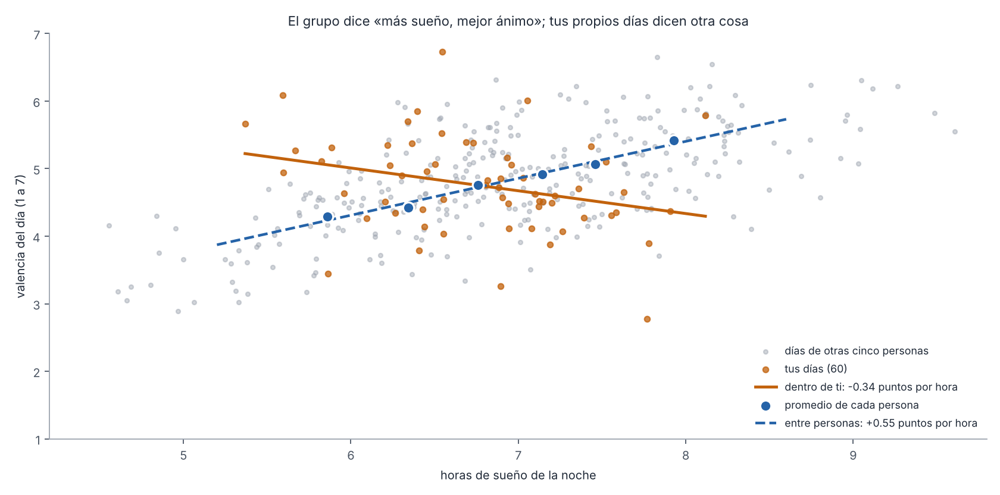
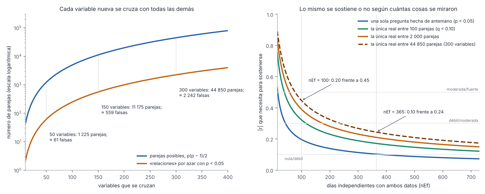

# Capítulo 1. Introducción y marco teórico

> **Para qué sirve este capítulo.** Explica **qué es Vestigium Mei, qué tipo de conocimiento puede dar y por qué está construida como está**. Sitúa la app en tres tradiciones de investigación: el autoseguimiento cuantificado (*Quantified Self*), la ciencia de una sola persona (diseños idiográficos y de caso único) y la medición en la vida diaria. Después discute dos decisiones de fondo que atraviesan todos los capítulos: que sea un sistema **para toda la vida** y no para una etapa, y que **todo pueda cruzarse con todo**, con su costo en comparaciones múltiples. Al final explica cómo está organizado el resto del documento.
>
> **Qué versión describe.** Todo el paper describe el código de la **v92**, esquema de datos `SCHEMA_V = 15`: la v90 (commit `8818d5a`), después de las entregas 10a a 10d del módulo 10 y de la revisión de navegación (entregas N0 a N7), más la entrega **10e**, que después de la lectura final arregló los hallazgos que tenían solución en el código (la v91), y la **10f**, que aplicó las decisiones del autor sobre los hallazgos que quedaban pendientes (la v92, commit `2b262c5`). Lo que cambió se marca «desde 10e» o «desde 10f». Los capítulos 2 a 10 se escribieron sobre la v81 y se actualizaron en cada entrega; cada cambio está en el Apéndice D con su motivo. Los ejemplos numéricos son **inventados**; ningún dato real aparece aquí.
>
> **Cómo leerlo.** Igual que el resto del paper: lenguaje sencillo, pero las cifras y reglas del código van tal cual, con el nombre de la función de donde salen. Cada decisión se marca como **[Validado]**, **[Aproximación]** o **[Diseño propio]** (sección 1.8). Lo que no se pudo comprobar se marca **[sin verificar]**.

---

## 1.1 Mini-glosario

| Término | Qué significa aquí |
|---|---|
| **Autoseguimiento** (*self-tracking*) | Registrar de forma sistemática datos sobre uno mismo: ánimo, sueño, pasos, gastos. Puede ser a mano (un diario) o con sensores (un reloj). |
| **Quantified Self** | El nombre con que se conoce a la comunidad y la práctica de medirse a uno mismo con números, sobre todo con tecnología (Swan, 2013). |
| **Nomotético** | Que busca leyes que valgan **para la gente en general**: «en promedio, quien duerme más está de mejor ánimo». Es el enfoque habitual de la psicología y la medicina. |
| **Idiográfico** | Que busca entender **a una persona concreta**: «en mis días, ¿dormir más va con mejor ánimo?». Es el enfoque de esta app. |
| **Entre personas / dentro de la persona** | Una relación **entre personas** compara a unas personas con otras (Ana duerme más que Beto). Una relación **dentro de la persona** compara los días de alguien consigo mismo (Ana duerme más los sábados que los martes). Pueden ir en direcciones distintas (sección 1.4.2). |
| **Diseño de caso único / N-de-1** | Un estudio con **una sola persona** que se observa o se compara consigo misma muchas veces. «N» es el número de participantes; aquí, 1 (capítulo 8). |
| **Medición en la vida diaria** | Preguntar o medir **mientras la persona vive su vida**, no en un laboratorio ni de memoria: avisos en el teléfono, sensores, diarios. En la literatura se llama *ambulatory assessment* o *ecological momentary assessment* (Trull y Ebner-Priemer, 2013; Shiffman et al., 2008). |
| **Comparaciones múltiples** | Revisar muchas preguntas a la vez. Cuantas más se revisan, más «hallazgos» salen por puro azar (sección 1.6). |
| **Estacionario** | Un proceso cuyas reglas no cambian con el tiempo: su promedio, su variabilidad y sus relaciones son las mismas este año que hace cinco. Una vida casi nunca lo es del todo. |

---

## 1.2 Qué es Vestigium Mei, en una página

Vestigium Mei («mi rastro», en latín) es una app de Android, escrita en Kotlin con Jetpack Compose, **con un solo usuario: su autor**. Su propósito es registrar, a lo largo de los años, el rastro de cada día y poder preguntarle a ese registro cosas sobre uno mismo. Todo vive en el teléfono (capítulo 2) y sale solo por los respaldos que el usuario activa y por consultas puntuales a servicios externos (capítulo 10).

**Tres capas de datos** (capítulo 2, sección 2.2):

- **Activa**: lo que escribes o marcas. La valencia y la activación del día (escalas de 1 a 7), los avisos de ánimo al azar (3 al día por omisión entre las 10:00 y las 21:00), los registros de ánimo por iniciativa propia, el diario con @personas y #temas, cuestionarios validados, sueños, gastos, hábitos (capítulo 3).
- **Pasiva**: lo que el teléfono y el reloj miden solos. Tiempo de pantalla, ubicación y lugares, pasos y sueño del reloj por Health Connect, clima, luz, ruido, notificaciones (capítulo 4).
- **Importada**: archivos que cargas. Spotify, Google Takeout, WhatsApp (solo conteos), MacroFactor, Kindle, Cold Turkey (capítulo 4).

**Una unidad de análisis: el día.** Todo se resume en el **panel diario**, una tabla con un renglón por día y una columna por variable (`Estadistica.panel`). El día no va de medianoche a medianoche, sino de **las 05:00 a las 04:59** del día siguiente (el *día lógico*, `Fechas.diaLogico`), para que la madrugada cuente con el día que se estaba viviendo. Algunas variables de fuentes externas siguen yendo por día de calendario, y la exportación lo dice en cada una (capítulo 2, sección 2.3.2). Además de 187 variables fijas (las que `Estadistica.variables()` escribe con su nombre; 57 de ellas solo existen si hay datos de su fuente; capítulo 2, sección 2.7, y Apéndice A.1), la app crea **variables dinámicas**: una por cada persona, tema, lugar, app, artista, nutriente o etapa de vida que aparece en tus datos (27 prefijos; capítulo 2, sección 2.7).

**Lo que la app devuelve:**

- **Análisis**: relaciones entre cualquier par de variables, quitando tendencias y corrigiendo por días parecidos y por muchas comparaciones; herramientas para un objetivo concreto, un modelo con varias causas posibles, dinámica emocional, ritmo de sueño, días atípicos (capítulo 6).
- **Experimentos personales**: semanas con y sin una acción, sorteadas, con la hipótesis sellada antes de empezar y, desde 10f, si se quiere, también el criterio para decidir si funcionó (capítulo 8).
- **Reportes, «Tu año», logros y campañas**: resúmenes y un sistema de motivación (capítulo 9).
- **Exportación**: 51 tablas CSV, un diccionario de variables y un script de R (`vestigium.R`) que repite los análisis de la app (Apéndices A y C).

**Lo privado.** Los impulsos, las recaídas, la libido, los detonantes, los medicamentos y el hábito ligado a las recaídas se anotan y se ven **solo en la pantalla Privado** y viajan completos a R; no aparecen en ninguna otra pantalla ni análisis de la app (capítulo 10, sección 10.3). En este paper se describen solo en su mecánica.

---

## 1.3 El autoseguimiento y el autoconocimiento a largo plazo

### 1.3.1 De dónde viene

Medirse a uno mismo no es nuevo: los diarios personales, el registro de la temperatura para conocer el ciclo menstrual o la libreta de un deportista lo son. Lo nuevo de las últimas dos décadas es la **escala**: un teléfono y un reloj registran sin esfuerzo miles de datos al día, y esa facilidad dio lugar a la comunidad conocida como **Quantified Self**. Swan (2013) la describe como el movimiento de personas que registran por su cuenta información biológica, física, conductual o ambiental sobre sí mismas, y señala que sus datos, aunque recogidos por individuos, tocan problemas de la ciencia de grandes datos y del descubrimiento biológico. No releí en esta sesión los detalles históricos que da sobre el origen del nombre **[sin verificar]**, así que no los repito.

Para entender qué hace una persona con sus datos, la investigación en interacción humano-computadora propuso modelos por etapas. El de Li, Dey y Forlizzi (2010) distingue cinco: **prepararse** (decidir qué medir), **recolectar**, **integrar** (juntar fuentes), **reflexionar** y **actuar**; cada etapa tiene sus propias barreras, y un problema en una arrastra a las siguientes. Choe et al. (2014), entrevistando a personas que se miden de forma intensiva, encontraron que suelen registrar demasiadas cosas a la vez y luego no saben cómo sacar conclusiones confiables de ellas. Epstein et al. (2015) añadieron que el autoseguimiento real no es lineal: la gente **deja de registrar, retoma, cambia de herramienta** y lo hace con distintos fines a lo largo del tiempo («informática vivida», *lived informatics*). **[Validado]**: estos son modelos descriptivos bien establecidos en ese campo.

### 1.3.2 Dónde se sitúa la app

Leída con esos modelos, Vestigium Mei toma decisiones claras en cada etapa:

| Etapa (Li et al., 2010) | Barrera típica | Qué hace la app | Capítulo |
|---|---|---|---|
| Prepararse | No saber qué medir | Mide mucho por omisión y deja que las preguntas surjan de los datos; el principio de «todo con todo» (sección 1.6) | 2, 6 |
| Recolectar | Cansancio, olvido, días malos sin registro | Captura pasiva; avisos al azar; registro de un toque para los días difíciles; «Ponerte al día» | 3, 4 |
| Integrar | Fuentes con formatos y días distintos | Un solo panel por día lógico; importadores propios | 2, 4 |
| Reflexionar | No saber interpretar | Análisis con protecciones estadísticas, reportes, «Tu año» | 6, 9 |
| Actuar | No saber si un cambio funcionó | Experimentos personales sorteados | 8 |
| (Abandono, Epstein et al., 2015) | Dejar de registrar | Constancia en lugar de rachas, campañas, recordatorios | 9 |

La respuesta a la barrera de Choe et al. (2014) es la parte más ambiciosa de la app: en lugar de dejar que la persona saque conclusiones a ojo, el capítulo 6 describe un análisis que quita tendencias, descuenta que los días se parecen entre sí y corrige por las miles de comparaciones. **[Diseño propio]** la combinación; cada pieza está **[Validado]** en la literatura estadística (capítulo 6).

### 1.3.3 Para qué sirve conocerse con datos

La promesa del autoseguimiento es el **autoconocimiento**: saber cosas de uno mismo que la memoria y la intuición no dan. Hay razones sólidas para esperar que los datos ayuden:

- **La memoria resume mal.** Al recordar un periodo pesamos de más el peor momento y el final, y casi ignoramos la duración (Kahneman et al., 1993); cuanto más lejos está lo que se recuerda, más se apoya el recuerdo en creencias generales y menos en lo vivido (Robinson y Clore, 2002). Un registro hecho en el momento no tiene ese sesgo (capítulo 3, sección 3.4).
- **Lo que creemos que hacemos difiere de lo que hacemos.** Lo que la gente dice sobre su uso del teléfono se parece solo moderadamente a lo que registran los aparatos (Parry et al., 2021; capítulo 4).
- **Los patrones lentos no se ven a simple vista.** Un cambio de ánimo de medio punto a lo largo de un otoño, o una relación entre el sueño y el ánimo que solo aparece con desfase de un día, no se perciben sin datos.

Pero hay que ser honestos sobre la evidencia: **no conozco un estudio que muestre que llevar un registro tan amplio como este mejore el bienestar** de quien lo hace; lo que sí está documentado es que el autorregistro **cambia** la conducta registrada (Korotitsch y Nelson-Gray, 1999; capítulo 9). El valor del sistema depende de lo bien que distinga lo que los datos muestran de lo que parecen mostrar, y ese es el tema de todo el paper.

---

## 1.4 Ciencia de una sola persona

### 1.4.1 Dos maneras de hacer preguntas sobre la gente

La mayor parte de la psicología y la medicina es **nomotética**: estudia a muchas personas para encontrar lo que vale en promedio. Su conclusión típica es «en la población, más sueño se asocia con mejor ánimo». Una persona concreta quiere saber otra cosa: «**en mí**, ¿dormir más va con mejor ánimo?». Esa pregunta es **idiográfica**.

Se suele suponer que la respuesta de grupo sirve para el individuo. Molenaar (2004) mostró que eso solo es cierto bajo una condición matemática fuerte, la **ergodicidad**: que todas las personas sigan el mismo proceso (homogeneidad) y que ese proceso no cambie con el tiempo (estacionariedad). Si no se cumple, lo que se aprende comparando personas **no dice nada seguro** sobre cómo funciona cada una a lo largo de sus días. Fisher, Medaglia y Jeronimus (2018) lo comprobaron con datos: en varios conjuntos de mediciones intensivas, las estimaciones obtenidas del grupo aproximaron mal la variabilidad y las relaciones de cada participante. **[Validado]**: es el argumento central de la investigación idiográfica moderna.

### 1.4.2 Un ejemplo de por qué importa (Figura 1.1)

Seis personas inventadas, 60 días cada una. Entre personas, quien duerme más en promedio está de mejor ánimo en promedio: la recta que une sus promedios sube **+0.55 puntos de valencia por hora de sueño**. Pero dentro de una de ellas («tú»), las noches en que duerme más que su propio promedio van con días **algo peores**: **−0.34 puntos por hora**. Para esta persona, quizá dormir más es señal de que estaba enferma o de que algo la tumbó; lo que sea, la regla del grupo no la describe.

*Figura 1.1. Seis personas sintéticas: relación entre personas (azul, discontinua) y relación dentro de una persona (naranja). Script: `figuras/fig30_dentro_entre.py`.*

Por eso, el panel de la app compara **tus días entre sí**, y no te compara con normas de población. Donde la app usa normas (los puntos de corte del WHO-5, los umbrales de Cohen, la «recomendación» de 7 h de sueño), los capítulos lo señalan como un préstamo que hay que leer con cuidado (capítulos 3, 6, 8 y 9).

### 1.4.3 Medir en la vida diaria

La fuente de datos de la ciencia idiográfica son las **mediciones intensivas**: muchas observaciones de la misma persona, tomadas mientras vive. Trull y Ebner-Priemer (2013) reúnen bajo el nombre de *ambulatory assessment* los autorreportes en el momento, las mediciones fisiológicas y las conductuales hechas con aparatos en la vida diaria. El **muestreo de experiencia**, que pregunta varias veces al día en momentos al azar, es la parte de autorreporte (Csikszentmihalyi y Larson, 1987; Shiffman et al., 2008). Hamaker y Wichers (2017) explican que estos datos permiten estudiar **dinámicas dentro de la persona**: cómo un estado de hoy se relaciona con el de mañana, qué tan persistente es el ánimo, qué lo mueve. La app combina las tres fuentes (avisos al azar, reloj y teléfono) en un solo panel. **[Validado]** el enfoque.

### 1.4.4 Experimentar en uno mismo

Observar no basta para saber qué **causa** qué. Los **ensayos N-de-1** resuelven eso para una persona: se alternan al azar periodos con y sin una acción y se compara (Guyatt et al., 1986; Kravitz et al., 2014; capítulo 8). En medicina se han propuesto como la forma de elegir el tratamiento de cada paciente, porque muchos tratamientos solo funcionan en una parte de quienes los reciben (Schork, 2015). En psicología existe la misma idea como **diseños de caso único**, con un llamado a sortear las condiciones para que sean más creíbles (Kratochwill y Levin, 2010).

La autoexperimentación también tiene una tradición más informal: Roberts (2004) describe diez ideas sobre sueño, ánimo, salud y peso que le surgieron de experimentar en sí mismo durante años. Su trabajo ilustra el valor del autoexperimento para **generar** hipótesis, y también su límite: con una sola persona, que además sabe lo que espera, el resultado vale para esa persona y es vulnerable al efecto expectativa (capítulo 8, sección 8.10). Daza (2018) propuso un marco formal para hacer inferencia causal con series de autoseguimiento, que deja explícitos los supuestos que hacen falta para pasar de una asociación a un efecto. **[Validado]** la lógica de los N-de-1; **[Aproximación]** su versión en la app, por la falta de cegamiento y las demás limitaciones del capítulo 8.

### 1.4.5 Tres tipos de pregunta y la herramienta de cada una

| Pregunta | Ejemplo | Herramienta de la app | Qué permite decir |
|---|---|---|---|
| **Descriptiva**: ¿cómo soy? | ¿Cuánto duermo? ¿Cómo varía mi ánimo? | Tus números, Totales, Dinámica emocional, Ritmo, reportes | Cómo fueron tus días, si las mediciones son válidas (capítulo 11, sección 11.3) |
| **De asociación**: ¿qué va con qué? | ¿Los días que camino más estoy mejor? | Las relaciones más marcadas, Cruzar dos variables, Todo lo que se mueve con algo, Modelo múltiple | Qué se mueve junto **en tus días**, descontando el azar y las tendencias; no qué causa qué |
| **Causal**: ¿qué me cambia? | ¿Dejar la cafeína de la tarde mejora mi sueño? | Experimentos personales | Si hacer esto, en este periodo y sabiendo que lo haces, cambió tu medida |

El capítulo 11 (sección 11.2) vuelve sobre esta tabla para decir con precisión qué puede y qué no puede concluirse en cada fila.

---

## 1.5 Por qué un sistema para toda la vida y no para una etapa

### 1.5.1 La decisión

La mayoría de los estudios de muestreo de experiencia duran una o dos semanas, y un ensayo N-de-1, unas semanas o meses. Vestigium Mei está pensada para **no terminar**. Eso se ve en el diseño: las marcas de tiempo completas, el esquema de documentos que crece sin migraciones, la versión de esquema en cada día y en cada respaldo, el respaldo cifrado y verificable (capítulos 2 y 10). **[Diseño propio]**.

### 1.5.2 Razones a favor

1. **Potencia.** Con pocos días solo se ven relaciones enormes. Para una sola pregunta y días independientes, con potencia de 80 % y α = 0.05, con 90 días se detecta una correlación de **0.29**; con 365, de **0.15** (capítulo 6, sección 6.21; fórmula B.15). Si los días se parecen a sus vecinos (autocorrelación 0.5 en las dos variables), hacen falta más: **0.37** con 90 días y **0.19** con 365. Y en la lista de relaciones, que revisa miles de parejas, el umbral efectivo se parece al de α = 0.001: con esa misma autocorrelación, **0.52** con 90 días y **0.27** con 365. Solo un registro de años permite ver relaciones moderadas en la lista completa.
2. **Lo que pasa poco.** Viajes, enfermedades, mudanzas, rupturas, una persona que ves una vez al mes: para tener 5 días con una persona (el mínimo de `per_`) o 60 días antes y 60 después de un cambio de vida («Antes y después», capítulo 8, sección 8.11), hace falta tiempo.
3. **Los ciclos lentos.** Las estaciones dan un solo ciclo al año. Para separar «el invierno» de «lo que me pasó ese invierno» hacen falta varios inviernos.
4. **Tu propia normalidad.** Los días atípicos se juzgan contra tu mediana (`Analisis.atipicos`, al menos 20 días por variable), la variabilidad del corazón contra tu línea base (capítulo 4, sección 4.5.2) y las cifras de los modelos fisiológicos sirven para compararte contigo mismo (capítulo 5). Una línea base larga es más estable.
5. **La memoria se pierde.** Lo que no se registró en su momento no se recupera después con la misma calidad (sección 1.3.3).

### 1.5.3 Costos

Un registro de por vida trae problemas que un estudio de dos semanas no tiene:

- **Cambia el instrumento.** En una década cambian el teléfono, el reloj, los permisos de Android y la propia app. Para comparar mediciones de distintas épocas hace falta que midan lo mismo de la misma manera, lo que en psicometría se llama **invarianza de la medición** (Meredith, 1993, para grupos; la idea se aplica igual entre periodos). La app ya tiene varias costuras así, todas marcadas: la ventana de pantalla y pasos (`ventana_pantalla`, `ventana_pasos`, esquema 13), el orden de la hoja de la noche (`version_noche`, 1 y 2), los avisos de ánimo contados solo desde el esquema 13 y las marcas `ts_creado` y `ts_editado` de momentos, gastos, ingresos, consumos, bloques del cronómetro y tomas solo desde el 14 (los días ya las tenían; Apéndice D), y, desde el 15, los días con cambio de horario (`cambio_horario`) y la fuente del clima (`clima_reanalisis`). Otras no dejan marca: cambiar la vida media de la cafeína reescribe todo el pasado (H-4-11). Para la definición de cada variable, desde 10f el diccionario tiene las columnas `desde_version` y `cambio` (H-1-8, D.115), aunque en el código revisado la tabla que las llena todavía está vacía (capítulo 2, sección 2.8).
- **Cambias tú.** Una relación entre el sueño y el ánimo puede ser distinta a los 25 y a los 35 años. Si el proceso no es estacionario, mezclar toda la historia en un solo número la promedia. La lista de relaciones usa **todos** los días del panel (`PantallaExplorar` llama a `Estadistica.relaciones` con el panel completo); quitar la tendencia corrige los **niveles** que cambian lento, pero no una **relación** que cambia con los años (capítulo 11, secciones 11.2.3 y 11.4; H-11-1).
- **El registro mismo cambia lo registrado,** y ese efecto se acumula y se mezcla con lo que se quiere medir (capítulo 3, sección 3.14, y capítulo 11, sección 11.5).
- **Se abandona.** Epstein et al. (2015) muestran que dejar de registrar y retomar es lo normal. Un hueco largo no es «nada pasó» (capítulo 2, sección 2.6; H-1-1 en su parte de abandono).
- **Los datos se pueden perder** en un cambio de teléfono o una restauración mal hecha (capítulo 10).

**Cómo lo enfrenta la app.** Guardar el dato crudo con su hora y calcular después, salvo en las fuentes que se guardan ya sumadas por día (capítulo 2, sección 2.1), marcar la versión de cada día y de cada respaldo, guardar la ventana de cada día cuando una regla cambia y documentar cada cambio con su versión en el Apéndice D. Es lo que en el capítulo 2 se llama principio 3, «conservar el dato crudo y derivarlo después». **[Diseño propio]**, coherente con los principios FAIR de reutilización de datos (Wilkinson et al., 2016) aplicados a una sola persona.

---

## 1.6 Todo con todo, y su costo

### 1.6.1 El principio

La app no decide de antemano qué preguntas son interesantes: **cualquier variable registrada puede compararse con cualquier otra** (capítulo 6, sección 6.3.3). Cada persona que nombras, cada app que usas, cada nutriente, cada lugar se vuelve una columna y entra en la lista de relaciones. La razón es la del modelo de Li et al. (2010): al empezar no se sabe qué conviene medir, y las relaciones inesperadas son justo las que la intuición no da. **[Diseño propio]**.

### 1.6.2 El costo

Revisar todo contra todo tiene un precio que crece muy rápido (Figura 1.2, izquierda). Con *p* variables hay *p*(*p* − 1)/2 parejas: con 50 variables, 1 225; con 150, 11 175; con 300, **44 850**. Si ninguna tuviera relación real y se usara el umbral habitual p < 0.05, saldrían por puro azar unas **61**, **559** y **2 242** «relaciones».

La app se defiende con varias capas (capítulo 6):

1. **Benjamini-Hochberg** (`Analisis.bh`): solo marca como firmes las relaciones con q < 0.10, lo que mantiene la **proporción esperada** de falsos descubrimientos entre las marcadas alrededor del 10 % (Benjamini y Hochberg, 1995).
2. **Las parejas obvias** (`Estadistica.obvia`, diez reglas) no se cuentan: calorías con proteína, una app con el total de pantalla. Así no ocupan lugares ni gastan corrección.
3. **Topes por familia**: entran las 15 personas más mencionadas (con al menos 5 días), las 12 apps con más minutos, etc. (capítulo 6, sección 6.3.3).
4. **Quitar la tendencia** y el **número efectivo de días**, para que el p de cada pareja no sea más pequeño de lo que debe.

El precio de esas defensas es la **potencia**: lo que se sostiene depende de cuántas cosas se miraron (Figura 1.2, derecha). Una pareja con 100 días independientes necesita |*r*| ≥ **0.20** si fue la única pregunta hecha de antemano, pero ≥ **0.45** si es la única relación real entre 44 850 parejas revisadas (le hace falta p < 0.10 / 44 850 ≈ 2.2 × 10⁻⁶). Con 365 días independientes, **0.10** frente a **0.24**.

*Figura 1.2. Izquierda: parejas posibles y «relaciones» esperadas por azar según el número de variables. Derecha: la |r| que necesita la mejor pareja para sostenerse, según los días independientes y cuántas parejas se revisaron. Script: `figuras/fig29_todo_con_todo.py` (cálculo con la aproximación de Fisher de `Estadistica.relaciones`; sin datos).*

### 1.6.3 Lo que la corrección no cubre

Benjamini-Hochberg cuenta las parejas **de una lista**. No cuenta las otras maneras de mirar los mismos datos:

- La lista se puede ver **con o sin tendencia**, **por día o por semana**, **con o sin las obvias** y con **ocho filtros por tema**; «Cruzar dos variables» tiene **desfase** de un día; «Todo lo que se mueve con algo» se puede abrir con cualquier variable como objetivo, y su corrección se hace solo entre las variables revisadas contra ese objetivo (capítulo 6, sección 6.13.5). En R, `privadas = TRUE` suma el seguimiento privado.
- Cada una de esas elecciones es una bifurcación. Gelman y Loken (2014) llaman a esto el **jardín de senderos que se bifurcan**: aunque nadie busque a propósito un resultado, cuando el análisis se elige después de ver los datos, la probabilidad de encontrar algo «firme» por azar es mayor que la que dice cada prueba. Simmons et al. (2011) mostraron cuánto puede crecer. Nada en la app registra cuántas de esas maneras se miraron (H-11-2).

Hay además un segundo efecto, más sutil: **la relación más fuerte de una lista larga casi siempre exagera su tamaño**, aunque sea real. Si entre muchas relaciones reales se escoge la que dio la *r* más grande, se escoge también la que tuvo más suerte; en la siguiente muestra, su *r* tenderá a bajar. Ioannidis (2008) documentó este efecto («la maldición del ganador») en la investigación biomédica, y es la misma regresión a la media que describen Barnett, van der Pols y Dobson (2005). Le pasa a «la relación del año» de «Tu año» (capítulo 9, sección 9.3.5) y a los extremos de «Palabras del diario» (capítulo 6, sección 6.17).

**[Validado]** que la corrección por comparaciones múltiples es necesaria y que BH es un método adecuado para explorar; **[Aproximación]** su garantía aquí, porque las pruebas comparten variables (capítulo 6, sección 6.8.3) y porque las bifurcaciones del análisis no entran en la cuenta.

### 1.6.4 Cómo leer la lista, en consecuencia

Ioannidis (2005) mostró que la probabilidad de que un hallazgo sea cierto depende de cuántas relaciones se prueban, de la potencia y de qué tan probable era de antemano. En una lista de miles de parejas con potencia modesta, una relación firme es **una buena pista, no una conclusión**. La app ya lo dice («Pistas para entenderte. Ninguna prueba causas»). El camino para pasar de pista a conclusión es el que se discute en el capítulo 11 (sección 11.7.4): confirmar la pista con datos que no se usaron para encontrarla, o con un experimento.

---

## 1.7 Qué no es este sistema

Para evitar malentendidos:

- **No es un instrumento clínico.** Los cuestionarios validados están adaptados (periodos de 7 días en WHO-5 y PSS-4; capítulo 3, sección 3.9) y los puntos de corte que muestra la app son orientativos.
- **No mide el cuerpo directamente en todo.** Cafeína, alcohol en sangre, reserva de creatina y niveles de suplementos son **estimaciones con parámetros de población**, no mediciones (capítulo 5).
- **No generaliza.** Lo que se encuentra vale para el autor, en el periodo analizado. No dice nada de otras personas (sección 1.4).
- **No es un estudio diseñado de antemano.** La mayoría de sus análisis son **exploratorios**: buscan pistas. Solo los experimentos personales tienen una hipótesis fijada antes de ver los datos y, desde 10f, pueden sellar con ella el criterio de decisión (capítulo 8).

---

## 1.8 Cómo se califica cada decisión

Cada decisión de diseño del paper lleva una de tres etiquetas:

- **[Validado]**: respaldada por literatura publicada o por un estándar. Ejemplo: el modelo circumplejo del afecto (Russell, 1980), la corrección de Benjamini-Hochberg, AES-256-GCM.
- **[Aproximación]**: razonable, pero con supuestos que conviene conocer. Ejemplo: tomar la luz alta del teléfono como señal de estar al aire libre; corregir por autocorrelación suponiendo que el parecido entre días decae como en un proceso AR(1).
- **[Diseño propio]**: una decisión de la app sin un estándar detrás; puede ser buena, pero no está probada. Ejemplo: el corte del día a las 05:00 (con un principio validado detrás, el día de 4:00 a 3:59 de la encuesta estadounidense de uso del tiempo; capítulo 2), el umbral de 0.12 para declarar «lenta» una variable.

Y una marca más: **[sin verificar]** señala lo que no se pudo comprobar en una fuente durante la sesión en que se escribió. No se presenta como hecho. La lista de lo que quedó sin verificar en cada capítulo está en `referencias.md`.

Esta clasificación sigue la regla del plan: **no presentar heurísticas como modelos validados**. Una buena parte de la app es diseño propio; eso no es un defecto, pero obliga a leer sus resultados con la confianza que corresponde a cada pieza.

---

## 1.9 Cómo está organizado el paper

| Capítulo | Tema | Pregunta que responde |
|---|---|---|
| 1 | Introducción y marco teórico | Qué es esto y qué tipo de conocimiento puede dar |
| 2 | Arquitectura y flujo de datos | Cómo se guarda cada dato, a qué día pertenece y cómo se distingue «cero» de «no sé» |
| 3 | Medición del estado subjetivo | Cómo se pregunta el ánimo, cuándo y con qué sesgos |
| 4 | Sensores, datos pasivos e importaciones | Qué mide el teléfono solo y qué tan confiable es |
| 5 | Modelos fisiológicos y variables derivadas | Qué cifras son cuentas con un modelo y no mediciones |
| 6 | Análisis estadístico | Cómo se pasa de miles de registros a «esto va con aquello», y cómo coinciden la app y R |
| 7 | Personas y red social | Cómo se cuentan las personas y qué miden la Constelación y la Red |
| 8 | Experimentos personales | Cómo probar algo en ti y qué tan confiable es el resultado |
| 9 | Reportes, visualización y motivación | Qué devuelve la app y cómo la motivación puede cambiar los datos |
| 10 | Privacidad, seguridad e integridad | Dónde viven los datos, cómo se protegen y cómo no se pierden |
| 11 | Discusión, limitaciones y trabajo futuro | Qué puede y qué no puede concluirse, y qué falta |
| Ap. A | Diccionario de variables | Cada variable del panel con su fuente y unidad |
| Ap. B | Fórmulas | Las fórmulas del capítulo 6, numeradas |
| Ap. C | Funciones de R | Qué hace cada función de `vestigium.R` y en qué difiere de la app |
| Ap. D | Cambios metodológicos aplicados | Cada cambio del módulo 10 y de la revisión de navegación, con su motivo y su versión |
| Ap. E | Glosario | Los términos de los mini-glosarios, en orden alfabético |

**Cómo se hizo.** El paper se escribió por módulos, cada uno en una sesión de trabajo con un modelo de Claude, leyendo el código de la app (el plan está en `PLAN_PAPER_METODOLOGIA.md`). Los módulos 1 a 8 describieron el código y anotaron problemas en `hallazgos.md` sin cambiarlo; el módulo 9 revisó todos los hallazgos y propuso cambios (`revision_propuestas.md`); el autor los aprobó, y el módulo 10 los aplicó en cuatro entregas, actualizando los capítulos; después de la lectura final (módulo 14), una quinta entrega, la 10e, arregló los que quedaban abiertos y tenían solución en el código, y una sexta, la 10f, aplicó lo que el autor decidió sobre los ocho que seguían pendientes (en siete cambió el código, por ejemplo para leer cada hora con la zona de entonces o para mostrar en la app la lista de servicios externos; en uno, H-8-6, decidió dejarlo como estaba). El módulo 11 escribió este capítulo y el 11; los módulos 12 a 14 ensamblaron, corrigieron y revisaron el documento. Por eso, muchos capítulos dicen «hasta la entrega 10c era así; desde entonces es así»: el paper documenta también **la historia de las decisiones**, que importa para leer datos viejos.

**Cómo se numeran los hallazgos.** Cada hallazgo lleva el número del **módulo** que lo encontró, no del capítulo: H-1-n son del capítulo 2; H-2-n, del 3; H-3-n, del 4, y así hasta H-7-n, del 8; H-8-n, de los capítulos 9 y 10; H-9-n, de la revisión general; H-11-n, de los capítulos 1 y 11, y H-NAV-n, de la revisión de navegación.

**Lo que no es.** No es un artículo para publicar ni una revisión sistemática de la literatura: las referencias se eligieron para respaldar o discutir decisiones concretas, y se buscaron en la sesión en que se citaron; las pocas que no se pudieron comprobar llevan «[sin verificar]» en `referencias.md`.

---

## 1.10 Resumen del capítulo

1. Vestigium Mei es un sistema de **autoseguimiento de por vida para una sola persona**: combina datos activos, pasivos e importados en un panel de un renglón por día lógico (de 05:00 a 04:59), y ofrece análisis, experimentos, reportes y una exportación completa a R.
2. Se sitúa en tres tradiciones: el **Quantified Self** (Swan, 2013; Li et al., 2010; Choe et al., 2014; Epstein et al., 2015), la **ciencia idiográfica** (Molenaar, 2004; Fisher et al., 2018) y la **medición en la vida diaria** (Trull y Ebner-Priemer, 2013; Shiffman et al., 2008), con los **ensayos N-de-1** para las preguntas causales (Guyatt et al., 1986; Kravitz et al., 2014).
3. Lo que vale para un grupo no tiene por qué valer para una persona (Figura 1.1); por eso la app compara tus días entre sí.
4. Un sistema **de por vida** da potencia, captura lo raro y lo lento y conserva una línea base propia; a cambio, el instrumento y la persona cambian con los años, y hay que marcar cada costura.
5. **Todo con todo** multiplica las comparaciones (44 850 parejas con 300 variables). La app corrige con Benjamini-Hochberg, las parejas obvias, los topes por familia, quitar la tendencia y el n efectivo; aun así, las bifurcaciones del análisis y la maldición del ganador quedan fuera de la cuenta. Una relación firme es una pista seria, no una conclusión.
6. Cada decisión se califica como **[Validado]**, **[Aproximación]** o **[Diseño propio]**, y lo no comprobado se marca **[sin verificar]**.
7. El módulo 11 anotó dos hallazgos nuevos: las relaciones se calculan con toda la historia, como si fueran las mismas en todas las etapas de la vida (H-11-1), y las maneras de mirar los datos no entran en ninguna corrección (H-11-2).

---

### Referencias citadas en este capítulo

Ver `referencias.md`. Citas: Barnett, van der Pols y Dobson (2005); Benjamini y Hochberg (1995); Choe et al. (2014); Csikszentmihalyi y Larson (1987); Daza (2018); Epstein et al. (2015); Fisher, Medaglia y Jeronimus (2018); Gelman y Loken (2014); Guyatt et al. (1986); Hamaker y Wichers (2017); Ioannidis (2005, 2008); Kahneman et al. (1993); Korotitsch y Nelson-Gray (1999); Kratochwill y Levin (2010); Kravitz et al. (2014); Li, Dey y Forlizzi (2010); Meredith (1993); Molenaar (2004); Parry et al. (2021); Roberts (2004); Robinson y Clore (2002); Russell (1980); Schork (2015); Shiffman, Stone y Hufford (2008); Simmons, Nelson y Simonsohn (2011); Swan (2013); Trull y Ebner-Priemer (2013); Wilkinson et al. (2016).
