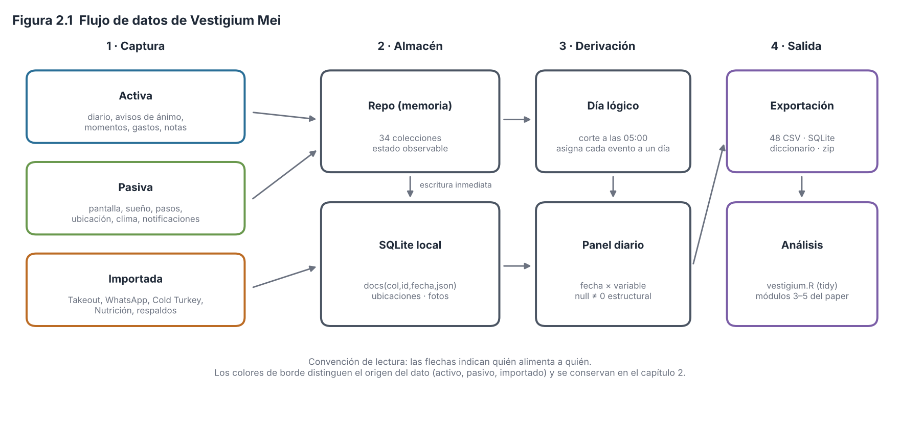
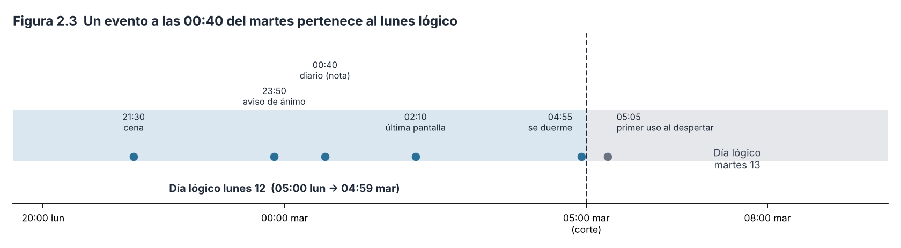
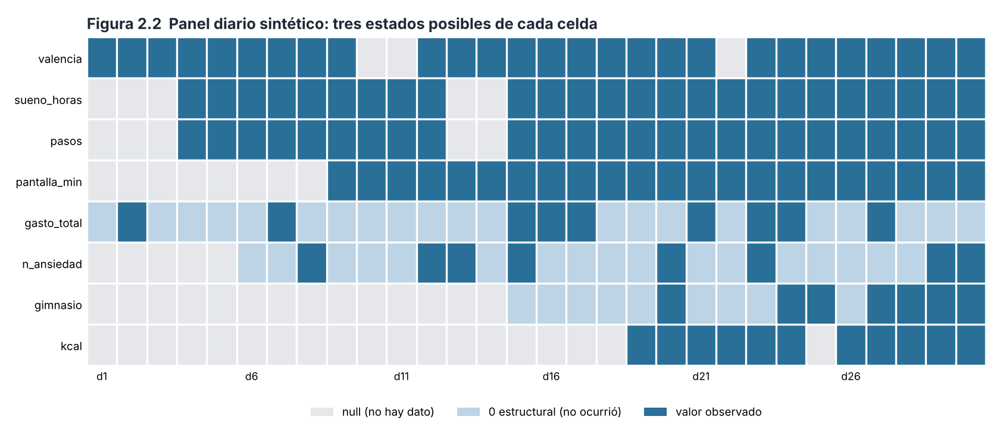

# Capítulo 2. Inventario y arquitectura de datos

> **Alcance.** Este capítulo describe *cómo se obtiene, se guarda, se asigna a un día y se organiza* cada dato de Vestigium Mei, y por qué cada decisión es razonable (o no) desde la metodología de investigación. No evalúa todavía las pruebas estadísticas (capítulos 6 en adelante). Se escribió sobre la v81 (commit `fa527df`, `SCHEMA_V = 12`) y está al día con el código de la v92 (la v91 más la entrega 10f; `SCHEMA_V = 15`), la versión que describe todo el paper; lo que cambió en el módulo 10 se marca «desde 10a…10d» (o «desde el esquema 13»), lo de las entregas 10e y 10f, «desde 10e» y «desde 10f», y todo está en el Apéndice D. Los ejemplos numéricos son **sintéticos**: ningún dato real del usuario aparece aquí.
>
> **Convención de etiquetas.** Cada decisión de diseño se marca como **[Validado]** (respaldada por literatura o por un estándar establecido), **[Aproximación]** (razonable pero con supuestos que conviene conocer) o **[Diseño propio]** (decisión de la app sin referente directo; defendible, pero no es un estándar). Los hallazgos llevan el número del módulo que los encontró: los de este capítulo (módulo 1) son H-1-n; los H-9-n son de la revisión general. Están en `hallazgos.md`.

---

## 2.1 Propósito y principios de diseño

Vestigium Mei es un instrumento de **autoseguimiento cuantificado (quantified self, QS) de un solo sujeto** (diseño N-de-1): una persona produce, durante años, un registro denso de su ánimo, cuerpo, conducta, entorno y relaciones. La pregunta metodológica central es: *¿qué estructura de datos permite hacer inferencia razonable sobre un solo individuo, sin falsear lo que realmente se midió?*

La arquitectura responde con cinco principios:

1. **Un día es la unidad de análisis.** Casi todo se resume en una fila por día (el *panel diario*). Es la unidad natural del autoseguimiento: el sueño, el ánimo del día y el diario se organizan por día. *Razonamiento:* la resolución diaria equilibra ruido y señal; las mediciones intradía (avisos de ánimo, ubicación por hora) se conservan en tablas aparte para análisis más finos.
2. **No inventar datos.** Un dato ausente no se convierte en cero salvo que haya una razón estructural (sección 2.6). *Razonamiento:* confundir «no medido» con «cero» es uno de los errores más comunes en datos observacionales y sesga medias, correlaciones y modelos (Rubin, 1976; Little y Rubin, 2019).
3. **Conservar el dato crudo y derivarlo después.** Cada evento (momento, gasto, visita, punto de ubicación) se guarda con su marca de tiempo completa (ISO-8601 con desfase horario), y el panel, la semana y los resúmenes se calculan después, al analizar o exportar. *Razonamiento:* permite re-derivar con otra regla (por ejemplo, otro corte de día) sin perder información. *Límite:* varias fuentes pasivas se guardan ya sumadas por día (`PantallaDia`, `SaludDia`: pantalla, pasos y lo que Health Connect entrega por día); para ellas no se puede re-derivar, y por eso el cambio de ventana del esquema 13 parte la serie (sección 2.3.2).
4. **Esquema flexible que crece con los años.** Cada colección guarda documentos JSON; añadir un campo no obliga a migrar la base. *Razonamiento:* un instrumento personal evoluciona; la rigidez de un esquema relacional estricto lo volvería inusable.
5. **Todo es exportable y legible por otros programas.** Existen exportaciones en formato ordenado (*tidy*, Wickham, 2014), diccionario de variables y un script en R. *Razonamiento:* reproducibilidad y principios FAIR (Wilkinson et al., 2016) a escala individual.

---

## 2.2 Las tres capas de captura: activa, pasiva e importada

El origen de un dato determina su tipo de error, por lo que la app conserva esa distinción (Figura 2.1).



*Figura 2.1. Flujo de datos: de las tres capas de captura al almacén, al día lógico, al panel diario y a la exportación y los análisis. Esquema, sin datos. Script: `figuras/fig01_flujo_datos.py`.*

| Capa | Ejemplos | Cómo se genera | Error típico |
|---|---|---|---|
| **Activa** | Diario del día (valencia, activación, dolor, sueño, hábitos), avisos de ánimo («muestreo»), momentos, gastos, notas, cartas | La persona lo teclea o marca | Sesgo de recuerdo, sesgo de deseabilidad social, fatiga de registro, días sin llenar |
| **Pasiva** | Tiempo de pantalla, desbloqueos, pasos, sueño del reloj, ubicación, clima y calidad del aire, notificaciones, luz ambiental, conectividad | Sensores y APIs del teléfono, sin esfuerzo | Error de instrumento, cambios de permisos u hora, huecos por apagado o falta de permiso |
| **Importada** | Historial de YouTube/Google (Takeout), chats de WhatsApp, minutos de laptop (Cold Turkey), nutrición, respaldos | Archivos que la persona carga | Cobertura parcial, formato cambiante, diferencias de zona horaria entre fuentes |

**Razonamiento científico.** Combinar medición subjetiva (activa) y objetiva (pasiva) es una práctica recomendada en psicología del autoseguimiento y en el muestreo de experiencias: lo pasivo reduce la carga y el sesgo de recuerdo, lo activo captura lo que ningún sensor ve (cómo se siente alguien). El método de **muestreo de experiencias** (*experience sampling*, ESM; Csikszentmihalyi y Larson, 1987) justifica los avisos de ánimo: preguntar *en el momento* reduce el sesgo retrospectivo frente al diario nocturno. **[Validado]** el principio; **[Diseño propio]** la frecuencia y el contenido exacto de los avisos.

**Cuándo falla.** Si dos fuentes miden lo mismo (valencia del diario vs. valencia media de los avisos), no son intercambiables: la app las guarda como variables distintas (`valencia`, `muestreo_valencia`, `animo_valencia`) justamente para poder comparar su concordancia.

### Ejemplo sintético

Un martes (día lógico 12): el diario nocturno marca `valencia = 5` (escala 1–7). Durante el día hubo tres avisos con valencias 4, 6 y 5. La app guarda `valencia = 5`, `muestreo_valencia = media(4, 6, 5) = 5.0`. Coinciden aquí; en otro día `valencia = 3` con `muestreo_valencia = 5.3` sugeriría que el recuerdo nocturno está dominado por el peor momento o por el final del día (la «regla del pico y el final», Kahneman et al., 1993). Esa diferencia **es un resultado de investigación**, no un error, y solo es visible porque ambas medidas se conservan.

---

## 2.3 Tiempo: marcas ISO y día lógico

### 2.3.1 Marcas de tiempo

`Fechas.ahoraIso()` genera `2026-10-16T08:42:10-06:00`: fecha y hora **locales con el desfase respecto a UTC**. Las fechas «de día» (sin hora) son `YYYY-MM-DD`. Desde el 6 nov 2026 (D.159) la hora lleva **siempre** segundos: antes, cuando eran :00, salía `2026-10-16T18:32-06:00` (así lo escribe `OffsetDateTime.toString()`), que también es ISO 8601 pero que Excel y algunos lectores de Python no leían. Lo guardado antes se queda como estaba; la app y `vestigium.R` leen los dos.

- *Qué hace:* guarda el instante exacto y a la vez la hora local con que la persona lo vivió.
- *Razonamiento:* el ISO-8601 con desfase es no ambiguo (identifica un instante físico) y conserva la hora «de reloj de pared», necesaria para ritmos circadianos (a qué hora se duerme, cuándo se usa el teléfono). Usar solo UTC borraría esa información; usar solo hora local sin desfase se volvería ambiguo en viajes y cambios de horario. **[Validado]** (práctica estándar de ISO 8601).
- *Cuándo falla:* hasta 10f, los eventos pasados se interpretaban con la zona **actual** del teléfono (`Fechas.zona()` = `ZoneId.systemDefault()`): después de un viaje, la hora de un evento antiguo tomado con otro desfase se reconvertía a la zona de hoy, y la hora de dormir o el día de una nota podían moverse artificialmente (H-1-7). Desde 10f se lee con la zona de entonces (lo que sigue).

**La hora local de entonces (desde 10f, D.109; H-1-7, resuelto).** Una *zona horaria* es la regla que convierte un instante en la hora del reloj de un lugar: «America/Mexico_City» da UTC−6 todo el año; «Europe/Madrid» da UTC+1 en invierno y UTC+2 en verano (el *horario de verano*). Desde 10f, la app sigue una regla: **cada instante se lee con la zona que tenía el teléfono en ese momento**, no con la de hoy.

- *Cómo.* La configuración guarda un historial, `Config.zonas`: una lista de `CambioZona(desde, zona)` («desde este instante, esta zona»). `Fechas.zonaEn(ms)` busca en esa lista (búsqueda binaria) la última zona que empezó antes del instante; antes del primer cambio guardado usa la primera zona de la lista, y sin historial, la de ahora. Con ella se calculan la hora (`Fechas.local`), el día de calendario (`diaDeMillis`), el día lógico (`diaLogicoDeMillis`) y la marca ISO (`isoDeMillis`). Al revés, para pasar una hora local a un instante (`Fechas.millisDe`) se usa la zona que regía ese día, y con ella los bordes de cada día: `inicioDiaLogico`, `finDiaLogico`, `inicioDia` y `finDia`. Una nota que ya trae su desfase se lee **con su propio desfase** (`Fechas.localDe`, que usan `horaDe` y las horas decimales de la exportación, `Exportar.horaDecimal`); solo las marcas en UTC («Z», que vienen de importaciones) se pasan a la zona de entonces. Lo leen así Health Connect, la pantalla, las fotos (con la hora de la cámara), WhatsApp, Kindle, la tabla por hora (`vm_horas.csv`), la cinta y la estadística. **[Validado]** el principio (es lo que el desfase de ISO 8601 permite conservar); **[Diseño propio]** cómo se arma el historial.
- *Cuándo se anota un cambio.* `Repo.registrarZona` compara la zona del teléfono con la última del historial y, si cambió, agrega una entrada con la hora de ahora. Corre al abrir la app, en la tarea de cada 15 minutos (`Pulso`, en `avisos/Trabajo.kt`) y cuando Android avisa que cambió la zona (`TIMEZONE_CHANGED`). El horario de verano no necesita entrada: la zona «Europe/Madrid» ya sabe cuándo cambia.
- *La primera vez (lo guardado antes de 10f).* No había historial, así que se arma con las marcas de momentos, respuestas, pruebas de reacción y tomas de suplementos, ordenadas en el tiempo (sin las que están en UTC). Una marca «delata» otra zona si su desfase no es el que la zona de hoy daría en ese instante. Un periodo con otro desfase empieza solo si **dos marcas seguidas** traen ese mismo desfase; una suelta (por ejemplo, una nota corregida estando de viaje) no basta. Ese periodo queda con el desfase fijo de las notas (por ejemplo, «−05:00»), y todo lo demás, con la zona de hoy. **[Diseño propio]**.
- *Ejemplo sintético.* Vives en la Ciudad de México (UTC−6) y pasas una semana en Madrid (UTC+2 en verano). Una toma de cafeína anotada allá se guardó como `2026-07-04T08:00:00+02:00`. Antes de 10f, al volver, la app la leía en UTC−6: las 00:00 del 4 de julio, y las cuentas que sacan el día del instante (`diaLogicoDeMillis`, como la última cafeína del día, `cafeina_ultima_h`) la ponían en el día lógico del **3**, con hora 24.0. Desde 10f se lee a las 08:00, la hora que viviste, y cuenta para el día lógico del **4**, con hora 8.0.
- *La marca del cambio de horario (D.110).* `vm_panel.csv` trae `desfase_utc_h`, las horas de diferencia con UTC a mediodía de ese día (`Fechas.desfaseH` de las 12:00, con la zona de entonces: −6 en la Ciudad de México), y `cambio_horario` (0/1): 1 si el desfase al empezar el día lógico (`inicioDiaLogico`) no es el de su último instante (`finDiaLogico` − 1 ms) (`Fechas.cambioDeHora`). Un día así no dura 24 horas: dura 24 − (desfase final − desfase inicial) (fórmula B.24). La pantalla del Día lo dice debajo de la fecha: «cambio de horario: de UTC−6 a UTC+2 · el día duró 16 h». El día del cambio al horario de verano dura 23 horas, y el de regreso, 25. *Por qué importa:* un día de 16 o de 25 horas tiene menos o más minutos posibles de pantalla, pasos o sueño; esas sumas no son comparables con las de un día normal, y en R se pueden separar con `cambio_horario`. **[Diseño propio]**.
- *Cuándo falla.* (a) Lo que el teléfono ya guardó **sumado por día** (sueño, pasos, pantalla, ubicaciones) no se recalcula: si viajaste antes de 10f, se guardó con la zona que tenía entonces el teléfono, y así se queda; lo que cambia es lo que la app saca de un instante al leer (las horas del panel, la tabla por hora). (b) El historial reconstruido solo ve los periodos en que anotaste algo: entre que llegaste y la primera de esas dos notas se usa la zona de hoy, y un periodo con desfase fijo no sigue un horario de verano que haya ocurrido dentro de él. (c) `cambio_horario` solo compara el principio y el fin del día lógico: un viaje de ida y vuelta el mismo día da 0. (d) No se probó en un teléfono que Android entregue el aviso `TIMEZONE_CHANGED`; si no llegara, el cambio se anota en la siguiente tarea de 15 minutos o al abrir la app, y lo de ese rato queda con la zona anterior.

### 2.3.2 Día lógico (corte a las 05:00)

```kotlin
fun diaLogico(ahora: LocalDateTime = LocalDateTime.now()): String {
    val d = if (ahora.hour < 5) ahora.toLocalDate().minusDays(1) else ahora.toLocalDate()
    return d.format(ISO_DIA)
}
```

*Qué hace:* un evento entre las 00:00 y las 04:59 se asigna al **día anterior**.

*Razonamiento científico.* La medianoche no es una frontera natural de la conducta: quien se acuesta a las 01:30 «todavía está viviendo» el día anterior. La *American Time Use Survey* usa un **día-diario que va de las 4:00 a.m. a las 3:59 a.m.** por la misma razón (U.S. Bureau of Labor Statistics, s. f.). Elegir el corte en un periodo de mínima actividad reduce el número de episodios (sueño, cena tardía, última revisión del teléfono) partidos entre dos días. **[Validado]** el principio (cortes entre 3 y 5 h en encuestas de uso del tiempo); **[Diseño propio]** el valor exacto 05:00.

**Desde la versión con esquema 13 (entrega 10b del módulo 10, Apéndice D), la pantalla y los pasos también van por día lógico.** Antes se sumaban de 0:00 a 24:00 (día de calendario), aunque todo lo demás usaba el corte de las 05:00. Ahora `Pantalla.calcular` lee los eventos de uso de las 05:00 de ese día a las 05:00 del siguiente (`Fechas.inicioDiaLogico` y `finDiaLogico`), y `Salud.sincronizar` agrega los pasos en la misma ventana. Cada día guarda qué ventana usó: `PantallaDia.ventana` y `SaludDia.ventana_pasos` valen `"logica"` desde ese cambio y `"calendario"` en los días de antes. *Por qué importa:* la serie **se parte en dos tramos**. Por ejemplo, una madrugada con el teléfono de 01:00 a 01:30 antes contaba para el día nuevo, y su `primer_uso_h` era 1.0; ahora cuenta para el día anterior, y el primer uso del día nuevo es el de la mañana. Las correlaciones que crucen la fecha del cambio deben leerse por tramo; en R se separan con las columnas `ventana_pantalla` y `ventana_pasos` de `vm_panel.csv`. El resto del reloj (ritmo cardiaco, oxígeno) sigue por día de calendario. **[Diseño propio]**.

**Qué va todavía por día de calendario, dicho en la exportación (entrega 10c, D.64).** No todo pudo pasar al día lógico: lo que Health Connect entrega ya sumado por día y lo que depende del calendario se queda de 0:00 a 24:00. La lista está en `Diccionario.CALENDARIO`: `fc_media`, `fc_reposo`, `spo2`, `spo2_min`, `cal_activas`, `temp_piel`, `resp_rpm`, `peso_kg` (reloj y báscula), `eventos` y `min_ocupado` (agenda), `t_max`, `t_min`, `precip_mm`, `nubes_pct`, `luz_horas`, `sol_horas`, `presion_hpa`, `aqi_us`, `pm25` (clima), `luna_ilum`, y `ciudades_dia`, `fuera_de_casa`, `extranjero`, `ciudad_nueva`, `unesco` y las familias `ciu_` y `pais_` (Mundo). En `vm_panel.csv` y `vm_panel_extendido.csv`, la descripción de cada una de esas columnas termina con «· por día de calendario (0:00 a 24:00)» (`Diccionario.conVentana`), y el `LEEME.txt` lo resume: los días empiezan a las 5:00 salvo esas variables, «la pantalla y los pasos de antes de la v13» (así lo dice el LEEME; se refiere al **esquema** 13, la entrega 10b, no a la versión 13 de la app) y el sueño, que va al día en que despiertas. Antes, el LEEME decía que **todo** empezaba a las 5:00, y era falso (H-9-4). **[Diseño propio]**.

**Los bordes del día con cambio de hora (desde 10f, D.109).** `inicioDiaLogico` y `finDiaLogico` son las 05:00 locales de cada extremo, y cada una se convierte con la zona que regía a esa hora (`Fechas.millisDe`); lo mismo `inicioDia` y `finDia` con las 0:00. Por eso un día lógico con cambio de horario dura 23 o 25 horas, y en un viaje, las que den los desfases (sección 2.3.1). Antes los dos bordes se convertían con la zona de hoy. El LEEME dice ahora que las fechas van «en hora local, la del lugar donde estabas en ese momento» (`Exportar.leeme`).



*Figura 2.2. Un evento a las 00:40 del martes pertenece al lunes lógico: el día lógico va de las 05:00 a las 04:59 del día siguiente (`Fechas.diaLogico`). Ejemplo sintético. Script: `figuras/fig03_dia_logico.py`.*

### Ejemplo sintético (Figura 2.2)

| Evento | Hora real | Día calendario | **Día lógico** |
|---|---|---|---|
| Cena | lun 21:30 | lun 12 | lun 12 |
| Nota en el diario | mar 00:40 | mar 13 | **lun 12** |
| Última pantalla | mar 02:10 | mar 13 | **lun 12** |
| Se duerme | mar 04:55 | mar 13 | **lun 12** |
| Primer uso al despertar | mar 05:05 | mar 13 | mar 13 |

Con corte a medianoche, el «lunes» perdería su cierre y el «martes» empezaría con la pantalla de la madrugada (de 00:40 a 04:55), que en realidad pertenece al lunes. La variable `ultimo_uso_h` se corrige además sumando 24 si la hora es < 5 (p. ej., 02:10 → 26.17), de modo que «más tarde» siga significando un número mayor.

En las pantallas donde se anota, el corte se dice en palabras antes de las 05:00: «Son las 01:30: lo que anotes va al lunes… (los días empiezan a las 5:00)» (`AvisoMadrugada`, en `ui/Componentes.kt`). La excepción es la calidad del sueño, que va al día del despertar (capítulo 3, sección 3.12.1).

**Cuándo falla.** (a) Quien trabaja de noche o duerme de madrugada con regularidad rompe el supuesto de que a las 05:00 «hay poca actividad»; la regla es fija y no se adapta a la persona (limitación L-1). (b) **No todo usa el mismo criterio de día**, aunque ahora se declara: las variables de la lista anterior siguen por día de calendario, y en una misma fila del panel la madrugada cuenta para unas y no para otras. Hasta la entrega 10c, además, `lugares_distintos` agrupaba las visitas con `entrada.take(10)` (fecha de calendario) mientras `en_casa_min` usaba `diaLogicoDeMillis`; ahora las dos usan el día lógico de la llegada (`Fechas.diaLogicoDeMillis(Fechas.millis(entrada))`), así que una visita que empieza a la 1:00 cuenta para el día anterior en ambas (H-1-2, resuelto en 10c, D.64).

---

## 2.4 El almacén: SQLite, documentos JSON y `Repo`

### 2.4.1 Base de datos

`Db` (`SQLiteOpenHelper`, archivo `vestigium.db`, versión 2) crea tres tablas:

| Tabla | Clave | Contenido |
|---|---|---|
| `docs` | `(col, id)` | `fecha` (texto, indexado por `(col, fecha)`), `json` (documento), `editado` (ms) |
| `ubicaciones` | — | `ms`, `lat`, `lon`, `precision`, `fuente` (índice por `ms`) |
| `fotos` | `clave` | catálogo de fotos con lugar: aparato, origen, fechas |

Desde el esquema 22 (D.168), la **foto del día** ya no es solo un enlace a la galería (`Dia.foto`): `FotoDelDia.copiar` guarda una copia reducida en `files/fotos_dia/<fecha>.jpg` (`Dia.foto_archivo`), que viaja en el respaldo. La tarea diaria copia las que falten mientras su enlace siga vivo (`FotoDelDia.completarPendientes`). Las pantallas muestran primero la copia (`FotoDelDia.miniatura`).

*Qué hace.* Un enfoque de **almacén de documentos sobre SQLite**: cada colección (`dias`, `momentos`, `gastos`…) es un conjunto de filas `docs` con el JSON del objeto. Las ubicaciones (muy numerosas, de tamaño fijo) van en una tabla con columnas numéricas.

*Razonamiento.* Para un instrumento que cambia continuamente, el costo de migrar un esquema relacional supera el beneficio; el JSON permite añadir campos con valor por omisión. SQLite aporta transacciones atómicas y robustez ante apagados. La separación de `ubicaciones` es una decisión de eficiencia: millones de puntos como documentos JSON serían lentos. **[Diseño propio]**, práctica común en apps móviles.

### 2.4.2 Serialización tolerante

La configuración global `JSON` activa cuatro opciones:

| Opción | Efecto | Consecuencia metodológica |
|---|---|---|
| `ignoreUnknownKeys` | Ignora campos que el código no conoce | Permite leer respaldos de versiones futuras, pero descarta en silencio lo que no entiende |
| `encodeDefaults` | Escribe también los valores por omisión | El JSON es autodescriptivo (se ve qué valor tenía cada campo) |
| `coerceInputValues` | Sustituye `null` o valores inválidos por el valor por omisión | Puede convertir un «sin dato» en un valor por omisión (H-1-4) |
| `isLenient` | Acepta JSON con sintaxis relajada | Tolera archivos importados imperfectos |

La carga inicial usa `cargar(col, serializer)`. Hasta el esquema 12 descartaba **sin aviso** los documentos que no se podían decodificar (`mapNotNull { runCatching … getOrNull() }`): seguían en la base de datos, pero eran invisibles para la app, el panel y la exportación (H-1-3). Desde el esquema 13 (P-07) los sigue dejando fuera, pero **los cuenta**: `Decodificar.todos` devuelve los leídos y el número de fallidos, y `Repo.ilegibles` guarda ese conteo por colección. Las consultas por fechas (`escuchas`, `huellas`, `comidas`, `series`) anotan el mayor conteo visto. El conteo aparece en «Estado de los datos» y como aviso en Hoy. La configuración, que es un solo documento, tiene un trato aparte: si no se puede leer, su texto original se copia a la colección `config_ilegible` **antes** de seguir con una configuración vacía. Sin esa copia, el siguiente cambio de ajustes la sobrescribiría, y se perderían personas, hábitos, perfil y campañas (H-9-2).

### 2.4.3 `Repo`: memoria con escritura inmediata

`Repo` mantiene en memoria el estado observable (Compose `mutableStateOf`) de las **36 colecciones** que precarga al iniciar (`dias`, `momentos`, `gastos`, `ingresos`, `respuestas`, `reacciones`, `lugares`, `visitas`, `youtube`, `salud`, `pantalla`, `cartas`, `experimentos`, `entorno`, `fotos`, `agenda`, `notifs`, `actividad`, `sesiones`, `ascensos`, `obras`, `comunicacion`, `conexiones`, `subrayados`, `huellas_dia`, `whatsapp`, `nutricion`, `entrenos`, `tramos`, `consumos`, `notas`, `metas`, `tomas`, `laptop` y, desde el esquema 13, `avisos`, un documento por día con los avisos de ánimo planeados, vencidos y mostrados, capítulo 3; desde el esquema 16, `ideas`, el Ideario, sección 2.5; desde el esquema 18, `listas`, las listas libres). Cada `guardarX` hace **escritura inmediata (write-through)**: primero a SQLite (`db.poner`), luego actualiza la memoria en el hilo principal. Los más usados (`guardarDia`, `guardarMomento`, `guardarConsumo` y los que anotan visitas, avisos, actividad, notificaciones y conexiones) están sincronizados (`@Synchronized`); los demás no.

Otras colecciones se guardan en la misma tabla pero no están en la carga de 36: `comidas`, `escuchas`, `huellas` y `series` se leen bajo demanda, por fechas; `papelera` (desde el esquema 14) y `config_ilegible`, cuando hacen falta. La configuración (`config`, un solo documento) se lee al iniciar, aparte de las 36; desde el esquema 15 guarda también el historial de zonas horarias (`Config.zonas`, sección 2.3.1), que `Repo` le pasa a `Fechas` (`Fechas.usarHistorial`) al iniciar y cada vez que cambia la configuración.

*Razonamiento.* La escritura inmediata minimiza la pérdida de datos si la app se cierra; mantener todo en memoria hace instantáneos los análisis sobre cientos o miles de días. El costo es el uso de memoria, aceptable para un solo usuario.

**Metadatos de calidad en `Dia`.** `guardarDia` añade a cada día:

- `ts_creado` (primera vez que se guardó), `ts_editado` (última edición), `schema_v`;
- **`retroactivo`**: hasta el esquema 12, `true` si el documento del día se guardaba por primera vez *después* de que su día lógico terminó. Esa regla fallaba cuando otra cosa creaba el documento ese mismo día (el sueño de la captura rápida, un hábito desde el widget): el día quedaba `false` para siempre, aunque la valencia se llenara días después (H-2-2). Desde el esquema 13 (P-13), `Dia` guarda **`ts_valencia`**, la hora en que la valencia pasó de vacía a llena o cambió (`Reglas.tsValencia`). Así, `retroactivo` = el día lógico de `ts_valencia` es posterior a la fecha del día (`Reglas.retroactivo`). Sin `ts_valencia` (días de antes del esquema 13, o sin valencia), el día conserva el valor que tenía; si el documento es nuevo, vale `true` si se creó después de su fecha.

*Razonamiento.* `retroactivo` permite estimar sesgo de recuerdo: un día llenado a posteriori se recuerda, no se vive. Es un **moderador** que el análisis puede incluir (¿cambian las asociaciones al excluir los días retroactivos?). **[Diseño propio]**, muy buena práctica: en la literatura de diarios se recomienda registrar *cuándo* se llenó cada entrada (Stone et al., 2002 propusieron verificar el cumplimiento temporal en diarios).

---

## 2.5 Catálogo de colecciones

Resumen por familia temática (el detalle campo a campo está en el Apéndice A):

| Familia | Colecciones | Granularidad | Capa |
|---|---|---|---|
| Ánimo y diario | `dias`, `momentos`, `respuestas`, `cartas`, `notas`, `metas`, `avisos` (desde el esquema 13) | día / evento | activa (`avisos`: automática) |
| Cuerpo y salud | `salud`, `entrenos`, `sesiones`, `ascensos`, `consumos`, `tomas`, `nutricion` | día / sesión | pasiva e importada (`consumos` y `tomas`: activa) |
| Teléfono y pantalla | `pantalla`, `notifs`, `conexiones`, `laptop`, `huellas_dia`, `youtube` | día | pasiva e importada |
| Dinero | `gastos`, `ingresos` | transacción | activa |
| Lugar y movimiento | `lugares`, `visitas`, `actividad`, `ubicaciones` (tabla), `fotos` | visita / punto | pasiva |
| Entorno | `entorno` (clima, aire, luz solar), fases de la luna (calculadas) | día | pasiva / calculada |
| Cultura y mente | `obras`, `subrayados`, `agenda`, `tramos` (cronómetro de enfoque y siestas), `ideas` (desde el esquema 16), `listas` (desde el esquema 18) | día / obra / bloque / idea / lista | activa e importada |
| Sociales | `comunicacion`, `whatsapp`, menciones `@persona` en texto | día | pasiva e importada |
| Cognición | `reacciones` (tiempo de reacción) | sesión | activa |
| Ciencia personal | `experimentos` | semanas | activa (diseño en capítulo de experimentos) |

**El Ideario (desde el esquema 16).** La colección `ideas` guarda, una por documento (`Idea`), lo que entendiste de un libro, un video o una plática, o algo que se te ocurrió, con tus palabras. Solo el texto es obligatorio; además puede llevar la idea en una línea (`titulo`), sus temas (`temas`, desde el esquema 17; se suman a los `#temas` escritos en el texto, `Ideario.temasDe`), de dónde viene (`origen`: leído, visto o escuchado, contado o propio), quién lo dice (`quien`, una lista de nombres que **no** son personas de Tu gente), la obra y la cita de las que salió (`obra_id`, `cita_id`), una fuente escrita y su enlace, el minuto o la página, cómo la tienes (`postura`: hecho comprobado —desde el esquema 25—, me convence, me hace pensar, la dudo, no estoy de acuerdo) y cada vez que la volviste a ver en «Una idea de antes» (`revisiones`). Se asigna al día que tú eliges (por omisión, el día lógico en que se anota) y guarda la hora en que se escribió (`creada`). Es una colección de **eventos** (varias ideas por día) que **no entra al panel**: ninguna variable diaria sale de ella, sus temas no se suman a «Tus temas» ni sus `@personas` a las menciones de la red social (capítulo 7). Solo se exporta tal cual (`vm_ideas.csv` y `vm_ideas_revisiones.csv`, Apéndice A.10). **[Diseño propio]**.

**Deseados y listas libres (desde el esquema 18, D.145).** Lo que quieres leer, ver o jugar es una `Obra` con `estado = "quiero"` (la pantalla «Quiero leer y ver»); desde el esquema 18 lleva además qué tan pronto la quieres (`prioridad`: pronto, cuando pueda, algún día), quién te la recomendó (`recomendo`, personas de tu gente sin @) y dónde verla o conseguirla (`donde`). Lo que no es una obra (lugares por visitar, cosas por comprar…) va en la colección `listas`: un documento por lista (`Lista`) con sus elementos (`ElementoLista`: texto, nota, enlace, prioridad, cuándo se agregó y cuándo se hizo). **Ninguna de las dos entra al panel.** Agregar algo a una lista o tacharlo no dice cómo fue un día; serían columnas casi siempre en cero que solo sumarían comparaciones a `vm_relaciones` (capítulo 6). Lo que sí describe el día ya se mide (`obras_dia`, `obra_terminada`), y el tiempo entre desear una obra y empezarla se calcula en R con `agregado` e `inicio` de `vm_biblioteca.csv`. Se exportan tal cual: tres columnas nuevas en `vm_biblioteca.csv` y `vm_listas.csv` (Apéndice A.12). **[Diseño propio]**.

«Una idea de antes» (`Ideario.resurgir`) elige, en el Día de hoy, una idea con al menos 30 días que no hayas respondido en los últimos 30, y prefiere las que cumplen un aniversario: 30, 180 o 365·n días (n = 1…10), con ± 3 días de holgura. Si ninguna cumple, toma cualquiera de las elegibles. La elección depende solo de la fecha y del identificador (el menor `hashCode` de «fecha:id»), así que es la misma toda la jornada; sale una por día. *Ejemplo con datos inventados:* el 2 de noviembre, con ideas del 20 de octubre (13 días: aún no), del 2 de octubre (31 días: aniversario de un mes) y del 15 de agosto (79 días), sale la del 2 de octubre. Releer a intervalos que se alargan se parece a la **repetición espaciada** (repasar algo justo cuando empieza a olvidarse ayuda a recordarlo), pero aquí los intervalos son fijos y no se adaptan a lo que recuerdas: es una aproximación a esa idea, no el método validado. **[Aproximación]**. *Cuándo falla:* con pocas ideas, casi siempre sale «cualquiera»; y la respuesta («sigo pensando igual», «ya no», «ahora no») mide si cambió tu opinión, no si la recordabas.

**Unidad de observación.** No todas las colecciones son «una fila por día»: `momentos` (varios por día, con hora), `gastos` (por transacción), `visitas` (con entrada/salida) y `ubicaciones` (puntos) son **eventos**. El paso evento → día (agregar por media, suma, conteo o máximo según la variable) es el corazón de la sección 2.6 y una fuente de decisiones que afectan los resultados (por ejemplo, un día con un solo aviso de ánimo tiene una media tan ruidosa como una observación única). Desde el esquema 13, `avisos_respondidos` dice cuántos de los avisos mostrados ese día tuvieron respuesta, que es casi siempre el número de valores detrás de `muestreo_valencia` (no siempre: la media usa todos los registros de tipo «muestreo» del día, también los que no están unidos a un aviso); antes solo estaba `registros_animo`, que cuenta también los registros por iniciativa propia.

---

## 2.6 El panel diario y las reglas de relleno

`Estadistica.panel()` devuelve un mapa `fecha → (id de variable → Double?)`. Cada celda puede tener **tres estados** (Figura 2.3):

| Estado | Significado | Representación |
|---|---|---|
| **Valor** | Se observó y vale *x* | número |
| **Cero estructural** | Se sabe que *podría haberse registrado* y no ocurrió | `0.0` |
| **Sin dato** | No hay información | `null` (celda vacía en CSV, `NA` en R) |



*Figura 2.3. Panel diario sintético de 30 días con los tres estados posibles de cada celda: sin dato (null), cero estructural y valor observado. El gasto vale 0 solo desde el primer gasto y en días con diario (`Estadistica.ceroDesde`). Script: `figuras/fig02_estructura_panel.py`.*

### 2.6.1 La regla general

Una fila de la tabla se crea para cada fecha que aparece en *alguna* fuente. Una variable recibe `null` si su fuente no tiene registro ese día, salvo en los casos de **relleno con cero**. Desde la entrega 10c (D.63, P-15) la regla es **una sola**, escrita en una función común, `Estadistica.ceroDesde(fuente, base)`: devuelve los días de `base` (los días que pudieron responderse) que son iguales o posteriores al primer registro de la fuente. En esos días «no hubo» vale 0; antes del primer registro, o fuera de la base, la celda queda vacía.

| Regla | Variables | Base (días que pueden valer 0) | Razonamiento |
|---|---|---|---|
| **Cero desde el primer registro, en días con diario** (`ceroDesde`) | `gasto_total`, `gasto_imprevisto` y, desde 10e, `gasto_imprevisto_monto` (primer gasto), `n_impulso` (primer impulso), `escalada` (primera sesión), `gimnasio` (primer entrenamiento; también cuenta los días con entrenamiento) | días con documento de diario | Cuando la persona *ya usa* esa función, un día con diario sin registro significa «no ocurrió». Antes del primer uso no se sabe. |
| **Cero desde el primer registro** (reglas que ya existían, con la misma lógica) | emociones `n_*`, `registros_animo`, `enfoque_*_min`, `siesta_min`, `horas_tipo_*`, `obras_dia`, `carta_escrita`, `cartas_otros`, `n_recaida`, `yt_megusta`, `yt_comentarios`, `ingreso_total`, `medicamentos_n`, `campana_*` | días con diario (o con datos de esa fuente) | Igual |
| **Hábitos** `hab_<id>` | 1 si lo marcaste; 0 desde `Habito.desde` (el día en que lo creaste); antes, vacío. Los hábitos sin esa fecha (importados o de versiones viejas) siguen en 0 todos los días. Desde el esquema 17, en los días contestados con «sí / no / sin contestar» (`habitos_tri`), «no» es 0 y un hábito sin respuesta queda vacío (D.133) | días con diario | Un hábito que aún no existía no se pudo cumplir ni dejar de cumplir |
| **Sueño recordado** `sueno_recordado` | 1 si recordaste un sueño; 0 solo si ese día dijiste algo del sueño (calidad o texto); si no, vacío | días con diario | Un día en que no abriste la sección del sueño no dice «no recordé nada» |
| **Variables sociales** `personas`, `vi_*`, `cercanos`, `cercania_media`, `personas_vistas`, `personas_pensadas`, `personas_mensajes`, `penso_en_*`, y las familias `per_` y `pen_` | 0 solo en los días en que se pudo nombrar a alguien (`Dinamicas.diasSociales`): con diario escrito o con un momento no privado que nombra a alguien con @. En `tema_`, los días con diario escrito o con un momento que lleva un #tema. Desde 10e (D.93), `personas` cuenta a quien nombras con @ en el diario **y** en los momentos no privados de ese día; antes contaba solo el diario, y un día con solo momentos valía 0 aunque nombraras a alguien (H-14-2) | esos días | Antes, un toque en el widget de hábitos o una recaída creaban el documento del día y con él un día de «no vi a nadie» |
| **Ejercicio y distancia** | `ejercicio_min` en 0 los días con datos del reloj (pasos o ritmo cardiaco) y sin sesión, desde la primera sesión; `distancia_km` en 0 los días con ubicaciones y sin movimiento (`Movilidad.kmPorDia`) | días con reloj / con ubicaciones | Antes quedaban vacíos aunque sí se sabía que fueron 0 |
| **Probióticos leídos de la bitácora** `probioticos_estimado` | solo los días con bitácora de MacroFactor | días con nutrición | Sin bitácora no se puede leer nada |
| **Cero en todo el diario** (lo que queda) | `n_madrugada…n_noche`, `ctx_*`, `dia_dificil`, `palabras`, `hitos_n` | todos los días con diario | Los contextos sin marcar valen 0 por convención de la pantalla («marca lo que aplique»); se documenta |
| **Ausencia = null** | pasos, sueño del reloj, pantalla, clima, HRV, etc. | — | Son mediciones instrumentales: no hay lectura = no hay dato (el dispositivo no midió). |

**Razonamiento científico.** Es una aplicación práctica de la teoría de datos faltantes (Rubin, 1976): un dato faltante puede ser *completamente aleatorio* (MCAR), *aleatorio condicionado a lo observado* (MAR) o *no aleatorio* (MNAR). Rellenar con cero es válido únicamente si el cero es el valor *verdadero* (se sabe que no hubo evento). Poner `null` evita crear ceros falsos que reducirían la media y crearían correlaciones espurias por el solo hecho de que la persona dejó de registrar. Como los días sin anotar no son al azar (suelen ser los peores o los más ocupados), un cero falso no solo baja la media: sesga las correlaciones. **[Validado]** la distinción cero/nulo; **[Aproximación]** la heurística «desde el primer registro» (supone que el uso de la función es continuo desde que se empieza).

### Ejemplo sintético

Un usuario registra su primera emoción el día 6 y no vuelve a hacerlo hasta el 8. La variable `n_ansiedad`: días 1–5 → `null`; día 6 → 2; día 7 → `0` (ya usa la función y ese día hay diario, pero no registró ansiedad); día 8 → 1. Si en cambio `n_ansiedad` se rellenara con 0 desde el día 1, la media de la ansiedad bajaría artificialmente y su correlación con cualquier variable que *empieza* a registrarse más tarde (por ejemplo, el sueño del reloj desde el día 4) mostraría una asociación falsa, producto solo del calendario de adopción.

Lo mismo con el gasto, que hasta la entrega 10c era la excepción. Con diario desde el día 1 y el primer gasto el día 40: antes, `gasto_total` valía 0 los días 1 a 39; ahora esos días quedan vacíos y el 0 empieza el día 40 (`ceroDesde(["día 40", …], días con diario)`). Un día 41 con diario y sin gasto vale 0; un día 42 sin documento de diario, vacío.

**Cuándo falla.** (a) «Desde el primer registro» no distingue entre *abandono de la función* y *ausencia real*: si la persona deja de usar el registro de emociones tres meses, esos meses quedan en 0, no `null` (H-1-1, sigue vigente para el abandono). (b) La base «días con diario» supone que, si abriste el diario, pudiste anotar un gasto o una escalada; un día en que solo marcaste la valencia cuenta como «sin gasto». (c) Los hábitos creados antes de que existiera `Habito.desde` no tienen fecha de inicio y siguen en 0 desde el principio. La inconsistencia entre fuentes parecidas que señalaba H-1-1 (gasto desde el diario, ingreso desde su primer registro) quedó resuelta en 10c (D.63). Desde la entrega 10d (P-30), `vm_panel.csv` toma estas mismas reglas del panel de la app en lugar de aplicar las suyas (§ 2.8).

### 2.6.2 Agregación de eventos a día

| Variable | Operación | Notas |
|---|---|---|
| `muestreo_valencia` | media de los avisos del día | `media()` devuelve null si no hay avisos |
| `registros_animo` | conteo | 0 estructural desde el primer registro |
| `gasto_total` | suma | `gasto_imprevisto` es **binaria** (¿hubo algún gasto imprevisto?), no un monto (H-1-5) |
| `gasto_imprevisto_monto` | suma de los gastos marcados como imprevistos | Desde 10e (D.94): el monto que `gasto_imprevisto` no da. Misma base que `gasto_total` (0 desde el primer gasto, en días con diario); un día con gastos y ninguno imprevisto vale 0. `gasto_imprevisto` conserva su nombre para no romper la serie (H-1-5, resuelto) |
| `acompanado_pct` | proporción de avisos con alguien | solo si hay avisos con «con quién» |
| `en_casa_min` | minutos dentro de lugares tipo «casa», recortados por día lógico, tope 1440 | visitas > 40 días se descartan como probable error |
| `aire_libre_min` | máximo entre luz alta del teléfono y tiempo a pie/corriendo/bici | **[Aproximación]**: dos proxies de la misma cosa, se toma el mayor |
| `ruido_db` | media de las lecturas del día | |
| `error_prediccion` | |predicción de ayer − valencia de hoy| | solo con días consecutivos |
| `error_prediccion_signo` | valencia de hoy − predicción de ayer (−6 a +6) | Desde 10e (D.94); los mismos días que `error_prediccion`. Positivo: el día salió mejor de lo predicho (capítulo 3, sección 3.8) |
| `balance_kcal` | `kcal − gasto_kcal` | null si falta cualquiera |

**Razonamiento.** La elección media/suma/máximo debe corresponder a la naturaleza física de la variable: cantidades extensivas (minutos, gastos, pasos) se **suman**; estados intensivos (valencia) se **promedian**; eventos raros (ansiedad, impulso) se **cuentan** o se marcan 0/1. Usar `max` para `escalada_grado` captura «el mejor del día», no la media, porque el desempeño en escalada se evalúa por su pico. **[Diseño propio]** cada operador, coherente con la naturaleza de la variable.

### 2.6.3 Variables binarias, escalas y códigos ordinales

Los 0/1 (`ctx_*`, `hab_*`, `vi_pareja`…) tratan una condición como «ocurrió o no ese día». Las escalas del diario (valencia, activación 1–7) se guardan como números pero son **ordinales** (la distancia entre 3 y 4 no es necesariamente la de 6 a 7). Algunos códigos ordinales se convierten a números: `sueno_lucidez` (no=0, parcial=1, total=2), `sueno_vividez` (vago=0, moderado=1, muy vivido=2). *Razonamiento:* los modelos de los capítulos siguientes usan métodos robustos (rangos, Spearman) cuando la variable es ordinal; el panel solo preserva el orden.

### 2.6.4 Variables derivadas deterministas

`luna_ilum` (iluminación lunar) se calcula con una fórmula astronómica para *cada* fecha del panel; no depende de lo que la persona registre. Es una variable **exógena y completa**, útil como control negativo (control de «placebo»): si una asociación con la luna aparece, probablemente es ruido o multiplicidad. Aun así, al estar presente en todos los días del panel, nunca produce celdas `null`.

---

## 2.7 Familias de variables dinámicas

**Cuántas variables fijas hay.** Contando como «fija» cada identificador que `Estadistica.variables()` escribe con su nombre, son **193** desde el esquema 17 (187 desde 10f, 186 en la v91 y 184 en la v90), en 24 grupos: 133 existen siempre y 60 solo si hay datos de su fuente (por ejemplo, `alcohol` si alguna vez anotaste alcohol, o `laptop_min` si importaste Cold Turkey). De ellas, 7 son privadas (`impulso`, `recaida`, `n_recaida`, `recaida_min`, `libido_max`, `n_libido`, `medicamentos_n`): la app no las cruza y van a R. Otras 39 salen de listas fijas del catálogo: los 13 `ctx_*` (10 hasta el esquema 16), las 13 opciones de las tres preguntas científicas, los 8 `con_*` (5 hasta el esquema 16), las 4 `laptop_<categoría>_min` y `n_impulso`. Las dos que agregó 10e (D.94), `error_prediccion_signo` (grupo «Ánimo») y `gasto_imprevisto_monto` («Dinero»), están en la lista fija y existen siempre. La que agregó 10f (D.114), `fuerza_ref_kg` («Cuerpo»), solo existe si hay datos: es la mejor 1RM estimada del día en un ejercicio fijo, el press inclinado con mancuernas (capítulo 8). El Apéndice A.1 lista 192 (186 hasta el esquema 16), porque pone `dia_especial` y `campanas_n` entre las de nombre generado y suma `n_impulso`.

Además, el sistema crea **variables dinámicas** por cada elemento que la persona usa: una por cada persona (`per_*`, `pen_*`), tema, hito, lugar, app, categoría de gasto, artista, canal, género, obra, medicamento, ciudad, país, músculo, nutriente, alimento… (27 prefijos, Apéndice A.2). Lo mismo los hábitos (`hab_*`), las emociones y pensamientos usados (`n_*`), las categorías de sueño, los tipos de lugar, los suplementos y las campañas, que `variables()` arma con lo que hay en tus datos.

- **Análisis:** entran solo las más frecuentes de cada familia, con un tope máximo y un mínimo de días (por ejemplo, `per_`: máx. 15, mín. 5 días; `Dinamicas.familia`).
- **Exportación extendida (`vm_panel_extendido.csv`):** entran todas las que aparecen en al menos 2 días, hasta 400 por familia.

*Razonamiento científico.* Con *p* variables hay *p(p−1)/2* pares posibles; crecer sin límite dispararía la **multiplicidad** (falsos positivos) y la inestabilidad de las estimaciones con pocos días. El filtro por frecuencia es una forma de control de la dimensionalidad: solo se analizan elementos con suficiente información para estimar algo. Aun así, el filtro depende de los datos (se eligen las más frecuentes *mirando los mismos datos*), por lo que el tratamiento estadístico posterior (corrección de falsos descubrimientos, capítulo 6) es imprescindible. **[Aproximación]**.

Además, el mapa `AGREGADOS` (en `ciencia/Dinamicas.kt`, usado por `Estadistica.obvia`) evita comparar variables **obviamente relacionadas** (p. ej., `app_instagram` contra `pantalla_min`: una es parte de la otra) y `ENTRE_SI` evita pares dentro de ciertas familias o entre familias que salen de lo mismo (dos nutrientes del mismo plato, un nutriente y un alimento, una ciudad y su país). *Razonamiento:* una correlación que es consecuencia de la definición (parte vs. todo) no es un hallazgo, es una tautología; excluirla reduce falsos positivos de «descubrimientos» triviales. **[Validado]** el principio (evitar colinealidad por construcción); **[Diseño propio]** los pares concretos.

**Ejemplo.** Si la persona menciona `@ana` en 12 de 60 días, existen `per_ana` (0/1 por día) y, si hubo días en que pensó en ella sin verla, `pen_ana`. La normalización de nombres (`Texto.canon` con el diccionario de equivalencias) unifica «@Ana», «@ana_m» y apodos declarados. Una mención escrita en el diario cuenta como **«estuve con»** por omisión (estado `estuve`), a menos que la persona cambie el estado a «pensé en» o «mensajes»; la marca `presencias_ok` indica si el día fue *revisado* (H-1-6). Esto es relevante porque una mención no es presencia. Desde la entrega 10c esa marca entra al panel como `presencias_revisado` (0/1, solo en días con personas en el diario o ya revisados), para usarla como covariable: así se puede comparar «estuve con» en días revisados y sin revisar. Es obvia con las variables sociales (se mueve con ellas por construcción), así que no sale como «relación» en la app. La normalización `Texto.canon` sigue además las uniones encadenadas (capítulo 7, D.73).

---

## 2.8 Exportación, diccionario y R

La app puede exportar **51 tablas CSV** con datos (las que arma `Exportar.tablas()`) (`vm_*.csv`, Apéndice A.3), más `vm_ubicaciones.csv`, `vm_fotos_catalogo.csv`, el diccionario `vm_diccionario.csv`, `vm_respaldo.json`, `LEEME.txt`, una copia SQLite (`vm_datos.sqlite`, en la exportación completa) y un script `vestigium.R` que carga todo en *tidy* (`Exportar.archivos`).

| Elemento | Función | Razonamiento |
|---|---|---|
| `vm_panel.csv` | Una fila por día con las variables principales | Entrada para el análisis rápido; tabla de compatibilidad para scripts viejos |
| `vm_panel_extendido.csv` | Panel de la app + todas las dinámicas (≥ 2 días) + las columnas de las tablas diarias | El panel que analiza `vestigium.R` desde la entrega 10d |
| `vm_variables.csv` | Las variables que la app cruza, con su nombre, su grupo y si son privadas | Que R cruce las mismas variables que la app (10d) |
| `vm_familias.csv` | Las parejas de variables que la app esconde por obvias, escritas como familias | Que R esconda las mismas parejas (10d) |
| Tablas por evento (`vm_momentos`, `vm_gastos`, `vm_horas`…) | Una fila por evento (o por hora) | Datos en forma **larga**: cada fila es una observación (Wickham, 2014) |
| `vm_diccionario.csv` | Qué significa cada columna, unidad, grupo | Interoperabilidad y reutilización (FAIR: *Findable, Accessible, Interoperable, Reusable*; Wilkinson et al., 2016) |
| `vestigium.R` | Carga, tipos de datos y funciones auxiliares | Reproducibilidad: otro analista (o la misma persona en 5 años) reproduce el análisis |
| Respaldo (zip / `.vmc` cifrado) | Copia completa de la información | Preservación y portabilidad |

**Principio tidy.** Cada variable es una columna, cada observación una fila, cada tipo de unidad observacional una tabla (Wickham, 2014). Así `vm_panel` (unidad = día) y `vm_gastos` (unidad = transacción) conviven sin mezclar granularidades. **[Validado]**.

**El diccionario, columna por columna (entrega 10c, D.76).** `Diccionario.describir` busca primero la clave «archivo:columna» (por ejemplo, `vm_red_nodos.csv:grado`) y, si no existe, la columna sola. Hasta 10c, varias columnas con el mismo nombre en tablas distintas compartían una sola clave, y en un `mapOf` de Kotlin gana la última: `grado` de los bloques de escalada se describía como «Con cuántas personas está unida en tu red», `antes` de los momentos como «Cómo estaba» y `dia_logico` de todas las tablas como un gasto (H-9-20). Ahora las que chocaban (`antes`, `inicio`, `fin`, `min`, `dia_logico`, `categoria`, `minutos`, `duracion_s`, `grado`, `cantidad`) tienen su clave por archivo, las columnas de `vm_experimentos.csv` tienen descripción propia, `distancia_km` se describe distinto en el panel (GPS) y en `vm_salud.csv` (Health Connect), y una prueba JVM (`CalculosPrueba.diccionarioSinClavesRepetidas`) falla si alguna clave vuelve a aparecer dos veces con descripciones distintas.

**El calendario como variable (entrega 10c, D.69).** `vm_panel.csv` trae, junto a `dia_semana`, dos columnas nuevas: `festivo` (0/1; día de descanso obligatorio de la Ley Federal del Trabajo de México, art. 74, solo si en «Conocerte» el país es México; vacío si no) y `dia_libre` (0/1; sábado, domingo o festivo). `dia_libre` es la misma regla que usa el jet lag social de la app (`Fechas.esDiaLibre`, capítulo 5), y R la lee de esa columna en vez de recalcularla. Desde 10f (D.110) van también `desfase_utc_h` y `cambio_horario` (sección 2.3.1), y `clima_reanalisis` (0/1: el clima de ese día viene del reanálisis histórico de Open-Meteo y no de los modelos de pronóstico; D.111, capítulo 4).

**R analiza el mismo panel que la app (entrega 10d, P-30 y P-31).** Hasta 10c, `vestigium.R` analizaba `vm_panel.csv`, que se armaba con reglas propias: `gasto_total` e `ingreso_total` valían 0 en cualquier fecha exportada, `escalada` y `gimnasio` eran «falso» en cualquier fecha, `canciones` contaba distinto y `ultimo_uso_h` sumaba 24 a cualquier hora antes de las 12:00. Así, R no servía para comprobar lo que muestra la app (H-5-1). Ahora hay cuatro piezas:

1. **Los valores de las columnas compartidas.** `Exportar.comoLaApp` recorre, después de armar `vm_panel.csv`, cada columna cuyo nombre también existe en el panel de la app (`Estadistica.panel()`) y le pone el valor de la app, con sus reglas de 0 y vacío (§ 2.6.1). Por ejemplo, `gasto_total`, `escalada` y `gimnasio` valen 0 desde el primer registro de su fuente y solo en días con diario, y antes quedan vacíos; `ejercicio_min` vale 0 en días con datos del reloj y sin sesión; `ultimo_uso_h` suma 24 solo antes de las 5:00, como el día lógico (1:00 → 25; 11:00 → 11). Se conserva el tipo que tenía la columna: si era 0/1, sigue siendo 0/1, y si era entero, sigue entero cuando el valor no tiene decimales. Así un script viejo la sigue leyendo igual. **[Diseño propio]**.
2. **Once nombres distintos, documentados y no renombrados.** La misma medida tiene otro nombre en `vm_panel.csv` y en la app. Por ejemplo, `km` es `distancia_km`, `sueno_min` es `sueno_horas` en minutos y `hrv_rmssd` es `hrv`. La lista completa está en `Exportar.EQUIVALENTES`: `sueno_min`, `sueno_profundo_min`, `sueno_rem_min`, `hrv_rmssd`, `km`, `valencia_muestreo`, `luz_dia_min`, `sol_min`, `carga_noche_inicio_h`, `temp_piel_delta` y `ruido_db_medio`. No se renombraron para no romper scripts viejos. El diccionario lo dice en las dos (`Diccionario.conEquivalente`: «· en el panel de la app: distancia_km» y «· en vm_panel.csv: km»). Las ocho de igual unidad (factor 1 en `EQUIVALENTES`) toman el valor de la app (`comoLaApp`); por ejemplo, `ruido_db_medio` ahora trae el `ruido_db` de la app, y `km`, la `distancia_km`. Las tres que cambian de unidad (minutos frente a horas, factor 60: `sueno_min`, `luz_dia_min`, `sol_min`) se dejan como estaban, porque salen de la misma fuente y solo difieren en la unidad.
3. **`vm_variables.csv` y `vm_familias.csv`.** La primera lista las variables que la app cruza en «Las relaciones más marcadas» (`Estadistica.variables()`), con la columna `privada` (0/1): la app nunca cruza las privadas, y R solo las cruza si se pide. La segunda escribe como familias las parejas que la app esconde por obvias (`Estadistica.familias`, P-31; detalle en el capítulo 6).
4. **R lee el panel extendido por omisión.** `vestigium.R` carga `vm_panel_extendido.csv` como `panel`, y `vm_relaciones()` y `vm_factores()` cruzan por omisión las variables de `vm_variables.csv`. `vm_panel.csv` queda en `vm$panel` como tabla de compatibilidad. El `LEEME.txt` lo explica.

Una prueba JVM (`ExportacionPrueba`) fija los números que da R con unos datos inventados y comprueba que la app da los mismos (capítulo 6). R no corre en la compilación automática. Con una exportación real de la v89, `vestigium.R` cargó y analizó sin errores, y así se vio que al panel extendido le faltaban 57 variables de la app, ya corregido (D.87). Después, el autor comprobó con una exportación real que las primeras parejas de `vm_relaciones()` coinciden con las de «Las relaciones más marcadas» (28 oct 2026).

**Desde qué versión rige cada columna (desde 10f, D.115; H-1-8).** Hasta 10f, el diccionario describía el *significado* pero no versionaba cada variable: si el código cambiaba una definición entre versiones (p. ej., el cálculo de `aire_libre_min`), el diccionario solo reflejaba la versión actual, y una exportación antigua podía no ser comparable (`schema_v` ayuda, pero no a nivel de variable). Desde 10f, `vm_diccionario.csv` trae dos columnas más: `desde_version`, la versión de la app desde la que rige la definición actual de la columna, y `cambio`, qué cambió entonces, con su fila del Apéndice D. Vacío quiere decir «sin cambios desde la v84». `Diccionario.desde(archivo, columna)` busca primero la clave «archivo:columna» en la tabla `Diccionario.DESDE`, después (en `vm_panel_extendido.csv`) la de `vm_panel.csv` con el mismo nombre, después la columna sola, como `describir`, y al final las claves con comodín (`per_*`, `supl_*_nivel`…; si dos coinciden, gana la más larga, así `app_min_*` le gana a `app_*`). La tabla tiene 165 entradas, armadas con las filas D.1 a D.118 del Apéndice D (v85: 5; v86: 40; v87: 7; v88: 53; v89: 27; v90: 3; v91: 16; v92: 14). *Ejemplo:* `sin_wifi_min` dice 92 y «ya no incluye los minutos sin dato (D.112)». El LEEME dice que se miren al comparar exportaciones de fechas distintas. **[Diseño propio]**. *Cuándo falla:* la tabla se escribe a mano: un cambio futuro que no se anote ahí deja «vacío» donde debía haber versión. El registro empieza en la v85: lo que cambió antes no se puede reconstruir. Y las columnas de hora que cambian solo cuando hubo un viaje (la hora local de entonces, D.109) no se marcan con 92, porque sin viajes nada cambió.

Desde 10e había ya dos ayudas parciales. El diccionario dice con qué parámetros se calcularon `cafeina_al_dormir_mg`, `creatina_saturacion_pct` y cada `supl_x_nivel` (vida media, días de carga y de lavado, dosis de referencia) y advierte que cambiarlos recalcula toda la historia (`Diccionario.conParametros`, D.99; capítulo 5). Y el `LEEME.txt` y el diccionario dicen «esquema 13» y «esquema 14» donde decían «v13» y «v14», que se confundían con las versiones de la app, y el LEEME dice que el esquema de cada día está en `schema_v` de `vm_dias.csv` (`Exportar.leeme`, D.107, H-14-1).

---

## 2.9 Integridad, respaldo e importación

- **Transacciones.** Las importaciones masivas (`importarDias`) usan `db.transaccion { }`: se aplican todas o ninguna.
- **Importar con o sin sobrescribir.** `importarDias(lista, sobrescribir)` evita pisar días existentes por omisión. Los días importados guardan lo que traiga el archivo, sin inventar nada (entrega 10d, P-33). Los de la versión web conservan su `ts_creado` y `ts_editado`, y `schema_v` es el del archivo, o 0 si no lo trae; antes recibían la versión de hoy. Los de Obsidian toman `ts_creado` y `ts_editado` del encabezado de la nota, o los dejan vacíos; antes recibían la hora de la importación. `origen` dice de dónde vinieron (`web`, `obsidian`). Sigue sin haber una marca de «importado el día X» (H-1-9): si el archivo no traía sellos, no se sabe cuándo se capturaron esos días, y la app no lo inventa.
- **Caché de variables dinámicas.** `Dinamicas.calcular` guarda en caché el resultado y lo invalida comparando referencias de las colecciones (`clave()`); si cambia cualquiera de ellas se recalcula. *Razonamiento:* cálculo costoso, pero la invalidación por referencia es correcta solo mientras las colecciones se reemplacen (inmutables), como hace `Repo`.
- **Restaurar sin pisar ni dejar a medias (esquema 13, P-08).** Un respaldo con `schema_v` mayor que el de la app no se restaura: los campos que esta versión no conoce se descartarían en silencio (`ignoreUnknownKeys`). Los gastos e ingresos del respaldo que ya existen (mismo id) no se tocan, ni en la base ni en memoria. Antes se sobrescribían en la base pero no en memoria, y al reiniciar aparecía la versión del respaldo. Un experimento del respaldo no reactiva uno terminado aquí, y se juntan las respuestas de «¿Lo hiciste hoy?» de los dos (`Fusion.experimento`). El detalle está en el capítulo 10.
- **Identificadores.** `nuevoId()` = UUID recortado a 16 caracteres hexadecimales (64 bits): colisión prácticamente imposible a esta escala (probabilidad de al menos una colisión ≈ 3×10⁻¹⁰ con 10⁵ registros).

---

## 2.10 Amenazas a la validez y limitaciones

| # | Amenaza | Dónde nace | Qué hace el sistema | Qué falta |
|---|---|---|---|---|
| L-1 | **Día lógico fijo** (05:00) | 2.3.2 | Corte único | No se adapta al ritmo de la persona |
| L-2 | **Cero vs. nulo** | 2.6.1 | Una sola regla, `ceroDesde` (10c) | El abandono de una función sigue contando como 0; desde 10d, `vm_panel.csv` usa las mismas reglas |
| L-3 | **Autoselección del registro** (se registra más cuando hay algo que contar) | Captura activa | Marca `retroactivo`; `con_diario` (0/1) en `vm_panel.csv` | Indicador de «días con diario» como covariable en el panel de la app |
| L-4 | **Medición reactiva** (medirse cambia lo medido; efecto Hawthorne personal) | N-de-1 | — | Inevitable; documentar periodos de adaptación |
| L-5 | **Cambios de instrumento** (nuevo reloj, nuevo permiso, nueva versión de la app, viaje o cambio de horario) | Captura pasiva | `schema_v`; desde el esquema 13, la ventana de cada día (`ventana_pantalla`, `ventana_pasos`); desde el 15, `cambio_horario` y `desde_version` en el diccionario | Registrar eventos de cambio como variables de intervención; llenar la tabla `Diccionario.DESDE` |
| L-6 | **Multiplicidad por variables dinámicas** | 2.7 | Filtros por frecuencia | Corrección formal en el análisis (cap. 6) |
| L-7 | **Autocorrelación** (días consecutivos no son independientes) | Estructura temporal | — | Tratada en capítulo 6 (tamaño efectivo de muestra) |
| L-8 | **Generalización** (un solo sujeto) | Diseño N-de-1 | — | Los resultados describen a *esa persona*; no se extrapolan a poblaciones |

---

## 2.11 Qué es estándar y qué es diseño propio

| Decisión | Clasificación | Fuente / justificación |
|---|---|---|
| Unidad de análisis = día | Aproximación | Convención en autoseguimiento; pierde variación intradía |
| ISO-8601 con desfase | Validado | Estándar internacional |
| Leer cada instante con la zona de entonces; historial de zonas armado con «dos notas seguidas» (10f) | Diseño propio (principio validado) | El desfase guardado es lo que permite conservar la hora de reloj de pared |
| Corte de día a las 05:00 | Diseño propio (principio validado) | ATUS usa 04:00 (BLS, s. f.) |
| Almacén de documentos JSON en SQLite | Diseño propio | Flexibilidad vs. rigidez relacional |
| Escritura inmediata (write-through) | Validado | Patrón estándar de persistencia |
| Distinguir cero y nulo | Validado | Teoría de datos faltantes (Rubin, 1976) |
| Rellenar con cero «desde el primer registro», en días que se pudieron responder (`ceroDesde`) | Aproximación | Heurística razonable con supuesto de uso continuo |
| `retroactivo` como moderador de sesgo de recuerdo | Diseño propio | Coherente con recomendaciones de diarios |
| Formato tidy y diccionario | Validado | Wickham (2014); Wilkinson et al. (2016) |
| Filtro de variables dinámicas por frecuencia | Aproximación | Control de dimensionalidad; requiere corrección posterior |

---

## 2.12 Resumen del capítulo

1. La app recoge datos activos, pasivos e importados y conserva su origen; eso permite comparar autorreporte con medición objetiva.
2. Cada evento guarda su marca de tiempo completa; el **día lógico** (corte 05:00) asigna los eventos nocturnos al día vivido, siguiendo la lógica de las encuestas de uso del tiempo. Desde 10f, cada instante se lee con la zona que tenía el teléfono entonces, y los días con cambio de horario quedan marcados (`cambio_horario`).
3. El almacén (SQLite + documentos JSON + `Repo` en memoria) privilegia flexibilidad y pérdida mínima de datos. Sus opciones tolerantes de lectura dejan fuera los documentos que no se pueden decodificar (desde el esquema 13 se cuentan y se avisan) y pueden convertir un «sin dato» en un valor por omisión (H-1-4).
4. El panel diario distingue **valor, cero estructural y sin dato**. Las reglas de relleno con cero no eran uniformes entre fuentes (hallazgo principal del módulo); desde la entrega 10c hay una sola regla, `ceroDesde`: 0 desde el primer registro de la fuente y solo en los días que se pudieron responder.
5. Las variables dinámicas amplían el panel con elementos de la vida de la persona; su volumen exige control de multiplicidad.
6. La exportación sigue principios tidy y FAIR, con diccionario y script de R.
7. El módulo 1 anotó **9 hallazgos** (H-1-1 a H-1-9) sin cambiar código. Después, el módulo 10 resolvió H-1-1 (salvo el abandono de una función, que sigue contando como 0), H-1-2, H-1-3 y H-1-6, y en parte H-1-9; la entrega 10e resolvió H-1-5 (`gasto_imprevisto_monto`, D.94), y la 10f, H-1-7 (la hora local de entonces, D.109 y D.110) y H-1-8 (`desde_version` en el diccionario, D.115). Sigue abierto solo H-1-4.

**Siguiente capítulo.** Capítulo 3: instrumentos de medición del estado de ánimo y el muestreo (valencia-activación, avisos, validez de escala).

---

## Referencias del capítulo

Ver `referencias.md` (APA 7). Las citas de este capítulo: BLS (s. f.); Csikszentmihalyi y Larson (1987); Kahneman et al. (1993); Little y Rubin (2019); Rubin (1976); Stone et al. (2002); Wickham (2014); Wilkinson et al. (2016).
