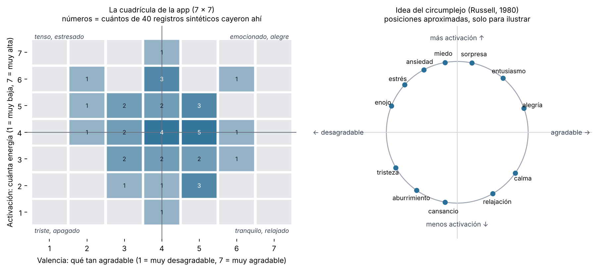
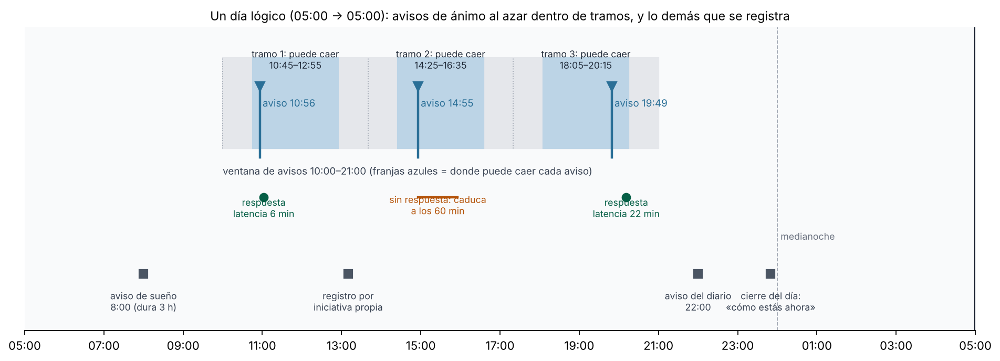
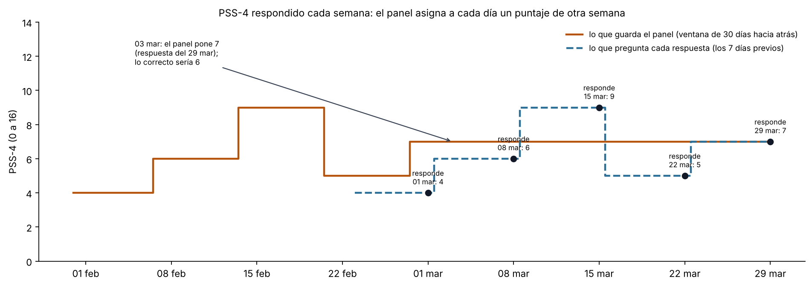
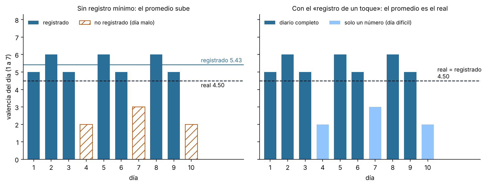

# Capítulo 3. Medición del estado subjetivo

> **Para qué sirve este capítulo.** Explica **cómo mide la app lo que sientes y piensas**: el ánimo en el momento, el ánimo del día, las emociones con nombre, los cuestionarios, los sueños, con quién estuviste y algunas mediciones raras (la brújula política, la prueba de reacción). Para cada cosa dice qué se pregunta, cuándo, en qué escala, cómo se convierte en número para los análisis y qué tan sólido es eso científicamente. Todo corresponde a la versión v81 del código (commit `fa527df`). **Los ejemplos numéricos son inventados.**
>
> **Cómo leerlo.** Está escrito para entenderse sin ser experto, pero sin recortar la precisión. Las cifras y reglas que vienen del código se dan tal cual. Cuando algo no lo pude comprobar, lo digo. Cada decisión se marca como **[Validado]** (respaldada por literatura o un estándar), **[Aproximación]** (razonable, pero con supuestos que conviene conocer) o **[Diseño propio]** (decisión de la app, sin estándar detrás). Los problemas encontrados se numeran H-2-n y se detallan en `hallazgos.md`.
>
> **Privacidad.** El seguimiento privado (impulsos, recaídas, libido) se describe solo en su mecánica, sin datos ni ejemplos personales.

---

## 3.1 Mini-glosario

| Término | Qué significa aquí |
|---|---|
| **Estado subjetivo** | Lo que solo tú puedes observar: cómo te sientes, qué piensas, qué tan estresado o solo te sientes. No hay sensor que lo mida; hay que preguntarlo. |
| **Autorreporte** | Una respuesta que das tú sobre ti mismo. Es la única forma de medir lo subjetivo, y tiene sesgos conocidos (sección 3.4). |
| **Valencia** | Qué tan **agradable o desagradable** se siente algo. En la app, de 1 (muy desagradable) a 7 (muy agradable). |
| **Activación** | Cuánta **energía o agitación** hay en el cuerpo y la mente, sin importar si es agradable. De 1 (muy baja: agotado) a 7 (muy alta: acelerado). En inglés, *arousal*. |
| **Muestreo de experiencia (ESM)** | Preguntar varias veces al día, en momentos al azar, «¿cómo estás ahora?». En inglés, *experience sampling method*; casi sinónimo de *ecological momentary assessment* (EMA). |
| **Retrospectivo** | Que se responde **después**, recordando («¿cómo estuvo tu día?»). Lo opuesto a «momentáneo» («¿cómo estás ahora?»). |
| **Instrumento validado** | Un cuestionario publicado cuyas preguntas, escala y forma de puntuar se han probado en estudios (miden lo que dicen medir y dan resultados estables). |
| **Ancla** | El texto que acompaña a un número de una escala para que signifique lo mismo cada vez (p. ej., «4 = Neutral: plano»). |
| **Panel** | La tabla de análisis: una fila por día, una columna por variable (capítulo 2). |
| **Día lógico** | El día de la app: empieza a las 05:00 (capítulo 2). Un registro a la 01:00 cuenta para el día anterior. |
| **MNAR** | «Faltante no al azar» (*missing not at random*): cuando la razón por la que falta un dato depende del propio dato. Ejemplo: no llenar el diario precisamente los días malos (Rubin, 1976; sección 3.15). |

---

## 3.2 Mapa: qué se pregunta, cuándo y dónde queda

| Medición | Cuándo se pide | Escala | Dónde se guarda | Variables principales del panel |
|---|---|---|---|---|
| Ánimo ahora (aviso) | 3 veces al día por omisión, al azar entre 10:00 y 21:00 | Cuadrícula 7 × 7 (valencia y activación) + opcionales | `Momento` con tipo `muestreo` | `muestreo_valencia`, `muestreo_activacion` |
| Ánimo ahora (por iniciativa propia) | Cuando tú quieras (botón, widget, mosaico) | Igual | `Momento` con tipo `animo` | entra en `animo_valencia`, `animo_activacion` |
| Ánimo al cerrar el día | Al final de la hoja de la noche | Cuadrícula 7 × 7 | `Momento` tipo `animo`, origen `cierre` | `animo_cierre_valencia`, `animo_cierre_activacion` |
| Ánimo del día (diario) | Aviso a las 22:00 por omisión | Valencia 1–7, activación 1–7, dolor 0–5, con anclas | `Dia` | `valencia`, `activacion`, `dolor` |
| Emociones con nombre, pensamiento, con quién | Dentro de cualquier registro de ánimo (opcional) | Listas | `Momento` | `n_<emoción>`, `n_<pensamiento>`, `con_*`, `acompanado_pct` |
| Predicción de mañana | En la hoja de la noche | 1–7 | `Dia` | `prediccion`, `error_prediccion` |
| «Lectura del día» (flujo, necesidades, evaluación) | En la hoja de la noche, plegada | Opción única | `Dia` | `flow_*`, `sdt_necesidad_*`, `apreciacion_*` |
| Cuestionarios (WHO-5, PSS-4, UCLA-3, TIPI) | Semanal, mensual o anual | Las de cada instrumento | `Respuesta` | `esc_<instrumento>_<puntaje>` |
| Sueño y sueños | Aviso a las 8:00 por omisión | Calidad 1–5, valencia 1–7, ejes de contenido | `Dia` | `sueno_calidad`, `sueno_recordado`, `sueno_<categoría>`… |
| Presencias (estuve / pensé / mensajes) | Al revisar el diario | 3 estados | `Dia.presencias` | `personas_vistas`, `vi_*`, `penso_en_*` (capítulo 7) |
| Brújula política | Una vez al año | 25 afirmaciones de 1 a 5 | `Config.politica` | `pol_<eje>` |
| Perfil («Conocerte») | Cuando cambie algo de tu vida | Opciones | `Config.perfil` + historial | `vida_*` |
| Prueba de reacción | Una vez al día (sugerida desde las 8:00) | Milisegundos | `Reaccion` | `rt_media` y relacionadas |

La idea general es **medir lo mismo de varias formas** (en el momento, al final del día, cada semana), porque cada forma tiene sesgos distintos. Las secciones siguientes explican cada una.

---

## 3.3 Los dos ejes del ánimo: valencia y activación

### 3.3.1 Qué es el modelo circumplejo

Russell (1980) propuso que casi todas las emociones se pueden ubicar en un plano con **dos ejes independientes**: qué tan agradable es la experiencia (**valencia**) y cuánta activación implica (**activación**). Las emociones con nombre quedan como puntos alrededor de un círculo: la *alegría* es agradable y algo activada; la *calma*, agradable y poco activada; la *ansiedad*, desagradable y muy activada; la *tristeza*, desagradable y poco activada (Figura 3.1, derecha). Por eso se llama **circumplejo** (dispuesto en círculo). **[Validado]**: es uno de los modelos de afecto más usados en psicología, aunque no el único (hay modelos con más dimensiones y modelos de emociones discretas; la app usa ambos, sección 3.6).

**Por qué importan dos ejes y no uno.** Con una sola pregunta («¿cómo te sientes, de mal a bien?») se confunden estados muy distintos: «tranquilo» y «emocionado» son ambos agradables, pero el primero tiene poca energía y el segundo mucha. Separar la activación permite ver, por ejemplo, si después de dormir poco no estás «peor», sino «más apagado».

### 3.3.2 La cuadrícula de la app

Para el ánimo **en el momento**, la app usa una **cuadrícula de 7 × 7** (`CuadriculaAfecto`, en `ui/Selectores.kt`): **un solo toque** da dos números. La columna tocada es la valencia (1 a la izquierda, 7 a la derecha) y la fila es la activación (1 abajo, 7 arriba). Los ejes se cruzan en el centro (4, 4 = neutral), y las esquinas llevan cuatro palabras guía: «tenso, estresado» (arriba a la izquierda), «emocionado, alegre» (arriba a la derecha), «triste, apagado» (abajo a la izquierda) y «tranquilo, relajado» (abajo a la derecha). El color de cada celda va de un extremo a otro según la valencia y es más intenso cuanto mayor es la activación.

*Cómo convierte el toque en números (exacto):* si el toque cae en la posición horizontal `x` de un cuadro de ancho `W`, la valencia es `⌊7·x/W⌋ + 1` (limitada a 1–7); si cae en la altura `y` (medida desde arriba) de un cuadro de alto `H`, la activación es `7 − ⌊7·y/H⌋` (limitada a 1–7).

**Base científica.** Es una versión de la **Affect Grid** (Russell, Weiss y Mendelsohn, 1989), una escala de un solo reactivo para agrado y activación. La publicación original usa una cuadrícula más fina (hasta donde sé, de 9 × 9; no pude comprobar el tamaño en la fuente durante esta sesión). **[Aproximación]**: la idea está validada, pero el formato 7 × 7, las palabras de las esquinas y la colocación en un teléfono son de la app, y no hay estudio que valide exactamente esta versión.

*Figura 3.1. Izquierda: la cuadrícula de la app con 40 registros sintéticos. Derecha: la idea del circumplejo, con posiciones aproximadas. La app **no** coloca sus emociones en el círculo; la figura solo ilustra el modelo. Script: `figuras/fig07_circumplejo.py`.*

### 3.3.3 La escala del día (1 a 7 con anclas)

Para el ánimo **del día**, la app no usa la cuadrícula, sino **dos filas de números del 1 al 7** con un texto por número (`Catalogo.ANCLAS`):

| | Valencia («qué tan agradable fue el día») | Activación («tu nivel de energía») |
|---|---|---|
| 1 | Muy desagradable: angustia, desesperanza | Muy baja: agotado, apagado |
| 2 | Desagradable: tristeza o frustración marcada | Baja: cansado, lento |
| 3 | Algo desagradable: incomodidad leve | Algo baja: relajado, en calma |
| 4 | Neutral: plano | Neutral |
| 5 | Algo agradable: contento | Algo alta: alerta, despierto |
| 6 | Agradable: disfrute claro | Alta: activo, con impulso |
| 7 | Muy agradable: entusiasmo pleno | Muy alta: acelerado, inquieto |

Además pide **dolor o molestia física de 0 a 5**, con anclas por **interferencia** («1 = lo noto, no interfiere» … «5 = no puedo funcionar normal»).

**Por qué 1 a 7.** Una escala con un punto medio (4) permite decir «neutral», y siete opciones dan más detalle que cinco sin volverse difíciles de distinguir. Las **anclas** existen para que un «5» signifique lo mismo hoy que dentro de dos años: sin texto, la gente tiende a «reajustar» lo que significa cada número con el tiempo. **[Aproximación]**: es una práctica común y razonable; las anclas concretas son de la app y no están validadas como instrumento.

**Detalle a saber.** Las anclas de activación mezclan un poco de valencia: «3 = relajado, en calma» suena agradable y «7 = acelerado, inquieto» suena algo desagradable. En el circumplejo puro, la activación no debería sugerir agrado ni desagrado. Además, la fila de activación usa **la misma paleta de color** que la de valencia (`Tonos.divergente`, del color «bajo» al «alto»), lo que puede insinuar que poca energía es «peor». Es un efecto pequeño y no hay forma de saber cuánto influye; lo dejo anotado (parte de H-2-11).

### 3.3.4 Las dos escalas no son la misma medida

La «valencia» del día y la del momento **comparten nombre y rango (1 a 7) pero no son el mismo instrumento**: una es una fila de números con anclas y pregunta por todo el día; la otra es una cuadrícula sin anclas por número y pregunta por *ahora*. Un 5 en una no equivale necesariamente a un 5 en la otra. Compararlas directamente («mi promedio de avisos es 5.1 y mi día fue 4») mezcla dos cosas. La sección siguiente explica por qué esa diferencia, además, es esperable.

---

## 3.4 Tres formas de responder «¿cómo estuve?»

Conner y Barrett (2012) distinguen tres «yo» que responden cuestionarios: el **yo que experimenta** (cómo te sientes *ahora*), el **yo que recuerda** (cómo *recuerdas* que te sentiste) y el **yo que cree** (cómo *crees* que eres en general). Robinson y Clore (2002) mostraron que, cuanto más lejos está el momento que se reporta, más se apoya la respuesta en **creencias generales** («los lunes siempre son malos») y menos en la experiencia concreta. **[Validado]**.

La app mide las tres:

| «Yo» | Qué lo mide en la app | Variable |
|---|---|---|
| El que experimenta | Avisos al azar y registros propios (cuadrícula) | `muestreo_valencia` (solo avisos), `animo_valencia` (todos) |
| El que recuerda | Diario de la noche («qué tan agradable fue el día») | `valencia` |
| El que cree | Cuestionarios semanales/mensuales/anuales | `esc_*` |

Y una cuarta, intermedia: el **cierre del día** («cómo estás ahora», al terminar la hoja de la noche) es momentáneo, pero siempre al final del día.

**Por qué el recuerdo no es un promedio.** Al evaluar un periodo, la gente pesa de más el **momento más intenso** y **cómo terminó**, y casi ignora la duración (regla «pico-final»; Kahneman et al., 1993). Así, un día bueno con un final malo puede recordarse como peor que su promedio.

**Ejemplo (inventado).** Un martes respondes tres avisos: 6, 5 y 6 (promedio 5.67). A las 21:30 tienes una discusión fuerte. En el diario de las 23:00 pones **3**. El cierre del día lo marcas en 2. Las tres cifras son «verdad», pero de cosas distintas: el promedio de avisos refleja **la mayor parte del día**; el diario, **el día tal como quedó en tu memoria**; el cierre, **cómo te fuiste a dormir**. Ninguna es la «correcta»; por eso se guardan las tres.

**Cómo se calcula cada una en el panel** (`Estadistica.panel`):

- `muestreo_valencia` = promedio de la valencia de los registros de tipo `muestreo` de ese día lógico; `muestreo_activacion`, igual con la activación.
- `animo_valencia` = promedio de **todos** los registros de ánimo del día (`muestreo` + `animo`, incluido el cierre).
- `animo_cierre_valencia` = la valencia del **último** cierre del día (si lo cambiaste varias veces, el último).
- `valencia` = el número del diario.

La app marca como «obvias» las relaciones entre estas variables (por ejemplo, `valencia` con `muestreo_valencia`), para no presentarlas como descubrimientos (capítulo 6).

**Un detalle de presentación que puede influir (H-2-11).** Mientras llenas la valencia del día en la hoja de la noche, debajo aparecen los valores de los avisos de ese día («avisos: 10:56→6 14:55→5…»). Ver esos números antes de calificar el día puede **anclar** tu respuesta hacia ellos, y así las dos medidas se parecen más de lo que se parecerían por sí solas. Es una decisión de diseño razonable (ayuda a recordar), pero vuelve menos independiente la valencia del día. **[Diseño propio]**.

---

## 3.5 El muestreo de experiencia: cómo y cuándo pregunta la app

### 3.5.1 La idea

Si solo preguntas al final del día, obtienes el «yo que recuerda», con todos sus sesgos. Si preguntas **varias veces al día, en momentos que no eliges tú**, obtienes muestras del «yo que experimenta». Esa es la idea del muestreo de experiencia (Csikszentmihalyi y Larson, 1987; Shiffman et al., 2008). **[Validado]**.

Dos detalles importan: que las horas sean **al azar** (si siempre preguntas a la misma hora, solo conoces esa hora) y que la persona **no las elija** (si solo registras cuando te pasa algo, solo conoces los momentos en que te pasa algo).

### 3.5.2 Cómo elige las horas (exacto)

La función `Programador.planDelDia` (`avisos/Trabajo.kt`) arma el plan de cada día así:

1. Toma la **ventana** configurada: por omisión de **10:00 a 21:00** (`ventana_inicio = 10`, `ventana_fin = 21`) y el número de avisos: por omisión **3** (`muestreos_por_dia`, ajustable de 0 a 6).
2. Divide la ventana en **n tramos iguales**: tramo = (fin − inicio) / n.
3. En cada tramo deja un **margen** a cada lado: margen = mín(45 minutos, tramo / 4).
4. Elige una hora **al azar** (distribución uniforme) entre «inicio del tramo + margen» y «fin del tramo − margen».

El generador al azar usa como semilla la fecha (`Random(fecha.hashCode())`), así que el plan de un mismo día es siempre el mismo aunque se recalcule. Esto se llama **muestreo aleatorio estratificado** (al azar, pero dentro de bloques): garantiza que haya un aviso en la mañana, otro en la tarde y otro en la noche, y a la vez que no sean predecibles. **[Validado]** como diseño; es el esquema habitual en estudios de muestreo de experiencia.

**Ejemplo con los valores por omisión.** La ventana dura 660 minutos; con 3 avisos, cada tramo dura 220 minutos y el margen es mín(45, 55) = **45 minutos**. Entonces:

| Tramo | Va de | Hora posible del aviso |
|---|---|---|
| 1 | 10:00 a 13:40 | 10:45 a 12:55 |
| 2 | 13:40 a 17:20 | 14:25 a 16:35 |
| 3 | 17:20 a 21:00 | 18:05 a 20:15 |

Dos avisos seguidos quedan separados **al menos 90 minutos** (el margen de un tramo más el del siguiente).

**Ojo con la promesa de los 90 minutos (H-2-7).** El comentario del código dice «separadas al menos 90 minutos», pero eso solo se cumple si cada tramo dura **3 horas o más** (porque el margen se reduce a tramo/4 cuando el tramo es corto). Con la misma ventana y **4** avisos, el tramo es de 165 minutos, el margen de 41.25 y la separación mínima de **82.5 minutos**; con **6** avisos, el tramo es de 110 minutos y la separación mínima de **55 minutos**. No es un error de cálculo, pero la descripción no es exacta. Gravedad baja.

### 3.5.3 Cómo llega el aviso (y cuándo se pierde)

La app no programa una alarma exacta para cada aviso: lo revisa en el **pulso** de cada ~15 minutos (capítulo 4). En cada pulso, para cada hora del plan que ya pasó y no se ha procesado:

- la marca como «ya procesada»;
- **solo si han pasado menos de 50 minutos** desde la hora planeada, muestra la notificación «¿Cómo te sientes ahora?»;
- la notificación **se borra sola a los 60 minutos** de mostrarse (`setTimeoutAfter`).

Si respondes tocando la notificación, el registro se guarda como tipo **`muestreo`**, con la hora planeada en `aviso_ts`. La exportación calcula `latencia_min` = minutos entre la hora planeada y tu respuesta. Si en vez de eso abres la app por tu cuenta, el registro se guarda como **`animo`** (iniciativa propia), aunque fuera para contestar el aviso.

**Lo que queda registrado desde el esquema 13 (P-10).** Cada pulso anota en la colección `avisos`, un documento por día del plan (`AvisosDia`):
- **`planeados`**: cuántos avisos podían sonar ese día. Si cambias los ajustes a mitad del día, el plan se rehace. Entonces se suman los que ya vencieron y los del plan nuevo que todavía pueden sonar; los de un turno ya usado no vuelven a sonar (H-9-11).
- **`vencidos`**: los avisos cuya hora ya pasó y que el pulso ya procesó.
- **`mostrados`**: los que además salieron en pantalla, es decir, con menos de 50 minutos de retraso y con permiso de notificaciones.

Las horas se guardan en el mismo formato que `aviso_ts`, para unir cada aviso con su respuesta. Con los avisos apagados no se anota nada, y el día queda **sin dato**, no en 0.

En el panel salen cuatro variables (`AvisosAnimo.cifras`):
- `avisos_planeados`;
- `avisos_mostrados`;
- `avisos_respondidos`: los mostrados que tienen un registro `muestreo` con esa hora, tenga o no valencia;
- **`tasa_respuesta`** = respondidos ÷ mostrados.

Se marcan como familia «obvia» entre sí y con `muestreo_valencia`, `muestreo_activacion` y `n_muestreos` (capítulo 6). En la exportación, `n_muestreos` cuenta ahora **todos** los avisos respondidos, con o sin valencia: la misma regla que el diccionario, Explorar y los widgets (H-9-10).

*Ejemplo (inventado):* 4 avisos planeados; 3 vencen y 2 se muestran (el tercero llegó 70 minutos tarde porque el teléfono dormía); respondes uno de los mostrados. Queda planeados 4, mostrados 2, respondidos 1, tasa 0.5. Los días anteriores al cambio quedan vacíos: reconstruirlos no es fiable. **[Validado]** el propósito (la tasa de respuesta es la primera cifra de un estudio de muestreo de experiencia); **[Diseño propio]** la forma de contarla.

También cambió la tarjeta «N avisos de ánimo sin contestar» de Hoy (H-9-9). Antes restaba registros a avisos planeados, y al tocarla la respuesta se guardaba como registro propio (`animo`), así que la tarjeta no se apagaba. Ahora cuenta los avisos sin respuesta por su hora (`AvisosAnimo.sinContestar`) y abre la captura con la hora del más antiguo. La respuesta queda como `muestreo` de ese aviso, con su `latencia_min`.

**Qué no quedaba registrado hasta el esquema 12 (H-2-3).** Si el teléfono estuvo dormido y el pulso llegó más de 50 minutos tarde, el aviso **se marca como hecho pero nunca se muestra**, sin dejar rastro. Tampoco se guarda, como dato del día, **cuántos avisos se mostraron**: el plan se borra a los 3 días y las marcas internas a los 40. La pantalla de Hoy sí cuenta «avisos sin contestar» del día en curso, pero ese número no llega al panel. Consecuencia: no se puede calcular la **tasa de respuesta** histórica (avisos respondidos / avisos mostrados), que es la primera cifra que se reporta en un estudio de muestreo de experiencia, ni saber si los avisos sin respuesta se concentran en ciertos días u horas (Rintala et al., 2019, combinando datos de varios estudios de este tipo, encontraron una respuesta promedio de 78 %, más baja temprano en la mañana y que bajaba con los días de estudio). Gravedad media.

*Figura 3.2. Un día sintético con los valores por omisión: tres avisos dentro de sus franjas posibles, una respuesta rápida, un aviso que caduca y los demás registros del día. Script: `figuras/fig08_dia_muestreo.py` (replica las reglas de `planDelDia`, pero no el generador al azar de Kotlin, así que las horas exactas difieren).*

### 3.5.4 Por qué se separan avisos y registros propios

Cuando tú decides registrar, sueles hacerlo **porque pasó algo** (una alegría, una preocupación). Eso es un muestreo **por evento**, válido para estudiar esos eventos, pero sesgado si se usa como «cómo estoy en general». Por eso la variable más limpia del ánimo momentáneo es `muestreo_valencia` (solo avisos), y `animo_valencia` (todo junto) mezcla los dos tipos. **[Validado]** el principio.

Ese mismo sesgo afecta al **mapa emocional de lugares** (pantalla Lugares): colorea cada lugar según la valencia de **todos** los registros de ánimo hechos ahí, avisos y propios, contra tu promedio general. Además, el mapa y la lista de la misma pantalla usan criterios distintos para decidir si un registro «es de ese lugar» (el mapa, solo si el registro quedó asignado al lugar; la lista, también si está dentro del radio). En R, la función `vm_mapa_animo` va más lejos: si un registro no tiene valencia, le pone **la valencia del diario de ese día**, mezclando en un mismo mapa el ánimo del momento con el recordado. Detalles menores (H-2-15).

---

## 3.6 Emociones con nombre, pensamientos y compañía

### 3.6.1 Qué se puede marcar

En cualquier registro de ánimo, después del toque en la cuadrícula, puedes marcar (todo opcional):

- **Qué sientes** (varias a la vez), de una lista de 25 emociones (`Catalogo.SENTIMIENTOS`) agrupadas por tono: **9 agradables** (alegría, calma, gratitud, entusiasmo, orgullo, cariño, alivio, diversión, esperanza), **13 desagradables** (estrés, ansiedad, frustración, tristeza, enojo, miedo, soledad, aburrimiento, culpa, vergüenza, celos, abrumado, cansancio) y **3 mixtas** (nostalgia, confusión, sorpresa). Más dos opciones especiales: **«otro…»** (escribes cuál) y **«no sé»**. Elegir «no sé» quita las demás; elegir otra quita «no sé».
- **En qué piensas** (una): en alguien o algo, preocupación, idea, recuerdo, plan o pendiente, dándole vueltas, autocrítica, deseo o antojo.
- **Una nota** con @personas y #temas.
- **Con quién estás** (varias): solo, pareja, amigos, familia, compañeros, desconocidos. «Solo» excluye a los demás.

### 3.6.2 Por qué emociones con nombre además de los dos ejes

Los dos ejes resumen bien, pero pierden información: «enojo» y «miedo» caen en la misma zona (desagradable, activado) y son experiencias distintas. Poder **nombrar con precisión** lo que sientes, llamado *diferenciación* o *granularidad emocional*, se asocia con manejar mejor las emociones desagradables (Kashdan, Barrett y McKnight, 2015). **[Validado]** el concepto. La app no calcula un índice de granularidad (eso requiere métodos estadísticos específicos); solo guarda los nombres.

**Por qué «no sé» es un dato.** No poder nombrar lo que sientes también es información (puede indicar baja diferenciación en ese momento, o un estado mezclado). Por eso se guarda como emoción propia (`no_se`) y produce su propia variable `n_no_se`. **[Diseño propio]**, razonable.

**Asimetría de la lista.** Hay más emociones desagradables (13) que agradables (9). Es habitual (el vocabulario emocional suele tener más palabras negativas), pero significa que **los conteos no son comparables entre sí**: que marques más emociones negativas que positivas puede deberse en parte a que hay más para elegir. **[Diseño propio]**.

### 3.6.3 Cómo entran al panel

- `n_<emoción>`: cuántos registros de ese día incluyen esa emoción (`n_alegria`, `n_estres`, `n_no_se`…). Solo se crean columnas para emociones que hayas usado al menos una vez (la de «otro» no genera columna).
- `n_<pensamiento>`: igual con los pensamientos.
- `registros_animo`: cuántos registros de ánimo hiciste ese día.
- **Relleno con cero:** desde la fecha de tu **primer** registro de ánimo, los días que tienen documento de diario y no tienen registros cuentan como **0** en estas variables (no como «sin dato»). **[Diseño propio]**: es razonable si se asume que siempre registras cuando sientes algo, cosa que no es cierta en un día sin registros por olvido (ver H-1-1 sobre el criterio de rellenar con cero).
- Con quién (solo con los registros **de aviso** que tienen compañía marcada): `acompanado_pct` (fracción de avisos en compañía), `con_pareja`, `con_amigos`… (fracción de avisos con cada tipo) y `valencia_acompanado` / `valencia_solo` (promedio de valencia en cada caso).

**Compatibilidad con los registros viejos.** Antes existían «tipos de momento» (tristeza, alegría, pensando en…). La función `Catalogo.emocionesDe` traduce los viejos al formato nuevo (un momento viejo de tipo «tristeza» cuenta como la emoción tristeza). En el panel la serie es continua. **En la exportación `vm_dias.csv` no**: sus columnas `m_<tipo>` siguen contando solo los tipos viejos, así que desde el cambio valen 0 aunque registres esas emociones (H-2-13).

### 3.6.4 Nombrar puede cambiar lo que sientes

Ponerle palabras a una emoción (*affect labeling*) puede reducir su intensidad: en un estudio de laboratorio, nombrar la emoción de una cara redujo la respuesta de la amígdala, una zona del cerebro relacionada con la reacción emocional (Lieberman et al., 2007). Es decir, **el acto de registrar puede cambiar un poco lo registrado**. Esto se retoma en la sección 3.14 (reactividad).

---

## 3.7 El diario de la noche

### 3.7.1 Qué contiene

La «hoja de la noche» (`PantallaNoche`, en `ui/pantallas/Dia.kt`) reúne en una página, **en este orden fijo** desde la entrega N4 de la revisión de navegación (`VERSION_NOCHE = 2`):

1. **«Cómo estás ahora»** (el cierre, sección 3.7.5), solo en la hoja del día de hoy.
2. **Ánimo y cuerpo** del día: valencia, activación y dolor.
3. **Predicción** de mañana.
4. **Contexto** del día (trabajo, gym, viaje, enfermo, académico, ocio inmersivo, naturaleza, amigos, romántico, familia; varios o ninguno).
5. **Hábitos** (casillas; sin el hábito ligado a las recaídas) y **suplementos de este día**.
6. **Diario** (texto libre con @personas y #temas) y con quién estuviste.
7. Plegado, como opcional: la «lectura del día», lo mejor y lo peor, hitos, lo que leíste o viste, la foto del día y «privado de este día →».
8. Sellar.

«Solo lo que falta» oculta lo ya contestado, pero no cambia el orden.

**Por qué este orden.** No hay un orden sin efectos: cada pregunta puede cambiar las que vienen después. Se eligió así:
- **El ánimo del momento va primero.** Recordar a propósito lo que te pasó cambia el ánimo; de hecho, es una forma habitual de inducir un ánimo en el laboratorio (Westermann et al., 1996). Y ponerle nombre a lo que sientes al escribir baja la intensidad de la emoción (Lieberman et al., 2007). Con el cierre al final, medía cómo quedaste después de repasar y escribir el día, no cómo estabas.
- **El juicio general del día va antes de las preguntas específicas.** Si primero se pregunta algo concreto («¿cumpliste tus hábitos?») y luego algo general («¿qué tan agradable fue el día?»), lo concreto se mete en el juicio general o se excluye de él, y cambia la relación entre las dos respuestas (Schwarz, Strack y Mai, 1991). El panel cruza justo la valencia con los hábitos.
- **El costo.** Con el ánimo del momento primero, ese ánimo puede teñir el juicio del día: es el efecto de usar el ánimo como información (Schwarz y Clore, 1983). Se aceptó porque el cierre es el dato que se quiere proteger (momentáneo, comparable entre días), mientras que el juicio del día es retrospectivo y el ánimo del momento lo tiñe en cualquier orden. En ese mismo trabajo, cuando la persona se fija en su ánimo actual, este pesa menos en el juicio.

Es una **[Aproximación]**: viene de estudios de encuestas y de laboratorio, no de una prueba con esta app. Para verlo en tus datos, cada día guarda `version_noche` (1 = el orden de antes: hábitos, ánimo, contexto, diario, obras, foto, predicción, lo opcional y el cierre al final; 2 = el nuevo). Así se pueden comparar los dos tramos en R.

Además, desde `VERSION_NOCHE = 2`, la línea con los valores de tus avisos de ánimo de ese día solo aparece **después** de elegir la valencia, y la activación usa una paleta de una sola dirección (`Escala(secuencial = true)`), para que «menos energía» no se lea como «peor» (H-2-11).

Desde la entrega N2 de la revisión de navegación hay también una sección **«Suplementos de este día»**: marca o quita la toma de ese día (a la hora habitual o a la de ahora). Y si faltan días, «Ponerte al día» abre la hoja en el primero que falta y, al sellar, pasa al siguiente (hasta 7 días hacia atrás). Lo que se llena así queda como `retroactivo` (sección 3.7.4), y la diferencia entre `ts` y `ts_creado` dice cuánto después se anotó.

Se guarda sola mientras escribes (cada 0.7 s sin cambios). Si tiene **valencia y texto del diario**, se puede «sellar» el día; sellar no cambia los datos, es solo un cierre simbólico.

### 3.7.2 La «lectura del día»: tres preguntas de marcos científicos

Son tres preguntas de opción única (`Catalogo.CIENTIFICAS`), cada una inspirada en una teoría:

**Flujo (Csikszentmihalyi).** «¿El reto igualó tu habilidad?» Opciones: **flujo** (concentración total), **ansiedad** (el reto te rebasó), **aburrimiento** (muy por debajo de tu capacidad), **apatía** (ni reto ni interés) y «no aplica». Corresponde al **modelo de cuadrantes**: cruzar «reto alto/bajo» con «habilidad alta/baja» da cuatro estados, y el flujo aparece cuando ambos son altos (Csikszentmihalyi y LeFevre, 1989). **[Aproximación]**: en los estudios se mide reto y habilidad por separado y se calcula el cuadrante; aquí se pide elegir directamente el estado, y referido al día completo (a «la actividad más exigente del día»), no a un momento.

**Necesidades psicológicas (Deci y Ryan).** «¿Qué necesidad se satisfizo más?»: **autonomía** (las decisiones fueron tuyas), **competencia** (algo se te dio bien), **relación** (te sentiste conectado), **ninguna** o **las tres**. Se basa en la teoría de la autodeterminación, que propone esas tres necesidades básicas (Deci y Ryan, 2000). **[Aproximación]**: las escalas validadas miden cada necesidad por separado con varios reactivos; aquí es una sola elección.

**Evaluación del estrés (Lazarus).** «¿Cómo evaluaste la exigencia del día?»: **reto** (exigente pero motivante), **amenaza** (exigente y temiste fallar), **pérdida** (algo ya salió mal) o **rutina** (baja exigencia). Corresponde a la «evaluación primaria» de Lazarus y Folkman (1984), que distingue daño/pérdida, amenaza y reto. **[Aproximación]**: mismo comentario, es una sola elección del día.

**Cómo entran al panel.** Cada opción se convierte en una columna de 0/1 (`flow_flujo`, `flow_ansiedad`, `sdt_necesidad_autonomia`…), con valor **vacío** si no respondiste. Dos consecuencias del código:

- Elegir «**no aplica**» deja todas las columnas de flujo en 0 (no en vacío), igual que si hubieras elegido algo que no existe. Se puede distinguir de «no respondí», pero no hay columna propia para «no aplica».
- Elegir «**las tres**» pone `sdt_necesidad_las_tres = 1` y deja `autonomia`, `competencia` y `relacion` en **0**, aunque las tres se hayan satisfecho. Al analizar cada necesidad por separado hay que sumar esos días a mano. (Parte de H-2-4.)

Estas preguntas están **plegadas por omisión**, así que se responden menos y probablemente no al azar (más en días con ganas de escribir). **[Diseño propio]**.

### 3.7.3 Lo mejor, lo peor, hitos, medicamentos, contextos y hábitos

- **Lo mejor y lo peor** del día: una línea cada uno, texto libre. No entran al panel como números.
- **Hitos**: etiquetas cortas de cosas que no pasan todos los días; `hitos_n` cuenta cuántas.
- **Medicamentos**: desde el módulo 10a son privados y se anotan en la pantalla Privado, no en el diario de la noche (al final hay un enlace «privado de este día»). Son etiquetas; `medicamentos_n` cuenta cuántas desde el primer día en que anotaste alguno y solo viaja a R.
- **Contextos** (`ctx_*`) y **hábitos** (`hab_*`): 1 si lo marcaste. **Ojo (H-2-4):** valen **0 en todos los días con diario**, también si no abriste esa sección, y los hábitos valen 0 incluso **antes de crear el hábito** (el modelo guarda la fecha `desde`, pero el panel no la usa). Así, «no lo marqué» se confunde con «no pasó» y con «aún no existía». Mismo problema de fondo que H-1-1.

### 3.7.4 «Retroactivo»: cuándo se llenó el día

Cada documento de día guarda `retroactivo`: verdadero si el día se **guardó por primera vez** después de que terminó (`Repo.guardarDia`: la fecha del documento es anterior al día lógico de hoy). Sirve para separar lo escrito en el momento de lo escrito de memoria días después, que tiene más sesgo de recuerdo. **[Validado]** el propósito (Stone et al., 2002, mostraron que en diarios en papel mucha gente llena días atrasados de golpe).

**Hasta el esquema 12 se decidía en el primer guardado, no cuando se llenó el ánimo (H-2-2).** Ejemplo (inventado): el martes a las 8:10 tocas la calidad del sueño en el widget. Eso crea el documento del martes con `retroactivo = falso`. El viernes llenas la valencia y el diario del martes de memoria: el día **sigue marcado como no retroactivo**, porque la marca ya existía. Al revés, un día que se crea retroactivo lo es para siempre. Además, `ts_editado` se sobrescribe en cada cambio, así que tampoco queda cuándo se escribió cada parte. Gravedad media: es justo la variable pensada para controlar el sesgo de recuerdo.

**Desde el esquema 13 (P-13)** cada día guarda `ts_valencia`: la hora en que la valencia pasó de vacía a llena, o en que cambió. Con ella, `retroactivo` = el día lógico de `ts_valencia` es posterior a la fecha del día (`Reglas.retroactivo`). En el ejemplo, la valencia del martes se llenó el viernes, así que el martes queda retroactivo aunque el widget lo haya creado el mismo martes. Llenarla el martes a la 1:30 de la madrugada del miércoles no cuenta como retroactivo, porque sigue siendo el día lógico del martes. Corregir la valencia días después también vuelve el día retroactivo: el número nuevo es de memoria. Los días de antes de la v13 no tienen `ts_valencia` y conservan su marca. **[Diseño propio]**.

**Un aviso que no tiene efecto (H-2-14).** Si abres un día futuro, la app dice «se marcará como escrito por adelantado», pero no existe ningún campo que lo registre. Gravedad baja.

### 3.7.5 El cierre del día

Al **principio** de la hoja (hasta `VERSION_NOCHE = 1` iba al final; sección 3.7.1) hay una cuadrícula «Cómo estás ahora» (`BloqueCierre`, en `ui/pantallas/Lote2.kt`). Guarda un registro de ánimo con la **hora real** (tipo `animo`, origen `cierre`). La idea es tener **la misma medición, en el mismo punto del día, todos los días**. **[Diseño propio]**, buena idea: es un dato momentáneo comparable entre días, menos afectado por el recuerdo que la valencia del diario.

Dos precisiones (H-2-8):

- El comentario dice «a la misma hora todos los días», pero en realidad es **a la hora en que cierres** el diario, que varía. La hora queda guardada, así que se puede controlar en el análisis.
- Hasta la entrega N4, si llenabas la hoja de **un día pasado**, el cierre se guardaba **con la fecha de ese día pero con la hora de ahora**: `animo_cierre_valencia` del martes podía ser cómo te sentías el viernes. Desde la N4, el cierre solo se ofrece en la hoja del día lógico de hoy (`cierrePermitido(fecha)`, en `data/Modelo.kt`; lo comprueba `EsquemaCatorcePrueba.cierreSoloHoy`). Los cierres tardíos de antes siguen en los datos; se reconocen porque el día de `ts` no coincide con `fecha`.

---

## 3.8 La predicción de mañana

En la hoja de la noche: «¿Cómo crees que estará tu ánimo mañana?», de 1 a 7 con las mismas anclas que la valencia. Al día siguiente el panel calcula:

  `error_prediccion` = | predicción de ayer − valencia de hoy |

(`Estadistica.panel`; solo si existen las dos).

**Para qué.** Las personas solemos equivocarnos al predecir cómo nos sentiremos: sobreestimamos cuánto y cuánto tiempo nos afectarán los eventos (*pronóstico afectivo*; Wilson y Gilbert, 2005). Medir el error permite ver si con el tiempo te conoces mejor y qué días predices peor. **[Validado]** la idea; **[Diseño propio]** la variable.

**Qué se pierde al usar el valor absoluto (H-2-10).** El valor absoluto quita la dirección del error. Ejemplo (inventado): el lunes predices 6 y el martes resulta 4 → error 2 (fuiste **optimista**). El miércoles predices 3 y el jueves resulta 5 → error 2 (fuiste **pesimista**). Para la variable son iguales, aunque son sesgos opuestos. Si quieres saber si tiendes al optimismo, hace falta también el **error con signo** (valencia − predicción). Gravedad baja; se resuelve agregando una columna.

---

## 3.9 Cuestionarios validados

### 3.9.1 Los cuatro instrumentos

Están en `ciencia/Escalas.kt`. Para guardar una respuesta hay que contestar **todos** los reactivos (el botón «Guardar» no se habilita antes), así que no hay puntajes con preguntas en blanco.

**WHO-5 (bienestar), cada 7 días.** Cinco frases («Me he sentido alegre y de buen humor», «…tranquilo y relajado», «…activo y enérgico», «Me he despertado fresco y descansado», «Mi vida diaria ha estado llena de cosas que me interesan»), cada una de 0 (nunca) a 5 (todo el tiempo).

  bruto = suma de las 5 (0–25)  porcentaje = bruto × 4 (0–100)

Referencia: Topp et al. (2015). La app interpreta: **≤ 28** «valor bajo, vale la pena hablarlo con un profesional si se repite»; **≤ 50** «por debajo de lo habitual»; más de 50, «rango habitual o alto». En la literatura, **≤ 50** suele usarse como punto de corte para **tamizaje de depresión** (indica que conviene evaluar más, no que haya depresión); el valor **≤ 28** se cita con frecuencia como indicativo de probable depresión, pero no pude comprobarlo en la fuente primaria durante esta sesión **[sin verificar]**. **Adaptación:** el original pregunta por **las últimas 2 semanas**; la app usa **7 días**. Los puntos de corte se establecieron con el periodo de 2 semanas, así que aplicados a una semana son orientativos.

**PSS-4 (estrés percibido), cada 7 días.** Cuatro preguntas de 0 (nunca) a 4 (muy a menudo): sentirte incapaz de controlar lo importante, seguro de manejar tus problemas (**inversa**), que las cosas te van bien (**inversa**), que las dificultades se acumulan.

  total = p1 + p4 + (4 − p2) + (4 − p3)  (0–16; más alto = más estrés)

Referencia: Cohen, Kamarck y Mermelstein (1983). La app cita además la versión española de Remor (2006), pero **esa validación estudió las versiones de 14 y 10 preguntas, no la de 4**: la versión corta en español que usa la app no está validada en ese artículo (y no comparé sus frases palabra por palabra con la publicada). **Adaptación:** el original pregunta por **el último mes**; la app, por **7 días**. No hay puntos de corte; la app solo propone compararte contigo mismo. **[Validado]** el instrumento; **[Aproximación]** el periodo semanal.

**UCLA-3 (soledad), cada 30 días.** Tres preguntas: falta de compañía, sentirte excluido, sentirte aislado; de 1 (casi nunca) a 3 (a menudo). Total 3–9 (Hughes et al., 2004). La app dice que «6 o más suele usarse como indicador de soledad»; ese punto de corte aparece en estudios que usan esta escala, pero no encontré la fuente que lo establece **[sin verificar]**. La app pregunta «pensando en el último mes». **[Validado]** el instrumento.

**TIPI (personalidad), cada 365 días.** Diez frases («Me veo a mí mismo como una persona… extravertida, entusiasta», «… reservada, callada», etc.), de 1 (muy en desacuerdo) a 7 (muy de acuerdo). Cada rasgo de los cinco grandes es el promedio de una frase directa y una **inversa** (inversa = 8 − respuesta):

| Rasgo | Fórmula |
|---|---|
| Extraversión | (t1 + (8 − t6)) / 2 |
| Amabilidad | ((8 − t2) + t7) / 2 |
| Responsabilidad | (t3 + (8 − t8)) / 2 |
| Estabilidad emocional | ((8 − t4) + t9) / 2 |
| Apertura | (t5 + (8 − t10)) / 2 |

Referencias: Gosling, Rentfrow y Swann (2003); versión española, Romero et al. (2012). Con solo dos frases por rasgo, el TIPI sirve para ver **cambios grandes** con los años, no matices. **[Validado]**. No comparé palabra por palabra las frases de la app con la versión española publicada.

**Ejemplo de puntuación (inventado), PSS-4.** Respuestas: p1 = 2, p2 = 3, p3 = 1, p4 = 2. Total = 2 + 2 + (4 − 3) + (4 − 1) = 2 + 2 + 1 + 3 = **8** de 16.

### 3.9.2 Cuándo se piden

`Escalas.proxima`: la fecha de la última respuesta más la frecuencia (7, 30 o 365 días); si nunca se respondió, hoy. El recordatorio (a las 19:00 por omisión, `escalas_hora`) insiste más con el atraso (`Escalas.horasAviso`): el día que toca, **una vez**; con 1 a 3 días de atraso, **dos** (12:00 y la hora configurada); con 4 o más, **tres** (10:00, 15:00 y la configurada o las 20:00, la que sea más tarde).

Que se pidan de forma regular es importante porque estos instrumentos preguntan por un periodo («los últimos 7 días»): si se responden irregularmente, los periodos se enciman o dejan huecos.

### 3.9.3 Cómo se pasan al panel: el problema principal de este capítulo (H-2-1)

Un cuestionario se responde **un día**, pero habla de **un periodo**. Para poder cruzarlo con variables diarias, la app copia el puntaje a varios días (`ciencia/Dinamicas.kt`, sección «Cuestionarios»):

- **WHO-5:** al día de la respuesta y a los **13 días anteriores** (ventana de 14).
- **PSS-4 y UCLA-3:** al día de la respuesta y a los **29 días anteriores** (ventana de 30).
- **TIPI:** del día de la respuesta **hacia adelante**, hasta la siguiente respuesta (o un año).

Las respuestas se procesan de la más antigua a la más nueva, y **cada una sobrescribe** lo que había. El comentario del código dice que cada puntaje vale «para el periodo que pregunta (dos semanas, un mes)», pero:

1. **Los periodos no coinciden con lo que la app pregunta.** WHO-5 y PSS-4 preguntan por **7 días** (adaptación de la propia app), y se copian a 14 y 30 días.
2. **La sobrescritura hace que cada día reciba la respuesta más nueva que lo alcanza, no la que habla de él.** Con un PSS-4 cada semana y ventana de 30 días, un día recibe el puntaje de la respuesta dada **hasta 29 días después**, que pregunta por otra semana.

**Ejemplo (inventado, Figura 3.3).** Respondes el PSS-4 los días 1, 8, 15, 22 y 29 de marzo, con 4, 6, 9, 5 y 7. ¿Qué guarda el panel el **3 de marzo**? Las respuestas cuya ventana de 30 días lo cubre son las del 8, 15, 22 y 29; la última en escribir es la del **29 (7)**. Pero la respuesta que habla de esa semana es la del 8 de marzo (periodo 2–8 de marzo): **6**. Peor aún: del 1 al 29 de marzo **todos** los días quedan con 7, y la semana de estrés alto (9, del 15 de marzo) **desaparece** del panel.

Con el WHO-5 semanal y ventana de 14 días pasa lo mismo de forma sistemática: cada día recibe la respuesta de la semana **siguiente a la suya**. Solo los últimos días (después de la última respuesta, mientras no haya otra) reciben el valor de su propia semana.

**Por qué importa.** Las correlaciones entre estos puntajes y cualquier variable diaria (sueño, pasos, ánimo) comparan cosas de **semanas distintas**, y en la dirección más engañosa: el «estrés» de un día viene del futuro. Además, la serie se aplana y las semanas extremas se pierden. Gravedad **alta**.

**Corrección mínima que propondría:** usar como ventana el periodo que de verdad pregunta la app (7 días para WHO-5 y PSS-4, 30 para UCLA-3) y, si dos respuestas se enciman, que **cada día se quede con la respuesta más cercana posterior a él** (la primera que lo cubre), no con la última.

*Figura 3.3. PSS-4 sintético respondido cada semana. Línea continua: lo que guarda el panel con la regla actual. Línea punteada: la semana a la que se refiere cada respuesta. Script: `figuras/fig10_cuestionarios_ventana.py` (replica la lógica de `Dinamicas.kt`).*

La app sí evita un error relacionado: dos puntajes del **mismo** cuestionario (por ejemplo, extraversión y apertura del TIPI) se marcan como relación «obvia», porque salen de las mismas respuestas.

---

## 3.10 La brújula política

Una vez al año (la primera vez, cuando ya hay al menos 14 días con documento de diario), 25 afirmaciones **escritas para la app** (`data/Politica.kt`), 5 por eje, respondidas de 1 (muy en desacuerdo) a 5 (muy de acuerdo). Ejes: economía (igualdad y Estado ↔ mercado y empresa), autoridad (libertad individual ↔ orden y autoridad), valores (cambio ↔ tradición), mundo (apertura ↔ soberanía) y ambiente (proteger el ambiente ↔ crecimiento primero). El orden de las afirmaciones se mezcla, con el mismo orden durante todo el año.

**Cálculo (exacto).** Cada afirmación tiene un **signo**: +1 si estar de acuerdo acerca al polo «positivo» del eje y −1 si al «negativo». Para cada eje:

  posición = Σ (respuesta − 3) × signo × 100 / (2 × número de afirmaciones respondidas)  (−100 a +100)

y se describe como «muy hacia…» (≤ −60 o ≥ 60), «hacia…» (de −60 a −20, o de 20 a 60) o «al centro» (entre −20 y 20).

**Para qué sirven los signos mezclados.** Hay personas que tienden a estar de acuerdo con todo (*aquiescencia*). Si todas las afirmaciones apuntaran al mismo lado, esa tendencia se confundiría con una postura. Mezclar afirmaciones en ambos sentidos la neutraliza… **si están equilibradas**.

**No lo están del todo (H-2-6).** Con 5 afirmaciones por eje el reparto es 3 contra 2. Si alguien responde «muy de acuerdo» (5) a las 25, cada eje queda en ±2 × 100 / 10 = **±20**, que la app describe como «hacia…» en los **cinco** ejes (hacia igualdad y Estado, hacia orden y autoridad, hacia cambio, hacia soberanía, hacia proteger el ambiente). El comentario del código dice que estar de acuerdo con todo «no empuja hacia ningún lado», y no es exacto. Con «de acuerdo» (4) en todo, el efecto es ±10 y queda «al centro». Gravedad baja: es un instrumento para compararte contigo mismo año con año, y ese sesgo es constante. **[Diseño propio]**: las afirmaciones no están validadas como escala.

En el panel, cada eje (`pol_<eje>`) vale lo mismo desde el día del test hasta el siguiente (o 400 días).

---

## 3.11 «Conocerte»: el perfil y las etapas de vida

«Conocerte» (`data/Perfiles.kt`, pantalla `Conocer.kt`) pregunta lo grande de tu vida: con quién vives, a quién ves más, pareja, ocupación, horario, cronotipo (de mañana o de noche), hábitos generales, ciudad, transporte, dieta, etc. Cada vez que cambias una respuesta se guarda en un **historial** con la fecha (`perfil_historial`).

Con eso, el panel crea variables de **etapa de vida** (`vida_en_pareja`, `vida_vive_solo`, `vida_trabaja`, `vida_desde_casa`, ciudad…): cada día sabe en qué etapa estabas, para comparar, por ejemplo, tu ánimo cuando vivías solo y cuando no. La función `valorEn(campo, fecha)` decide el valor de un día así: el último cambio **antes o en** esa fecha; si no hay, el valor **«antes»** del primer cambio posterior; si nunca hubo cambios en ese campo, **el valor actual**.

**El valor actual se proyecta hacia atrás (H-2-5).** Si llenas el perfil por primera vez hoy (por ejemplo, «en pareja»), **todos los días anteriores**, incluidos años de historia importada, quedan como «en pareja», porque no hay ningún cambio registrado. Lo mismo si una situación cambió antes de que empezaras a usar «Conocerte». Las comparaciones «antes y después» de una etapa quedan contaminadas sin que se note. Gravedad media. Corrección mínima: no asignar etapa a los días anteriores a la primera vez que se respondió ese campo (o pedir la fecha desde la que vale).

---

## 3.12 Sueño y sueños

### 3.12.1 Cómo se captura

A la hora configurada (**8:00** por omisión, `hora_sueno`), si el día lógico aún no tiene sueño anotado, llega el aviso «¿Recuerdas lo que soñaste? Anótalo antes de levantarte; el recuerdo se borra en minutos», que se borra solo a las **3 horas**. El aviso solo se intenta durante las 3 horas siguientes a la hora configurada. La pantalla rápida pone **primero la narración** y después lo demás, precisamente porque el contenido de los sueños se olvida muy rápido al despertar. Que el olvido sea cuestión de minutos es la afirmación de la app; es coherente con lo que sé de la literatura sobre el recuerdo de sueños, pero no la verifiqué con una fuente en esta sesión **[sin verificar]**.

Se registra:

- **Calidad del sueño como la sentiste**, de 1 (muy mala) a 5 (muy buena). Es una percepción, distinta de las horas que mide el reloj (capítulo 4). Se guarda en el **día del despertar** (la fecha del calendario, `Fechas.hoyCalendario()`), igual que las horas del reloj. Así, quien despierta a las 04:30 y la anota no la deja en el día anterior. Esto es así desde la entrega N2 de la revisión de navegación; antes usaba el día lógico (H-NAV-7).
- **¿Recordaste un sueño?** (sí/no). Si sí: **valencia del sueño** (1–7), **lucidez** (no / parcial / total), **vividez** (vago / moderado / muy vívido), **tipo** (mundano, ansioso o pesadilla, bizarro o surreal, recurrente), **categorías por ejes** y personas y temas.

### 3.12.2 Las categorías por ejes

Seis ejes independientes (`Catalogo.SUENO_EJES`), con varias opciones cada uno: **quiénes aparecen** (familia, pareja, expareja, amistades, gente de antes, desconocidos, figuras públicas, animales, alguien que ya murió), **dónde pasa**, **qué pasa entre personas** (romántico, sexual, amistoso, conflicto, ayuda, rechazo), **temas típicos** (persecución, caer, volar, examen, perder algo, muerte, desnudez, dientes, viaje, desastre, regreso al pasado, poderes), **estructura** (una persona casi todo el sueño, restos del día anterior, se repite, continúa uno anterior, fragmentos) y **emoción principal**.

Se basan en el sistema de **Hall y Van de Castle (1966)**, que codifica los sueños en categorías como personajes, interacciones sociales, escenarios, emociones, éxitos y fracasos, entre otras. **[Aproximación]**: el sistema original se aplica **leyendo el relato** con reglas detalladas de codificación; aquí la persona que soñó elige categorías simplificadas. Sirve para ver patrones propios, no para compararse con las normas publicadas. La idea de que los sueños reflejan preocupaciones de la vida despierta (hipótesis de la **continuidad**) es la de Domhoff (2003).

### 3.12.3 Cómo entra al panel

- `sueno_calidad` (1–5), `sueno_valencia` (solo si recordaste), `sueno_palabras` (palabras del relato).
- `sueno_lucidez` y `sueno_vividez` se convierten en **0, 1, 2** (por ejemplo, vago = 0, moderado = 1, muy vívido = 2), solo en días con sueño recordado. Tratarlas como números supone que los saltos entre niveles son iguales. **[Aproximación]**.
- `sueno_<categoría>` = 1/0, solo en días en que marcaste **alguna** categoría (si no marcaste ninguna, quedan vacías: bien resuelto).

**`sueno_recordado` vale 0 cuando no respondiste (H-2-4).** Esta variable es 1 si marcaste que recordaste un sueño y **0 en cualquier otro caso**, incluidos los días en que no abriste la pantalla de sueño. Así, «no recordé» y «no contesté» quedan iguales, y la frecuencia de recuerdo de sueños **se subestima** en proporción a los días sin registro. Es el mismo problema que con contextos y hábitos (sección 3.7.3).

---

## 3.13 Presencias: estuve, pensé, mensajes

Cuando nombras a una @persona en el diario, la app pregunta (con un toque sobre el nombre) cómo fue: **estuve con** (la viste en persona), **pensé en** (no la viste) o **mensajes** (hablaron sin verse). Está en `data/Presencias.kt`.

Reglas exactas:

- **En el diario, el estado por omisión es «estuve con»**: si no tocas el nombre, cuenta como que la viste (este punto ya está anotado como H-1-6 en el capítulo 2). El día queda «revisado» (`presencias_ok`) al tocar un nombre debajo del diario o al confirmarlo en la pantalla de revisión de presencias.
- **Si alguien aparece solo en momentos** (no en el diario), cuenta como «pensé en» si ese momento era de tipo «pensando en» o «recuerdo» **y** estabas solo o no marcaste compañía; en otro caso, como «estuve con». Si aparece en varios momentos, basta uno de «estuve» para que cuente como «estuve».
- Lo que marcas en el diario **manda** sobre lo que dicen los momentos.
- Los momentos privados no se usan para esto.

**Razonamiento.** Nombrar a alguien no es haberlo visto, y para estudiar el efecto del contacto social sobre el ánimo importa la diferencia entre ver, pensar y escribir. **[Diseño propio]**, razonable. Cómo se usan estas presencias en la red de personas y en las variables `vi_*` y `penso_en_*` se explica en el capítulo 7.

---

## 3.14 Reactividad: medir cambia lo medido

**Qué es.** Que el acto de registrar cambie la conducta o el estado que se registra. Puede pasar porque registrar te hace **prestar atención** (te das cuenta de que duermes poco y duermes más), porque **nombrar** una emoción la modifica (sección 3.6.4) o porque quieres **verte bien** en tus propios datos (más aún si hay logros y rachas; capítulo 9).

**Qué dice la evidencia.** En un estudio con pacientes con dolor crónico que registraban su dolor cada hora durante una semana, el registro intensivo no cambió en promedio el dolor reportado (Cruise et al., 1996). Hasta donde sé, la literatura en general encuentra efectos de reactividad pequeños en estos diseños, más probables en conductas que la persona quiere cambiar; no verifiqué esa conclusión general con una revisión durante esta sesión **[sin verificar]**. **[Validado]** que puede no haber reactividad apreciable en el ánimo o el dolor; no se puede descartar para hábitos y conductas.

**Qué implica para la app.**

- Los cambios **al inicio** del uso (o al empezar a medir algo nuevo) pueden deberse en parte a empezar a medir. Conviene no sacar conclusiones de las primeras semanas.
- Las conductas que quieres cambiar (hábitos, sustancias, el seguimiento privado) son las más expuestas.
- Ver tus propios números antes de responder (sección 3.4) es una forma de reactividad dentro del mismo día.
- Desde la entrega N4 de la revisión de navegación, Hoy muestra **«Tus últimos días»**: 14 hilos con el color de la valencia de cada día, el alto del sueño frente a tu normal y si el día quedó sellado (`FranjaDias`, en `ui/pantallas/Hoy.kt`). Pone tu historial de ánimo en primer plano. Para no influir en cómo calificas el día, el hilo de hoy no se colorea hasta que tiene valencia y diario, y la franja no aparece en la hoja de la noche. Aun así, puede influir; se puede apagar en Apariencia. **[Diseño propio]**.

---

## 3.15 Datos que faltan: por qué no da igual cuándo faltan

### 3.15.1 El problema

En un registro personal, los datos **no faltan al azar**. Lo típico es no llenar el diario precisamente los días malos (por cansancio, tristeza o porque no hay ganas de pensar en ellos), o no contestar avisos cuando estás ocupado o con gente. Cuando la probabilidad de que falte un dato depende del propio dato, se habla de faltante **no al azar** (MNAR; Rubin, 1976), y los promedios quedan sesgados de una forma que **no se puede corregir solo con los datos que sí hay**.

**Ejemplo (inventado, Figura 3.4).** Diez días con valencias reales 5, 6, 5, 2, 6, 5, 3, 6, 5, 2 (promedio **4.50**). Si los tres días malos (2, 3, 2) no se registran, el promedio de lo registrado es 38 / 7 = **5.43**: casi un punto más alto. Todas las correlaciones con la valencia quedan calculadas sobre «los días que tuviste ganas de registrar».

### 3.15.2 Lo que hace la app

**El registro de un toque.** La notificación del diario trae un botón «**Día difícil: solo un número**» que abre una pantalla con **una sola escala de valencia**. Al tocarla se guarda la valencia del día con la marca `dia_dificil = 1` (`QuickActivity.Minimo`). La idea: que llenar el día cueste un segundo justo cuando menos ganas hay. «Un día registrado así vale mucho más que un día vacío», dice la propia pantalla, y es correcto: en el ejemplo, con esos tres números el promedio vuelve a 4.50. **[Diseño propio]** con buen fundamento. La variable `dia_dificil` permite además ver cuántos días se registraron así.

**Otros apoyos:** el diario de ayer aparece como pendiente hasta las 14:00 del día siguiente; los cuestionarios insisten más con el atraso; la «semana corta» reduce la app a lo mínimo; y `retroactivo` intenta separar lo escrito tarde (con el problema de H-2-2).

**Lo que faltaba hasta el esquema 13:** saber **cuántos avisos se mostraron** (H-2-3). Desde entonces `tasa_respuesta` está en el panel (sección 3.5.3). Con ella se puede ver si los avisos sin respuesta se concentran en ciertos días u horas, y usarla como covariable: por ejemplo, ver si los días con tasa baja son también los de valencia baja del diario.

*Figura 3.4. Cómo los días malos sin registro inflan el promedio, y cómo el registro de un toque lo corrige (datos sintéticos). Script: `figuras/fig09_dia_faltante.py`.*

### 3.15.3 Editar después

Un registro de ánimo se puede editar más tarde con `DialogoMomento`: valencia, activación, emociones, pensamiento, texto y, desde el esquema 14, también **la fecha y la hora**. Se abre tocándolo en el Día de su fecha (sección «Tu día»), en Diario → «Línea de tiempo» o en Privado.

Desde la entrega N3 de la revisión de navegación, «Tu día» lista todo lo que tiene hora ese día (momentos, consumos, tramos, gastos, ingresos, tomas y notas; lo privado no) y cada fila abre su corrección. «＋ agregar a este día…» abre el registro de ánimo, el gasto, la nota o las tomas **con la fecha de ese día ya puesta**. El registro de ánimo empieza a mediodía de ese día y la hora se elige ahí mismo. Todo lo que se agrega así guarda `ts_creado` con la hora real en que se anotó, así que `vm_retraso()` lo marca como anotado tarde.

Hasta el esquema 13, el registro **no guardaba que fue editado ni cuándo**, así que un dato «momentáneo» podía convertirse en retrospectivo sin que se supiera (H-2-9). Desde el 14:
- cada corrección guarda `ts_editado`, y cada registro nuevo, `ts_creado` (cuándo se anotó);
- al cambiar la hora, el día se recalcula con el día lógico y el lugar se toma de las ubicaciones de esa hora (`Recaidas.aOtraHora`); la luz y el ruido medidos al registrar se descartan;
- un momento de antes, con tipo «idea», «alegría», etc., pasa a tipo `animo` al corregirlo: lo que sentías y pensabas ya va explícito en `emociones` y `pensamiento`. Por eso los conteos `m_<tipo>` de esos tipos viejos pueden bajar un poco en los días con correcciones.

En R, `vm_retraso()` dice qué registros se anotaron tarde (Apéndice C). Los registros con `ts_editado` se pueden excluir si se quiere solo lo momentáneo sin tocar.

---

## 3.16 Seguimiento privado (solo la mecánica)

Hay tres registros:
- **impulso**: intensidad de 0 a 5 en el día, y momentos con intensidad de 1 a 5;
- **recaída**: sí o no en el día; momentos con hora, duración, detonantes, aparato y qué hacías antes;
- **libido**: de 0 a 5 y en qué está el foco; es distinta del impulso.

Usan anclas propias (`Catalogo.ANCLAS["impulso"]`, `["libido"]`). Los momentos de impulso se pueden registrar siempre. La intensidad del día, las recaídas, la libido y los detonantes solo con el seguimiento privado activado.

Desde el módulo 10a todo esto, junto con los medicamentos, **se anota y se ve solo en la pantalla Privado**. No aparece en el Día, los momentos, la cinta, los reportes, los logros, «Tu año», los mapas, los widgets ni los análisis de la app, y la red de personas no lo usa. **Sí** entra en el panel que se exporta a R (por ejemplo, `n_recaida`, `recaida_min`, `n_impulso`), porque su propósito es entender qué días y contextos lo hacen más difícil. El capítulo 10 detalla cómo se protege. **[Diseño propio]**.

**Para la medición, el cambio tiene dos efectos posibles, sin comprobar:**
- Ver menos estos datos en el día a día puede reducir la reactividad (que registrar cambie lo registrado).
- Que la intensidad del impulso ya no esté en el diario de la noche puede hacer que se anote menos días, y eso aumenta los datos faltantes.

---

## 3.17 Una medida que no es autorreporte: la prueba de reacción

En «Medir» hay una **prueba de reacción** breve (`PantallaReaccion`, en `ui/pantallas/Medir.kt`): **10 intentos**; en cada uno se espera un tiempo al azar entre **1.5 y 4.0 segundos** y aparece un círculo; hay que tocar lo antes posible. Se guarda el tiempo de cada intento, la **media**, la **mediana**, los **lapsos** (respuestas de **500 ms o más**) y las **anticipaciones** (toques antes de que aparezca el círculo). Entre intentos hay una pausa de 0.6 s.

**Base científica.** Es una versión muy corta de la **prueba de vigilancia psicomotora (PVT)**, la medida estándar de cómo la falta de sueño afecta la atención (Basner y Dinges, 2011). La PVT estándar dura **10 minutos**, con esperas de **2 a 10 s**, cuenta como lapso un tiempo de **500 ms o más** y como **falsa salida** tanto tocar sin estímulo como responder en **menos de 100 ms** (demasiado rápido para ser una reacción real). La versión breve validada (PVT-B) dura **3 minutos**, con esperas de **1 a 4 s** (Basner, Mollicone y Dinges, 2011), y sus autores encontraron que para ella funcionaba mejor un umbral de lapso de **355 ms**.

**Comparación (H-2-12).** La prueba de la app dura unos 30 segundos (10 intentos), mucho menos que cualquier versión validada; usa el umbral de 500 ms (pensado para la prueba de 10 minutos); **no marca como falsas salidas las respuestas de menos de 100 ms** (entran en la media); y mide en una pantalla táctil, con retrasos de dibujo y de detección del toque que varían entre teléfonos. La propia app advierte que solo sirve para compararte contigo mismo. **[Aproximación]**: útil para ver tendencias grandes, con mucho ruido de un día a otro. En el panel, `rt_media` es el promedio de las medias de las pruebas hechas ese día.

---

## 3.18 Amenazas a la validez (resumen)

| Código | Amenaza | Dónde | Qué hacer al analizar | Hallazgo |
|---|---|---|---|---|
| L-3.1 | Cuestionarios asignados a semanas que no les corresponden | 3.9.3 | No cruzar `esc_*` con variables diarias hasta corregir | H-2-1 |
| L-3.2 | Días malos sin registrar (MNAR) | 3.15 | Revisar `dia_dificil` y días sin diario; no confiar en promedios de periodos con muchos huecos | — |
| L-3.3 | Tasa de respuesta a avisos desconocida | 3.5.3 | Usar `n_muestreos` con cautela; no hay denominador | H-2-3 |
| L-3.4 | Recuerdo frente a experiencia | 3.4 | No tratar `valencia` y `muestreo_valencia` como intercambiables | — |
| L-3.5 | Registros por iniciativa propia sesgados hacia eventos | 3.5.4 | Preferir `muestreo_valencia` para «cómo estoy en general» | — |
| L-3.6 | «No respondí» codificado como 0 | 3.7.3, 3.12.3 | Interpretar `ctx_*`, `hab_*`, `sueno_recordado` como cotas inferiores | H-2-4 |
| L-3.7 | `retroactivo` poco fiable | 3.7.4 | No usarlo como control del sesgo de recuerdo hasta corregir | H-2-2 |
| L-3.8 | Perfil proyectado hacia atrás | 3.11 | Desconfiar de `vida_*` en días anteriores a la primera respuesta | H-2-5 |
| L-3.9 | Reactividad | 3.14 | Descartar o separar las primeras semanas de cada medición nueva | — |
| L-3.10 | Instrumentos adaptados (periodo de 7 días) | 3.9.1 | Usar los puntajes para compararte contigo, no con normas | — |
| L-3.11 | Anclaje al calificar el día | 3.4 | Tener presente que `valencia` y `muestreo_valencia` no son independientes | H-2-11 |

---

## 3.19 Qué es estándar y qué es propio

| Elemento | Clasificación | Respaldo |
|---|---|---|
| Valencia y activación como ejes del ánimo | Validado | Russell (1980) |
| Cuadrícula de un toque | Aproximación | Russell et al. (1989); formato 7 × 7 propio |
| Escala diaria 1–7 con anclas | Aproximación | Práctica común; anclas propias |
| Avisos al azar dentro de tramos | Validado | Shiffman et al. (2008); Csikszentmihalyi y Larson (1987) |
| Separar avisos de registros propios | Validado (principio) | Shiffman et al. (2008) |
| Tres «yo»: momento, recuerdo, creencia | Validado | Conner y Barrett (2012); Robinson y Clore (2002) |
| Emociones con nombre y «no sé» | Validado (concepto) / Diseño propio (lista) | Kashdan et al. (2015) |
| Flujo, necesidades, evaluación del estrés | Aproximación | Csikszentmihalyi y LeFevre (1989); Deci y Ryan (2000); Lazarus y Folkman (1984) |
| Predicción de mañana y su error | Validado (idea) / Diseño propio (variable) | Wilson y Gilbert (2005) |
| WHO-5, PSS-4, UCLA-3, TIPI | Validado (instrumentos) / Aproximación (periodo adaptado) | Topp et al. (2015); Cohen et al. (1983); Hughes et al. (2004); Gosling et al. (2003) |
| Asignación de cuestionarios a días | Diseño propio (con error) | — (H-2-1) |
| Brújula política | Diseño propio | — |
| Etapas de vida desde el perfil | Diseño propio | — |
| Categorías de sueños por ejes | Aproximación | Hall y Van de Castle (1966); Domhoff (2003) |
| Presencias (estuve / pensé / mensajes) | Diseño propio | — |
| Registro de un toque para días difíciles | Diseño propio (con fundamento) | Rubin (1976) sobre datos faltantes |
| Prueba de reacción | Aproximación | Basner y Dinges (2011); Basner et al. (2011) |

---

## 3.20 Resumen del capítulo

1. La app mide el ánimo en **dos ejes** (valencia y activación) y de **tres formas**: en el momento (avisos al azar y registros propios), al recordar el día (diario) y como creencia general (cuestionarios). Cada forma tiene sesgos distintos y **no son intercambiables**.
2. Los avisos usan **muestreo aleatorio estratificado**: 3 al día por omisión, uno por tramo de la ventana 10:00–21:00, con margen de 45 minutos. Es un diseño estándar.
3. El hallazgo más grave del módulo: **los puntajes de los cuestionarios se asignan en el panel a días de otras semanas** (ventanas de 14 y 30 días hacia atrás, con sobrescritura) (H-2-1). Hasta corregirlo, no conviene cruzarlos con variables diarias.
4. Varias variables codifican «no respondí» como 0 (`sueno_recordado`, contextos, hábitos, «las tres» necesidades) (H-2-4); el perfil se proyecta hacia atrás (H-2-5); la marca `retroactivo` no refleja cuándo se llenó el ánimo (H-2-2).
5. No se guarda cuántos avisos se mostraron, así que la tasa de respuesta no se puede calcular (H-2-3).
6. El **registro de un toque** para días difíciles es una buena defensa contra el sesgo de los días malos sin registrar.
7. Los cuestionarios están bien puntuados (incluidas las preguntas inversas), pero WHO-5 y PSS-4 usan un periodo de 7 días distinto al original, y algunos puntos de corte que muestra la app no los pude verificar.
8. Se identificaron **15 hallazgos** (H-2-1 a H-2-15). No se cambió código.

---

### Referencias citadas en este capítulo

Ver `referencias.md`. Citas: Basner y Dinges (2011); Basner, Mollicone y Dinges (2011); Cohen, Kamarck y Mermelstein (1983); Conner y Barrett (2012); Cruise et al. (1996); Csikszentmihalyi y Larson (1987); Csikszentmihalyi y LeFevre (1989); Deci y Ryan (2000); Domhoff (2003); Gosling, Rentfrow y Swann (2003); Hall y Van de Castle (1966); Hughes et al. (2004); Kahneman et al. (1993); Kashdan, Barrett y McKnight (2015); Lazarus y Folkman (1984); Lieberman et al. (2007); Remor (2006); Rintala et al. (2019); Robinson y Clore (2002); Romero et al. (2012); Rubin (1976); Russell (1980); Russell, Weiss y Mendelsohn (1989); Shiffman, Stone y Hufford (2008); Stone et al. (2002); Topp et al. (2015); Wilson y Gilbert (2005).
