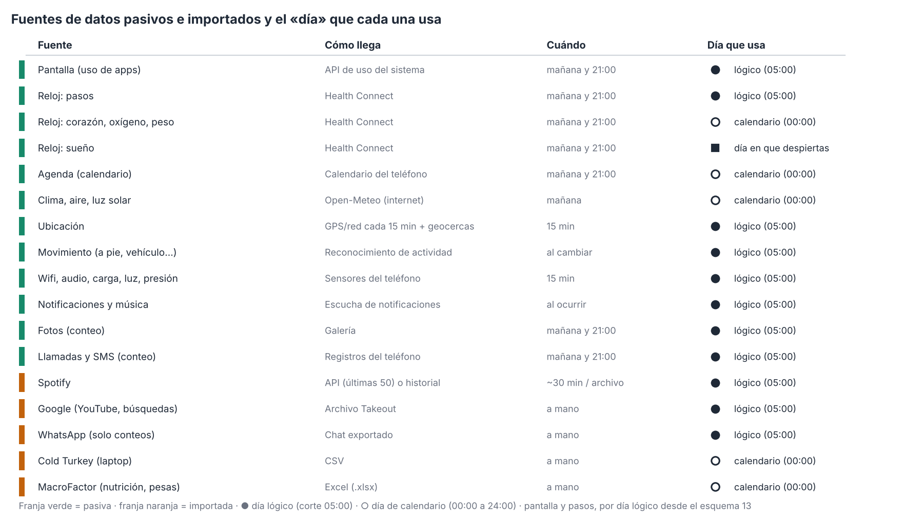
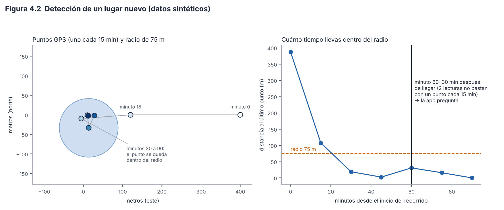
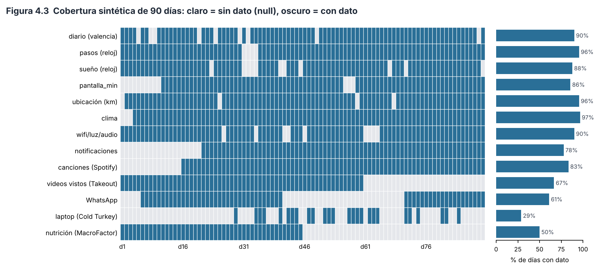

# Capítulo 4. Sensores, datos pasivos e importaciones

> **Para qué sirve este capítulo.** Explica, fuente por fuente, **qué mide la app sin que tú escribas nada** (datos *pasivos*) y **qué datos entran cuando tú cargas un archivo** (datos *importados*): qué dato es, cómo se obtiene exactamente, qué tan confiable es, qué hace la app cuando falta y a qué día se asigna. Se escribió sobre la v81 (commit `fa527df`) y está al día con el código de la v92 (la v91 más la entrega 10f; `SCHEMA_V = 15`), la versión que describe todo el paper; lo que cambió en el módulo 10 se marca «desde 10a…10d» (o «desde el esquema 13»), lo de la entrega 10e, posterior al módulo 14, «desde 10e», lo de la entrega 10f (las decisiones del autor sobre los hallazgos pendientes) «desde 10f», y todo está en el Apéndice D. Los ejemplos numéricos son **inventados**; no hay datos reales aquí.
>
> **Cómo leerlo.** Está escrito para entenderse sin ser experto, pero sin recortar la precisión: cuando una cifra o regla viene del código, se da tal cual (umbrales, ventanas de tiempo, mínimos). Cuando algo es una suposición mía o no pude comprobarlo, lo digo. Cada decisión se marca como **[Validado]** (respaldada por literatura o un estándar), **[Aproximación]** (razonable, pero con supuestos que conviene conocer) o **[Diseño propio]** (decisión de la app, sin estándar detrás). Los problemas encontrados se numeran H-3-n (el 3 es el número del módulo que los encontró, no del capítulo) y se detallan en `hallazgos.md`.

---

## 4.1 Mini-glosario (palabras que aparecen mucho)

| Término | Qué significa aquí |
|---|---|
| **Dato pasivo** | Lo que el teléfono o el reloj registran solos (pasos, pantalla, ubicación…). Tú no haces nada. |
| **Dato importado** | Lo que llega de un archivo que tú exportas de otro servicio y cargas en la app (Spotify, Google, WhatsApp…). |
| **Proxy** | Una medida *indirecta* de lo que de verdad nos interesa. Ejemplo: «luz fuerte del teléfono» es un proxy de «estuve al aire libre», porque no mide el aire libre, sino la luz. |
| **Mediana** | El valor del medio al ordenar una lista. Aguanta mejor los valores raros que el promedio. |
| **hPa** | Hectopascales, la unidad de presión del aire (a nivel del mar, ~1013 hPa). |
| **RMSSD** | Una forma de medir la variabilidad del corazón (sección 4.5.2). |
| **Día lógico** | El día de la app: empieza a las 05:00 (capítulo 2, sección 2.3). Un evento a las 01:00 cuenta para el día *anterior*. |
| **Día de calendario** | El día normal, de 00:00 a 24:00. |
| **Zona horaria y desfase con UTC** | La zona es la regla de hora de un lugar («America/Mexico_City»); el desfase, cuántas horas va ese lugar respecto a la hora universal (UTC): −6 en la Ciudad de México, +2 en Madrid en verano. Un mismo instante es las 15:30 en un sitio y las 23:30 en el otro (sección 4.3). |
| **Pulso** | La tarea que la app ejecuta cada ~15 minutos en segundo plano (sección 4.2). |

---

## 4.2 Cómo y cuándo llegan los datos

### 4.2.1 El «pulso» de 15 minutos

La app programa una tarea periódica (`Pulso`, con `PeriodicWorkRequestBuilder` de WorkManager) **cada 15 minutos**. En cada pulso hace, en este orden: guarda un punto de ubicación, toma una «muestra de percepción» (wifi, audio, carga, luz, presión), revisa si llevas rato en un lugar nuevo, consulta Spotify (si pasó al menos 25 minutos desde la última vez), decide si toca algún aviso y, una vez al día, sincroniza lo demás.

**Qué significa «cada 15 minutos» en la práctica.** 15 minutos es el **mínimo** que Android permite para tareas periódicas, y el sistema puede **retrasarlas** para ahorrar batería (por ejemplo, si el teléfono está en reposo profundo). Es decir, el pulso es una *intención*, no un reloj exacto. Por eso todos los cálculos de tiempo que dependen del pulso usan el tiempo *real* transcurrido entre una lectura y la anterior, no «15 minutos fijos» (sección 4.4.5).

### 4.2.2 La sincronización diaria

Una vez al día, después de las 06:00 (`Trabajo.kt`, función `diario`), la app trae del teléfono (desde el 5 nov 2026, cada paso se anota como hecho al terminar y no antes: si Android corta la tarea a los 10 minutos, el siguiente pulso sigue donde se quedó, con un máximo de dos intentos por paso; D.152), en este orden: reloj (últimos **3** días), pantalla (últimos **2** días), registra de nuevo las geocercas y el reconocimiento de actividad, fotos (3 días), agenda, llamadas/SMS (3 días), clima y un respaldo automático. A partir de las 21:00 hay una **segunda** pasada más corta (1 día de pantalla, reloj, fotos y llamadas, más la agenda). Además, una vez al mes (después de las 13:00) rellena la historia que guardan la galería (hasta 400 días con registro y sin conteo de fotos), el calendario y el registro de llamadas (hasta un año atrás), y pide clima atrasado (hasta 20 peticiones).

Hay un botón «Sincronizar todo ahora» (`Sincronizar.todo`): en Permisos y sensores lee 7 días; el de Estado de los datos, y los de Hoy y el Día, 3 días. Hay otros para rangos mayores.

**Por qué importa la ventana de 2–3 días.** Si la app no corrió durante más días (teléfono apagado, ahorro de batería agresivo), esos días **no se recuperan solos**. Para el reloj hay botones que leen hasta 30 días; para la pantalla, el botón manual calcula 7 días. Android conserva los eventos de uso por un tiempo limitado, así que el historial de pantalla de días lejanos puede ya no existir en el sistema (esto último es comportamiento de Android que conozco pero no pude comprobar en la documentación oficial durante esta sesión).

### 4.2.3 Permisos y el panel «Estado de los datos»

Cada fuente necesita un permiso del sistema. Sin permiso no hay dato, y la app **no inventa nada**: la variable queda vacía (`null`, capítulo 2, sección 2.6). La pantalla **Estado de los datos** (`EstadoDatos.kt`) reúne el estado de cada fuente en cuatro categorías: *Al día*, *Atrasada*, *Faltan permisos* y *Apagada*. Cada fuente tiene su tolerancia en días (por omisión 1: pantalla, clima, reloj; fotos y llamadas, 3; agenda, 7; notificaciones y wifi/luz, 0, es decir, deben haber llegado hoy).

**Razonamiento.** Saber *por qué* falta un dato es tan importante como el dato. Un hueco por «sin permiso» o «teléfono apagado» no es lo mismo que un hueco porque «no pasó nada», y confundirlos sesga el análisis (teoría de datos faltantes, capítulo 2). La pantalla de estado deja ver los huecos, pero **la app no guarda una marca de «hueco por permiso» en el panel**: el análisis ve solo una celda vacía (limitación L-4.1, sección 4.9).

*Figura 4.1. Fuentes de datos pasivos e importados: cómo llega cada una, cuándo se sincroniza y qué «día» usa. Esquema, sin datos. Script: `figuras/fig04_fuentes_datos.py`.*

---

## 4.3 Dos relojes: día lógico y día de calendario (¡lee esta sección!)

En el capítulo 2 vimos que la app define el «día» de 05:00 a 04:59. **Pero no todas las fuentes pasivas usan esa definición.** Según el código:

| Usan **día lógico** (05:00 → 04:59) | Usan **día de calendario** (00:00 → 24:00) |
|---|---|
| Ubicación (km del día), Movimiento, Wifi/audio/carga/luz/presión, Notificaciones, Música (Oyente), Fotos, Llamadas/SMS, Spotify, Google Takeout, WhatsApp, Kindle, ejercicio del reloj (día del inicio) y, **desde el esquema 13, Pantalla y pasos** | **Pantalla** (hasta el esquema 12), **Reloj** (pasos hasta el esquema 12; corazón, oxígeno, calorías…), **Agenda**, **Clima/aire** (por naturaleza son datos por día de calendario), **ciudades y países** (`Mundo`), Cold Turkey y MacroFactor (el archivo trae la fecha) |
| El **sueño** del reloj se asigna al **día en que despiertas** (fecha de calendario del final de la sesión). | |

**Ejemplo (inventado), como era hasta el esquema 12.** Un lunes te quedas usando el teléfono de 00:30 a 01:30 de la madrugada del martes.
- Esa hora de **pantalla** se sumaba al **martes** (calendario).
- Las **notificaciones** que llegaron a las 01:00 se cuentan para el **lunes** (lógico).
- El **wifi** de esa hora también va al **lunes**.

Resultado: dentro de una misma fila del panel (digamos «martes»), la pantalla incluía una hora que las notificaciones y el wifi del mismo martes *no* incluyen. Ese es el hallazgo **H-3-1** (gravedad alta, porque afecta justo las variables de uso nocturno, que son las más interesantes para el sueño).

**Por qué importa científicamente.** Cuando se cruzan dos variables medidas con ventanas distintas, parte de la relación (o de la falta de relación) viene de que «no hablan del mismo día». Para quien duerme tarde, el desfase es de varias horas.

**Qué ocurre en la práctica.** Para alguien que se duerme antes de la medianoche, ambos criterios casi coinciden y el efecto es pequeño. Para quien usa el teléfono de madrugada, el efecto es real. La propuesta del módulo 3 fue usar un solo criterio o, al menos, declarar el de cada variable; el módulo 10 hizo las dos cosas en parte (abajo). **[Aproximación]** mientras queden variables por calendario.

**Lo que cambió en el esquema 13 (entrega 10b; P-16 ii, decisión D-3 del autor).** La pantalla y los pasos pasan al día lógico de aquí en adelante. En el ejemplo, la hora de 00:30 a 01:30 de pantalla cuenta ahora para el **lunes**, igual que las notificaciones y el wifi. Cada día guarda qué ventana usó (`PantallaDia.ventana`, `SaludDia.ventana_pasos`: `"logica"` o `"calendario"`), y el panel exportado lleva `ventana_pantalla` y `ventana_pasos`, para analizar por separado los dos tramos de la serie. La app no recalcula por su cuenta los días de antes: Android solo guarda unos días de eventos de uso, y mezclar días recalculados con otros sin recalcular sería peor. Los botones manuales sí vuelven a calcular, con la ventana nueva, los días que cubren (7 de pantalla, hasta 30 del reloj), y esos días quedan marcados `"logica"`. Lo que **no** cambió: el corazón, el oxígeno y las demás lecturas del reloj (salvo pasos, sueño y ejercicio) siguen por día de calendario, y la agenda, el clima y las ciudades también. Desde la entrega 10c (P-16 i, D.64) eso queda declarado: el LEEME de la exportación lo dice y el diccionario marca «por día de calendario» en cada una de esas variables del panel (`Diccionario.CALENDARIO`); además, `lugares_distintos` pasó al día lógico. Por eso H-3-1 queda **resuelto en parte**.

Una consecuencia concreta (**H-3-2**), hasta el esquema 12: `primer_uso_h` (hora del primer uso del día) se calculaba con la ventana de calendario, así que el uso de las 01:00 de la madrugada aparecía como «primer uso» a la 01:00, no a la hora real en que te levantaste. Y la corrección «+24 si la hora es menor a 5» de `ultimo_uso_h` casi nunca llegaba a actuar, porque la ventana de calendario termina a las 24:00. Desde el esquema 13, con la ventana del día lógico, el primer uso es el de después de las 05:00 y la corrección sí actúa (`Estadistica.panel`); los días anteriores quedan como estaban y se reconocen por `ventana_pantalla`.

**La hora local de entonces (desde 10f; H-1-7, D.109 y D.110).** Además del corte del día, importa **en qué zona horaria** se lee cada hora. Casi todo lo que guarda el teléfono es un **instante** (milisegundos desde 1970, igual en todo el mundo); la hora y el día salen de convertir ese instante con una zona. Hasta la v91, `Fechas.zona()` era la zona que el teléfono tiene **hoy** (`ZoneId.systemDefault()`), y con ella se convertía todo, también lo de hace meses (H-1-7).

*Ejemplo (inventado).* Vives en UTC−6 y pasas una semana en Madrid (UTC+2). Allá te duermes a las 23:30, hora de Madrid. El reloj guarda la hora de dormir con su desfase (`…T23:30:00+02:00`). Al volver, la app convertía esa marca a la zona de hoy: 15:30, y `sueno_inicio_h` salía 15.5 en vez de 23.5. Del mismo modo, un punto de ubicación de las 09:00 del miércoles en Madrid (01:00 del miércoles en UTC−6) pasaba a contar para el día lógico del **martes**.

**Cómo es desde 10f.**
- **El historial de zonas.** La app guarda cada cambio de zona del teléfono en `Config.zonas`: una lista de «desde este instante, esta zona» (`CambioZona`). `Repo.registrarZona` anota la zona si cambió: al abrir la app, en cada pulso de 15 minutos y cuando Android avisa de un cambio de zona (`TIMEZONE_CHANGED`, en `ArranqueReceiver`).
- **Cada instante con su zona.** `Fechas.zonaEn(ms)` busca en el historial la zona que regía en ese instante; antes del primer cambio guardado usa la primera zona de la lista, y con el historial vacío, la de hoy. Con ella se calculan la hora local (`local`), el día de calendario (`diaDeMillis`), el día lógico (`diaLogicoDeMillis`) y la marca ISO (`isoDeMillis`).
- **Al revés: de una hora local a un instante.** `Fechas.millisDe` usa la zona que regía ese día. Así se calculan los bordes de cada día (`inicioDiaLogico`, `finDiaLogico`, `inicioDia`, `finDia`), cada uno con la zona de esa hora. Por eso un día con cambio de horario dura 23 o 25 horas, y el día de un viaje, las horas que toque: de UTC−6 a UTC+2, un día lógico dura 16 horas.
- **Las marcas con desfase y las marcas en UTC.** Una nota guardada con su desfase se lee con **ese** desfase (`localDe`, `horaDe`, y en el panel `Exportar.horaDecimal`). Una marca en UTC (las que traen las importaciones, como el historial de Spotify) se pasa a la zona de entonces.

**Lo guardado antes del historial.** La primera vez, `registrarZona` arma el historial con lo que ya hay: revisa las marcas de los momentos, las respuestas, las reacciones y las tomas de suplementos, en orden. Si **dos o más notas seguidas** traen un desfase que la zona de hoy no daría en ese instante, ese periodo queda con ese desfase (un desfase fijo, como «+02:00»); todo lo demás, con la zona de hoy. Una nota suelta con un desfase raro (por ejemplo, editada en otra zona) no abre un periodo. **[Diseño propio]**: reconstruye bien los viajes en que escribiste al menos dos notas; uno sin notas, o con una sola, se queda con la zona de hoy.

**Las marcas en la exportación.** `vm_panel.csv` trae `desfase_utc_h` (el desfase con UTC a mediodía de ese día, `Fechas.desfaseH`: −6 en la Ciudad de México) y `cambio_horario` (1 si el desfase al empezar el día lógico no es el mismo que al terminar, `Fechas.cambioDeHora`: horario de verano o viaje). El Día lo dice debajo de la fecha, por ejemplo «cambio de horario: de UTC−6 a UTC+2 · el día duró 16 h». En R, `vm_hora_local(ts)` da la hora de una marca con su propio desfase (7.5 = 7:30); `vm_fecha_hora` sigue pasando todo a `vm_zona` (es el mismo instante, mostrado con otra hora).

**Quiénes lo usan.** Health Connect, la pantalla, las fotos, WhatsApp, Kindle, las ubicaciones, Spotify y Google, además de la tabla por hora, la cinta y la estadística (cada ficha lo dice abajo).

**Cuándo falla.**
- Es la zona **del teléfono**, no la tuya: si el teléfono no ajusta la hora solo al viajar, la app no se entera del viaje.
- Si Android no avisa del cambio, se anota en el siguiente pulso o al abrir la app. Lo de ese rato queda con la zona anterior.
- Lo que el teléfono ya había guardado **por día** antes de 10f (sueño, pasos, pantalla, notificaciones, wifi) se calculó con la zona que tenía al sincronizar o al anotarlo, y no se recalcula. Lo que sí cambia es lo que la app saca de un instante al leer: las horas del panel, la tabla por hora, los kilómetros por día y los días del Mundo.
- Los días de 23 o 25 horas (y los de un viaje) acumulan más o menos minutos que un día normal en las variables que suman tiempo. `cambio_horario` permite separarlos.
- No se probó en un teléfono que llegue el aviso `TIMEZONE_CHANGED` (Apéndice D, D.118: solo hay pruebas JVM del historial y de los bordes del día).

Mientras el teléfono no cambie de zona, nada de esto mueve una sola cifra.

---

## 4.4 Fuente por fuente: teléfono

Cada ficha responde: **qué mide · cómo lo hace exactamente · qué tan confiable es · qué pasa si falta**.

### 4.4.1 Pantalla (`sensores/Pantalla.kt`)

**Qué mide.** Cuánto tiempo estuvo en primer plano cada app, cuántas veces desbloqueaste el teléfono, cuándo fue el primer y último uso y cómo se reparte el uso por hora.

**Cómo lo hace.** Android guarda una bitácora de eventos de uso («esta app pasó a primer plano», «esta app salió», «se apagó la pantalla», «se quitó el bloqueo»). La app recorre los eventos del día y arma «tramos»:

1. Cuando una app pasa a primer plano (`ACTIVITY_RESUMED`), cierra el tramo anterior y abre uno nuevo. **No cuenta** el lanzador (la pantalla de inicio) ni la propia Vestigium Mei.
2. El tramo termina cuando esa app sale (`ACTIVITY_PAUSED`), cuando la pantalla se apaga (`SCREEN_NON_INTERACTIVE`) o al final de la ventana.
3. Los **desbloqueos** son los eventos `KEYGUARD_HIDDEN` (se quitó el bloqueo de pantalla).
4. `total_min` = suma de todos los tramos, entera, **sin descartar nada**. La lista `por_app_min` guarda solo apps con **≥ 1 minuto** y como máximo **40** apps.
5. Cada tramo se reparte entre las horas que cruza (`por_hora_min`, 24 valores).

**Ejemplo (inventado).**

| Evento | Hora |
|---|---|
| App A a primer plano | 22:10 |
| App B a primer plano (A sale) | 22:40 |
| Pantalla se apaga | 23:10 |

Resultado: A = 30 min, B = 30 min, total 60 min. Por hora: 22:00–23:00 → 50 min (30 de A + 20 de B), 23:00–24:00 → 10 min (de B).

**Qué es y qué no es.** Es **tiempo de apps en primer plano**, no «pantalla encendida». Un video que se ve sin tocar la pantalla cuenta mientras la app esté al frente; un teléfono con pantalla encendida en la pantalla de inicio **no cuenta** (porque el lanzador se excluye). Por eso **no coincidirá exactamente** con «Bienestar digital» u otras apps, que pueden definir el tiempo de otra manera. **[Diseño propio]** la definición.

**Relación con el autorreporte.** Una revisión sistemática de 106 tamaños de efecto encontró que lo que la gente *dice* que usa los medios digitales **solo se correlaciona moderadamente** con lo que registran los dispositivos, y que los autorreportes rara vez reflejan con exactitud el uso real (Parry et al., 2021). Esa es la razón principal para medirla de forma pasiva. **[Validado]**.

**Día y cobertura.** Hasta el esquema 12, ventana de **calendario** (H-3-1, H-3-2). Desde el esquema 13, ventana del **día lógico**: de las 05:00 de ese día a las 05:00 del siguiente, y en `por_hora_min` las horas 0 a 4 son de la madrugada siguiente. La sincronización recalcula el día lógico de hoy y el de ayer (2 días). Desde 10f (D.109), los bordes de la ventana y el reparto por hora usan la zona que tenía el teléfono en cada instante (`Fechas.zonaEn`, sección 4.3): en un día de 25 horas, la hora que se repite suma sus dos vueltas en el mismo casillero de `por_hora_min`, y en uno de 23, la hora que se salta queda en 0. `primer_uso_h` y `ultimo_uso_h` se leen con el desfase guardado en cada marca.

**Cuando falta.** Sin permiso de «acceso a uso», la función devuelve nulo y esa fecha no se guarda.

#### Variables derivadas del sueño y el teléfono (`cama_min`, `dormir_tras_tel_min`, `tel_tras_despertar_min`)

Solo si el reloj registró el sueño de esa noche (`sueno_inicio`, `sueno_fin`):

- `cama_min` = minutos de pantalla en la **última hora antes de dormirte**.
- `dormir_tras_tel_min` = minutos entre que **soltaste el teléfono** (fin del último uso en las 3 horas antes de dormir) y te **dormiste**.
- `tel_tras_despertar_min` = minutos entre que **despertaste** y tomaste el teléfono (primer uso en las 4 horas siguientes).

*Razonamiento.* El uso de pantalla antes de dormir es una hipótesis frecuente en la investigación del sueño (luz, activación mental). Aquí se calcula el dato para *cruzarlo* con tu sueño, no para afirmar causalidad. **[Aproximación]**: la hora de dormir del reloj es una estimación (sección 4.5.1), así que estas variables heredan su error.

### 4.4.2 Ubicación (`sensores/Ubicacion.kt`)

**Qué guarda.** Puntos con hora, latitud, longitud, precisión (en metros) y la fuente («app», «geocerca», «foto», «foto_takeout», «maps», «takeout»…), en la tabla `ubicaciones`.

**Cómo lo obtiene.**
- **Muestra de fondo:** en cada pulso (cada ~15 min), si tienes el permiso de ubicación *en segundo plano* y el muestreo está activo, pide una lectura de **potencia equilibrada** (`PRIORITY_BALANCED_POWER_ACCURACY`: en general usa wifi y antenas antes que encender el GPS; gasta poca batería, pero es menos precisa). Espera hasta 10 s; si no responde, usa la última ubicación conocida y cancela la petición (antes seguía buscando señal). Desde el esquema 19, un punto que ya está guardado (misma hora, latitud y longitud) no se vuelve a guardar (`Db.ponerMuestra`): la «última ubicación conocida» suele ser la misma varios pulsos seguidos, y antes quedaba repetida una vez por pulso. Lo mismo vale para el punto que trae cada aviso de geocerca.
- **Geocercas:** para cada lugar guardado (hasta **95**; Android permite 100 por app) registra un círculo con radio `max(radio del lugar, 80 m)`. Android avisa al **entrar** y al **salir**. Eso crea o cierra «visitas» sin gastar mucha batería. (El código también fija una «espera» de 2 minutos, pero esa espera solo aplica a un tipo de aviso, «permanencia», que la app no pide; por eso no tiene efecto.) Las geocercas se registran una vez al día, al encender el teléfono, al cambiar los lugares y cuando la app deduce una salida (4.4.3). Desde el esquema 19 ya **no** se registran cada vez que arranca el proceso de la app (lo arrancan también cada pulso y cada widget), salvo que los lugares hayan cambiado o haya pasado un día: al quitarlas y ponerlas de nuevo, una salida que pasara justo en ese momento se perdía. Al registrarlas, Android avisa también de los lugares donde **ya no** estás (`INITIAL_TRIGGER_EXIT`), lo que cierra una visita que quedó abierta.

**Precisión.** El campo `precision` es la estimación que da Android del error. Según la documentación de Android para `Location.getAccuracy` (Android Developers, s. f.), es el **radio horizontal con 68 % de confianza**: hay 68 % de probabilidad de que la posición verdadera esté dentro de un círculo de ese radio alrededor del punto. Con potencia equilibrada es normal ver errores de decenas o cientos de metros; por eso la detección de lugares ignora puntos con precisión peor a **120 m** (4.4.3). Un punto **sin** precisión (los importados de Google Maps, 4.6.7) cuenta desde la entrega 10d como de **100 m** (`Db.PRECISION_SIN_DATO`), no de 0 m. Así lo leen la detección de lugares (`Lugares.estancia`), `Db.recorrerUbicaciones` (el mapa y el Mundo) y la ruta del mapa. Antes, `COALESCE(precision, 0)` lo trataba como un punto perfecto. Los 100 m son una cifra prudente propia, sin estándar detrás. **[Diseño propio]**. Con los umbrales actuales (120 m para lugares, 150 m para la ruta, 500 m y 1 000 m para el mapa y el Mundo), un punto así **sigue entrando** en todos: el cambio corrige lo que el valor significa y deja de presentarlo como exacto, pero no cambia por sí solo ningún resultado.

**Nota.** Hasta el esquema 18, el código **insertaba siempre** un punto por pulso, aunque fuera el mismo de antes (**H-3-8**, inciso a). Además de hacer crecer la tabla, el mismo punto viejo repetido varias horas pesaba de más en todo lo que cuenta puntos. Desde el esquema 19 no se repite, y una corrección única quitó los repetidos ya guardados de las fuentes del propio teléfono («app», «geocerca», «momento»; se queda el primero de cada uno). No toca los puntos importados ni los de fotos.

#### Distancia recorrida (`distancia_km`)

`Movilidad.kmPorDia` (`ciencia/Estadistica.kt`) recorre **todos** los puntos en orden (de cualquier fuente) y, para cada par consecutivo, suma la distancia en línea recta (fórmula del *haversine*, radio terrestre 6 371 km) **si**:
1. el tiempo entre los puntos está entre **1 segundo y 2 horas**,
2. la velocidad implícita es menor a **70 m/s** (252 km/h: descarta saltos imposibles), y
3. la distancia es mayor a **30 m** (descarta el «temblor» del GPS quieto).

La distancia se asigna al **día lógico** del segundo punto (desde 10f, con la zona que tenía el teléfono en ese instante, sección 4.3; también la hora `ts` de `vm_ubicaciones.csv`). Desde la entrega 10c (P-15, D.63), un día con puntos de ubicación pero sin ningún tramo que cuente vale **0 km**, no «sin dato».

*Cómo interpretarlo.* Es una **cota inferior**: la línea recta entre dos puntos siempre es ≤ el camino real, y los tramos con huecos de más de 2 horas se pierden. Además, mezcla puntos de varias fuentes con precisiones distintas (fotos, importaciones de Maps), y cuánto se queda corta depende de cuántos puntos haya ese día: un día con pulsos retrasados o con huecos pierde más camino que uno bien muestreado. Úsala para comparar días entre sí con esa cautela, no como los kilómetros reales. **[Aproximación]** (**H-3-5**, resuelto por documentación: la propuesta era describirla como cota inferior, que es lo que hace este párrafo; la app no pondera ni filtra los puntos por fuente).

### 4.4.3 Lugares y visitas (`data/Lugares.kt`)

**Qué hace.** Cuando llevas un rato en un sitio que no tienes guardado, la app te pregunta si es un «lugar especial». Al guardarlo, reconstruye las visitas pasadas y luego las geocercas lo vigilan.

**Regla exacta de detección** (función `estancia`; parámetros de la configuración: radio **75 m** y **20 min** por omisión, con topes de 30–300 m y 10–120 min):

1. Toma los puntos de ubicación de la **ventana** (tiempo configurado + 45 min), **sin fotos**, con **precisión ≤ 120 m**.
2. Hacen falta **≥ 2 puntos** y el último debe tener **≤ 25 min** de antigüedad.
3. Desde el último punto va hacia atrás **mientras cada punto esté a ≤ 75 m del último** (no del centro del grupo).
4. Si ese tramo tiene ≥ 2 puntos y dura **≥ 20 min** → candidato. El centro es el promedio de lat/lon del tramo.
5. Se descarta si ya está cerca de un lugar guardado (distancia ≤ radio del lugar + radio/2) o de uno ignorado.

**Reglas para no molestar** (`revisar`): solo entre **08:00 y 22:00**; **máximo 2 preguntas al día**; un mismo sitio (a ≤ 150 m de un candidato anterior) se pregunta **máximo 3 veces**, y después de cada pregunta (la respondas con «ahora no» o no) espera **3 días**.

**Un detalle importante (con ejemplo).** Como los puntos llegan *aproximadamente cada 15 minutos*, con solo 2 puntos (15 min de diferencia) no se llega a 20 min. En la práctica, se necesitan **3 lecturas dentro del radio**, es decir, **~30 minutos** de permanencia. La Figura 4.2 lo muestra con datos inventados: llegas en el minuto 30 del recorrido y la app pregunta en el minuto 60.

*Figura 4.2. Detección de un lugar nuevo con datos sintéticos: un punto cada 15 minutos y un radio de 75 m; la app pregunta en el minuto 60, 30 minutos después de llegar. Script: `figuras/fig05_deteccion_lugar.py`.*

**Reconstrucción de visitas** (`reconstruir`, 30 días hacia atrás; el cálculo está en `reconstruirEn`): recorre los puntos; cada racha de puntos dentro del radio del lugar (**mínimo 60 m**) es una visita; huecos de hasta **2 horas** dentro del radio no la rompen; **solo cuentan visitas de ≥ 8 minutos** (10 hasta el esquema 18) y no se duplican con las existentes. Su salida queda marcada como `reconstruida`.

**Cuándo termina una visita** (esquema 19, decisiones del autor del 5 nov 2026). Android no siempre avisa la salida de una geocerca: con el teléfono en reposo o con mala señal el aviso puede llegar tarde o no llegar. Hasta el esquema 18, una visita sin aviso de salida quedaba **abierta** hasta la siguiente salida de ese mismo lugar, aunque mientras tanto hubieras ido a otros lugares; y como Android seguía creyendo que estabas dentro, tampoco avisaba cuando volvías. Desde el esquema 19 la salida se deduce con tres reglas:

1. **Llegar a un lugar lejano** (`Repo.entrada`) cierra la visita abierta de otro lugar si sus círculos vigilados no se tocan (`Lugares.lejos`: distancia entre centros > suma de los radios, cada uno de al menos 80 m). Si un lugar está dentro de otro (un gimnasio dentro del campus), estar en uno no te saca del otro.
2. **Tus ubicaciones** (`Lugares.salidaPorUbicaciones`): la salida es el primero de **dos puntos seguidos** fuera del círculo vigilado aun restando su imprecisión (distancia − precisión > radio). Solo cuentan puntos con precisión de **150 m** o mejor; a los que no la traen se les supone 100 m. Un punto suelto fuera no basta, porque puede ser un brinco del GPS. Esta regla se aplica en cada pulso a las visitas abiertas (`cerrarAbiertas`) y también al llegar a otro lugar, si da una hora anterior.
3. **Un aviso de salida tardío** (`Lugares.salidaAvisada`): si tus ubicaciones dicen que saliste al menos **15 minutos** antes del aviso, vale esa hora.

Cuando la app deduce una salida, vuelve a registrar las geocercas para que Android avise la próxima entrada. Si mientras tanto ya habías vuelto, esa vuelta sale de tus ubicaciones con `reconstruirEn`.

**Mínimo de 8 minutos.** Una visita cerrada de menos de **8 minutos** (`VISITA_MINIMA_MS`) se quita: pasar cerca en coche o un brinco del GPS. Si esa visita falsa había cerrado al empezar la de otro lugar donde en realidad seguías (regla 1), esa visita se vuelve a abrir. El autor eligió 8 minutos (5 nov 2026), y el mismo mínimo vale para las visitas reconstruidas.

**Cómo se supo la salida** (`Visita.cierre`, columna `cierre` de `vm_visitas.csv`): `geocerca` (avisó Android), `otro_lugar` (regla 1), `ubicaciones` (reglas 2 y 3), `reconstruida`, `manual` (la corregiste tú) o vacío (abierta, o anterior al esquema 19 y sin corregir). Sirve para separar en R las salidas medidas de las deducidas.

**Corrección de lo ya guardado** (una sola vez, `limpiarVisitasPasadas`). El autor decidió corregir también la historia. Primero se quitan las visitas de menos de 8 minutos. Luego, a cada visita se le aplican las reglas 1 y 2, y solo se cambia si la salida deducida es anterior: con la regla 2, al menos 15 minutos antes de la que tenía. Las que quedan de menos de 8 minutos también se quitan. Por último, el tramo liberado (entre la salida nueva y la vieja) se reconstruye con tus ubicaciones, por si volviste al mismo lugar.

*Ejemplo (datos inventados).* Llegas a casa el lunes a las 19:00. El martes sales a las 08:30, pero Android no avisa. A las 09:10 la geocerca del trabajo avisa la entrada; trabajas y regresas a casa a las 20:00, sin aviso, porque Android te creía en casa. El miércoles a las 08:00, al salir, sí avisa. Hasta el esquema 18 había una sola visita a casa de 37 h, encimada con la del trabajo. Con estas reglas pasa esto:
- Si los puntos de las 08:40 y las 08:55 ya te ponen fuera, la visita termina a las 08:40 (`ubicaciones`). Si no, termina a las 09:10 (`otro_lugar`).
- De 20:00 a 08:00 se reconstruye otra visita a partir de tus puntos (de 20:05 a 07:50, por ejemplo).
- En total suman unas 25 horas en casa en lugar de 37.

**[Diseño propio]**. Las reglas usan el mismo radio que la geocerca y la misma idea de estancia que la detección de lugares; los 15 minutos y los dos puntos seguidos son umbrales propios, sin validación externa.

*Cuándo falla.* (a) Si en casa los puntos son muy imprecisos, dos puntos seguidos «fuera» pueden cerrar la visita aunque sigas ahí. Se pierde el tiempo hasta el siguiente aviso o hasta que `reconstruirEn` encuentre puntos dentro. (b) Sin puntos (muestreo apagado, sin permiso en segundo plano), solo queda la regla 1. (c) La salida deducida por puntos cae, como mucho, un intervalo de muestreo (~15 min) después de la real: es una cota tardía.

**Corregir lugares y visitas** (desde la entrega N7 de la revisión de navegación, H-NAV-4). Un lugar guardado se puede renombrar, cambiar de radio o quitar. Agrandar el radio vuelve a llamar a `reconstruir` (30 días), que solo agrega visitas que no se enciman con las existentes; achicarlo no quita las que ya hay. Al quitar un lugar se pregunta qué pasa con sus visitas: pasarlas a otro lugar o quitarlas (`Repo.borrarLugar(id, pasarA)`, `Lugares.reasignar`); ya no quedan visitas que apuntan a un lugar que no existe. Se puede, además, ignorar el sitio para siempre. En el Día, cada visita aparece en «Tu día» y se corrige con «fue en…» (otro de tus lugares) o «no estuve aquí». *Límite:* «no estuve aquí» no se recuerda; si después agrandas el radio de ese lugar, `reconstruir` podría volver a crear esa visita. **[Diseño propio]**.

**Tipos de lugar y tiempo por tipo.** Cada lugar tiene un tipo (casa, trabajo, bar…). `minutosPorTipo` reparte cada visita entre los **días lógicos** que cruza (desde el esquema 19, cortando en `Fechas.finDiaLogico`, con la zona horaria: antes cortaba a medianoche + 5 h de reloj, y la noche en que se atrasa el reloj eso caía a las 04:00), descarta visitas de más de **40 días** (error probable) y limita cada día a **1 440 min** (24 h). La app también estima la **valencia media por tipo de lugar** (sin momentos privados).

**Razonamiento.** Detectar *estancias* (*stay points*) con un radio y un tiempo mínimo es la técnica estándar de la minería de trayectorias GPS (Zheng, 2015). La app usa una versión simple: sin agrupamiento por densidad y con el último punto como referencia. **[Aproximación]**.

**Cuándo falla.** (a) Interior de edificios: el GPS «salta» y la precisión es mala (se filtra a ≤ 120 m, pero un salto de 100 m dentro de un edificio grande sigue pasando). (b) Lugares de menos de 30 minutos (una tienda rápida) **no se detectan**. (c) Dos lugares a menos de ~75 m se funden. (d) El nombre sugerido viene del servicio de direcciones del teléfono (*geocoder*), si responde.

### 4.4.4 Movimiento (`sensores/Actividad.kt`)

**Qué mide.** Cuántos minutos del día pasaste «a pie», «corriendo», «en bici», «en vehículo» o «quieto».

**Cómo.** La app se suscribe al **reconocimiento de actividad** de Android (Google Play Services): el sistema avisa cada vez que *empieza* o *termina* una actividad. La app guarda el tipo y la hora de inicio y, al llegar el siguiente aviso, **suma los minutos** al día. Reglas:

- Un tramo se parte en el corte de las **05:00** (día lógico).
- **Se ignora cualquier tramo de más de 20 horas** (probable aviso perdido).
- Los avisos se ordenan por su marca de tiempo del sistema.
- **Al encender el teléfono, el tramo abierto se descarta** (desde el 6 nov 2026, D.159; `ArranqueReceiver`). Antes seguía abierto mientras el teléfono estuvo apagado, y al llegar el siguiente aviso se sumaba todo ese rato (por ejemplo, 8 horas «en vehículo» que no pasaron), siempre que fueran menos de 20 horas. Como no se sabe a qué hora se apagó, ese último tramo se pierde. **[Diseño propio]**.

**Razonamiento y confiabilidad.** Es un clasificador del propio Android (no controlado por la app) que combina acelerómetro y otros sensores. Funciona bien para distinguir «quieto / a pie / vehículo» y peor para matices. No hay una validación publicada en esta app. **[Aproximación]**. «Quieto» es especialmente ambiguo (teléfono sobre la mesa mientras tú caminas por otro lado). Las variables `a_pie_min` y `vehiculo_min` entran al panel.

### 4.4.5 «Percepción»: wifi, audio, música, carga, luz, presión (`sensores/Percepcion.kt`)

Cada pulso toma una **muestra** del estado del teléfono. Las variables resultantes no son *mediciones continuas*, sino **estimaciones por muestreo**.

**La regla de los minutos («mantener el último estado»).** Cada muestra atribuye al día **el tiempo transcurrido desde la muestra anterior**, como si el estado actual hubiera durado todo ese tiempo:

- Si no había muestra previa → **15 min**.
- Si pasaron **más de 2 horas** → solo **15 min** («para no inventar»).
- En otro caso → los minutos reales, **con tope de 60**.

**Ejemplo (inventado).** Muestras a las 10:00, 10:16, 10:31 y 12:45.

| Muestra | Tiempo desde la anterior | Minutos que se cuentan |
|---|---|---|
| 10:00 | más de 2 h (la anterior fue de la noche) | 15 |
| 10:16 | 16 min | 16 |
| 10:31 | 15 min | 15 |
| 12:45 | 134 min (> 2 h) | **15** (no 134) |

Total: 61 min contados. Entre 10:31 y 12:45 pasaron 134 min, pero solo 15 se contaron. La app prefiere **subestimar** a inventar. Consecuencia clave: `wifi_min + sin_wifi_min` (más `wifi_sin_dato_min`, desde 10f) **no suma 1 440**; son **«minutos observados»**, no minutos del día. Un día con el teléfono apagado seis horas simplemente tiene menos minutos. Esto es un **sesgo de subestimación conocido** y deliberado. **[Diseño propio]** (similar a la lógica de «último valor conocido» de la minería de series de tiempo; no tiene un referente estándar específico).

**Qué se mide en cada muestra** (todas con *try/catch*: si algo falla, esa pieza queda vacía):

| Variable | Qué hace exactamente |
|---|---|
| **Wifi** | Desde 10f (D.112; `Percepcion.wifi`), cada muestra cae en uno de tres casos. **Con wifi**: alguna red activa es wifi según `ConnectivityManager` (`TRANSPORT_WIFI`), o la conexión tiene red o dirección IP; se suma a esa red por su nombre (SSID) o, si Android lo oculta, a «wifi (sin nombre)». **Sin wifi** (`sin_wifi_min`): el wifi está apagado o el sistema dice que ninguna red activa es wifi. **Sin dato** (`wifi_sin_dato_min`, en `vm_conexiones.csv`): no se pudo saber (el sistema no respondió o la lectura falló). **[Diseño propio]** los tres casos. *(H-3-7: hasta la v91, «no hay información» y «no hay red» iban juntos a `sin_wifi_min`, que podía inflarse; desde 10f puede bajar, así que los días de antes y de después no son del todo comparables. Que `ConnectivityManager` responda así cuando Android esconde el nombre no se probó en un teléfono.)* |
| **Audio** | Dispositivos de salida activos: audífonos (cable, USB o Bluetooth clase «headphones»), coche (Bluetooth clase «car audio/handsfree»), bocina, USB, pantalla HDMI, «bluetooth» genérico. Se guarda la categoría y el **nombre** del dispositivo. |
| **Música** | `isMusicActive` del sistema de audio: ¿suena algo ahora? |
| **Carga** | ¿Está enchufado? Más **carga nocturna**: si se enchufó entre las **20:00 y las 04:00** y estuvo enchufado **> 3 h y < 16 h**, se guarda inicio y fin como marca aproximada de cuándo dormiste. |
| **Batería** | Suma de niveles y mínimo del día. |
| **Luz** | Una lectura del sensor de luz (hasta 1.5 s de espera), **si** la opción está activa. Guarda suma por hora, máximo, y **`luz_alta_min` = minutos con ≥ 1 000 lux**. |
| **Presión** | Una lectura del barómetro **si la opción está activa y el teléfono tiene sensor**; se **descartan lecturas fuera de 300–1 100 hPa** (`Percepcion.RANGO_HPA`, desde la entrega 10d; antes, 850–1 090 hPa). Guarda suma, cantidad, mínimo, máximo y el **cambio de presión en ~3 horas** (ver abajo). |

**Sobre la luz.** Un sensor de luz de teléfono mide dentro del bolsillo o sobre la mesa, no donde están tus ojos. Por eso `luz_alta_min` **subestima** el tiempo al aire libre. La app lo compensa en `aire_libre_min` (capítulo 2) tomando el **máximo** entre la luz alta y el tiempo a pie/corriendo/en bici, un **proxy** razonable pero no medición. Los 1 000 lux son un umbral práctico (por referencia, el exterior de día suele ser de miles a decenas de miles de lux y una oficina bien iluminada ronda cientos), **regla propia, sin estándar detrás**. **[Aproximación]**.

**Sobre la presión y la altitud (hallazgo H-3-3, resuelto en 10d).** Hasta la entrega 10d, el filtro era 850–1 090 hPa, para descartar «lecturas absurdas». Pero 850 hPa corresponde a unos **1 450 m** sobre el nivel del mar en una atmósfera estándar. En una ciudad más alta, la presión *normal* es menor que 850 hPa, y **todas** las lecturas se descartaban, dejando sin datos todas las variables de presión. La gravedad era **alta si se vive por encima de ~1 450 m y ninguna más abajo**; no sé a qué altitud vive la persona usuaria, así que quedó como condicional.

**Corregido en la entrega 10d (P-33, D.85).** El filtro pasó a **300–1 100 hPa** (`Percepcion.RANGO_HPA`, que aplica `Percepcion.presion`). Es el rango de medida de dos sensores de presión comunes en teléfonos, comprobado en sus hojas de datos en la sesión de la entrega 10d. El BMP280 de Bosch mide de 300 a 1 100 hPa (revisión 1.26, «*handsets such as mobile phones*»; Bosch Sensortec, 2021). El LPS22HB de ST mide de 260 a 1 260 hPa (DocID027083, revisión 5; STMicroelectronics, 2016). 300 hPa equivale, en atmósfera estándar, a unos 9 000 m, así que ya no se pierde ninguna ciudad habitada. Lo que se descarta sigue siendo lo imposible: un cero o un valor basura del sensor. Qué sensor trae tu teléfono **no lo comprobé**: si fuera otro modelo con un rango más estrecho, el filtro dejaría pasar lecturas que ese sensor no garantiza. **[Aproximación]**. Efecto: si vives o viajas por encima de ~1 450 m, aparecen lecturas de presión que antes se descartaban todas; por debajo, nada cambia.

**Cambio de presión en 3 horas.** Se guardan las lecturas de las últimas 4 horas; la comparación usa la lectura más cercana a **hace 3 horas** entre **2.5 y 3.5 h**. Del día se queda el cambio con **mayor valor absoluto, con signo** («las bajadas bruscas son las que se notan»). Es una hipótesis popular (los cambios de presión y el dolor o el ánimo), pero la evidencia es mixta; aquí se mide para *poder cruzarlo*, no para afirmarlo.

**Calibración del barómetro** (`data/Barometro.kt`). La presión de un sensor de teléfono tiene un **sesgo constante** (cada sensor «lee» unos hPa de más o de menos). La app (`Barometro.ajuste`) toma los **60 días más recientes con ≥ 8 lecturas** del sensor; de ellos, los que tienen presión de Open-Meteo (clima) y una diferencia < 150 hPa. Calcula la **mediana de las diferencias** (Open-Meteo menos la media del sensor) y se la suma a la media del sensor. Necesita **≥ 3 días**. El resultado se parece a la presión meteorológica del lugar, y los *cambios* del día conservan la precisión del sensor.

*Razonamiento.* Si el sesgo es constante, la **diferencia** entre dos lecturas (el cambio de presión) no se ve afectada; solo se corrige el nivel absoluto para que se pueda comparar con datos de clima. **[Diseño propio]**, lógica razonable.

**Qué NO hace.** No «escucha» (no hay micrófono aquí), no guarda contraseñas de wifi. Sí guarda **nombres de redes wifi y de dispositivos Bluetooth** (revisar en el capítulo de privacidad).

### 4.4.6 Ruido del ambiente (`sensores/Ambiente.kt`)

**Qué hace.** Cuando registras algo (un momento, un aviso), puede escuchar el micrófono **1.5 segundos**, calcular un nivel y **descartar el audio**.

**Cómo.** Graba a 16 000 muestras por segundo, **ignora el primer cuarto de segundo** (el micrófono se estabiliza), calcula la **raíz del promedio de los cuadrados (RMS)** de las muestras restantes y convierte:

> `dB = 20 · log10( RMS / 32768 ) + 90`

(32768 es el valor máximo de una muestra de 16 bits; el «+90» desplaza la escala para que quede positiva).

**Ejemplo (inventado).** Si el RMS es 328 (≈ 1 % del máximo): 20·log10(0.01) = −40 → −40 + 90 = **50**. Con RMS 33 (0.1 %): −60 + 90 = **30**.

**Qué es y qué NO es.** Es un **nivel relativo**, no decibeles de presión sonora (dB SPL). Los micrófonos de teléfono no están calibrados, tienen control automático de ganancia y filtran frecuencias. Las pruebas con apps de sonómetro para teléfono muestran que algunas se acercan a un sonómetro profesional y otras no, y que **la precisión varía mucho entre dispositivos y apps** (Kardous y Shaw, 2014). El propio código lo reconoce: es «útil para comparar tus lugares entre sí», no para medir ruido real. **[Aproximación]**. La variable `ruido_db` del panel es la media de las lecturas del día.

### 4.4.7 Notificaciones y música (`sensores/Oyente.kt`)

**Notificaciones.** Un servicio del sistema (`NotificationListenerService`) recibe un aviso cada vez que llega una notificación. La app **solo anota** de qué app y a qué hora (suma al día lógico por app y por hora). **No lee ni guarda el texto.**

Qué **no** cuenta: notificaciones de la propia app, notificaciones «en curso» (`isOngoing`, como el reproductor de música fijo), resúmenes de grupo, y **actualizaciones de la misma notificación** (misma clave) si ocurren en **menos de 60 segundos** o si está marcada «alertar solo una vez».

**Música.** El mismo servicio puede ver las **sesiones de reproducción** del teléfono. Cuando pasa a *reproduciendo*, anota título, artista, álbum, app y duración. **No cuenta dos veces** la misma canción de la misma app si vuelve a sonar dentro de `max(duración, 3 min) + 1 min`. En el análisis, una escucha cuenta como **música** (`esMusica`) salvo que venga de una app de video, un navegador, una red social o de mensajería (lista `NO_MUSICA` en `data/Modelo.kt`).

*Razonamiento.* Contar notificaciones es una medida de **interrupciones externas**. Las notificaciones y el tiempo de pantalla son indicadores de la relación con el teléfono que se usan en investigación del uso del teléfono inteligente (Mohr et al., 2017 hablan del «sensado personal» en general). **[Aproximación]**.

**Cuando falla.** Si el servicio no está activo (permiso retirado, o la app «dormida» por ahorro de batería), esas notificaciones **nunca se cuentan** y no hay forma de recuperarlas después.

### 4.4.8 Fotos (`sensores/Galeria.kt` y `FotosLugar.kt`)

**Conteo diario.** Lee solo los **metadatos** de las fotos en la galería: cuántas hubo ese día lógico, de qué tipo (cámara: carpeta que empieza con `DCIM/`; captura de pantalla; otras) y cuántos videos. **Las imágenes nunca se copian ni salen del teléfono.** Con el acceso parcial de Android 14 («solo algunas fotos») la app **no cuenta** (lo considera poco confiable, porque solo vería las fotos que elegiste).

**Fotos con lugar (para el mapa).** La app puede leer, de cada foto, el lugar y la hora que la cámara guarda dentro del archivo (**EXIF**), en el teléfono o en un Takeout de Google Fotos. La hora EXIF es local y no dice de qué zona: desde 10f (D.109) se lee con la zona que regía ese día (`Fechas.millisDe`, en `FotosLugar.fechaExif`); antes se leía con la de hoy, y las fotos de un viaje se corrían de hora. Guarda una fila por foto: hora, lat, lon, aparato u origen. Reglas:
- La **clave** de cada foto es *(segundo, lat redondeada a 4 decimales, lon redondeada)*, así la misma foto en el teléfono y en Takeout no se duplica (el redondeo equivale a ~10 m).
- **Solo cuentan fotos de tus aparatos** (si eliges aparatos) y, opcionalmente, no las «compartidas».
- Se descartan fechas imposibles (antes de 2004 o más de 1 día en el futuro) y coordenadas (0, 0).
- **Fotos «raras»:** si una foto te ubica en un país distinto al tuyo y ese día el teléfono estaba en otro lado (**contradicha**) o es un país con muy pocos días (**aislada**), la app te pregunta antes de contarla en el mapa.

*Razonamiento.* Las fotos con GPS dan **posiciones del pasado** (años), muy útiles para reconstruir historia. Pero son **puntos aislados** (cuando tomaste una foto), con precisión y fiabilidad de fecha variables, por eso se marcan con su propia fuente y se pueden activar o apagar. **[Diseño propio]**.

### 4.4.9 Agenda y llamadas/SMS

**Agenda** (`Agenda.kt`): lee los eventos del calendario del teléfono: cuántos, **minutos ocupados** (uniendo eventos que se enciman para no contar dos veces), hora del primero y del último, y títulos (hasta 30). Ignora eventos cancelados y calendarios ocultos; los eventos de «todo el día» se cuentan aparte (se guardan en UTC). Ventana de **calendario**. La sincronización cubre de mañana a hace 2 días.

**Llamadas y SMS** (`Comunicacion.kt`): solo **cuenta**: llamadas entrantes, salientes, perdidas, rechazadas, minutos hablados (segundos / 60, solo entrantes y salientes), SMS enviados y recibidos, y **personas distintas**. Para contar personas, cada número se reduce a sus **últimos 8 dígitos** y se descarta si tiene menos de 6 dígitos (así los SMS de bancos y servicios, que llegan de números cortos, no cuentan como «personas»). **Los números se usan en memoria y se descartan.** Ventana de **día lógico**.

*Razonamiento.* La comunicación (frecuencia y duración) es un indicador clásico de actividad social en estudios de «sensado móvil». **[Aproximación]**: un número de teléfono no es una persona (compartidos, varios números por persona), y WhatsApp/Telegram no aparecen aquí (ver WhatsApp, sección 4.6.4).

### 4.4.10 Clima, aire y luna (`sensores/Entorno.kt`, `data/Calculos.kt`)

**De dónde viene.** De **Open-Meteo**, un servicio gratuito sin cuenta. Solo se envían **coordenadas redondeadas a 0.01°** (~1 km) y fechas; **nunca tu ruta**. Desde 10f (D.116; H-8-17), Ajustes › Privacidad › «Qué sale del teléfono» lo dice así, junto con los demás servicios externos (`Red.SERVICIOS`).

**Dónde estabas.** `lugarDe` toma la **mediana** de latitud y la **mediana** de longitud de los puntos de ese día de calendario (si no hay, de tus momentos no privados con coordenadas; si no, la última ubicación conocida). Se piden varios días seguidos de golpe mientras estén a < 0.1° (≈ 10 km), a < 60 días de distancia y usen la misma fuente (archivo o pronóstico).

**Qué se pide.** Diarios: código de clima, temperatura máxima y mínima, sensación térmica máxima, precipitación, horas de lluvia, amanecer, atardecer, duración de luz y de sol, viento máximo (y **índice UV máximo**, que solo da el pronóstico: el archivo no lo trae). Por hora, de las que se saca el **promedio diario**: temperatura, humedad, nubosidad y **presión de superficie**. De la API de calidad del aire: **PM2.5** y **PM10** (promedio diario, partículas de menos de 2.5 y 10 micrómetros) y el **índice de calidad del aire de EE. UU.** (máximo del día).

**Dos fuentes (hallazgo H-3-4).** Si el día tiene **más de 80 días** de antigüedad (`Entorno.DIAS_ARCHIVO`), la app pide el **archivo histórico** (reanálisis: el clima pasado reconstruido con modelos y observaciones; Open-Meteo indica que usa conjuntos como ERA5, un reanálisis global del centro europeo ECMWF, Hersbach et al., 2020, con resolución del orden de 10–25 km y hasta ~5 días de retraso). Si es **más reciente**, pide el **pronóstico** (modelos de pronóstico). Un día se marca **completo** (y deja de pedirse en cada sincronización) cuando tiene **al menos 2 días** de antigüedad.

*Lo que pasaba hasta la v91.* Un día completo ya no se volvía a pedir. Los días que la app sincronizó con entre 2 y 80 días **se quedaban para siempre con los valores del pronóstico**, y los antiguos, rellenados con el archivo, venían del reanálisis. La fuente de cada día dependía de cuándo sincronizó la app, y no quedaba anotada: la serie mezclaba dos fuentes con modelos y resolución distintos sin poder separarlas.

*Desde 10f (D.111).*
1. **Cada día guarda su fuente** (`EntornoDia.fuente`: «archivo» o «pronostico»). En lo guardado antes, `Entorno.fuente` la deduce de cuántos días habían pasado entre el día y su última petición (`EntornoDia.ts`), con la misma regla de 80 días. Sin `ts`, queda sin fuente.
2. **El pronóstico se cambia por el reanálisis.** En cada sincronización, los días del último año (hasta 365 días atrás, con algún registro) que vinieron del pronóstico y ya tienen más de 80 días se vuelven a pedir al archivo. Se piden primero los más recientes, hasta 8 peticiones en la sincronización diaria (20 en la mensual y en el botón del clima); cada petición cubre hasta 60 días seguidos en un mismo lugar, pero la primera vez el cambio puede tardar más de una sincronización. Los días de hace más de un año que vinieron del pronóstico se quedan así.
3. **Lo que el archivo no trae se conserva.** El archivo no da el índice UV: si el día ya lo tenía del pronóstico, `uv_max` se queda. También se conservan PM2.5, PM10 y el índice de calidad del aire si ese servicio no responde.
4. **Columnas:** `fuente` en `vm_entorno.csv` y `clima_reanalisis` (1 = archivo, 0 = pronóstico, vacío si no se sabe) en `vm_panel.csv`.

*Ejemplo (inventado).* El 1 de marzo la app pidió el clima del 27 de febrero (2 días: pronóstico) y lo marcó completo. Hasta la v91 se quedaba así. Desde 10f, en la primera sincronización desde el 19 de mayo (81 días después, más de 80), se pide de nuevo al archivo: `t_max` puede pasar, digamos, de 24.1 a 23.6 °C, `clima_reanalisis` pasa de 0 a 1 y `uv_max` sigue siendo el del pronóstico.

*Cuándo falla.* (a) Un día del reanálisis puede traer `uv_max` del pronóstico, y los días que siempre vinieron del archivo no tienen `uv_max`: el índice UV **sigue siendo solo del pronóstico** y no se puede usar en una serie larga sin cuidado. (b) Los días de los últimos 80 siguen siendo de pronóstico: `clima_reanalisis` sirve para separarlos o para controlar la fuente en un modelo. (c) Que el archivo ya tenga los días de más de 80 días es lo que la app supone desde antes; no se consultó en la sesión, y el cambio no se probó con la red (Apéndice D, D.111). **[Aproximación]**: las diferencias típicas entre las dos fuentes deberían ser pequeñas, pero no las medí.

**Datos de clima = «clima de la zona», no de tu cuerpo.** No miden temperatura *donde estuviste* (adentro, afuera), sino una estimación del lugar en una rejilla. Una persona que pasa el día en interiores climatizados tiene una exposición distinta a la reportada.

**La luna.** No viene de internet; se **calcula** (`Luna.fase`): edad de la luna = (días desde una luna nueva de referencia, 6-ene-2000 18:14 UTC) **módulo 29.530588853** (el mes sinódico medio); fase = edad / 29.53; **iluminación = (1 − cos(2π·fase)) / 2**, evaluada al mediodía local (desde 10f, con la zona que regía ese día). Usa el **promedio** del mes lunar (la luna real adelanta o atrasa unas horas), así que es una aproximación. Es una variable **determinista**: no depende de ti, por eso sirve de **control negativo** (si algo «se asocia con la luna», sospecha de azar).

---

## 4.5 Fuente por fuente: reloj (Health Connect)

La app lee los datos de tu reloj a través de **Health Connect**, el sistema de salud de Android, donde otras apps (por ejemplo, la del reloj Samsung) escriben sus datos. Solo se piden **permisos de lectura**.

### 4.5.1 Sueño (`Salud.noche`, `Salud.sincronizar`)

**Qué mide.** Duración de la noche, tiempo en etapas (profundo, REM, ligero, despierto), hora de dormir y de despertar, y siestas detectadas por el reloj.

**Cómo lo calcula exactamente** (esta es una de las partes más cuidadas del código):

1. Lee las sesiones de sueño que **terminan** ese día de calendario, desde el mediodía del día anterior.
2. **Una sola fuente por noche:** elige la app con más puntos (prefiere la que trae **etapas**; después, Samsung Health; después, la de más duración total). Así no se suma la misma noche dos veces desde dos apps.
3. **Une sesiones separadas por menos de 1 hora** en un mismo «bloque» (la noche).
4. **La noche** es el bloque más largo que **empezó antes del mediodía**; los demás bloques son **siestas** (`siesta_reloj_min`).
5. **Lo que marcaste «no cuenta»** no entra en ninguno de los pasos anteriores (desde la entrega N7 de la revisión de navegación, H-NAV-3). En la corrección del sueño, cada sesión que llegó del reloj tiene «no cuenta»: sirve para la siesta del sofá o para una noche que no fue tuya. Se guarda la clave de la sesión (fuente y horas, `claveFuenteSueno`) en `SaludDia.sueno_descartadas`; cada sincronización la respeta, y un respaldo no la borra (`Fusion.salud` junta las de los dos lados). Con la noche corregida a mano, las siestas se vuelven a contar en cada sincronización; antes se quedaban con el último valor leído.
6. Dentro del bloque, si dos sesiones se **enciman más de 10 minutos**, se descarta la más corta.
7. **Minutos dormido:** si las etapas cubren **al menos 60 %** de la sesión, se suman las etapas de sueño (profundo, REM, ligero y «sin clasificar»); si no, se toma **la sesión completa menos lo despierto**. Se calcula en **segundos** y se redondea al final (para no perder minutos por truncar etapas cortas, que antes hacía perder hasta una hora).

**Ejemplo (inventado).** Una sesión de 23:40 a 07:10 dura **450 min**. Las etapas registradas suman 400 min (≥ 60 % de 450 = 270, así que se usan las etapas): profundo 70 + REM 95 + ligero 210 = **375 min dormidos**, más 25 min despierto dentro de las etapas. El panel guarda `sueno_horas = 375 / 60 = 6.25` h y `sueno_profundo = 70`, `sueno_rem = 95`. Si las etapas solo hubieran cubierto 200 min (< 270), se habría usado 450 − (despierto registrado).

**Día asignado.** El **día de calendario en que termina** la sesión (el día en que despiertas). Desde 10f (D.109), ese día, los bordes del día de calendario, el mediodía que separa la noche de las siestas y la ventana de 18:00 a 14:00 de la variabilidad se calculan con la zona que tenía el teléfono entonces (sección 4.3), y lo mismo el resto de Health Connect. Si hay una corrección **manual** del sueño (`sueno_manual`), la sincronización no la sobrescribe, y desde el esquema 14 tampoco un respaldo que no la tenía (`Fusion.salud`). Quitar la corrección («volver a lo del reloj») pide confirmación, avisa si el reloj no tiene esa noche (quedaría vacía) y se puede deshacer; la relectura del reloj espera a que pase el «deshacer» (H-NAV-5).

**Confiabilidad.** Los relojes y anillos de consumo **detectan bien el sueño** pero **detectan mal la vigilia**: en una comparación contra la polisomnografía (el estándar de laboratorio) de siete dispositivos, la sensibilidad para detectar sueño fue ≥ 0.93, mientras que la **especificidad para detectar vigilia fue de solo 0.18–0.54**; tres de ellos **sobrestimaron** significativamente el tiempo total de sueño (dos relojes Garmin, en ~44 y ~47 minutos por noche, y un sensor de cama, ~14 minutos) (Chinoy et al., 2021; dispositivos distintos al reloj de la app). **[Validado]** el patrón general; **no hay una validación del reloj específico de esta app**. Las **etapas** (profundo/REM) son las menos fiables de todas las salidas del reloj.

**Cuando falta.** Sin reloj puesto esa noche, no hay sesión: las variables quedan vacías (la app puede estimar «noches aproximadas» por uso del teléfono; eso es del capítulo 5).

### 4.5.2 Corazón, oxígeno y variabilidad

| Variable | Cómo se calcula |
|---|---|
| `fc_media`, mínimo, máximo | Agregación de Health Connect sobre el día de calendario (promedio de lecturas; si no hay agregación, calcula con las muestras sueltas). |
| `fc_reposo` | Promedio de los registros de «frecuencia en reposo» del día. |
| `fc_sueno` | Promedio de la frecuencia cardiaca **durante la noche** (el bloque de sueño). |
| `spo2` | Promedio de los registros de saturación de oxígeno del día. |
| `spo2_min` | Mínimo durante la noche. |
| `hrv` (RMSSD) | Promedio de los registros de variabilidad **durante la noche**; si no hay noche, de 18:00 del día anterior a 14:00. |

**Qué es el RMSSD.** El corazón no late a intervalos exactamente iguales. El RMSSD es la **raíz cuadrada del promedio de los cuadrados de las diferencias entre intervalos de latidos consecutivos** (en milisegundos). Un valor mayor suele reflejar más **actividad parasimpática** («descanso y recuperación»); es la medida de variabilidad de **corto plazo** más usada en dispositivos de consumo (Task Force of the ESC and NASPE, 1996; Shaffer y Ginsberg, 2017). **[Validado]** el significado; **[Aproximación]** el uso: el RMSSD depende de cuándo y cómo se mide (en reposo, de noche) y **varía mucho entre personas y días**, así que se interpreta sobre todo como cambio **respecto a tu propia línea base**, no contra normas.

**Un matiz.** Un «promedio de lecturas del día» pesa más los momentos con más lecturas (por ejemplo, durante el ejercicio, si el reloj mide más seguido). Es un promedio **de muestras**, no de **tiempo** (no lo pude comprobar en la documentación de Health Connect; lo asumo por el nombre de la función `BPM_AVG`).

**Confiabilidad.** Una revisión sistemática de dispositivos de consumo encontró que **los pasos y la frecuencia cardiaca se miden con razonable exactitud en laboratorio** (la frecuencia cardiaca con error mediano ≈ −1 %; los pasos con error medio ≈ −9 % y mediano ≈ −2 %), pero que **ninguna marca midió bien el gasto de energía** (Fuller et al., 2020). **[Validado]** para pasos y corazón; **la app no usa el gasto del reloj como dato principal** (`cal_activas`, `cal_totales` se guardan, pero conviene desconfiar de ellos).

### 4.5.3 Otras lecturas del reloj

Peso, grasa corporal, frecuencia respiratoria (`resp_rpm`), temperatura corporal, **temperatura de la piel** (`temp_piel_delta`: diferencia respecto a la línea base del propio dispositivo), presión arterial, distancia, calorías activas y totales, pisos, VO2 máx. y agua: se guarda **lo que el reloj o la báscula escriban**, si tienes el permiso. **Ejercicio:** se leen las sesiones (tipo, duración, frecuencia cardiaca media y máxima) y se asignan al **día lógico** del inicio (igual que los pasos desde el esquema 13; hasta el 12 los pasos usaban el calendario, H-3-1).

### 4.5.4 Resumen de confianza (reloj)

| Dato | Calidad esperada | Nota |
|---|---|---|
| Pasos | Buena | Subestima un poco; ignora movimiento sin brazo |
| Frecuencia cardiaca | Buena en reposo; peor en movimiento intenso | |
| Sueño total | Razonable; tiende a sobrestimar si despiertas en silencio | |
| Etapas del sueño | Baja | Útiles solo como tendencia |
| HRV nocturno | Razonable, ruidoso entre noches | Mirar promedios de varios días |
| Calorías | Baja | No usar para decisiones |

---

## 4.6 Importaciones: lo que cargas tú

Las importaciones tienen una ventaja (traen datos que el teléfono no ve) y tres riesgos: llegan **a destiempo** (cuando tú los cargas), **parciales** (solo lo que cada servicio exporta) y en **formatos que cambian**. Cada fuente tiene un «toca cada N días» en el panel de estado (por ejemplo, mensual).

### 4.6.1 Spotify (`data/Spotify.kt`, `Importaciones.spotify`)

**Dos caminos que se complementan:**

**(a) Conexión directa (API «recently-played»).** Autorización **PKCE** (un método estándar sin guardar un «secreto» en la app: la app crea un código de un solo uso y su huella SHA-256). La app abre durante un rato un receptor en `127.0.0.1` (solo accesible desde el propio teléfono) para recibir la respuesta. Los **tokens** se guardan en preferencias privadas y **no entran al respaldo ni a los CSV**. Cada **~25–30 min** (desde el pulso) lee las **últimas 50** reproducciones. *Limitación de Spotify:* esa API solo devuelve 50, así que si no se consulta a tiempo (muchas canciones cortas, teléfono sin pulso), **se pierden**.

Spotify entrega la hora en que **terminó** cada canción (`played_at`); la app calcula el **inicio = fin − duración** de la canción. **Ojo (H-3-9):** si paraste la canción a la mitad, el inicio calculado queda **demasiado temprano** (resta la duración completa y no lo que realmente escuchaste). El error es de minutos y solo importa cerca del corte de las 05:00. No hay con qué corregirlo: de cada reproducción, `Spotify.sincronizar` lee la hora de fin (`played_at`) y la duración de la canción (`duration_ms`), no cuánto se escuchó (no comprobé en esta sesión, en la documentación de Spotify, que la API no lo dé). El historial descargable (b) no tiene este problema: resta lo que de verdad escuchaste (`ms_played`, `Importaciones.spotify`), y al importarlo **reemplaza** lo que había llegado por la API en esos días. Por eso H-3-9 queda **resuelto por documentación**: el límite es de la conexión directa y se corrige importando el historial.

**(b) Historial descargable.** El «historial de reproducción ampliado» (`Streaming_History_Audio_*.json`) trae **cuántos milisegundos escuchaste** y si **saltaste** la canción. Las horas vienen en **UTC** y se convierten a la hora local de entonces (desde 10f, con la zona que tenía el teléfono en ese instante; sección 4.3). La app **reemplaza** lo de Spotify anotado antes por notificaciones o por la API en esos días (el historial es más preciso) y no duplica (identificador por huella de *hora de fin + título + artista*). Distingue las reproducciones de **≥ 30 s** («reales»; 30 s es el umbral habitual con que Spotify cuenta una reproducción, dato que no comprobé en esta sesión). La variable `canciones` del panel cuenta solo esas, en la app y en la exportación (desde la entrega 10d, P-30; antes la app contaba todas las escuchas y la exportación solo las de 30 s o más, H-9-3). Una escucha sin la duración escuchada (por notificaciones o por la API) cuenta.

**Música vs. «lo que sonó».** `Escucha.esMusica`: todo lo de Spotify cuenta; lo que viene de notificaciones cuenta salvo apps de video o navegadores.

### 4.6.2 Google Takeout: YouTube, búsquedas y fotos

**Historial** (`Importaciones.google`): lee `watch-history.json`, `search-history.json`, `MyActivity.json` (JSON, no HTML). Para cada registro toma título, hora, canal, producto. **Quita los anuncios** (marcados «From Google Ads»). Reconoce los prefijos «Watched/Viste/Has visto…», «Searched for/Buscaste…», «Visited/Visitaste…» (inglés y español). Genera un **resumen por día** (videos vistos, búsquedas, canales más vistos) recalculado con todo lo guardado en esas fechas para no contar dos veces.

**Qué es un «video visto».** Es un **evento** de «abriste/viste este video» en el historial de Google, **no una duración** de visualización. Un video abierto 5 segundos y uno visto completo cuentan igual.

**CSV de YouTube:** suscripciones, «me gusta», listas de reproducción, comentarios y chats en vivo. De los comentarios y chats **solo se guarda la fecha** (nunca el texto).

**Fotos con lugar (Takeout de Google Fotos):** cada foto trae un `.json` con la fecha, el lugar (`geoData`) y **de dónde llegó** (subida desde un teléfono, álbum compartido, fotos de tu pareja…). Esa «procedencia» permite **separar las fotos propias de las compartidas**.

**Riesgos.** Si el historial de actividad estaba **pausado** en tu cuenta de Google, hay huecos; solo cubre hasta la fecha del Takeout; y el formato cambia entre versiones (la app lo intenta tolerar y avisa qué archivos no pudo usar).

### 4.6.3 Kindle (`Importaciones.kindle`)

Lee `My Clippings.txt` (subrayados, notas y marcadores). Reconoce los formatos de fecha en inglés y español. La fecha del subrayado es **cuándo subrayaste**, no cuándo leíste. La hora del archivo no dice de qué zona es: desde 10f se lee con la zona que regía ese día (`Fechas.millisDe`). Cada fila se identifica por una **huella** (libro + metadatos + texto) para no duplicar al reimportar. El **texto** del subrayado **sí se guarda** (a diferencia de WhatsApp y comentarios).

### 4.6.4 WhatsApp (`Importaciones.whatsappLeer / whatsappGuardar`)

**Qué hace.** Lee chats exportados («Exportar chat → Sin archivos») y **solo guarda conteos y tiempos**; **ningún texto**. Para cada chat y día guarda: mensajes míos y de otros, palabras mías y de otros, multimedia, hora del primero y del último, **tiempo de respuesta** (mediana en minutos), **cuántas veces iniciaste tú la conversación** y cuántas conversaciones hubo.

**Reglas exactas.**
- Una **conversación nueva** es un mensaje que llega **más de 4 horas** después del anterior.
- Un **tiempo de respuesta** es el tiempo entre el último mensaje de la otra persona y tu primera respuesta, **si fue en menos de 12 horas**.
- Un chat es **de grupo** si tiene **más de 2 autores**.
- Hay que **decir cuál autor eres tú** para separar «míos» y «de otros».
- El **día** es el **día lógico**. Las horas del export no dicen de qué zona son: desde 10f se leen con la zona que regía ese día (`Fechas.millisDe`, sección 4.3).

**La ambigüedad de las fechas (H-3-10).** Un export puede venir como día/mes o mes/día («3/5/26»). La app lo decide así, chat por chat (`Importaciones.whatsappLeer`): si algún primer número pasa de 12, es día/mes; si algún segundo número pasa de 12 y ningún primero, es mes/día. Hasta la v90, **si todo era ≤ 12 asumía día/mes**, y un chat corto en mes/día se leía al revés.

**Desde 10e (D.105)**, cuando ningún número pasa de 12, la app prueba las dos lecturas y cuenta, en cada una, cuántas veces un mensaje queda con fecha **anterior** a la del mensaje de arriba (los mensajes vienen en el archivo en el orden en que se mandaron). Se queda con la lectura que tiene menos retrocesos; **con empate, día/mes**. Ejemplo (inventado): un chat con mensajes del «5/10/26», «5/11/26» y «6/1/26». Leído como mes/día, son el 10 y el 11 de mayo y el 1 de junio: van en orden, 0 retrocesos. Leído como día/mes, son el 5 de octubre, el 5 de noviembre y el 6 de enero: un retroceso (de noviembre a enero). Gana mes/día. **[Diseño propio]**.

*Cuándo falla.* Si las dos lecturas dejan los mensajes en orden, decide el empate. Por ejemplo, un chat con mensajes de un solo día («3/5/26») o con el primer número fijo («3/5», «3/6», «3/7») queda en día/mes, aunque sea mes/día. La app no pregunta, como proponía el hallazgo: elige sola. En un chat con fechas mayores a 12, la regla vieja sigue decidiendo y no falla.

**Multimedia.** Un mensaje cuenta como multimedia (y sus palabras no se cuentan) si contiene, sin importar mayúsculas, alguna de estas frases (`Importaciones.MULTIMEDIA`): «omitido», «omitida», «omitted», «<adjunto:», «<attached:» y, desde 10e (D.105), «<médias omis>», «<mídia oculta>», «<media omessi>» y «<medien ausgeschlossen>» (francés, portugués, italiano y alemán). Hasta la v90 solo reconocía español e inglés, y en otro idioma esos avisos contaban como palabras. En un idioma que no está en la lista sigue pasando. Que esas frases sean las que escribe WhatsApp en cada idioma no lo comprobé con un export real en esta sesión.

**Razonamiento.** Las medidas de frecuencia, equilibrio (quién escribe más) y rapidez de respuesta son indicadores usados en el estudio de relaciones y comunicación mediada; aquí sirven para cruzar con el ánimo y con la red de personas (capítulo 7). **[Aproximación]**: dependen de que **exportes el chat completo y a tiempo**; no es una medición continua.

### 4.6.5 Cold Turkey (laptop) (`data/Lote3.kt`, `ColdTurkey`)

Cold Turkey es un programa de bloqueo para la computadora que registra **minutos por app y por sitio web**. La app importa su CSV («Statistics → Export», uno de apps y otro de sitios).

**Cómo se lee.** Para cada fila, la fecha (`AAAA-MM-DD`) y los minutos; nombres normalizados (sin `www.`, sin `.exe`). Solo se guardan días desde el **primer día con algún minuto**.

**Variables.** `laptop_min` (total de apps, o de sitios si no hay apps), `laptop_web_min` (total de sitios) y minutos por **categoría**: productivo, ocio, social, otro. Los **navegadores** no cuentan en categorías (sus minutos ya están repartidos entre los sitios): son 8, `chrome`, `msedge`, `firefox`, `opera`, `brave`, `vivaldi`, `safari` y `arc` (`ColdTurkey.NAVEGADORES`). Desde 10e, `vm_laptop()` de R excluye los mismos 8; antes solo excluía los 5 primeros, y en R los minutos de Vivaldi, Safari o Arc se contaban dos veces (D.106, H-14-6).

**La categorización es automática** con listas de palabras: «productivo» (winword, excel, rstudio, code, notion, github, zoom…), «ocio» (steam, netflix, youtube, spotify, leagueoflegends…), «social» (whatsapp, instagram, reddit, **x.com**…). Lo demás es «otro». Puedes **corregir a mano** la categoría de cada nombre, y tu corrección siempre manda.

**Cómo se compara, desde la entrega 10d (P-33, `ColdTurkey.coincide`).** Hay dos casos:
- **Sitios** (nombres con punto): la palabra de la lista tiene que ocupar **partes completas del dominio**. La regla es que «.sitio.» contenga «.palabra.». Así, «x.com» coincide con `x.com` y `m.x.com`, pero ya no con `dropbox.com` ni `wix.com`. «youtube» coincide con `youtube.com` y `m.youtube.com`, y «gemini.google» con `gemini.google.com`. «max.com» ya no atrapa a `hbomax.com`.
- **Apps** (sin punto): basta con que el nombre contenga la palabra, como antes (`rstudio`, `leagueclient`).

Se agregó «leagueoflegends» a «ocio», porque con la regla nueva «league» ya no coincide con `leagueoflegends.com`. **[Diseño propio]**.

**El defecto que corrigió (H-3-6).** Antes la coincidencia era por *contiene* también en los sitios: «**x.com**» coincidía con **«dropbox.com»**, **«box.com»** o **«wix.com»**, que se clasificaban como «social», y con «code» pasaba algo parecido. Eso inflaba `laptop_social_min`. Lo que queda: un sitio que no está en ninguna lista va a «otro», y en las apps, «code» sigue coincidiendo con cualquier nombre que lo contenga.

**Día.** El de la fecha del CSV (calendario).

### 4.6.6 MacroFactor (nutrición y entrenamiento) (`data/Macrofactor.kt`)

Lee el `.xlsx` que exporta MacroFactor (la app incluye su propio lector mínimo de Excel, sin librerías externas): resumen diario de nutrición, alimentos, series de entrenamiento y series/volumen por grupo muscular. **Reimportar un periodo reemplaza lo de esas fechas.**

- Los nombres de columna se traducen a claves de la app (`calories_kcal → kcal`, `protein_g → proteina_g`, `caffeine_mg → cafeina_mg`…). Las **libras se convierten a kilos** (× 0.45359237).
- **Horario de comidas:** se saca la hora de la **primera** y la **última** comida y la de la **última cafeína** (importa para el sueño), por fecha de MacroFactor. Según el Apéndice D (D.91), es la hora en que **anotaste** el alimento, no necesariamente la de la toma (no lo comprobé en la documentación de MacroFactor). Desde 10e (D.92), la variable `cafeina_ultima_h` del panel ya no es esa hora tal cual: sale de las mismas tomas que `cafeina_total_mg` (MacroFactor y lo anotado en la app, juntadas toma por toma desde 10e, D.91), por día lógico y sumando 24 antes de las 5:00. El detalle está en el capítulo 5.
- **Entrenamiento:** de las series se calculan series efectivas (**sin calentamientos**), repeticiones, volumen = Σ (peso × repeticiones) y la duración del entrenamiento.
- En el panel, `balance_kcal` = kcal comidas − gasto estimado (si ambos existen).
- **1RM estimado** (`e1rm`, solo series efectivas de **≤ 12 repeticiones**): `peso × (1 + repeticiones / 30)` (con **1** repetición, el peso mismo desde el 5 nov 2026, D.156; antes daba 3.3 % de más) (**fórmula de Epley**, una estimación de la fuerza máxima en una repetición, útil para *comparar* tus propias series entre días). Es una estimación, no una prueba de fuerza; el tope de 12 repeticiones es una decisión del código (no revisé literatura específica sobre su exactitud). **[Aproximación]**.

**Limitación que conviene saber.** Lo que MacroFactor registra **depende de lo que tú anotas** y de la base de datos de alimentos: los **micronutrientes** (vitaminas y minerales) suelen estar **incompletos** en las entradas de alimentos. No lo pude comprobar con una fuente citable en esta sesión, así que **trátalo como supuesto**, no como hecho. El gasto energético («expenditure») es un **algoritmo propio de MacroFactor**, no una medición.

### 4.6.7 Otras importaciones

- **Cronología de Google Maps** (JSON del teléfono o el formato viejo de Takeout): se leen los puntos de ubicación y las visitas y se guardan en la tabla `ubicaciones`, con fuentes «maps», «maps_visita» y «takeout». No se duplica un punto con la misma marca de tiempo. Los puntos del JSON del teléfono **no traen precisión** (queda vacía) y, desde la entrega 10d, se leen como de 100 m (4.4.2). El formato viejo de Takeout sí trae `accuracy` en cada punto, y desde 10d se guarda como su precisión (P-33; antes se descartaba) (**H-3-8**, H-9-7).
- **Notas de Obsidian (`.md`)**: migran los **diarios antiguos** (YAML al principio de cada nota) a días de la app, sin sobrescribir los existentes. Desde la entrega 10d (P-33), `ts_creado` y `ts_editado` se toman del encabezado si los trae y, si no, quedan vacíos; antes recibían la hora de la importación, y el día parecía escrito ese día (H-9-5). `schema_v` es el del encabezado, o 0.
- **Respaldo propio** (JSON, `.zip` o `.vmc` cifrado) y el JSON de la versión web: restauran datos y configuración (capítulos 2 y 10). Los días de la versión web conservan sus sellos y, desde la entrega 10d, `schema_v` es el del día en el archivo, o 0; antes recibían la versión actual (H-9-5).

---

## 4.7 El mundo sin conexión (`data/Mundo.kt`)

Para convertir coordenadas en **países y ciudades** la app no manda tus ubicaciones a internet: trae dentro de sí **fronteras de Natural Earth**, unas **135 mil localidades de GeoNames** y los sitios del **Patrimonio Mundial** de la UNESCO.

- **País:** una regla clásica de geometría (**par-impar**, *ray casting*) decide si el punto cae dentro del contorno de cada país; las islas pequeñas pueden perderse por la simplificación de los contornos, así que, si el punto cae «fuera de todo», se asigna el país más cercano a **menos de ~0.6°** (unos 65 km) del borde.
- **Ciudad:** la localidad de la lista **más cercana a menos de 3 km** o, si no hay, la **ciudad principal** (≥ 5 mil habitantes) a menos de **30 km**.

**Razonamiento.** Procesar localmente es una decisión de **privacidad** (capítulo 10) y también de **disponibilidad** (funciona sin internet). El precio es resolución: los contornos están simplificados, así que **en la frontera** el país puede ser el equivocado. **[Aproximación]**.

---

## 4.8 Cobertura y huecos: ¿cómo se ve un dato que falta?

Cada fuente empieza cuando le das el permiso (o cuando importas), tiene huecos (teléfono apagado, reloj sin batería) y algunas se llenan por periodos (importaciones). La Figura 4.3 muestra una situación **inventada** de 90 días: cada fila es una variable, cada columna un día, **oscuro = hay dato** y **claro = no hay (null)**.

*Figura 4.3. Cobertura sintética de 90 días por fuente (oscuro = con dato; claro = sin dato) y porcentaje de días con dato. Script: `figuras/fig06_cobertura.py`.*

**Cómo lo trata el panel (capítulo 2, sección 2.6).** Una celda sin dato queda **vacía**, no en 0, salvo las reglas de relleno con cero (que son por función, no por sensor). Los datos **de sensores** (pantalla, reloj, ubicación, notificaciones) **nunca se rellenan con ceros**: sin lectura, sin dato. Un 0 aparece solo cuando la fuente sí registró algo ese día; por ejemplo, desde 10c, `distancia_km` con puntos pero sin movimiento y `ejercicio_min` con datos del reloj y sin sesión (D.63).

**Por qué importa para el análisis.** Dos variables pueden estar disponibles en periodos distintos. Una correlación entre «Spotify» y «ánimo» solo usa los días con ambas. Si **el hueco no es azar** (por ejemplo, el reloj se agota justo las noches de poco sueño), el resultado se **sesga** aunque se ignoren las celdas vacías (datos faltantes «no al azar», Rubin, 1976; capítulo 2).

**Lo que la app NO guarda (limitación L-4.1).** El *motivo* del hueco (permiso, apagado, nada que reportar). El panel de estado lo ve «en vivo», pero **no queda en el histórico**.

---

## 4.9 Resumen de amenazas a la validez

| # | Amenaza | Dónde | Qué hace la app | Qué falta |
|---|---|---|---|---|
| L-4.1 | **No se guarda el motivo de un hueco** | Todas las fuentes pasivas | Estado en vivo | Marcar «hueco por permiso/apagado» en el histórico |
| L-4.2 | **Dos criterios de día** (calendario vs. lógico) | 4.3 | Desde el esquema 13, pantalla y pasos por día lógico, con `ventana_pantalla` y `ventana_pasos`; desde 10c, el diccionario marca las variables por calendario (`Diccionario.CALENDARIO`) | Corazón, oxígeno, agenda, clima y ciudades siguen por calendario, y los días de antes del esquema 13 no se recalculan solos (H-3-1, resuelto en parte; H-3-2, resuelto en los días nuevos) |
| L-4.3 | **Muestreo cada ~15 min con mínimos** (minutos «observados») | 4.4.5 | Tope de 15 min tras huecos; desde 10f, lo que no se pudo saber del wifi va a `wifi_sin_dato_min` (H-3-7, resuelto) | Guardar también las horas cubiertas por muestras |
| L-4.4 | **Proxies** (luz → aire libre; notificaciones → interrupciones; pantalla de apps ≠ pantalla encendida) | 4.4 | Variables separadas | Validar contra autorreportes |
| L-4.5 | **Instrumentos de consumo** (reloj, micrófono, clasificador de actividad) | 4.5, 4.4.6 | — | Sin calibración propia |
| L-4.6 | **Importaciones tardías y parciales** | 4.6 | Recordatorios | Fecha de «cubierto hasta» por fuente |
| L-4.7 | **Procedencia mixta de clima** | 4.4.10 | Desde 10f, fuente por día (`clima_reanalisis`) y el pronóstico se cambia por el reanálisis a los 80 días (H-3-4, resuelto) | Los últimos 80 días siguen siendo de pronóstico, y el índice UV solo existe en el pronóstico |
| L-4.8 | **Presión descartada en altura** (hasta 10d) | 4.4.5 | Desde 10d acepta 300–1 100 hPa (`Percepcion.RANGO_HPA`) | — (H-3-3, resuelto) |
| L-4.9 | **Medir cambia la conducta** (saber que te miden) | Todas | — | Inevitable en N-de-1 |
| L-4.10 | **Hora local tras viajes o cambios de horario** | 4.3 | Desde 10f, cada instante con la zona que tenía el teléfono entonces; `desfase_utc_h` y `cambio_horario` (H-1-7, resuelto) | Antes de 10f, el historial se reconstruye con las notas; un viaje sin dos notas seguidas queda con la zona de hoy |

---

## 4.10 Qué es estándar y qué es diseño propio

| Decisión | Clasificación | Fuente o justificación |
|---|---|---|
| Medir uso de pantalla de forma pasiva | Validado | Autorreporte y registro difieren (Parry et al., 2021) |
| Definir pantalla = apps en primer plano, sin lanzador | Diseño propio | No equivale a «pantalla encendida» |
| Detección de estancias por radio y tiempo | Aproximación | Técnica estándar (Zheng, 2015); parámetros propios |
| Radio 75 m, 20 min, precisión ≤ 120 m | Diseño propio | Configurable |
| Minutos por muestreo con tope de 15 min tras huecos | Diseño propio | Subestima a propósito |
| Umbral 1 000 lux = «luz alta» | Diseño propio | Regla práctica |
| Ruido en dB relativos | Aproximación | Los micrófonos de teléfono no están calibrados (Kardous y Shaw, 2014) |
| Sueño del reloj (cálculo, bloques, siestas) | Aproximación | Dispositivos de consumo sobrestiman sueño (Chinoy et al., 2021) |
| RMSSD nocturno | Validado (concepto) | Task Force (1996); Shaffer y Ginsberg (2017) |
| Pasos y corazón del reloj | Validado (laboratorio) | Fuller et al. (2020) |
| Clima de Open-Meteo (reanálisis/pronóstico); desde 10f, fuente por día y reanálisis a los 80 días | Aproximación | Hersbach et al. (2020) para el reanálisis |
| Fase lunar con mes sinódico medio | Aproximación | Fórmula astronómica simple |
| Calibración del barómetro por mediana de 60 días | Diseño propio | Corrige sesgo constante |
| Filtro del barómetro 300–1 100 hPa (10d) | Aproximación | Rango de medida del BMP280 (Bosch Sensortec, 2021); el LPS22HB mide 260–1 260 hPa (STMicroelectronics, 2016) |
| Precisión de 100 m para puntos sin ella (10d) | Diseño propio | Cifra prudente |
| Cold Turkey por partes completas del dominio (10d) | Diseño propio | Corrige H-3-6 |
| Importar solo conteos de WhatsApp | Diseño propio | Privacidad |
| Fechas ambiguas de WhatsApp por el orden de los mensajes (10e) | Diseño propio | Corrige H-3-10 sin preguntar |
| Wifi en tres casos: con red, sin red, sin dato (10f) | Diseño propio | Corrige H-3-7 |
| Historial de zonas de lo de antes armado con «dos notas seguidas» (10f) | Diseño propio | Corrige H-1-7 en lo ya guardado, hasta donde las notas lo permiten |

---

## 4.11 Resumen del capítulo

1. Los datos pasivos llegan por un **pulso de ~15 min** (ubicación y estados del teléfono) y una **sincronización diaria** (reloj, pantalla, fotos, agenda, llamadas, clima). Los importados llegan **cuando tú los cargas**.
2. **No todas las fuentes usan el mismo «día»:** hasta el esquema 12, pantalla, reloj, agenda y clima usaban el día de calendario, y casi todo lo demás, el día lógico (H-3-1, H-3-2); fue el hallazgo más importante del módulo 3. Desde el esquema 13 (10b), la pantalla y los pasos van por día lógico; siguen por calendario el corazón, el oxígeno y las demás lecturas del reloj (salvo pasos, sueño y ejercicio), la agenda, el clima y las ciudades, y desde 10c el diccionario lo marca en cada variable. Desde 10f, además, cada instante se lee con la zona horaria que tenía el teléfono entonces, no con la de hoy (H-1-7): un viaje ya no mueve lo que pasó a otra hora ni a otro día, y `cambio_horario` marca los días de 23, 25 u otras horas.
3. Los minutos de wifi, audio, carga y luz son **estimaciones por muestreo** con una regla que **subestima** a propósito; no son minutos del día. Desde 10f, lo que no se pudo saber del wifi va aparte (`wifi_sin_dato_min`) y no a `sin_wifi_min` (H-3-7).
4. El **sueño** del reloj está bien cuidado en el cálculo, pero el dato en sí es una estimación de consumo (buena para duración, débil para etapas).
5. **Detectar un lugar** necesita ~**30 min** reales, no 20.
6. El módulo 3 encontró además defectos concretos: barómetro descartado a gran altura (H-3-3), procedencia mixta del clima (H-3-4), categorías de Cold Turkey por coincidencia de texto (H-3-6). La entrega 10d corrigió el barómetro (300–1 100 hPa), Cold Turkey (partes completas del dominio) y la precisión de los puntos importados (H-3-8, inciso b). La entrega 10e corrigió las fechas ambiguas y el idioma de los avisos de multimedia de WhatsApp (H-3-10). La entrega 10f anotó la fuente del clima de cada día y cambia el pronóstico por el reanálisis a los 80 días (H-3-4; el índice UV sigue siendo solo del pronóstico), y separó el wifi sin dato (H-3-7).
7. El módulo 3 identificó **10 hallazgos** (H-3-1 a H-3-10) y, como todo módulo de contenido, no cambió código. Después, el módulo 10 resolvió H-3-3 y H-3-6, H-3-2 en los días nuevos, el inciso b de H-3-8 y H-3-1 en parte; la entrega 10e resolvió H-3-10 (D.105); la entrega 10f, H-3-4 y H-3-7 (D.111 y D.112), y H-3-5 y H-3-9 quedaron resueltos por documentación (este capítulo los describe; el código no cambió). Quedan **8 resueltos** y **2 resueltos en parte** (H-3-1 y H-3-8, cuyo inciso a no se cambió); ninguno pendiente.

**Siguiente capítulo.** Capítulo 5: modelos fisiológicos (cafeína, alcohol, creatina…) y variables derivadas.

---

## Referencias del capítulo

Ver `referencias.md`. Citas de este capítulo: Chinoy et al. (2021); Fuller et al. (2020); Hersbach et al. (2020); Kardous y Shaw (2014); Mohr et al. (2017); Parry et al. (2021); Rubin (1976); Shaffer y Ginsberg (2017); Task Force of the ESC and NASPE (1996); Zheng (2015).
