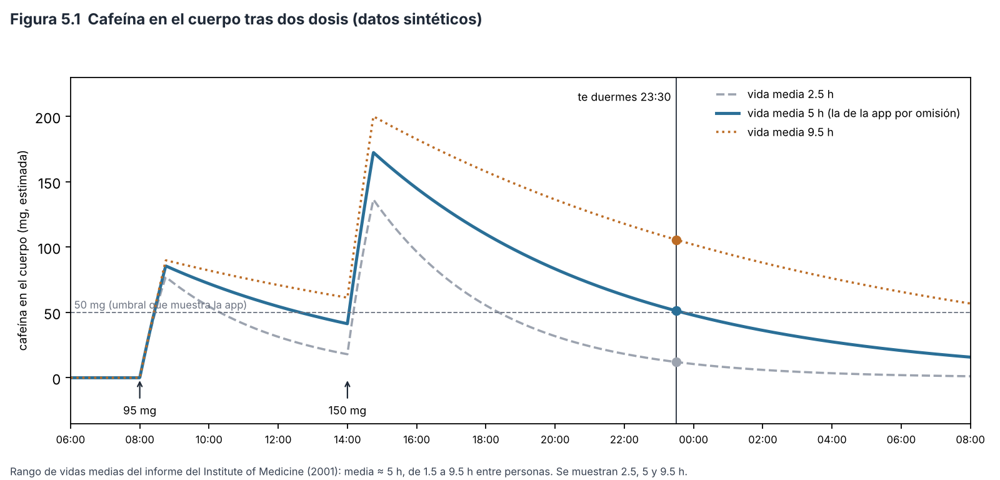
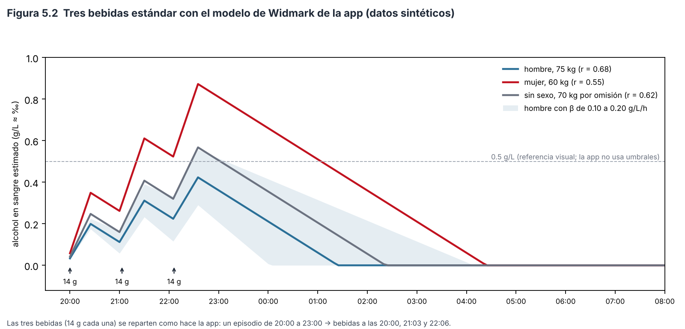
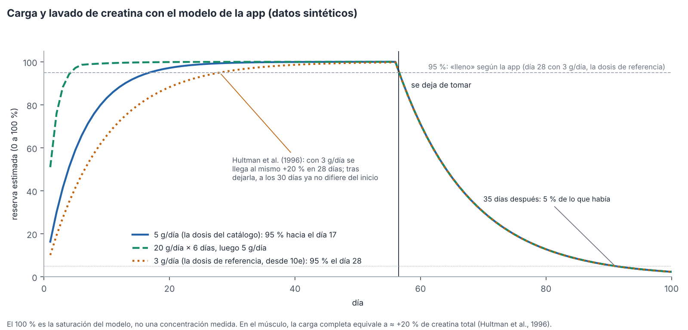
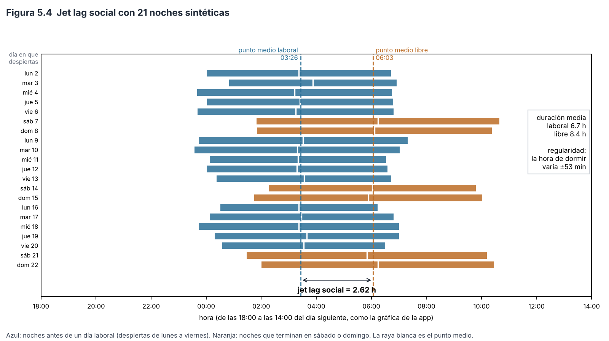

# Capítulo 5. Modelos fisiológicos y variables derivadas

> **Para qué sirve este capítulo.** Algunas variables de la app no se miden: se **calculan con un modelo** a partir de otros datos. La cafeína que te queda en el cuerpo al dormir, el alcohol en sangre, la reserva de creatina del músculo, el «jet lag social» o los minutos al aire libre son **estimaciones**, no mediciones. Este capítulo explica cada modelo: qué calcula, con qué fórmula exacta y qué parámetros, de dónde salen esos parámetros, qué tan preciso puede ser y cuándo falla. Se escribió sobre la v81 (commit `fa527df`) y está al día con el código de la v90 (commit `8818d5a`, `SCHEMA_V = 14`), la versión que describe todo el paper. Lo que cambió en el módulo 10 se marca «desde la 10c» y está en el apéndice D (D.63 y D.69 a D.72): el peso y la *r* del alcohol, las tomas sin hora, el ritmo de sueño con las noches recientes y los festivos, y una sola repetición máxima. Está puesto al día también con la **entrega 10e**, posterior (todavía sin número de versión; `SCHEMA_V` sigue en 14), que se marca «desde 10e» (D.88 a D.92, D.98 y D.99): el alcohol de la noche anterior en el máximo del día, la cafeína y el alcohol de MacroFactor y de la app juntados toma por toma, la hora de la última cafeína, la referencia de 3 g de la creatina, los suplementos de vida media corta y los parámetros en el diccionario. **Los ejemplos usan datos inventados.**
>
> **Cómo leerlo.** Igual que los capítulos anteriores: lenguaje sencillo, fórmulas y cifras del código tal cual, con el nombre de la función. Cada decisión se marca como **[Validado]**, **[Aproximación]** o **[Diseño propio]**. Los problemas se numeran H-4-n (por el módulo 4, en que se escribió este capítulo) y se detallan en `hallazgos.md`. **Ningún número de este capítulo es una medición de tu cuerpo**: son cuentas con parámetros promedio de la literatura.

---

## 5.1 Mini-glosario

| Término | Qué significa aquí |
|---|---|
| **Farmacocinética** | Cómo entra, se reparte y sale una sustancia del cuerpo con el tiempo. |
| **Absorción** | El paso de la sustancia del estómago a la sangre. Tarda un rato: por eso un café no hace efecto en el segundo en que lo tomas. |
| **Eliminación** | Cómo el cuerpo la va quitando (sobre todo el hígado). |
| **Vida media** (T½) | El tiempo que tarda en irse **la mitad** de lo que hay. Si la vida media es 5 h, de 100 mg quedan 50 a las 5 h, 25 a las 10 h, 12.5 a las 15 h. Esto se llama eliminación **de primer orden** (se va una proporción fija por hora). |
| **Eliminación de orden cero** | Se va una **cantidad fija** por hora, sin importar cuánto haya. El alcohol se elimina así casi siempre, porque la enzima que lo procesa trabaja a su máxima velocidad desde los primeros tragos (Jones, 2010). |
| **Volumen de distribución** | El «tamaño del recipiente» en el que se diluye una sustancia. Con la misma cantidad, un recipiente más chico da una concentración más alta. |
| **Factor de Widmark** (*r*) | La fracción del peso corporal en la que se reparte el alcohol (casi toda el agua del cuerpo). |
| **Saturación** | Qué tan llena está una reserva (aquí, la de creatina del músculo), de 0 a 100 %. |
| **Punto medio del sueño** | La hora a la mitad entre dormirte y despertar. |
| **Jet lag social** | La diferencia entre el punto medio del sueño en los días libres y en los laborales: como si cada fin de semana viajaras a otro huso horario y volvieras el lunes (Wittmann et al., 2006). |
| **Proxy** | Una medida indirecta de lo que interesa (capítulo 4). |

---

## 5.2 Mapa: qué se estima y con qué

| Qué | Función (archivo) | Parámetros | Variables del panel | Tipo |
|---|---|---|---|---|
| Cafeína en el cuerpo | `Sustancias.cafeinaEn` (`data/Sustancias.kt`) | absorción 45 min; vida media 5 h (ajustable) | `cafeina_total_mg`, `cafeina_al_dormir_mg`, `cafeina_ultima_h` (desde 10e; y `cafeina_mg`, de MacroFactor) | Aproximación |
| Alcohol en sangre | `Sustancias.alcoholEn` | absorción 30 min; β = 0.15 g/L/h; *r* de Watson (con peso, sexo, estatura y edad) o fija de 0.68, 0.55 o 0.62; peso de cada día | `alcohol_bebidas`, `alcohol_estimado_max`, `alcohol_al_dormir` | Aproximación |
| Nivel subjetivo de un episodio | `Sustancias.nivelEn` | tus lecturas de 0 a 10 | `alcohol_nivel_max`, `cannabis_nivel_max`, `*_horas` | Diseño propio |
| Reserva de creatina | `Suplementos.carga` (`data/Lote3.kt`) | 28 días para llenar con 3 g al día (desde 10e), 35 para vaciar | `creatina_saturacion_pct`, `supl_creatina_nivel` | Aproximación |
| Suplementos con vida media | `Suplementos.cantidadEn` | vitamina D 360 h, magnesio 12 h, melatonina 1 h, omega-3 60 h | `supl_<id>_nivel` (desde 10e, solo con vida media de 6 h o más: la melatonina no lo tiene) | Aproximación |
| Probióticos | `Suplementos.probioticosEstimados` | palabras clave en la bitácora de comidas | `probioticos_porciones`, `probioticos_estimado` | Diseño propio |
| Ritmo de sueño y jet lag social | `Analisis.ritmo` (`ciencia/Analisis.kt`) | noches de los últimos 56 días; días libres = sábado, domingo y, en México, festivos (`Fechas.esDiaLibre`) | solo en la pantalla Análisis (el panel exportado lleva `festivo` y `dia_libre`) | Validado (definición) / Aproximación |
| Noches sin reloj | `Analisis.ritmo` | último y primer uso del teléfono | solo en Análisis | Aproximación |
| Aire libre, km | `Estadistica.panel`, `Movilidad.kmPorDia` | luz ≥ 1000 lux, actividad; trayectos en línea recta | `aire_libre_min`, `distancia_km` | Aproximación (capítulo 4) |
| Otras | `Luna`, `Grados` (`data/Calculos.kt`), fórmula de Epley (`Macrofactor.e1rm`) | — | `luna_ilum`, grados de escalada | Validado / Aproximación |

---

## 5.3 Cafeína en el cuerpo

### 5.3.1 Qué hace

Estima cuántos miligramos de cafeína tienes en el cuerpo en cada momento. Se usa en la pantalla de sustancias («ahora», «baja de 50 mg a las…»), en la cinta del día y en el panel (`cafeina_al_dormir_mg`).

### 5.3.2 Cómo lo hace exactamente (`Sustancias.cafeinaEn`)

Para cada dosis *D* (mg) tomada hace Δ*t* horas:

$$C(t) = \sum_{\text{dosis}} D \cdot \min\!\left(1, \frac{\Delta t}{0.75}\right) \cdot 0.5^{\Delta t / T_{1/2}}$$

- El primer factor sube en línea recta de 0 a 1 en **45 minutos** (0.75 h): la absorción.
- El segundo es la eliminación de primer orden con la vida media *T*½ de `Config.cafeina_vida_media_h`, **5 h por omisión** (se cambia en Privacidad, de 2 a 10 h en pasos de media hora).
- Las dosis se suman: cada café se va por su cuenta.

**De dónde salen las dosis** (`Sustancias.dosis`): de **MacroFactor** (cada alimento con su hora y su `cafeina_mg`) y de lo que anotes en la app. Desde la entrega 10e (D.91), las dos fuentes se juntan **toma por toma**, para no contar dos veces la misma taza:

- Cada toma de la app (en orden de hora) busca entre las de MacroFactor que aún no tienen pareja una que esté a **90 minutos o menos** (`MISMA_TOMA`) y cuya cantidad vaya **de la mitad al doble** de la suya; si hay varias, la más cercana en hora.
- Si la encuentra, las dos son **la misma toma** y cuenta **una vez, con la hora y los miligramos de la app**: la hora de MacroFactor es la de cuando registraste el alimento, no necesariamente la de cuando lo tomaste.
- Las tomas de MacroFactor sin pareja y las de la app sin pareja cuentan todas.

*Ejemplo inventado.* En la app anotas un café de 150 mg a las 14:00; en MacroFactor hay un café de 95 mg a las 8:30 y uno de 120 mg registrado a las 15:10. El de 15:10 está a 70 minutos y 120 cae entre 75 y 300 mg: es la misma toma. Cuentan 95 mg a las 8:30 y 150 mg a las 14:00: `cafeina_total_mg` = **245 mg**. Hasta 10e, como MacroFactor tenía cafeína ese día, mandaba solo MacroFactor (H-4-2): **215 mg**, con el segundo café a las 15:10 y el de la app perdido. Los 90 minutos y el rango de la mitad al doble son **[Diseño propio]**: un margen razonable para la diferencia entre la hora de la toma y la del registro, no un valor estimado.

Desde la entrega 10c, un alimento de MacroFactor cuya hora no se puede leer se pone **al mediodía de su día** (`msComida`) en lugar de perderse; antes desaparecía de `cafeina_total_mg` aunque sí contaba en `cafeina_mg` (H-9-13).

**Variables del panel:**

- `cafeina_total_mg`: suma de las dosis del día lógico (de ambas fuentes, juntadas toma por toma), desde el primer día con cafeína.
- `cafeina_al_dormir_mg`: la cafeína estimada **en el instante en que te dormiste** según el reloj, sumando las dosis de las **36 horas** previas. Va en el día del sueño (el día en que despiertas).
- `cafeina_ultima_h`: desde 10e (D.92), la hora de la **última dosis del día lógico** en la misma lista de dosis que `cafeina_total_mg` (MacroFactor y la app), en hora decimal con dos decimales; **antes de las 5:00 suma 24** (un café a las 0:30 cuenta como 24.5 del día anterior), como `ultimo_uso_h`. Queda vacía los días con bitácora de MacroFactor sin ninguna dosis. Antes salía solo de MacroFactor y por día de calendario, así que un café anotado solo en la app no contaba y uno de madrugada caía en el día siguiente. La exportación (`Exportar.filasPanel`) usa la misma cifra y solo recurre a la de MacroFactor si el panel no la calculó.
- `cafeina_mg` sigue viniendo **directo de MacroFactor** (el nutriente del día, tal cual, como los demás nutrientes), sin el modelo.

### 5.3.3 Razonamiento científico

El informe del Institute of Medicine (2001) resume: la cafeína se absorbe **rápida y casi completamente** (alrededor del **99 % en 45 minutos**, con el pico en sangre entre 15 y 120 minutos), y su vida media en adultos sanos es en promedio de **unas 5 horas**, con un rango individual de **1.5 a 9.5 horas**. El embarazo, la obesidad, los anticonceptivos orales, el tabaco y la altitud la cambian. Nehlig (2018) explica que esa variabilidad depende en gran parte de la enzima hepática CYP1A2, que metaboliza el 95 % de la cafeína y tiene variantes genéticas.

Los parámetros de la app (45 min y 5 h) coinciden con esos promedios. **[Aproximación]**: el modelo es razonable para el promedio, pero tu vida media real puede estar en cualquier punto de ese rango.

### 5.3.4 Ejemplo trabajado (Figura 5.1)

Un café de **95 mg a las 8:00** y uno grande de **150 mg a las 14:00**; te duermes a las **23:30**. Con *T*½ = 5 h:

- Primer café: han pasado 15.5 h → 95 × 0.5^(15.5/5) = 95 × 0.117 = **11.1 mg**.
- Segundo café: han pasado 9.5 h → 150 × 0.5^(9.5/5) = 150 × 0.268 = **40.2 mg**.
- `cafeina_al_dormir_mg` = **51.3 mg**.

Con una vida media corta (2.5 h; el rango va de 1.5 a 9.5 h) serían **12 mg**; con la más larga (9.5 h), **106 mg**. **La misma tarde da una cifra que varía casi nueve veces según la persona.** Por eso la cifra solo sirve **para compararte contigo mismo** (si fijas tu vida media), no como dato absoluto.

*Figura 5.1. Cafeína estimada tras dos dosis con tres vidas medias. Script: `figuras/fig25_cafeina.py`.*

### 5.3.5 Cuándo falla

- **El pico queda un poco bajo y temprano** (H-4-1, resuelto por documentación: este punto y el siguiente son esa documentación; el código no cambió). Como la rampa de absorción se multiplica por la eliminación desde el primer minuto, a los 45 min queda 0.5^(0.75/5) = **90 %** de la dosis. Un modelo farmacocinético estándar (absorción y eliminación de primer orden) da otra forma de curva. Para dosis separadas por horas, la diferencia es pequeña. **[Aproximación]**.
- **Una sola vida media para toda la historia**: si la cambias, **todas** las `cafeina_al_dormir_mg` pasadas se recalculan con la nueva, sin dejar registro.
- **Juntar dos fuentes** (H-4-2, resuelto en 10e, D.91). Hasta 10e mandaba una sola fuente por día: si en MacroFactor anotaste un café y en la app otro distinto el mismo día, el de la app se perdía. Ahora se juntan toma por toma (sección 5.3.2), pero la regla puede equivocarse en los dos sentidos: dos cafés distintos de cantidad parecida, uno en cada app y a menos de 90 minutos, cuentan como uno; y la misma taza registrada en MacroFactor más de 90 minutos después, o con una cantidad muy distinta, cuenta dos veces. Una toma de MacroFactor sin pareja conserva la hora del registro, que puede no ser la de la toma.
- **Las cifras cambiaban según dónde se calcularan** (H-4-3, resuelto en 10c, D.71). Para no trabar la pantalla, cuando el panel se calculaba en el hilo principal **sin un cálculo previo guardado**, `Estadistica.sustancias` usaba solo lo anotado en la app y **omitía MacroFactor**, y la pantalla de experimentos calculaba ahí. Desde la entrega 10c: la pantalla de experimentos arma el panel en segundo plano, como Explorar y Análisis; si aun así toca calcular en el hilo principal sin caché y hay datos de MacroFactor, las variables que dependen de las dosis (`cafeina_total_mg`, `cafeina_al_dormir_mg`, `alcohol_bebidas`, `alcohol_estimado_max`, `alcohol_al_dormir`) quedan **vacías** en lugar de dar otra cifra (`alcohol` 0/1 valía 1 solo en los días con episodios sin cantidad y 0 en los demás, aunque hayas bebido; desde 10e, D.90, en ese caso vale **1 los días con un episodio anotado** y queda **vacío** los demás, porque sin MacroFactor no se sabe si un día sin episodios fue 0, H-14-4); y la clave de la caché incluye la identidad del mapa de MacroFactor, que cambia con cada importación, no solo el número de días (H-9-14).
- **Cuatro variables de cafeína** (H-4-12, resuelto en parte en 10e, D.92): `cafeina_total_mg`, `cafeina_al_dormir_mg` y, desde 10e, `cafeina_ultima_h` salen de la misma lista de dosis; `cafeina_mg` sigue siendo el nutriente de MacroFactor, así que puede no coincidir con `cafeina_total_mg` los días con cafeína anotada en la app. En el hilo principal sin caché (punto anterior), `cafeina_ultima_h` queda vacía, como las demás variables que dependen de MacroFactor.

---

## 5.4 Alcohol en sangre: el modelo de Widmark

### 5.4.1 Qué hace

Estima la concentración de alcohol en sangre (g/L, aproximadamente lo mismo que «por mil», ‰) a lo largo de la noche. Se usa en la cinta del día, en la lista de episodios («≈ 0.45 g/L estimado») y en el panel.

### 5.4.2 Cómo lo hace exactamente (`Sustancias.alcoholEn`)

La fórmula clásica de Widmark (de los años treinta) dice que la concentración es el alcohol tomado repartido en el agua del cuerpo, menos lo que el hígado ya quitó:

$$C(t) = \frac{A}{r \cdot W} - \beta \cdot t$$

con *A* = gramos de alcohol, *W* = peso (kg), *r* = factor de Widmark y β = velocidad de eliminación. La app la aplica como una **simulación en pasos de 5 minutos**:

1. Cada dosis entra **repartida en 30 minutos** (en cada paso de 5 min entra 1/6 de la dosis).
2. En cada paso, el cuerpo quita β · *r* · *W* · (5/60) gramos, con **β = 0.15 g/L por hora**, sin bajar de 0.
3. La concentración es gramos en el cuerpo ÷ (*r* · *W*).

**Los parámetros** (desde la entrega 10c, D.70; los dos se calculan **para cada día** de la simulación, con `rYPeso`):

- *W* (`pesoDe`): de todos los pesos con fecha (la báscula de Health Connect y la **tendencia de peso de MacroFactor**, `pesos()`), el **más reciente hasta ese día**, sea de la fuente que sea; el mismo día, gana la báscula. Si no hay ninguno antes de esa fecha, el **primero posterior**. Solo si no hay ningún peso registrado se usan **70 kg** (`PESO_OMISION`). Antes de la 10c, cualquier pesada de la báscula, aunque fuera de hace años, le ganaba a la tendencia de MacroFactor de ayer, y antes de la primera pesada se usaban 70 kg aunque hubiera pesos posteriores (H-9-24).
- *r*: con un **peso real** ese día, la *r* sale del **agua corporal total** de Watson et al. (1980) (`watsonR`):
  - hombres: agua (L) = 2.447 − 0.09516 · edad + 0.1074 · estatura (cm) + 0.3362 · peso (kg);
  - mujeres: agua (L) = −2.097 + 0.1069 · estatura (cm) + 0.2466 · peso (kg);
  - *r* = agua / (0.80 · peso), acotada entre **0.45 y 0.95**. El 0.80 (`AGUA_SANGRE`) es la proporción de agua en la sangre que usan Watson et al. (1981) para pasar del agua corporal a *r*.

  Hace falta el sexo (de Conocerte o de Salud), la estatura de Conocerte entre **100 y 250 cm** y, en los hombres, la edad de ese día (`Perfiles.edad`, a partir de la fecha de nacimiento de Conocerte). Si falta algo, o si el peso es el de omisión, se usa la *r* fija (`widmarkR`): **0.68** si dijiste «hombre», **0.55** si «mujer», **0.62** si no dijiste nada. Con 70 kg inventados, Watson no corregiría nada: por eso no se usa.
- **Bebida estándar** = **14 g** de alcohol puro (`GRAMOS_BEBIDA`), la definición de Estados Unidos (NIAAA, s. f.). Otros países usan otras cifras.

**De dónde salen las dosis** (`Sustancias.dosis`): de MacroFactor (`alcohol_g` de cada alimento, con su hora; sin hora legible, al mediodía de su día desde la 10c) y de los episodios que anotas. Las bebidas de un episodio se **reparten** en el primer 70 % del episodio (si dijiste cuándo terminó) o una cada 40 minutos (si no).

Desde la entrega 10e (D.91), las dos fuentes se juntan **por episodio**, no por día. Para cada episodio de la app con cantidad (en orden de inicio), se toman los registros de MacroFactor que aún no se usaron y caen entre su inicio y su fin, con **90 minutos** de margen a cada lado (sin fin dicho, el fin es la hora de la última bebida repartida). Son lo mismo y **cuenta la fuente con más gramos**: si MacroFactor suma más, se quedan sus registros y se quitan las bebidas del episodio; si no (también con empate), se quedan las del episodio y se quitan esos registros. Lo de MacroFactor fuera de todo episodio cuenta siempre. *Ejemplo inventado:* un episodio de 20:00 a 23:00 con 3 bebidas (42 g) y, en MacroFactor, una cerveza de 13 g a las 21:30 y un vino de 15 g a las 23:40 (dentro del margen, que llega a las 00:30): 28 g < 42 g, así que cuentan las 3 bebidas del episodio. Hasta 10e, como MacroFactor tenía alcohol ese día, contaban solo los 28 g (H-4-2). El margen de 90 minutos y «la fuente con más gramos» son **[Diseño propio]**.

**Variables del panel** (desde el primer día con alcohol):

- `alcohol_bebidas`: gramos del día ÷ 14.
- `alcohol_estimado_max` (desde 10e, D.88 y D.89): para cada día lógico con alcohol, el máximo de la simulación **desde su primera dosis hasta 14 horas después, o hasta justo antes de la primera dosis del siguiente día con alcohol** si llega antes (para no contar el mismo pico en dos días). La simulación incluye las dosis de las **24 horas previas** a esa primera dosis: lo que seguía en la sangre de la noche anterior cuenta. Las muestras son **cada 5 minutos**, como en la lista de episodios (`Sustancias.alcoholMaximo`). Los días desde el primero con alcohol sin ninguna dosis valen 0. Las 14 horas y las 24 horas son **[Diseño propio]**; con β = 0.15 g/L/h, en 24 horas se eliminan 3.6 g/L, así que lo tomado antes ya no queda en la sangre, salvo tras más de un día bebiendo casi sin parar.
- `alcohol_al_dormir`: la concentración en el instante en que te dormiste, con las dosis de las **18 horas** previas.
- `alcohol` (0/1, desde la 10c con **una sola regla de día**, H-9-17): 1 el día lógico de **cada dosis**; los episodios anotados **sin cantidad** (que no tienen dosis) cuentan el día lógico en que empezaron; 0 los demás días desde el primero con alcohol. Antes, la variable mezclaba el día del episodio y el de las dosis, y un episodio que cruzaba las 5:00 podía quedar en un día y sus bebidas en otro.
- Aparte, `alcohol_nivel_max` y `alcohol_horas` vienen de **tu nivel subjetivo** (sección 5.5), no del modelo.

### 5.4.3 Razonamiento científico

- **β = 0.15 g/L/h** es el valor que Jones (2010) recomienda como **promedio para bebedores moderados**, en una revisión de la evidencia forense: en ayunas, de 0.10 a 0.15; después de comer, de 0.15 a 0.20; en personas con consumo intenso, hasta 0.25–0.35. La eliminación es casi de orden cero porque la enzima se satura desde los primeros tragos. **[Validado]** como promedio.
- **Los factores *r*** de 0.68 y 0.55 son los valores clásicos de Widmark para hombres y mujeres; el 0.62 «sin sexo» es un punto intermedio **[Diseño propio]**. En realidad, *r* depende de la composición corporal: el alcohol se reparte en el agua del cuerpo, y una persona alta y delgada tiene más agua por kilo que una de más peso y edad. Watson et al. (1980) dieron ecuaciones del agua corporal total a partir de peso, estatura, edad y sexo, y Watson et al. (1981) propusieron usarlas para actualizar la ecuación de Widmark. Searle (2015) lo resume así: la *r* de Widmark es el agua corporal total dividida entre el peso por la proporción de agua en la sangre. Desde la 10c la app usa esa *r* cuando tiene los datos. **[Aproximación]** (mejor que la *r* fija): reduce el error, pero no lo elimina; según Searle (2015), la *r* conserva una incertidumbre de alrededor de un 9 %. **El valor 0.80 de la proporción de agua en la sangre [sin verificar]**: se comprobó la definición en Searle (2015), pero no se leyó el valor en el texto original de Watson et al. (1981).
- **La incertidumbre es grande.** Searle (2015) revisa cómo se propaga el error en estos cálculos: Gullberg había propuesto un coeficiente de variación fijo de ±21 % para la concentración calculada, y Searle muestra que el error **no es fijo** y hay que calcularlo en cada caso. **[Aproximación]**: el modelo da un orden de magnitud, no una cifra confiable al centésimo.

### 5.4.4 Ejemplo trabajado (Figura 5.2)

Tres bebidas estándar (42 g) en un episodio de 20:00 a 23:00. La app las coloca a las **20:00, 21:03 y 22:06** (el primer 70 % de 3 h son 2.1 h, repartidas en 2 intervalos).

- **Hombre de 75 kg** (*r* = 0.68): *r* · *W* = 51. Si todo entrara de golpe: 42/51 = 0.82 g/L. Con la absorción y la eliminación simultáneas, la simulación da un **máximo de 0.42 g/L a las 22:35** y llega a **0 a la 01:25**. (Con la fórmula simple: 0.82 − 0.15 × 2.58 h = 0.44 g/L en el pico, y 0.82/0.15 = 5.5 h después de empezar, 01:29: muy parecido).
- **Mujer de 60 kg** (*r* = 0.55): *r* · *W* = 33 → máximo **0.87 g/L**, en 0 a las **04:25**.
- **Sin sexo ni peso** (*r* = 0.62, 70 kg): máximo **0.57 g/L**.

Si en el hombre β fuera 0.10 o 0.20 en lugar de 0.15, el final de la curva se movería más de una hora en cada dirección (banda sombreada).

**Con la *r* de Watson (desde la 10c).** El mismo hombre de 75 kg, si en Conocerte su fecha de nacimiento le da 30 años y dijo que mide 180 cm: agua = 2.447 − 0.09516 × 30 + 0.1074 × 180 + 0.3362 × 75 = 44.14 L; *r* = 44.14 / (0.80 × 75) = **0.736**. Con un recipiente más grande, el máximo baja de 0.42 a **0.36 g/L** y llega a 0 hacia la **01:00** (línea punteada).

**Cuánto cambia con Watson** (tres bebidas de 14 g a los 0, 40 y 80 minutos, como reparte la app un episodio de tres bebidas sin hora de fin; simulación de `alcoholEn`, en pasos de 5 minutos, para personas inventadas; desde 10e es también lo que da `alcohol_estimado_max`; tres decimales para que los porcentajes se puedan rehacer):

| Persona | *r* fija | *r* de Watson | Máximo con *r* fija | Máximo con Watson |
|---|---|---|---|---|
| Hombre, 30 años, 175 cm, 70 kg | 0.68 | 0.749 | 0.607 g/L | 0.527 g/L (−13 %) |
| Hombre, 30 años, 190 cm, 70 kg | 0.68 | 0.777 | 0.607 g/L | 0.497 g/L (−18 %) |
| Hombre, 55 años, 170 cm, 95 kg | 0.68 | 0.624 | 0.375 g/L | 0.434 g/L (+16 %) |
| Mujer, 30 años, 160 cm, 60 kg | 0.55 | 0.621 | 0.998 g/L | 0.852 g/L (−15 %) |

El error que más pesaba no era *r*, sino el **peso**: con las mismas tres bebidas y *r* = 0.68, un hombre de 90 kg reales calculado con 70 kg sale con un máximo de **0.61 g/L** en lugar de **0.41 g/L** (casi un 50 % más alto: el peso divide la dosis, pero la eliminación por hora no cambia). Por eso `pesoDe` busca el peso más reciente entre las dos fuentes antes de cualquier ajuste de *r*.

*Figura 5.2. Tres bebidas estándar con la simulación de la app para tres perfiles y, punteado, el mismo hombre con la *r* de Watson; la banda muestra β de 0.10 a 0.20 g/L/h. Script: `figuras/fig26_alcohol_widmark.py`.*

### 5.4.5 Cuándo falla

- **Parámetros fijos** (H-4-4, resuelto en parte en 10c): β sigue sin ajustarse a si comiste o no (que según Jones cambia de 0.10–0.15 a 0.15–0.20). Desde la 10c, *r* sale de Watson cuando hay peso, sexo, estatura y edad, y el peso es el más reciente entre las dos fuentes; pero sin ningún peso registrado se siguen usando **70 kg sin avisar** en la pantalla (el diccionario sí lo dice), y la estatura es la de hoy (en un adulto casi no importa).
- **No muestra incertidumbre**: dice «≈ 0.45 g/L estimado», pero el error razonable es de varias décimas.
- **Unidades**: la fórmula de Widmark da gramos por kilo de peso corporal; la app lo presenta como g/L de sangre. La diferencia (por la densidad y el contenido de agua de la sangre) es pequeña frente a las demás incertidumbres, pero existe.
- **Absorción de 30 minutos fija**: con el estómago lleno la absorción es más lenta y el pico más bajo y tardío.
- **Cada día se simulaba por separado** (H-4-5, resuelto en 10e, D.88). Hasta 10e, `alcohol_estimado_max` empezaba en 0 con la primera dosis del día lógico y no arrastraba lo del día anterior: si un episodio cruzaba las 5:00, las bebidas posteriores caían en el día siguiente, que arrancaba de cero. *Ejemplo inventado* (hombre de 75 kg, *r* = 0.68): un episodio de 1:00 a 7:00 con 5 bebidas, repartidas a las 1:00, 2:03, 3:06, 4:09 y 5:12. Las cuatro primeras son del día lógico anterior y la última del siguiente. Antes, el primer día daba 0.536 g/L y el segundo, con una sola bebida desde cero, **0.187 g/L**. Desde 10e, el primer día mira hasta justo antes de las 5:12 y da 0.548 g/L; el segundo incluye las cuatro bebidas anteriores y da **0.660 g/L** (el pico de la noche, a las 5:40). Lo que queda: si el pico llega después de la primera bebida del día siguiente, cuenta en ese día, aunque ahí `alcohol_bebidas` valga 1 (en el ejemplo).
- **Dos máximos que no coincidían** (H-14-5, resuelto en 10e, D.89). Hasta 10e, la lista de episodios (`alcoholMaximo`) miraba la simulación cada 5 minutos y `alcohol_estimado_max` cada 10: si el pico caía entre dos muestras de 10 minutos, el panel daba hasta 0.15/12 ≈ **0.0125 g/L** menos (en la tabla de arriba, 0.595 en lugar de 0.607 g/L). Ahora los dos miran cada 5 minutos desde la primera bebida y, con un episodio por día y sin alcohol en las horas previas, dan la misma cifra. Pueden seguir difiriendo cuando no se cumple eso: el episodio solo cuenta las dosis desde 1 hora antes de su inicio y hasta 3 horas después de su fin, el panel da un solo máximo por día (y, como en el ejemplo anterior, lo corta en la primera dosis del día siguiente), y si mandan los registros de MacroFactor las muestras del panel empiezan en la primera de ellas.
- **Juntar dos fuentes** (H-4-2, resuelto en 10e): la regla por episodio de la sección 5.4.2 puede equivocarse si un registro de MacroFactor de otra ocasión cae dentro del margen de 90 minutos, o si la misma bebida se registró en MacroFactor fuera de él. La dependencia del hilo (H-4-3) se resolvió en la 10c (sección 5.3.5).

---

## 5.5 Episodios con nivel subjetivo (`Sustancias.nivelEn`)

Para alcohol y cannabis (las sustancias «con nivel»), además de las dosis, puedes decir **qué tan fuerte lo sientes** de 0 a 10, una o varias veces. La curva del episodio se arma así:

- Con lecturas: se unen con líneas rectas, empezando en el nivel de la primera lectura; si el máximo que dijiste después (la mañana siguiente) es mayor que lo leído, se agrega ese máximo **a la mitad del episodio**; si el episodio terminó (o quedó abierto de otro día), baja a 0 al final.
- Sin lecturas, solo con el máximo: un trapecio que sube de 0 al máximo en el primer 35 % del episodio, se queda hasta el 65 % y baja a 0 al final.
- **Fin efectivo** (`finEfectivo`): el que dijiste; si el episodio sigue abierto y empezó hace menos de 18 horas, «ahora»; si quedó abierto de otro día, **4 horas** después del inicio.

Variables: `alcohol_nivel_max`, `cannabis_nivel_max` (el mayor nivel del día) y `alcohol_horas`, `cannabis_horas` (duración). **[Diseño propio]**: son **autorreportes**, no estimaciones fisiológicas; la forma de trapecio y el «4 horas por omisión» son decisiones de la app. Es útil tener ambas medidas: la estimada (Widmark) y la sentida.

---

## 5.6 Suplementos: tres modelos

`Suplementos` (`data/Lote3.kt`) ofrece tres modelos, elegibles por suplemento y con parámetros editables en la app. Catálogo inicial:

| Suplemento | Dosis de referencia | Modelo | Parámetros |
|---|---|---|---|
| Creatina | 5 g (la reserva se calcula con 3 g, desde 10e) | carga | 28 días para llenar, 35 para vaciar |
| Vitamina D | 2000 UI | vida media | 360 h (15 días) |
| Magnesio | 300 mg | vida media | 12 h |
| Melatonina | 1 mg | vida media | 1 h (sin `nivel`, desde 10e) |
| Omega-3 | 1000 mg | vida media | 60 h |
| Probióticos | 1 porción | exposición | — |

Para todos se guardan, por día, `supl_<id>_dosis` (lo anotado) y `supl_<id>_tomado` (0/1), desde la primera toma.

Una toma olvidada se puede anotar después, con su hora real («¿Cuándo la tomaste?», o «Suplementos de este día» en la hoja de la noche), y una toma de más se puede quitar. Los niveles se recalculan con lo corregido. Cada toma guarda `ts` (cuándo se tomó) y `ts_creado` (cuándo se anotó), así que en R se ve cuáles se anotaron tarde (`vm_retraso`). Esto es desde la entrega N2 de la revisión de navegación (H-NAV-1).

### 5.6.1 Carga: la creatina (`Suplementos.carga`)

La creatina no actúa como una pastilla que sube y baja en horas: se **acumula** en el músculo durante semanas. El modelo representa esa reserva de 0 a 100 %:

$$s = 1 - 0.05^{1/\text{carga\_días}}, \qquad b = 1 - 0.05^{1/\text{lavado\_días}}$$

- Un día con dosis *d*: $\text{nivel} \mathrel{+}= \left(1 - (1-s)^{d/\text{ref}}\right)\cdot(100 - \text{nivel})$: se llena una fracción de **lo que falta**. *ref* es la **dosis de referencia** (`Suplementos.dosisReferencia`): desde la entrega 10e (D.98), **3 g en la creatina**, la dosis del estudio del que salen los 28 días, aunque en el catálogo tenga 5 g; en los demás suplementos con este modelo, la dosis que pusiste. Antes de 10e, *ref* era siempre la dosis del suplemento (5 g en la creatina).
- Un día sin dosis: $\text{nivel} \mathrel{\times}= (1 - b)$: se vacía una fracción de **lo que hay**.

Con 28 y 35 días, *s* = 0.1015 y *b* = 0.0820. El diseño garantiza dos cosas: con la dosis de referencia todos los días, a los **28 días** queda lleno al **95 %** (falta el 5 %); y sin tomarla, a los **35 días** queda el **5 %** de lo que había. Con una dosis diaria *d* distinta, el 95 % llega a los 28 · ref/*d* días. Las variables son `supl_creatina_nivel` y `creatina_saturacion_pct`, redondeadas a una décima.

**Ejemplo (Figura 5.3).**

- 3 g diarios (la referencia): día 28 → **95.0 %**.
- 5 g diarios (la dosis del catálogo, 5/3 de la referencia): llega al 95 % a los 28 × 3/5 = 16.8 días, es decir, el **día 17** (95.2 %); día 28 → **99.3 %**.
- Carga de 20 g × 6 días (20/3 ≈ 6.7 veces la referencia): cada día se llena 1 − (1 − 0.1015)^(20/3) = 51.0 % de lo que falta; al día 6 → **98.6 %**.
- Tras 8 semanas a 5 g (100.0 %) se deja: 30 días después → **7.7 %**; 35 días → **5.0 %**.

Hasta 10e, con la referencia de 5 g, las mismas cuentas daban 83.4 % con 3 g al día 28, 95.0 % con 5 g al día 28 y 92.3 % con la carga al día 6.

**De dónde salen los parámetros.** Hultman et al. (1996) midieron la creatina del músculo en 31 hombres: aumentó alrededor de un **20 %** tras 6 días a 20 g diarios; se mantuvo con 2 g diarios; **30 días después de dejarla ya no difería** del valor inicial; y con **3 g diarios** se alcanzó el mismo 20 % de forma gradual en **28 días**. **[Aproximación]**: los 28 días del modelo vienen de ese protocolo lento, y desde 10e con su misma dosis (3 g); el vaciado de 35 días es compatible con los 30 días medidos (el modelo dice 7.7 % a los 30 días). Que con 5 g llegue al 95 % en 17 días, o con 20 g en 5, sale de la forma del modelo (más dosis llena proporcionalmente más rápido), no de una medición: el estudio midió el +20 % tras 6 días a 20 g, pero no a qué día llega con 5 g **[Diseño propio]**.

*Figura 5.3. La reserva de creatina del modelo con tres formas de tomarla y al dejarla, con la dosis de referencia de 3 g (desde 10e). Script: `figuras/fig27_creatina.py`.*

**Cuándo falla** (H-4-6):

- **La dosis de referencia define la velocidad** (resuelto en 10e, D.98). Hultman et al. llenaron la reserva con **3 g** en 28 días; con la referencia de 5 g que usaba la app, 3 g diarios daban solo 83 % al día 28: el modelo se llenaba más lento que el estudio en que se basa. Desde 10e la referencia es 3 g. Queda fija en el código: cambiar la dosis de la creatina en la app ya no cambia la velocidad del llenado (cambiar los días de carga o de lavado, sí).
- **El 100 % es del modelo**, no una concentración: no considera la creatina de la dieta (carne, pescado), el punto de partida de cada persona ni que hay personas que casi no responden a la suplementación.
- **Interacción con los experimentos**: la plantilla de experimento de creatina usa 28 días de lavado, que con 8 semanas eliminaba todos los días con creatina (capítulo 8, H-7-1). Desde la entrega 10c dura 12 semanas (6 sin la acción y luego 6 con ella; el lavado se come los primeros 28 días con ella): quedan 14 días con la acción y 42 sin ella (`Experimentos.PLANTILLAS`, `data/Lote3.kt`). Desde 10e (D.96), en esa plantilla los días sin respuesta a «¿Lo hiciste hoy?» se completan con `supl_creatina_tomado` (capítulo 8).

### 5.6.2 Vida media (`Suplementos.cantidadEn`)

La cantidad «en el cuerpo» en un instante es la suma de cada toma multiplicada por 0.5^(horas transcurridas / vida media), **sin fase de absorción**. La variable `supl_<id>_nivel` se evalúa **al final del día lógico** (las 5:00 del día siguiente). Desde la entrega 10e (D.98), solo existe si la vida media es de **6 horas o más** (`Suplementos.VIDA_MEDIA_MIN_NIVEL`); con menos, a las 5:00 casi no queda nada. La regla mira la vida media que tenga el suplemento: con la de omisión, la melatonina (1 h) se queda sin `nivel`; si se la subieras a 6 h, volvería. El umbral de 6 h es **[Diseño propio]**: con esa vida media, una toma a las 23:00 conserva la mitad a las 5:00.

**Los parámetros:**

- **Vitamina D, 360 h (15 días)**: coincide con la vida media de **25(OH)D**, la forma que circula en sangre, de unos 15 días; la vitamina D almacenada en la grasa tiene una vida media de unos 2 meses (Jones, 2008). **[Aproximación]**: el modelo suma «UI en el cuerpo», que no es lo que mide un análisis de sangre. Con 2000 UI diarias, el modelo se estabiliza en 2000 / (1 − 0.5^(24/360)) ≈ **44 000 UI**: una cifra sin interpretación fisiológica directa, útil solo para ver la tendencia.
- **Melatonina, 1 h**: la vida media de la melatonina oral va de unos 28 a 126 minutos según la revisión de Harpsøe et al. (2015). **[Validado]** como orden de magnitud. Pero si la tomas a las 23:00, a las 5:00 han pasado 6 vidas medias y queda el 1.6 %: **`supl_melatonina_nivel` era casi siempre ≈ 0** y no servía para el análisis (H-4-7, resuelto en parte en 10e): desde 10e ya no existe, y la variable útil es `supl_melatonina_tomado`. Lo demás de H-4-7 (las fuentes del magnesio y el omega-3, y las unidades de la vitamina D) queda solo documentado aquí.
- **Magnesio, 12 h; omega-3, 60 h**: no encontré en esta sesión una fuente que respalde esos valores **[sin verificar]**. El magnesio no se comporta como un fármaco con una vida media única (el cuerpo regula sus reservas), y los omega-3 se incorporan a las membranas durante semanas.

### 5.6.3 Exposición: los probióticos (`Suplementos.probioticosEstimados`)

No hay farmacocinética: solo se cuentan **porciones**. A lo que anotes se suma **una porción por cada alimento de MacroFactor cuyo nombre contenga** alguna de las palabras clave que configures (por ejemplo, «yogur» o «kéfir»; comparación sin acentos ni mayúsculas). Variables: `probioticos_porciones` (anotadas + estimadas) y `probioticos_estimado` (solo las estimadas; desde la entrega 10c, vacía los días sin bitácora de MacroFactor, porque esos días no se sabe, D.63). **[Diseño propio]**: es una cuenta de exposición, sin relación con las unidades formadoras de colonias ni con si el producto tiene cultivos vivos (H-4-8; lo que proponía, dejar vacío `probioticos_estimado` sin bitácora, se hizo en la 10c).

---

## 5.7 Ritmo de sueño y jet lag social (`Analisis.ritmo`)

### 5.7.1 Qué hace

La herramienta «Ritmo» de Análisis muestra a qué hora te duermes y despiertas en promedio, cuánto duermes antes de un día laboral y antes de un día libre, la **regularidad** y el **jet lag social**, con una barra por noche (Figura 5.4). No crea variables del panel; el panel tiene aparte `sueno_inicio_h` y `sueno_fin_h` del reloj y, desde la entrega 10c, el panel exportado lleva `festivo` y `dia_libre` (sección 5.7.2).

### 5.7.2 Cómo lo hace exactamente

0. **Solo las noches recientes** (desde la entrega 10c, D.69): las que terminan en los **últimos 56 días** hasta hoy (`Analisis.recientes`; la noche cuenta por el día en que despiertas). Todos los umbrales que siguen se aplican dentro de esa ventana. En R, `vm_ritmo(dias = 56)` aplica la misma ventana con el último día de `vm_salud` como referencia (`dias = Inf` para toda la historia), pero solo con las noches del reloj: no usa las del teléfono ni pide un mínimo de noches.
1. **Noches del reloj**: inicio y fin del sueño en hora decimal; si el inicio es antes de las 12:00, se le suman 24 (dormirte a la 1:00 cuenta como 25.0, para promediarlo bien con las 23:00); al fin se le suman 24 siempre. La noche se guarda con **el día en que despiertas**.
2. **Noches del teléfono** (si faltan del reloj): inicio = **último uso del teléfono** del día lógico (debe ser **a las 18:00 o después**; uno de madrugada, antes de las 12:00, cuenta como 24 + la hora y también vale); fin = **primer uso** del día siguiente (a las **4:00 o después**).
3. Si hay **7 o más** noches del reloj, se usan solo esas; si no, se completan con las del teléfono en las fechas sin reloj. La pantalla lo dice: sin ninguna noche del reloj, «Sin datos del reloj en las últimas 8 semanas…»; con 1 a 6, «Solo *N* noches del reloj en las últimas 8 semanas: las demás se aproximan con el último uso del teléfono y el primero del día siguiente» (fuente «mezcla»). Las noches del reloj se cuentan antes del filtro del paso 4.
4. Se descartan las noches de menos de **2 h** o más de **16 h**. Hacen falta al menos **5** noches.
5. **Días libres** (`Fechas.esDiaLibre`, la única regla de la app desde la 10c): una noche es libre si el día en que despiertas es **sábado, domingo** o, si en Conocerte dijiste que vives en México (`pais = "MX"`), un **festivo** de la Ley Federal del Trabajo, art. 74 (`Fechas.esFestivoMx`): 1 de enero; primer lunes de febrero; tercer lunes de marzo; 1 de mayo; 16 de septiembre; tercer lunes de noviembre; 25 de diciembre; y el día de la transmisión del Poder Ejecutivo Federal, cada seis años (años 2024, 2030… el **1 de octubre**; hasta 2018, el **1 de diciembre**). **Antes de 2006**, los de febrero, marzo y noviembre iban en su fecha fija (5 de febrero, 21 de marzo y 20 de noviembre). Se omite la jornada electoral (cae en domingo) y no se cuentan Jueves ni Viernes Santo, que no están en la ley. Las demás noches son laborales. La misma regla da las columnas `festivo` (vacía si no vives en México) y `dia_libre` del panel exportado, y R la lee de ahí.
6. **Punto medio** de cada noche = (inicio + fin)/2. **MSW** = promedio de los puntos medios laborales; **MSF** = de los libres (cada uno con al menos 2 noches).
7. **Jet lag social** = |MSF − MSW|.
8. **Regularidad** = desviación estándar de la hora de dormirte (en la pantalla, «la hora de dormir varía ±*N* min»).
9. Duraciones medias en laborales y libres.

### 5.7.3 Razonamiento científico

Wittmann et al. (2006) definieron el jet lag social como la discrepancia entre el horario biológico y el social: las personas de cronotipo tardío duermen muy distinto en días laborales y libres, acumulan deuda de sueño entre semana y la compensan en el fin de semana. Lo midieron con el cuestionario de cronotipo de Múnich (MCTQ) y lo asociaron con peor bienestar y más consumo de estimulantes, sobre todo en jóvenes. Roenneberg et al. (2012), en un estudio poblacional grande, encontraron que el jet lag social se asocia con un índice de masa corporal más alto, más allá de la duración del sueño. **[Validado]** como definición y como variable asociada a la salud.

La app dice en la pantalla que «más de 1 hora se ha asociado con peor ánimo y salud». La asociación está respaldada por esos estudios; **el umbral de 1 hora no lo pude verificar** en esta sesión **[sin verificar]**.

Sobre la **regularidad**: existen medidas específicas, como el **Índice de Regularidad del Sueño** (SRI) de Phillips et al. (2017), que compara, minuto a minuto, si estabas dormido o despierto a la misma hora en días consecutivos; en estudiantes, la irregularidad se asoció con un ritmo circadiano retrasado y peor rendimiento académico. La app usa algo más simple: la desviación estándar de la hora de dormirte. **[Aproximación]**.

**Las noches del teléfono** son un proxy: usar el teléfono por última vez no es dormirte. Cuttone et al. (2017) mostraron que, con un modelo estadístico de los eventos de encender y apagar la pantalla, se puede estimar el sueño con buena exactitud (0.89 frente a pulseras de sueño); la app usa una regla mucho más simple. **[Aproximación]**.

### 5.7.4 Ejemplo trabajado (Figura 5.4)

Tres semanas inventadas. Entre semana te duermes hacia las **00:15** y despiertas a las **06:45**; las noches del viernes y el sábado, hacia las **01:45** y las **10:15** (con variación al azar).

- **MSW** = **03:26**; **MSF** = **06:03** → jet lag social = **2.62 h**.
- Duración media: **6.7 h** entre semana y **8.4 h** en fin de semana: la deuda que se paga el sábado.
- Regularidad: la hora de dormir «varía **±53 min**». Ojo: casi toda esa variación es la diferencia **sistemática** entre semana y fin de semana; la desviación estándar no distingue «me duermo cada día a una hora distinta» de «me duermo siempre igual entre semana y siempre igual el fin de semana, pero distinto».

*Figura 5.4. 21 noches sintéticas dibujadas como en la app, con los puntos medios y el jet lag social. Script: `figuras/fig28_jetlag_social.py`.*

### 5.7.5 Cuándo falla (H-4-9 y H-4-10)

- **Días libres por calendario.** Desde la 10c cuentan los festivos de México, pero no el horario de Conocerte, las vacaciones ni los turnos. Si trabajas un sábado o tienes vacaciones, el cálculo los clasifica mal. Los festivos mueven poco el jet lag social (unas 7 noches laborales al año, el 2.8 %); las vacaciones, que no arregla ningún calendario fijo, pesan mucho más. Las fechas anteriores a 2006 y a 2024 siguen las reglas de entonces: que los «lunes» empezaran con la reforma de 2006 y que antes de 2024 la transmisión fuera el 1 de diciembre se dedujo de las notas de reforma del artículo, no del texto de los decretos **[sin verificar]**.
- **Toda la historia junta** (esta parte de H-4-9 se resolvió en la 10c; el hallazgo queda resuelto en parte): hasta la 10c, los promedios usaban **todas** las noches registradas aunque la gráfica mostrara solo las últimas 30. Ahora usan las de los últimos 56 días. *Ejemplo inventado:* 60 noches de hace meses con 3 h de jet lag social y 60 recientes con 1 h: con toda la historia salía cerca de **2 h**; con la ventana, **1 h**, que es tu presente.
- **El valor absoluto** pierde la dirección (si en días libres duermes antes o después), aunque casi siempre es después.
- **Reloj y teléfono mezclados** cuando hay menos de 7 noches del reloj: dos medidas distintas en un mismo promedio. Desde la 10c la pantalla lo avisa, pero sigue mezclándolas (H-4-10, resuelto en parte).
- **Hora de dormir con dos cortes distintos** (H-5-15, resuelto en 10c): ahora los reportes (`Periodo`) usan la misma regla que aquí y el panel (`Exportar.horaDecimal`: antes de las 12:00 suma 24).

---

## 5.8 Aire libre y kilómetros

Ambas están descritas con detalle en el capítulo 4. En resumen:

- **`aire_libre_min`** = el mayor entre los minutos con luz de **1000 lux o más** en el sensor del teléfono (`luz_alta_min`) y los minutos caminando, corriendo o en bici. Es un proxy que **subestima** (el teléfono en el bolsillo no ve la luz) y que no distingue un parque de una calle. **[Aproximación]**.
- **`distancia_km`** suma la distancia **en línea recta** entre puntos de ubicación consecutivos, solo si pasaron entre 1 s y 2 h, la velocidad implícita es menor a 70 m/s y la distancia es mayor a 30 m. Es una **cota inferior** del recorrido real (H-3-5). Desde la entrega 10c, un día con ubicaciones y sin ningún tramo que cumpla esas condiciones vale **0 km** en lugar de quedar vacío (D.63). **[Aproximación]**.

---

## 5.9 Otras variables derivadas

- **Fase lunar** (`Luna`, `data/Calculos.kt`): edad de la luna a partir de una luna nueva de referencia (6 ene 2000, 18:14 UTC) y del **mes sinódico medio** de 29.530588853 días, evaluada al mediodía local; iluminación = (1 − cos 2π*f*)/2 (variable `luna_ilum`). **[Validado]** como aproximación astronómica: el mes real varía alrededor de ese promedio, así que la fase puede desviarse algunas horas; no lo cuantifiqué **[sin verificar]**.
- **Enfoque y siestas** (`Enfoque`, `data/Enfoque.kt`): el cronómetro guarda cada bloque como un tramo **sin contar las pausas**, redondeado a minutos; los bloques de **menos de 1 minuto** no se guardan. Con meta y descansos, la meta se reparte en bloques iguales (2 h con 3 descansos = 4 bloques de 30 min). Los tramos anotados después con hora antes de las 5:00 se asignan a la madrugada del día lógico. Variables: `enfoque_min`, `enfoque_<tipo>_min`, `siesta`, `siesta_min`. Son **mediciones** (de tu cronómetro), no modelos.
- **Repetición máxima estimada** (1RM): peso × (1 + repeticiones/30), la **fórmula de Epley**, una de las habituales para estimar el máximo; no verifiqué su fuente original **[sin verificar]**. Desde la entrega 10c (D.72) hay **un solo criterio** en toda la app, `Macrofactor.e1rm`: series de 1 a **12** repeticiones, sin calentamientos, redondeada a una décima. Lo usan la exportación, `vm_fuerza()` de R, Fuerza, Totales, los reportes (`Periodo`) y Tus apps. Antes, los reportes aceptaban hasta 15 repeticiones con calentamientos y Tus apps no tenía límite (H-4-13). *Ejemplo:* series de 100 kg × 15, 120 kg × 5 y un calentamiento de 130 kg × 8: antes el reporte daba 130 × (1 + 8/30) = **164.7 kg** (el calentamiento); ahora, 120 × (1 + 5/30) = **140 kg**, como en R.
- **Grados de escalada** (`Grados`): los grados de Fontainebleau se convierten a la escala V con una tabla fija (6A = V3, 7A = V6…) y los de YDS a número (5.10a = 10, 5.10b = 10.25…). **[Aproximación]**: las tablas de equivalencia publicadas no coinciden entre sí.

---

## 5.10 Estimaciones, no mediciones

Todo este capítulo comparte tres advertencias:

1. **Parámetros promedio.** Los modelos usan valores promedio de la literatura; tu cuerpo puede estar lejos de ese promedio (la vida media de la cafeína varía entre 1.5 y 9.5 h). Los resultados sirven sobre todo para **compararte contigo mismo** con los mismos parámetros.
2. **Sin incertidumbre visible.** Ninguna pantalla ni variable dice cuánto podría equivocarse la cifra.
3. **Parámetros que reescriben el pasado** (H-4-11, resuelto en parte en 10e, D.99). La vida media de la cafeína y los parámetros de los suplementos se pueden cambiar, y al hacerlo **todas** las variables derivadas pasadas se recalculan, sin guardar qué parámetro se usó ni cuándo cambió. Desde 10e, el diccionario de cada exportación (`Diccionario.conParametros`) agrega a la descripción de `cafeina_al_dormir_mg`, `creatina_saturacion_pct` y cada `supl_<id>_nivel` los parámetros vigentes al exportar: por ejemplo, «· al exportar: vida media de la cafeína de 5 h (si lo cambias, se recalcula toda la historia)», o, en la creatina, «llega al 95 % en 28 días con 3 g al día y se vacía en 35 días». Así se sabe con qué se calculó cada exportación, pero no qué valía antes: dos exportaciones con parámetros distintos siguen sin ser comparables entre sí (relacionado con H-1-8).

Cuando una variable estimada aparece relacionada con otra en Explorar, la relación es tan buena como el modelo: por ejemplo, `cafeina_al_dormir_mg` es, en la práctica, una **combinación de la cantidad y la hora** de tus cafés. Si se relaciona con dormir peor, eso dice que «tomar más o más tarde» se asocia con dormir peor; no que tu sangre tuviera exactamente esos miligramos.

---

## 5.11 Resumen de decisiones

| Decisión | Clasificación | Respaldo |
|---|---|---|
| Cafeína: absorción en 45 min, vida media 5 h por omisión | Aproximación | Institute of Medicine (2001); Nehlig (2018) |
| Cafeína: vida media ajustable | Diseño propio (bien fundado) | Nehlig (2018) sobre la variabilidad |
| Alcohol: Widmark con β = 0.15 g/L/h | Validado como promedio | Jones (2010) |
| *r* de Watson (agua corporal / (0.80 · peso), acotada 0.45–0.95) con peso real, sexo, estatura y edad | Aproximación (mejor que la fija) | Watson et al. (1980, 1981); Searle (2015); el 0.80 [sin verificar] |
| *r* fija 0.68 / 0.55 / 0.62 si falta algo; peso más reciente entre báscula y MacroFactor; 70 kg solo sin pesos | Aproximación / Diseño propio | Searle (2015) sobre la incertidumbre |
| Bebida estándar de 14 g | Validado (definición de EE. UU.) | NIAAA (s. f.) |
| Nivel subjetivo con interpolación y trapecio | Diseño propio | — |
| Cafeína y alcohol de MacroFactor y de la app juntados toma por toma: 90 min; en la cafeína, de la mitad al doble; en el alcohol, la fuente con más gramos (desde 10e) | Diseño propio | — |
| Máximo de alcohol del día: dosis de las 24 h previas; de la primera dosis a 14 h o a la primera del día siguiente; muestras cada 5 min (desde 10e) | Diseño propio | — |
| Creatina: 28 días para llenar con 3 g al día (desde 10e), 35 para vaciar | Aproximación | Hultman et al. (1996) |
| Sin `supl_<id>_nivel` con vida media de menos de 6 h (desde 10e) | Diseño propio | — |
| Vitamina D 15 días; melatonina 1 h | Aproximación / Validado (orden de magnitud) | Jones (2008); Harpsøe et al. (2015) |
| Magnesio 12 h; omega-3 60 h | Diseño propio | [sin verificar] |
| Probióticos por palabras clave | Diseño propio | — |
| Jet lag social | Validado (definición) | Wittmann et al. (2006); Roenneberg et al. (2012) |
| Ritmo con las noches de los últimos 56 días | Diseño propio | — |
| Días libres = fin de semana o festivo de México | Validado (calendario legal) / Aproximación (sin vacaciones ni turnos) | Ley Federal del Trabajo, art. 74 |
| 1RM con Epley, 1 a 12 repeticiones, sin calentamientos | Aproximación | [sin verificar] |
| Regularidad = desviación estándar de la hora de dormir | Aproximación | Phillips et al. (2017), el SRI como alternativa |
| Noches por uso del teléfono | Aproximación | Cuttone et al. (2017) sobre lo que se puede lograr |
| Aire libre, km | Aproximación | capítulo 4 |
| Fase lunar con el mes sinódico medio | Validado (aproximación astronómica) | — |

---

## 5.12 Resumen del capítulo

1. La cafeína y el alcohol se estiman con modelos farmacocinéticos sencillos y **parámetros promedio bien elegidos** (5 h de vida media y 45 min de absorción; β = 0.15 g/L/h), pero la variación entre personas es enorme: la misma tarde de café puede dejar de 12 a 106 mg al dormir según la vida media.
2. Desde la entrega 10c, el alcohol usa el peso más reciente entre la báscula y MacroFactor y, cuando tiene los datos, la *r* de Watson; sin pesos sigue usando 70 kg y no muestra su incertidumbre (H-4-4, en parte).
3. Desde la 10e, lo de MacroFactor y lo anotado en la app se juntan toma por toma, en vez de ignorar la app los días en que MacroFactor tenía algo (H-4-2); el máximo de alcohol del día arrastra lo de la noche anterior (H-4-5) y se lee cada 5 minutos, como la lista de episodios; y la hora de la última cafeína sale de las mismas dosis que los totales (H-4-12, en parte). Desde la 10c, las cifras ya no cambian según la pantalla (H-4-3) y las tomas de MacroFactor sin hora ya no se pierden.
4. El modelo de creatina se basa en Hultman et al. (1996) y, desde la 10e, usa su dosis de 3 g como referencia: 3 g al día llenan al 95 % en 28 días, y 5 g en unos 17 (H-4-6). La melatonina, cuyo nivel al final del día era casi siempre 0, ya no tiene `nivel` (H-4-7, en parte).
5. El jet lag social está bien definido. Desde la 10c usa las noches de los últimos 56 días y una sola regla de día libre con los festivos de México (H-4-9 y H-4-10, resueltos en parte); las vacaciones siguen sin contarse y la regularidad es una desviación estándar simple.
6. Todas estas cifras son **estimaciones**: sirven para compararte contigo mismo con parámetros fijos, y cambiar un parámetro reescribe el pasado (H-4-11, en parte: desde la 10e el diccionario dice con qué parámetros se exportó).
7. El módulo 4 identificó **13 hallazgos** (H-4-1 a H-4-13) y no cambió código. Después, la entrega 10c resolvió H-4-3, H-4-8 y H-4-13, y en parte H-4-4, H-4-9 y H-4-10 (apéndice D, D.63 y D.69 a D.72); la entrega 10e resolvió H-4-2, H-4-5 y H-4-6, y en parte H-4-7, H-4-11 y H-4-12 (D.88 a D.92, D.98 y D.99), y H-4-1 quedó resuelto por documentación (este capítulo). Quedan **7 resueltos** (H-4-1, H-4-2, H-4-3, H-4-5, H-4-6, H-4-8 y H-4-13), **6 resueltos en parte** (H-4-4, H-4-7, H-4-9, H-4-10, H-4-11 y H-4-12) y ninguno pendiente.

---

### Referencias citadas en este capítulo

Ver `referencias.md`. Citas: Cuttone et al. (2017); Harpsøe et al. (2015); Hultman et al. (1996); Institute of Medicine (2001); Jones, A. W. (2010); Jones, G. (2008); Ley Federal del Trabajo, art. 74; Nehlig (2018); NIAAA (s. f.); Phillips et al. (2017); Roenneberg et al. (2012); Searle (2015); Watson, Watson y Batt (1980, 1981); Wittmann et al. (2006).
