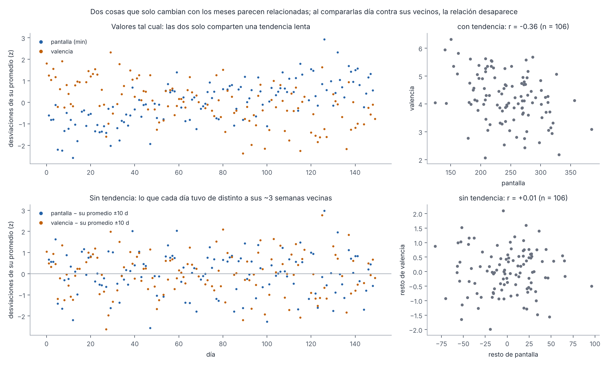
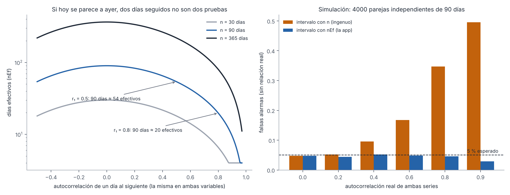
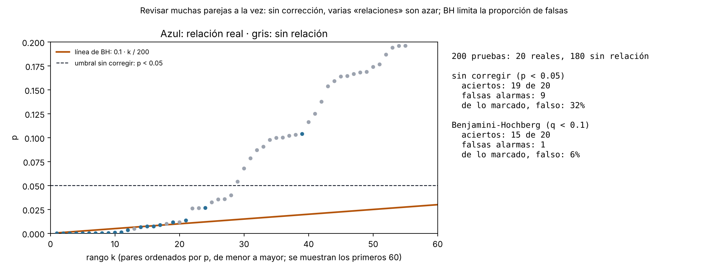
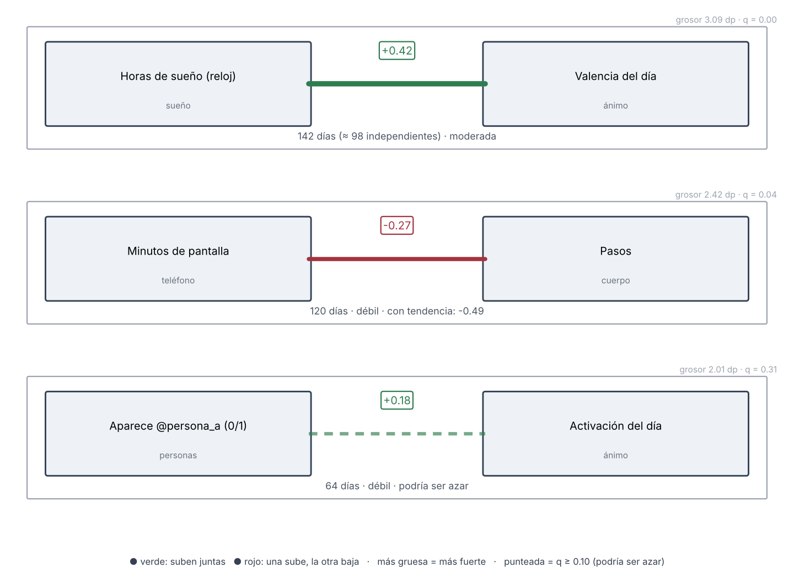
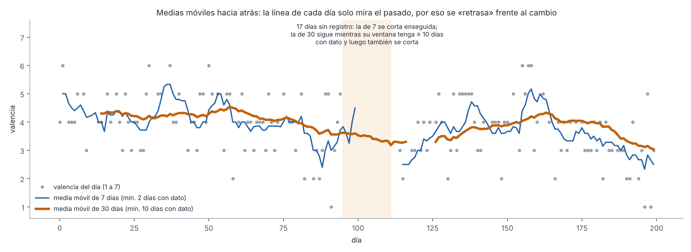
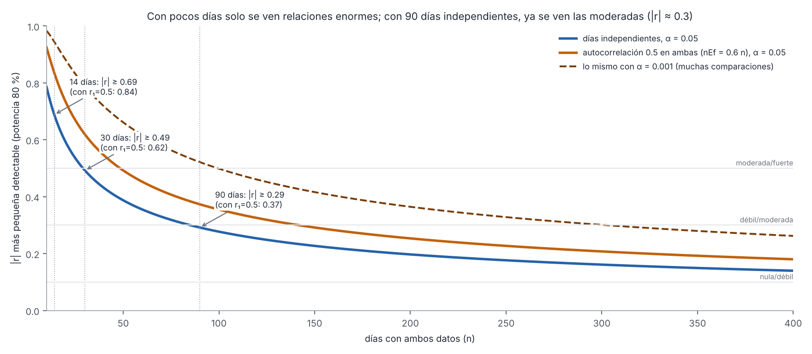

# Capítulo 6. Análisis estadístico

> **Para qué sirve este capítulo.** Explica **cómo la app pasa de miles de registros a frases como «cuando duermes más, tu ánimo tiende a subir»**: cómo arma la tabla de un renglón por día (el *panel*), cómo compara cada variable con cada otra, qué hace para no dejarse engañar por las tendencias, por los días que se parecen a sus vecinos y por el azar de revisar miles de parejas, y qué hacen las demás herramientas de análisis (modelo múltiple, dinámica emocional, palabras, días atípicos…). Al final compara **función por función** lo que hace la app con lo que hace el script de R que viaja en cada exportación. Todo corresponde a la versión v81 del código (commit `fa527df`), con los cambios del módulo 10 señalados donde corresponde; la comparación con R (6.3.4, 6.9.3 y 6.22) describe el script de la entrega 10d (commit `035982c`). **Los ejemplos numéricos son inventados.**
>
> **Cómo leerlo.** Está escrito para entenderse sin saber estadística, pero sin recortar la precisión. Las cifras, umbrales y fórmulas se dan tal como están en el código, con el nombre de la función de origen; las fórmulas completas están reunidas en el **Apéndice B** y las funciones de R en el **Apéndice C**. Cada decisión se marca como **[Validado]** (respaldada por literatura o un estándar), **[Aproximación]** (razonable, con supuestos que conviene conocer) o **[Diseño propio]** (decisión de la app, sin estándar detrás). Los problemas encontrados se numeran H-5-n y se detallan en `hallazgos.md`.
>
> **Archivos leídos.** `ciencia/Estadistica.kt` (completo), `ciencia/Analisis.kt`, `ciencia/Dinamicas.kt`, `ciencia/Periodo.kt`, `ciencia/TusNumeros.kt`, `ciencia/Totales.kt`, `ui/pantallas/Explorar.kt`, `ui/pantallas/Analisis.kt`, `ui/Relacion.kt` (la tarjeta de relación), la parte de `data/Exportar.kt` que arma `vm_panel.csv` y todas las funciones de análisis de `app/src/main/assets/vestigium.R`.

---

## 6.1 Mini-glosario

| Término | Qué significa aquí |
|---|---|
| **Variable** | Algo que tiene un número cada día: horas de sueño, valencia, minutos en una app, si mencionaste a una persona (1) o no (0). |
| **Panel** | La tabla con **un renglón por día** y **una columna por variable**. Casi todos los análisis salen de ahí. |
| **Dato faltante (`null`)** | «No sé» para ese día. No es lo mismo que 0: 0 minutos de ejercicio es un dato; no tener reloj ese día es un faltante. |
| **Correlación (r)** | Un número de −1 a 1 que dice qué tanto dos variables suben y bajan juntas. +1: suben juntas siempre en línea recta; 0: ninguna relación lineal; −1: cuando una sube, la otra baja. |
| **Pearson / Spearman** | Dos formas de calcular la correlación. Pearson usa los valores; Spearman usa su **orden** (el día con más sueño es el 1.º, el siguiente el 2.º…), así que no le afectan los valores extremos y capta relaciones que suben sin ser rectas. |
| **Tendencia** | Un cambio lento, de semanas o meses (bajas de peso poco a poco; los días se acortan en otoño). |
| **Quitar la tendencia** | Comparar cada día con sus vecinos en el calendario en vez de con todo tu historial. |
| **Autocorrelación** | Qué tanto el valor de hoy se parece al de ayer. Si duermes poco una semana entera, los días de esa semana se parecen entre sí. |
| **n / n efectivo (nEf)** | n: cuántos días tienen ambos datos. nEf: a cuántos días **independientes** equivalen, una vez descontado que se parecen a sus vecinos. |
| **Intervalo de confianza de 95 %** | El rango de valores compatibles con tus datos. Si va de 0.10 a 0.47, la relación real probablemente está en ese rango; si incluye el 0, podría no haber relación. |
| **p** | La probabilidad de ver una relación así de fuerte **por puro azar** si en realidad no hubiera ninguna. |
| **Comparaciones múltiples** | Revisar muchas parejas a la vez. Con 1000 parejas sin relación, unas 50 tendrán p < 0.05 por azar. |
| **Benjamini-Hochberg (BH) y q** | Una corrección para comparaciones múltiples. q < 0.10 quiere decir, aproximadamente: «de todas las relaciones que marco como firmes, espero que a lo más un 10 % sean azar». |
| **Relación obvia** | Dos variables que salen de la misma fuente o se calculan una de otra (calorías y proteína). Su correlación no dice nada nuevo de ti. |
| **Desfase** | Comparar lo de hoy con lo de **mañana** (¿dormir hoy se asocia con el ánimo de mañana?). |
| **β estandarizado** | En un modelo con varias causas posibles: cuántas desviaciones estándar cambia el objetivo cuando un predictor sube una desviación estándar, con los demás fijos. |
| **Desviación estándar (DE)** | Qué tan lejos del promedio suelen caer los valores. |
| **Mediana / MAD** | La mediana es el valor de en medio. La MAD (desviación absoluta mediana) es la mediana de las distancias a la mediana: una DE que no se deja arrastrar por los valores extremos. |

---

## 6.2 Mapa: qué análisis hay y con qué método

La pantalla **Análisis** (`ui/pantallas/Explorar.kt`) tiene, de arriba abajo (desde la entrega N4 de la revisión de navegación): los experimentos, «Las relaciones más marcadas» (las 5 primeras, con «ver las siguientes»), las herramientas en fichas y, plegadas, «Cruzar dos variables», la cobertura, «¿Qué tan bien te conoces?», «A qué hora aparecen tus emociones», «Ánimo según con quién estás», listas de personas, temas y lugares, y «Antes y después». Desde ahí se abren ocho **herramientas** (`ui/pantallas/Analisis.kt`). La tabla resume qué hace cada una y qué protecciones estadísticas aplica.

| Dónde | Función | Coeficiente o prueba | ¿Quita tendencia? | ¿Corrige por días parecidos? | ¿Corrige por muchas pruebas? | En R |
|---|---|---|---|---|---|---|
| Las relaciones más marcadas | `Estadistica.relaciones` | Pearson | Sí (interruptor, encendido por omisión) | Sí (nEf) | Sí (BH, q < 0.10) | `vm_relaciones` |
| … por semana | `Estadistica.semanal` + `relaciones` | Pearson sobre promedios semanales | Sí (±35 días) | Sí (nEf semanal) | Sí | — |
| Cruzar dos variables | `Estadistica.pares`, `pearson`, `spearman`, `correlacionEf`, `sinTendencia` | Pearson y Spearman; intervalo sobre Pearson con nEf; r sin tendencia al lado | Se muestra al lado (r sin tendencia) | Sí (nEf, desde 10c) | No aplica (una sola pareja) | `vm_cruce` (Spearman) |
| Todo lo que se mueve con algo | `Analisis.factores` | Pearson con nEf (continuas); diferencia de medias con t de Welch y factor AR(1) (0/1) | Sí (interruptor, el mismo de la lista; desde 10c) | Sí (desde 10c) | Sí (BH, q < 0.1) | `vm_factores` (las mismas correcciones desde 10d) |
| Modelo múltiple | `Analisis.modelo` | Mínimos cuadrados estandarizados; t con n − k − 1; R² ajustado | No | En parte (el día anterior como predictor) | No | `vm_modelo`, `vm_modelo_ar1` |
| Tendencia | `Analisis.movil`, `Analisis.cambio` | Medias móviles; diferencia de medias con t de Welch y factor AR(1) | — | Sí (desde 10c) | No | `vm_tendencia` |
| Día de la semana | `Analisis.porDiaSemana` | Media ± t(n − 1) · EE, con 5 días o más | No | No | No | `vm_semana` |
| Dinámica emocional | `Analisis.dinamica` | DE, MSSD, autocorrelación | No | — | — | `vm_dinamica` |
| Ritmo de sueño | `Analisis.ritmo` | Promedios de horas | — | — | — | `vm_ritmo` |
| Palabras del diario | `Analisis.palabras` | Diferencia de medias, sin prueba | No | No | No | `vm_palabras` |
| Días atípicos | `Analisis.atipicos` | z robusto (mediana y MAD) | No | — | — | `vm_atipicos` |
| Antes y después | `Estadistica.diferenciaEnDias` (en `EtapasDeVida`) | Diferencia de medias con t de Welch y factor AR(1) | No | Sí (desde 10c) | No | — |

Lo importante de la tabla: **«Las relaciones más marcadas» y, desde la entrega 10c, «Todo lo que se mueve con algo» aplican las tres protecciones a la vez** (tendencia, días parecidos y muchas pruebas). Hasta 10c, «Todo lo que se mueve» no quitaba tendencia ni contaba los días parecidos, así que la misma pareja podía verse «podría ser azar» en la lista y con ✓ un toque después (H-5-3, H-5-4; secciones 6.12 y 6.13). Las demás herramientas son descriptivas o aplican una o dos; la app lo dice: «Pistas para entenderte. Ninguna prueba causas».

---

## 6.3 El panel diario: la tabla de la que sale todo

### 6.3.1 Qué es

`Estadistica.panel()` devuelve un mapa `fecha → (variable → valor)`. Cada **fecha** es un día lógico (de 5:00 a 4:59 del día siguiente; capítulo 2). Cada **valor** es un número o `null`. Las variables 0/1 se guardan como 0.0 y 1.0.

Qué variables entran en los análisis lo decide otra función, `Estadistica.variables()`: una lista de unas 150 variables fijas (valencia, sueño, pasos, clima…) más las que **solo aparecen si hay datos** (por ejemplo, las de alcohol solo si alguna vez registraste alcohol; las privadas nunca: desde el módulo 10a se excluyen siempre y solo viajan a R) y, con `dinamicas = true`, las **variables dinámicas** de `Dinamicas.calcular()`: una por persona, tema, lugar, app, artista, nutriente, cuestionario, etapa de vida… (sección 6.3.3). El panel puede tener columnas que no están en esa lista; esas no se analizan. **[Diseño propio]**.

### 6.3.2 Cero o faltante: la decisión más delicada del panel

Para cada variable la app decide qué pasa en los días en que no hay registro. Desde la entrega 10c (D.63) hay **una regla general** y unas pocas excepciones declaradas:

1. **Faltante**: si la fuente no dio nada, `null` (sueño del reloj, clima, pantalla…).
2. **Cero desde el primer registro** (`Estadistica.ceroDesde(fuente, base)`): devuelve los días de `base` que son iguales o posteriores al primer día de `fuente`. En esos días «no hubo» vale 0; antes, `null`. La usan `gasto_total` y `gasto_imprevisto` (desde el primer gasto, en días con diario), `n_impulso` (desde el primer impulso), `escalada` (desde la primera sesión), `gimnasio` (desde el primer entrenamiento, en días con diario o con entrenamiento) y `ejercicio_min` (desde la primera sesión del reloj, en días con datos del reloj: pasos o frecuencia cardiaca). Las familias que ya seguían esta idea siguen igual: `registros_animo` y `n_<emoción>`, `enfoque_*`, `ingreso_total`, `obras_dia`, las de sustancias…
3. **Cero solo donde se pudo responder.** Algunas variables necesitan algo más que «ya usabas la función»:
   - `hab_<id>`: 0 desde el día en que creaste el hábito (`Habito.desde`); antes, `null`, salvo que lo hayas marcado. Los hábitos creados antes de que se guardara esa fecha no la tienen y valen 0 en todos los días con diario.
   - `sueno_recordado`: 1 si recordaste un sueño; 0 solo si ese día dijiste algo del sueño (calidad o texto); si no, `null`.
   - Las sociales (`personas`, `cercanos`, `vi_*`, `cercania_media`, `personas_vistas`, `personas_pensadas`, `personas_mensajes`, `penso_en_*`) y la base de `per_` y `pen_`: solo en los días «sociales» (`Dinamicas.diasSociales`), es decir, con diario escrito o con un momento no privado que nombra a alguien con @. En `tema_`, los días con diario escrito o con un momento que tiene un #tema.
   - `distancia_km`: 0 en los días con ubicaciones y sin movimiento (`Movilidad.kmPorDia` marca cada día lógico que tiene alguna muestra).
   - `probioticos_estimado`: solo en los días con bitácora de MacroFactor.
4. **Excepción declarada**: los contextos `ctx_*` valen 0 cuando no se marcan, porque la pantalla del Día dice que lo no marcado es «no».

La regla 2 es la más defendible: antes de empezar a usar una función no se sabe si «no pasó» o «no lo anotaste» (H-1-1, H-9-16). **[Diseño propio]**. Además, `presencias_revisado` (si revisaste quién estuvo y en quién solo pensaste) entra al panel como covariable en los días con personas, y es obvia con las variables sociales (H-1-6).

**Ejemplo.** Empiezas a registrar gastos el 1 de marzo. Hasta la entrega 10c, el 15 de febrero `gasto_total` valía 0 si ese día escribiste el diario: si comparabas «gasto» con «ánimo» usando todo el año, los ceros de enero y febrero contaban como «no gasté nada», aunque solo significaban «todavía no anotaba gastos». Ahora ese día es `null`, como ya pasaba con `ingreso_total`.

**Efecto:** más vacíos y menos ceros. Cambian medias, frecuencias y correlaciones, y la cobertura por variable baja; el cambio vale también para los días viejos, porque se recalcula con lo ya guardado.

### 6.3.3 Las variables dinámicas: «todo se puede cruzar con todo»

`Dinamicas.construir()` crea **familias** de variables con la función interna `familia(prefijo, …, max, minDias)`:

- Recorre los días, cuenta en cuántos días aparece cada cosa (una persona, una app) y suma su «peso» (minutos, pesos, horas).
- Se queda con las que aparecen al menos **`minDias`** días y, de ellas, con las **`max`** más frecuentes (o con más peso, si `porPeso`).
- En los días «base» de la familia, lo que no aparece vale **0**; fuera de la base, no hay valor.
- En la **exportación extendida** (`extendido = true`) el mínimo baja a **2 días** y el máximo sube a **400** por familia.

| Prefijo | Qué es | Valor | Máx. / mín. días (app) |
|---|---|---|---|
| `per_` | aparece @persona (diario, momentos, sueños, cartas) | 0/1 | 15 / 5 |
| `pen_` | pensé en @persona sin verla | 0/1 | 10 / 3 |
| `tema_`, `hito_` | aparece #tema; hito del día | 0/1 | 12 / 5; 10 / 3 |
| `lug_` | horas en cada lugar marcado | horas | 15 / 3 (por peso) |
| `app_`, `ntf_` | minutos y notificaciones por app | min, n | 12 / 5; 8 / 5 (por peso) |
| `lap_`, `web_` | minutos por app y sitio en la laptop | min | 10 / 4 (por peso) |
| `ytc_`, `art_` | videos por canal; canciones por artista | n | 8 / 5; 10 / 5 |
| `gcat_`, `icat_` | gasto e ingreso por categoría | $ | 15 / 5; 8 / 3 (por peso) |
| `obr_`, `gen_` | cada obra y cada género | 0/1 | 10 / 5 |
| `med_`, `det_` | cada medicamento; cada detonante (privadas: solo en la exportación para R, nunca en las listas de la app) | 0/1 | 15 / 3; 10 / 3 |
| `suenot_` | tipo de sueño | 0/1 | 6 / 3 |
| `ciu_`, `pais_` | horas en cada ciudad y país | horas | 8 / 3; 6 / 3 |
| `musc_`, `act_` | series por músculo; minutos por tipo de movimiento | n, min | 12 / 3; 6 / 3 |
| `nut_`, `ali_` | cada nutriente de MacroFactor; cada alimento | cantidad; 0/1 | 60 / 14; 12 / 5 |
| `esc_` | puntaje de cada cuestionario, copiado a los días que pregunta (7 en WHO-5 y PSS-4, 30 en UCLA-3; si dos respuestas cubren un día, la primera que lo cubre; desde 10c, `Dinamicas.porDiaCuestionario`) | puntaje | todos |
| `vida_` | etapas de vida («Conocerte») | 0/1 o número | todas |
| `pol_` | brújula política, vigente hasta el test siguiente | −100 a 100 | todos |

**Por qué.** El principio de la app es que cualquier cosa registrada pueda compararse con cualquier otra. El tope por familia evita que las relaciones se ahoguen en casos raros (una persona mencionada dos veces). **[Diseño propio]**. El costo es enorme en comparaciones múltiples (sección 6.8).

**Un efecto que conviene conocer.** Las variables de tipo «escalón» (`vida_*`, `pol_*`, y en buena parte `esc_*`) cambian pocas veces al año. Al quitar la tendencia casi no les queda variación de un día a otro, así que la app las clasifica como «lentas» y **no entran** en «Las relaciones más marcadas» con el interruptor encendido (sección 6.5.4). Con el interruptor apagado sí entran, pero entonces quedan expuestas a cualquier otra tendencia que coincida en el tiempo. Dicho de otro modo: **una etapa de vida nunca puede aparecer como relación «sin tendencia»**; para ella están «Antes y después» y el análisis en R (H-5-14).

### 6.3.4 El panel de R y el de la app (H-5-1, resuelto en 10d)

Hasta la entrega 10d, el script de R leía `vm_panel.csv`, que **no** es `Estadistica.panel()`: lo arma `Exportar.filasPanel()`, y tenía otros nombres para lo mismo, otros ceros (`gasto_total` e `ingreso_total` en 0 en cualquier fecha exportada; `escalada` y `gimnasio` falso en cualquier fecha), otras filas y muchas menos variables. Así, `vm_relaciones()` y «Las relaciones más marcadas» aplicaban el mismo algoritmo a tablas distintas. Desde 10d (P-30; Apéndice D, D.79 a D.84):

- **R analiza `vm_panel_extendido.csv`.** Empieza con las columnas de `vm_panel.csv` y suma todas las del panel de la app que falten, con sus nombres (`sueno_horas`, `distancia_km`, `hrv`…), las dinámicas, los contextos, hábitos, lectura del día y demás. `vm_panel.csv` se queda como tabla de compatibilidad.
- **Mismos valores en las columnas que comparten nombre.** En `vm_panel.csv` (y por tanto en el extendido) cada columna con el mismo nombre que una variable de la app lleva el valor de la app (`Exportar.comoLaApp`), con su regla de 0 y vacío (`ceroDesde`, sección 6.3.2): `gasto_total`, `ingreso_total`, `escalada` y `gimnasio` valen 0 desde el primer registro y en días con diario, y antes quedan vacíos; `ejercicio_min` vale 0 en días con datos del reloj y sin sesión; `ultimo_uso_h` suma 24 solo antes de las 5:00 (antes, en el CSV, antes de las 12; H-9-4); `canciones` cuenta solo escuchas de 30 s o más, también en la app (H-9-3). El tipo de cada columna (0/1, entero o número) se conserva.
- **Once nombres distintos, documentados.** `sueno_min`/`sueno_horas` (en minutos frente a horas), `sueno_profundo_min`/`sueno_profundo`, `sueno_rem_min`/`sueno_rem`, `km`/`distancia_km`, `hrv_rmssd`/`hrv`, `valencia_muestreo`/`muestreo_valencia`, `luz_dia_min`/`luz_horas` (minutos frente a horas), `sol_min`/`sol_horas` (minutos frente a horas), `carga_noche_inicio_h`/`carga_noche_h`, `temp_piel_delta`/`temp_piel` y `ruido_db_medio`/`ruido_db` (`Exportar.EQUIVALENTES`). No se renombraron, para no romper scripts viejos; el diccionario dice en cada una cuál es la otra, y `vm_familias.csv` las trata como la misma medida.
- **Mismas variables.** `vm_variables.csv` lista las que la app cruza (`Estadistica.variables()`, con las dinámicas recortadas igual que en la app); `vm_relaciones` y `vm_factores` se limitan a ellas por omisión. El seguimiento privado va marcado y solo se cruza con `privadas = TRUE`.

Lo que sigue distinto: `n_momentos` y `m_<tipo>` (solo en `vm_panel.csv`) cuentan también momentos privados (H-2-13), y R completa el calendario con renglones vacíos (`complete()`), que no cambia ningún cálculo porque los vacíos no entran. **Cómo se comprobó:** `ExportacionPrueba.kt` fija que, con el mismo panel inventado, `vm_relaciones` y `vm_factores` dan los mismos números que la app; con una exportación real de la v89, el script cargó y analizó sin errores (y así se encontró lo que corrigió D.87); y después el autor comprobó con una exportación real que las primeras parejas de `vm_relaciones()` coinciden con las de «Las relaciones más marcadas» (28 oct 2026). Ver la comparación completa en la sección 6.22.

---

## 6.4 La correlación: Pearson y Spearman

### 6.4.1 Qué hace

Ambas responden «¿cuando una sube, la otra tiende a subir (o a bajar)?» con un número de −1 a 1.

### 6.4.2 Cómo lo hace exactamente

**Pearson** (`Estadistica.pearson`, ecuación B.1). Con n ≥ 3 pares:

$$ r = \frac{\sum_i (x_i-\bar x)(y_i-\bar y)}{\sqrt{\sum_i (x_i-\bar x)^2\,\sum_i (y_i-\bar y)^2}} $$

Si una de las dos variables no cambia (suma de cuadrados igual a 0), devuelve `null`: no hay relación que calcular. La función interna `r()` de `relaciones` es la misma fórmula, escrita sobre arreglos para ir más rápido.

**Spearman** (`Estadistica.spearman`, B.2): Pearson aplicado a los **rangos**. `Estadistica.rangos` ordena los valores y, si hay empates, a todos les da el **promedio** de los lugares que ocupan (dos valores empatados en los lugares 3.º y 4.º reciben 3.5). Es el tratamiento estándar de empates. **[Validado]**.

**Cómo se nombra la fuerza** (`Estadistica.fuerza`): |r| < 0.1 «prácticamente nula»; < 0.3 «débil»; < 0.5 «moderada»; de 0.5 en adelante «fuerte». Son los cortes convencionales de Cohen (1988) para r (0.1, 0.3 y 0.5). **[Validado]** como convención; Cohen mismo advertía que dependen del campo.

### 6.4.3 Cuál se usa dónde (pista 5 del plan: confirmada, H-5-7)

| Lugar | Coeficiente |
|---|---|
| Las relaciones más marcadas (`relaciones`) | **Pearson** sobre los restos sin tendencia (o los valores, si se apaga el interruptor) |
| Cruzar dos variables | Muestra **Pearson y Spearman**; el texto, la fuerza y el intervalo usan **Pearson** |
| Todo lo que se mueve con algo (`factores`) | Desde 10c, **Pearson** (sobre los restos sin tendencia, como la lista) para variables continuas; diferencia de medias para 0/1. Hasta 10c era Spearman |
| Dinámica (inercia) | Pearson |
| R: `vm_relaciones`, `vm_factores` | Pearson (como la app; `vm_factores` desde 10d) |
| R: `vm_cruce`, `vm_cruce_horas`, `vm_presion` | **Spearman** por omisión |

### 6.4.4 Razonamiento y cuándo falla

Pearson mide relaciones **rectas** y se deja arrastrar por un día extremo (un día con 30 000 pasos pesa mucho). Spearman mide relaciones **que solo suben o solo bajan** (monótonas) y es robusto a extremos, pero con muchas variables 0/1 o con muchos empates pierde información. Usar Pearson sobre los restos sin tendencia es razonable: al restar el promedio de los vecinos, los valores se vuelven más simétricos. El problema no es elegir uno u otro, sino que **la misma pareja puede mostrar números distintos en dos pantallas** (r en la lista, ρ en la ficha de la variable) sin que la app lo explique. Desde la entrega 10c, la ficha usa también r de Pearson con la misma tendencia quitada que la lista, así que la pareja muestra el mismo número en las dos; «Cruzar dos variables» sigue mostrando los dos coeficientes y ahora también la r sin tendencia. En R, desde la entrega 10d `vm_factores` usa Pearson como la app; `vm_cruce`, `vm_cruce_horas` y `vm_presion` siguen con Spearman por omisión (P-32 no los incluía). **[Aproximación]**.

---

## 6.5 Quitar la tendencia

### 6.5.1 El problema: correlaciones de mentira por tendencias

Si dos cosas cambian lentamente con el tiempo, **parecen relacionadas aunque no tengan nada que ver**. Este problema se conoce desde hace un siglo como «correlaciones sin sentido» entre series de tiempo (Yule, 1926) y, en regresión, como «regresiones espurias» (Granger y Newbold, 1974). **[Validado]**.

**Ejemplo.** En otoño los días se acortan; al mismo tiempo, por otras razones, estás bajando de peso. Si correlacionas «horas de luz» con «peso», sale una correlación positiva fuerte. Pero no es que la luz te haga subir de peso: ambas bajan con los meses y nada más.

### 6.5.2 Cómo lo hace exactamente

`Estadistica.series()` (privada) transforma cada variable antes de compararla:

1. Alinea la variable a las fechas del panel; donde no hay dato, `NaN`.
2. Para cada día *i* con dato, toma **todos los días con dato que estén a 10 días de calendario o menos** de él (de *i* − 10 a *i* + 10, **incluido el propio día**). Esa es la constante `VENTANA = 10`.
3. Si hay al menos **3** de esos días, el **resto** del día es su valor menos el promedio de esa ventana (ecuación B.3):

$$ \text{resto}_i = x_i - \frac{1}{|W_i|}\sum_{j\in W_i} x_j,\qquad W_i=\{j:\ |d_j-d_i|\le 10,\ x_j\ \text{existe}\},\ |W_i|\ge 3 $$

4. Si hay menos de 3, el resto queda vacío (ese día no entra en la comparación sin tendencia).

La ventana es de **días de calendario**, no de registros: si faltaron días, la ventana tiene menos valores, pero no se estira hacia días más lejanos. Cerca del principio y del final de tus datos la ventana queda **cargada hacia un solo lado** (el primer día solo tiene vecinos posteriores). El interruptor dice «Compara cada día con sus ~3 semanas alrededor»: 21 días como máximo. **[Diseño propio]** en la elección de ±10 días; la técnica (restar una media móvil centrada) es un filtro pasa-altas estándar. **[Aproximación]**.

R hace exactamente lo mismo en `vm_relaciones(…, ventana = 10)` con la función interna `quitar()`.

### 6.5.3 Ejemplo trabajado

Valencia de los días 1 a 15 (faltan los días 7 y 13): 5, 4, 6, **3**, 5, 5, —, 4, 6, 5, 4, 5, —, 3, 6.

Para el **día 4** (valor 3): los días con dato a 10 o menos de distancia son del 1 al 14, menos el 7 y el 13: 12 días (el 15 está a 11 días, fuera). Su promedio es 55/12 = **4.583**. Resto del día 4: 3 − 4.583 = **−1.583**. Es decir: el día 4 fue 1.6 puntos peor que sus semanas vecinas, y eso es lo que se compara con las otras variables, no el 3.

### 6.5.4 Variables «lentas»

Si a una variable casi no le queda variación después de quitar la tendencia, compararla «sin tendencia» no tiene sentido. `series()` la marca como **lenta** si se cumplen las tres condiciones:

- su varianza original es mayor que 0 (no es constante);
- tiene al menos **14** restos (al menos **8** en el análisis por semana);
- la varianza de los restos es **menor que el 12 %** de la varianza original: var(resto) / var(x) < 0.12.

Con el interruptor encendido, las lentas **se omiten** y la pantalla lo dice: «Sin tendencia no entran …: casi solo cambian con las semanas». Ejemplos típicos: horas de luz, peso de tendencia de MacroFactor, etapas de vida, brújula política. **[Diseño propio]** (el corte de 0.12 no viene de la literatura).

### 6.5.5 Figura

*Figura 6.1. Dos variables sintéticas sin relación día a día que solo comparten un cambio lento: con los valores tal cual, r = −0.36; con los restos de ±10 días, r = +0.01. Script: `figuras/fig12_tendencia_espuria.py` (replica `Estadistica.series`).*

### 6.5.6 Cuándo falla

- **El ciclo de la semana no se quita (H-5-6).** Una ventana de 21 días contiene exactamente tres semanas, así que el promedio de la ventana **borra** cualquier patrón semanal del promedio y lo **deja entero** en los restos. Si dos variables cambian ambas con el fin de semana (duermes más y te sientes mejor el sábado), su correlación sin tendencia puede deberse solo al calendario. A veces eso es justo lo que quieres saber («el fin de semana me hace bien»); otras veces confunde (no es el sueño, es el sábado). La app no ofrece quitar el efecto del día de la semana. **[Aproximación]**.
- **Cambios bruscos.** Si algo cambia de golpe (te mudas), los días cercanos al cambio quedan a medio camino entre «antes» y «después» y sus restos son raros durante ~10 días.
- **Efectos lentos reales.** Si dormir mal **durante semanas** te deprime poco a poco, ese efecto es justo lo que quitar la tendencia borra. Con el interruptor encendido solo se ven efectos **de corto plazo** (de días). Por eso el interruptor existe y por eso la tarjeta avisa cuando la correlación «con tendencia» difiere en 0.2 o más.

---

## 6.6 Los días no son independientes: el número efectivo de días

### 6.6.1 El problema

Las fórmulas clásicas de intervalos y valores p suponen que cada día es una observación **independiente**. Pero tus días se parecen a sus vecinos: una semana de exámenes tiene varios días seguidos con poco sueño **y** mal ánimo. Si cuentas esos 7 días como 7 pruebas independientes, la relación parece más segura de lo que es. En la simulación de la Figura 6.2, con dos series sin relación real y autocorrelación de 0.8, el intervalo ingenuo «encuentra» una relación en el **35 %** de los casos en vez del 5 % esperado.

### 6.6.2 Cómo lo hace exactamente

1. **Autocorrelación de cada variable** (`Estadistica.autocorr`, B.4): Pearson entre el valor de cada día y el del día siguiente, usando **solo pares de días consecutivos** con dato en ambos (en el análisis por semana, semanas consecutivas: `paso = 7`). Si hay **menos de 10 pares**, devuelve **0** (no corrige). Se calcula sobre los restos (con el interruptor encendido) o sobre los valores (apagado), sobre **toda la serie** de la variable.
2. Cada autocorrelación se **recorta** a [−0.5, 0.97].
3. **Días efectivos** (B.5):

$$ n_{Ef} = n\,\frac{1-r_a r_b}{1+r_a r_b},\qquad \text{acotado a } [\min(4,n),\ n] $$

donde *n* son los días con ambos datos y *r_a*, *r_b* las autocorrelaciones de las dos variables. Si nEf ≤ 3, la pareja no se evalúa.

### 6.6.3 Razonamiento científico

Es la aproximación clásica para la correlación entre dos series con autocorrelación de orden 1 (AR(1)), conocida en climatología y ecología (Bretherton et al., 1999; Pyper y Peterman, 1998). La idea: lo que infla la incertidumbre es que **ambas** series sean persistentes; si solo una lo es (*r_b* = 0), no hay inflación. **[Validado]** como aproximación de primer orden. Supone que la dependencia es de tipo AR(1) (que el parecido decae geométricamente con los días) y que las autocorrelaciones se estiman bien.

Las cotas son decisiones propias y prudentes: la cota superior *n* impide que una autocorrelación negativa en una variable y positiva en la otra **aumente** los días efectivos por encima de los reales; el tope de 0.97 evita dividir casi entre cero. **[Diseño propio]**.

### 6.6.4 Ejemplo trabajado

Sueño y valencia, sin tendencia: n = 120 días con ambos; autocorrelación de los restos de sueño *r_a* = 0.4 y de valencia *r_b* = 0.3. Producto 0.12.

nEf = 120 × (1 − 0.12) / (1 + 0.12) = 120 × 0.88 / 1.12 = **94.3** días efectivos.

Como 94.3 es menor que 0.8 × 120 = 96, la tarjeta escribe «120 días (≈ 94 independientes)».

### 6.6.5 Figura

*Figura 6.2. Izquierda: días efectivos según la autocorrelación (la misma en ambas variables) para 30, 90 y 365 días. Derecha: 4000 parejas simuladas de series AR(1) independientes de 90 días; con la autocorrelación real de 0.8, el intervalo con n da falsas alarmas el 35 % de las veces y el de la app, el 4.6 %. Script: `figuras/fig13_n_efectivo.py`.*

### 6.6.6 Cuándo falla (H-5-13)

- **Variables esporádicas**: si una variable tiene menos de 10 pares de días consecutivos, su autocorrelación se toma como 0 y no se corrige nada. En el análisis por semana pasa durante las primeras ~11 semanas.
- **Autocorrelación de toda la serie, no de los días compartidos**: si una variable tiene dos años y la otra dos meses, la autocorrelación de la primera se calcula con los dos años, aunque la comparación use solo los dos meses comunes.
- **Persistencia más larga que un día**: si el parecido entre días dura semanas (no decae geométricamente), la fórmula de primer orden se queda corta. Quitar la tendencia reduce mucho este problema.
- **Ya no solo en esta lista (resuelto en 10c, D.65 y D.66).** Hasta la entrega 10c, la corrección existía solo en «Las relaciones más marcadas»; «Cruzar dos variables», «Todo lo que se mueve con algo», «Tendencia» y «Antes y después» trataban los días como independientes (H-5-3, H-5-4, H-5-5). Ahora las correlaciones de «Cruzar» y de «Todo lo que se mueve» usan la misma fórmula de nEf (`Estadistica.correlacionEf`, con la autocorrelación de cada serie calculada por `Estadistica.ar1`, que también exige 10 pares de días seguidos), y las diferencias de medias usan el factor AR(1) de la sección 6.15.2.

---

## 6.7 Intervalo de confianza y valor p

### 6.7.1 Cómo lo hace exactamente

Para una correlación *r* con *n* días (o nEf), la app usa la **transformación z de Fisher** (Fisher, 1915) (B.6–B.8):

$$ z=\operatorname{atanh}(r),\qquad EE=\frac{1}{\sqrt{n-3}},\qquad IC_{95}=\big[\tanh(z-1.96\,EE),\ \tanh(z+1.96\,EE)\big] $$

- `Estadistica.ic95(r, n)`: con *n* entero; exige n ≥ 5; recorta *r* a ±0.9999 para que atanh no sea infinito.
- En `relaciones` se usa **nEf** en lugar de *n*, y el valor p bilateral es *p* = 2 · (1 − Φ(|z| / EE)).
- Φ (la distribución normal acumulada) se calcula con `Analisis.phi`, la aproximación 7.1.26 de Abramowitz y Stegun (1964) para la función de error, con error máximo del orden de 10⁻⁷. Para estos usos es exacta en la práctica. **[Validado]**.

**La t de Student (desde la entrega 10c).** Para las diferencias de medias, el modelo múltiple y el día de la semana, la app ya no usa 1.96 sino el cuantil de la **t de Student**, la curva que reemplaza a la normal cuando la variabilidad se estima con pocos datos: tiene colas más gruesas, y más cuanto menos grados de libertad (con 2, el 95 % central llega a ±4.30; con 5, a ±2.57; con 30, a ±2.04; con muchos, a ±1.96).

- `Estadistica.pT(t, gl)`: el *p* de dos colas, con la fórmula exacta p = I_{gl/(gl+t²)}(gl/2, 1/2), donde I es la función beta incompleta regularizada. La app la calcula con una fracción continua (método de Lentz) y el logaritmo de la función gamma con la aproximación de Lanczos (g = 7). Admite grados no enteros, como los de Welch (B.14a).
- `Estadistica.cuantilT(p, gl)`: el valor t tal que la probabilidad acumulada es *p*, buscado por bisección (100 pasos) sobre `pT`.

Se comprobó en pruebas JVM (`CalculosPrueba.cuantilesDeT`): cuantilT(0.975, 1) = 12.706, (0.975, 2) = 4.303, (0.975, 5) = 2.571, (0.975, 30) = 2.042, y pT(2, 10) = 0.0734, los valores de las tablas. **[Validado]**.

### 6.7.2 Por qué

La distribución de *r* es asimétrica cerca de ±1; atanh la vuelve aproximadamente normal con varianza 1/(n − 3). Es el método estándar. **[Validado]**. Usarlo con nEf es la combinación habitual con la corrección de la sección 6.6. **[Aproximación]**.

### 6.7.3 Ejemplo trabajado (continúa el de 6.6.4)

r = 0.30, nEf = 94.29.
z = atanh(0.30) = 0.3095; EE = 1/√(94.29 − 3) = 0.1047.
IC: tanh(0.3095 ± 1.96 × 0.1047) = tanh(0.1044) a tanh(0.5146) = **0.10 a 0.47**.
z/EE = 2.957 → **p = 0.0031**.
Con *n* = 120 sin corregir habría salido IC 0.13 a 0.45 y p = 0.0008: casi cuatro veces «más significativo» de lo que es.

### 6.7.4 Cuándo falla

- Para **Spearman**, la varianza de atanh(ρ) es algo mayor que 1/(n − 3) (Fieller et al., 1957, proponen 1.06/(n − 3)). Hasta 10d, `vm_factores` en R usaba 1/(n − 3) también para ρ: intervalos ligeramente estrechos. Desde 10c en la app y desde 10d en R, `factores` usa Pearson, así que este punto ya no los afecta. **[Aproximación]**.
- El intervalo de la correlación sigue usando **1.96** (normal) aun con nEf pequeño. Con la transformación de Fisher eso es lo estándar: el error de usar la normal es pequeño frente al de no corregir por días parecidos. **[Aproximación]**.
- Para variables 0/1 con pocos «1», Pearson es una correlación punto-biserial; la aproximación de Fisher es menos precisa. La app exige al menos **4 días de cada valor** para evaluarlas (sección 6.10).

---

## 6.8 Muchas comparaciones a la vez: Benjamini-Hochberg

### 6.8.1 El problema

Con 300 variables hay 300 × 299 / 2 = **44 850** parejas. Si ninguna tuviera relación real, con el umbral clásico p < 0.05 saldrían **unas 2 240 «relaciones» por puro azar**. Revisar «todo contra todo» obliga a corregir.

### 6.8.2 Cómo lo hace exactamente

`Analisis.bh(p)` (B.9): ordena los *m* valores p de menor a mayor, p₍₁₎ ≤ … ≤ p₍ₘ₎, y calcula para cada uno

$$ q_{(k)} = \min_{j\ge k}\ \min\!\Big(1,\ p_{(j)}\,\frac{m}{j}\Big) $$

(recorre de abajo hacia arriba guardando el mínimo, así q nunca baja cuando p sube). Una relación «se sostiene» si **q < 0.10**. En `relaciones` se calculan dos q:

- `q`: corrigiendo **solo entre las parejas no obvias** (es el que se usa por omisión);
- `qConObvias`: corrigiendo entre todas (se usa si activas «Mostrar también las obvias»).

«Tu año» (`TuAnio.kt`) usa un criterio más estricto: q < **0.05**, n ≥ 30 y al menos 40 días en el año.

### 6.8.3 Razonamiento científico

El procedimiento es el de Benjamini y Hochberg (1995). No controla «la probabilidad de equivocarme alguna vez» (eso sería Bonferroni, mucho más estricto) sino la **proporción esperada de falsos descubrimientos** entre lo que se marca como firme (FDR). El valor *q* así calculado es el «valor p ajustado» de BH, cercano al q de Storey y Tibshirani (2003). Es apropiado para exploración: prefiere encontrar varias pistas aceptando que unas pocas sean falsas. **[Validado]**.

**Supuesto.** BH garantiza su control si las pruebas son independientes o tienen cierta dependencia positiva (Benjamini y Yekutieli, 2001). Aquí las pruebas **comparten variables** (la valencia aparece en cientos de parejas), así que están correlacionadas. En la práctica BH suele comportarse bien en esa situación, pero la garantía formal no está demostrada para este caso. **[Aproximación]**.

### 6.8.4 Ejemplo trabajado

Seis parejas con p = 0.0004, 0.003, 0.011, 0.02, 0.04 y 0.30 (m = 6):

| k | p | p · 6 / k | q |
|---|---|---|---|
| 1 | 0.0004 | 0.0024 | 0.0024 |
| 2 | 0.003 | 0.009 | 0.009 |
| 3 | 0.011 | 0.022 | 0.022 |
| 4 | 0.02 | 0.030 | 0.030 |
| 5 | 0.04 | 0.048 | 0.048 |
| 6 | 0.30 | 0.300 | 0.300 |

Las cinco primeras tienen q < 0.10: se sostienen. Con m = 6 la corrección es suave. Con m = 44 850, la mejor pareja necesita p < 0.10/44 850 = 2.2 × 10⁻⁶ para tener q < 0.10 si es la única real; con nEf = 100, eso equivale a |r| ≳ **0.45**. Si hay unas 50 relaciones reales, el umbral de la 50.ª baja a |r| ≳ 0.37. Por eso la app avisa: «Con pocos días es normal que nada se sostenga».

### 6.8.5 Figura

*Figura 6.3. 200 pruebas simuladas (20 relaciones reales con r = 0.35, 180 sin relación, 90 días). Sin corregir: 19 aciertos y 9 falsas alarmas (32 % de lo marcado es falso). Con BH a q < 0.10: 15 aciertos y 1 falsa alarma (6 %). Script: `figuras/fig14_benjamini_hochberg.py` (replica `Analisis.bh`).*

### 6.8.6 Cuándo falla

- **El número de pruebas depende del modo.** Por día o por semana, con o sin tendencia, se prueban parejas distintas (las lentas salen, el mínimo de días cambia), así que la misma pareja puede tener q distinto en cada modo.
- **Excluir las obvias es razonable pero no neutral**: baja *m* y hace la corrección más permisiva. Está bien porque esas parejas no son descubrimientos, pero la lista de obvias debe estar completa y ser la misma en app y R (H-5-2; desde 10d lo es, sección 6.9.3).
- **«Todo lo que se mueve con algo» corrige con p que no descuentan la autocorrelación** (H-5-3): ahí BH trabaja con valores p demasiado pequeños.

---

## 6.9 Las relaciones «obvias» y cómo se excluyen

### 6.9.1 Qué hace

Marca las parejas cuya correlación es casi segura por construcción, para no presentarlas como descubrimientos: calorías con proteína, eventos de agenda con minutos ocupados, pasos con minutos a pie, «minutos en Instagram» con «minutos de pantalla».

### 6.9.2 Cómo lo hace exactamente

`Estadistica.obvia(a, b)` devuelve verdadero si se cumple **cualquiera** de estas reglas:

1. Ambas son del mismo grupo y el grupo es «Lectura del día», «Momentos», «Sentimientos» o «Sueños».
2. Ambas están en una misma familia de `Estadistica.FAMILIAS` (57 conjuntos desde el esquema 13; una variable puede estar en varios). Ejemplos: todos los nutrientes fijos; `valencia` con `muestreo_valencia`; `valencia`, `animo_valencia`, `animo_cierre_valencia`, `momentos_valencia`, `valencia_acompanado` y `valencia_solo`; las de alcohol entre sí; impulsos, recaídas y libido entre sí.
3. Ambas son de lugares (`horas_tipo_*` o `lug_*`).
4. Son del mismo suplemento (`supl_<id>_dosis`, `_tomado`, `_nivel`…).
5. Una es un sentimiento y la otra `registros_animo`; o una es una categoría de sueño y la otra empieza con `sueno_`.
6. Una es dinámica y la otra es uno de sus **totales** (`Dinamicas.AGREGADOS`: `app_*` con `pantalla_min` y `desbloqueos`; `per_*` con `personas`, `cercanos`, `palabras`…).
7. Ambas son dinámicas de familias que se consideran obvias **entre sí** (`Dinamicas.ENTRE_SI`: dos nutrientes, nutriente y alimento, ciudad y país, obra y género, dos músculos, dos artistas, dos etapas de vida, dos ejes políticos…).
8. `per_X` y `pen_X` de la **misma** persona.
9. Dos puntajes del **mismo** cuestionario (`esc_<instrumento>_…`).
10. Desde el esquema 13: una campaña (`campana_<reto>`) y lo que ese reto busca mover (`Campanas.MUEVE`; por ejemplo, la de pasos con `pasos`, `a_pie_min` y `distancia_km`; la de un hábito con su `hab_`), y cualquier campaña con `campanas_n` (capítulo 9).

La familia de los avisos de ánimo, también del esquema 13, entra por la regla 2: `avisos_planeados`, `avisos_mostrados`, `avisos_respondidos` y `tasa_respuesta`, entre sí y con `muestreo_valencia`, `muestreo_activacion` y `n_muestreos` (capítulo 3).

Las obvias se calculan igual pero se esconden (el interruptor «Mostrar también las obvias» las muestra) y no cuentan en la corrección BH por omisión.

### 6.9.3 Razonamiento y cuándo falla

No hay una regla estadística para decidir qué es «obvio»; es una lista curada a mano. **[Diseño propio]**. Dos riesgos: (a) olvidar una familia hace que aparezca como «hallazgo» algo trivial; (b) marcar como obvio algo que no lo es esconde una relación interesante. Un caso discutible: la regla 1 declara obvias **todas** las parejas entre sentimientos (por ejemplo, «registros con tristeza» con «registros con alegría»), aunque su relación sí podría ser informativa (¿las emociones opuestas se excluyen o conviven el mismo día?).

Hasta la entrega 10d, en R `vm_familias` tenía solo 20 conjuntos y `vm_obvia` no tenía las reglas 1 y 3–9 (salvo los `m_*` entre sí), así que en `vm_relaciones()` salían como «firmes» parejas que la app esconde, como `valencia` con `animo_valencia` o `vi_familia` con `cercanos`, y BH corregía sobre otro número de pruebas (H-5-2). Desde 10d (P-31) la exportación escribe `vm_familias.csv`, generado por `Estadistica.familias()` con las **mismas** diez reglas, sobre las variables fijas y todas las dinámicas, con los nombres del panel exportado. Cada familia tiene un **lado**: con lado 0 todas sus variables son obvias entre sí; con lados 1 y 2, cada una de un lado lo es con cada una del otro, pero no con las de su lado. Así se escriben las reglas «en estrella» (6, 10 y parte de 5): `per_ana` es obvia con `personas` y con `palabras`, pero eso no vuelve obvias a `personas` y `palabras` entre sí. `vm_obvia` lee ese archivo. `ExportacionPrueba.familiasIgualQueObvia` comprueba, con 45 variables inventadas que tocan todas las reglas, que da lo mismo que `obvia()` en cada par. La forma (familias con lados) es **[Diseño propio]**; la lista sigue siendo la misma lista curada a mano. Sin ese archivo (exportaciones viejas o la resumida), R usa la lista corta de antes.

---

## 6.10 «Las relaciones más marcadas», paso a paso

### 6.10.1 Qué hace

Revisa **todas las parejas** de variables y muestra las más sólidas como tarjetas.

### 6.10.2 Cómo lo hace exactamente (`Estadistica.relaciones`)

Con el panel, la lista de variables, el modo (`sinTendencia`), `minN = 14`, `paso = 1` y `ventana = 10`:

1. `series()` prepara cada variable con al menos 3 días: valores, restos (6.5), autocorrelaciones (6.6), si es lenta y si es 0/1.
2. Con el interruptor encendido, aparta las lentas.
3. Para cada pareja (a, b):
   - toma los días en que **ambas** tienen valor (resto o valor, según el modo): *n*;
   - si *n* < **14**, la salta;
   - si una variable es 0/1 y, en esos días, tiene **menos de 4** días de alguno de los dos valores, la salta («una variable 0/1 necesita algunos días de cada tipo para decir algo»);
   - calcula *r* (Pearson sobre restos o valores) y `bruta` (Pearson sobre los valores, en los mismos días);
   - calcula nEf, el intervalo y *p* (6.6 y 6.7);
   - marca si es obvia (6.9).
4. Calcula `q` (entre no obvias) y `qConObvias` (entre todas) con BH.
5. **Ordena** primero por lo «seguro»: qué tan lejos del cero queda el extremo **más cercano** del intervalo (si el intervalo va de 0.10 a 0.47, 0.10; si cruza el cero, 0); a igualdad, por |r|.

### 6.10.3 Qué se muestra (Explorar.kt)

- Un resumen: «Revisé N combinaciones (dejé fuera M obvias)… ya corregido eso, K se sostienen», donde K es el número con q < 0.10. Si hay lentas, las nombra.
- Filtros por tema (`FOCOS`: con tu ánimo, con tu sueño, personas y vida, lugares y viajes, cuerpo y comida, teléfono y social, cultura, dinero). Una pareja entra si **alguna** de sus dos variables es del tema.
- `agrupar(lista, 15)`: junta las parejas **casi repetidas**. Dos parejas son «parecidas» si comparten una variable y la otra de cada una está en la misma familia de `FAMILIAS` (ánimo con horas de sueño y ánimo con sueño REM). Recorre la lista ya ordenada; la primera de cada grupo es la representante y las demás se anotan como «También con «…» (+0.31)» (máximo 3 nombradas y «y N más»). Muestra hasta **15** grupos; deja de buscar parecidas después del elemento 400.
- La **tarjeta** (`ui/Relacion.kt`, `TarjetaRelacion`): dos recuadros con los nombres y un **lazo** entre ellos.
  - Color: verde si r ≥ 0 («suben juntas»), rojo si r < 0.
  - **Grosor**: (1.2 + 4.5 · |r|) dp; un r de 0.42 da 3.09 dp.
  - **Punteado** y con 65 % de opacidad si q ≥ 0.10 («podría ser azar»).
  - Texto de detalle: «N días»; «(≈ nEf independientes)» si nEf < 0.8 · n; la fuerza; «con tendencia: ±0.xx» si el interruptor está encendido y |bruta − r| ≥ 0.2; «obvia»; «podría ser azar».
- Tocar una tarjeta abre «Todo lo que se mueve con algo» con una de las dos variables como objetivo (la que no es la valencia).

*Figura 6.4. Tres tarjetas sintéticas: una relación positiva firme (grosor 3.09 dp), una negativa firme cuya correlación con tendencia era bastante más fuerte, y una que podría ser azar (punteada). Script: `figuras/fig15_tarjeta_relacion.py` (imita `TarjetaRelacion` y `lazo` del tema por omisión; los temas cambian la forma del lazo, no su grosor ni el punteado).*

### 6.10.4 Ejemplo trabajado completo

Sueño (h) y valencia, interruptor encendido. Tras quitar la tendencia hay 120 días con ambos restos. r = 0.30, autocorrelaciones 0.4 y 0.3 → nEf = 94.3; IC 0.10 a 0.47; p = 0.0031 (6.6.4 y 6.7.3). Supón que se probaron m = 2 000 parejas no obvias y que esta queda en el lugar 25 por p: su q es como mucho 0.0031 × 2000 / 25 = 0.25 (puede bajar si alguna pareja de más abajo da un mínimo menor). Con q ≥ 0.10, la tarjeta sale **punteada** y dice «120 días (≈ 94 independientes) · moderada · podría ser azar», aunque su intervalo no incluya el cero. **No es una contradicción**: el intervalo es el de esa pareja sola; q tiene en cuenta que se miraron 2 000.

### 6.10.5 Cuándo falla

- Las tres protecciones solo cubren el azar y las tendencias; **no** cubren **confusores** (una tercera cosa que mueve a las dos, como el día de la semana o estar enfermo) ni la **dirección** (¿el sueño mejora el ánimo o el buen ánimo te deja dormir?). La app lo dice en «Cruzar dos variables».
- El mínimo de 14 días con 14 restos es bajo; con 14 días solo se ven correlaciones muy grandes (sección 6.21).
- Las variables privadas **no** entran en esta lista ni en ningún análisis de la app desde el módulo 10a (`Estadistica.variables()` las excluye; ver capítulo 10, sección 10.3). Son `impulso`, `recaida`, `n_recaida`, `recaida_min`, `libido_max`, `n_libido`, `n_impulso`, `medicamentos_n`, `med_*`, `det_*` y `hab_` del hábito ligado a las recaídas. El panel las sigue calculando para la exportación, así que solo se cruzan en R. Hasta v84 entraban con el interruptor encendido, y `n_impulso` y `med_*` siempre.

---

## 6.11 Análisis por semana

**Qué hace.** «Por semana» repite la lista con **semanas** en lugar de días. Sirve para lo que pasa pocas veces (escalar, viajar, escribir cartas).

**Cómo exactamente** (`Estadistica.semanal`, B.10): cada semana va de **lunes a domingo**; cada variable es el **promedio** de los días de esa semana con dato (en las 0/1, la proporción de días con 1); una semana entra para una variable si tiene **al menos 3** días con dato. Luego `relaciones(…, minN = 8, paso = 7, ventana = 35)`: al menos 8 semanas en común; la tendencia se quita con ±35 días (±5 semanas, ventana de hasta 11 semanas); la autocorrelación es entre semanas consecutivas; una variable es lenta con al menos 8 restos. «Cruzar dos variables» por semana usa `pares(…, paso = 7)`: Y de la semana siguiente.

**Por qué.** Promediar reduce el ruido diario y vuelve frecuentes los eventos raros. **[Diseño propio]**.

**Cuándo falla.** Con 8 semanas solo se ve una correlación enorme; durante las primeras ~11 semanas la autocorrelación se toma como 0 (6.6.6); el promedio de una semana con 3 días no es comparable al de una con 7.

---

## 6.12 «Cruzar dos variables»

**Qué hace.** Eliges X e Y y ves su dispersión, r de Pearson, la r sin tendencia, ρ de Spearman, el número de días y un texto.

**Cómo exactamente.** `Estadistica.pares(panel, x, y, desfase)` toma los días con ambos datos; con desfase, Y es la del **día siguiente de calendario** (fecha + 1; por semana, la semana siguiente). Con menos de 3 días no dibuja. Desde la entrega 10c (D.66):

- **El intervalo** sale de `Estadistica.correlacionEf`: Pearson con el intervalo de Fisher sobre **nEf** (6.6), usando la autocorrelación de toda la serie de X y de toda la de Y (`Estadistica.ar1`; por semana, entre semanas seguidas). Requiere 5 días. Si nEf < 0.8 · n, el texto añade «cuentan como unos N independientes».
- **La r sin tendencia**: `Estadistica.sinTendencia` resta a cada valor el promedio de sus ±10 días (±35 por semana), como la lista; con al menos 5 pares, la pantalla la muestra en una cifra aparte, y si difiere de la bruta en 0.2 o más el texto lo explica («parte de lo que se ve es que las dos cambiaron con el tiempo»).

El texto dice la fuerza, la dirección, si el intervalo incluye el cero («podría ser azar») y, con menos de 30 días, «Solo son N días: tómalo como pista»; siempre recuerda que correlación no es causa. La recta punteada de la dispersión es la de mínimos cuadrados de Y sobre X.

**Cuándo falla.** Hasta 10c esta pantalla usaba el **n bruto** y solo los valores tal cual, así que podía decir «no incluye el cero» para una pareja que la lista marcaba «podría ser azar» (H-5-4, **resuelto en 10c, D.66**). Sigue habiendo diferencias menores con la lista: el intervalo y la fuerza son los de la r **bruta** (la sin tendencia se muestra al lado, sin intervalo), y la autocorrelación se calcula con toda la serie de cada variable, no solo con los días comunes. Para una sola pareja elegida por ti no hace falta BH. **[Aproximación]**.

---

## 6.13 «Todo lo que se mueve con algo»

### 6.13.1 Qué hace

Eliges un objetivo (tu ánimo, una persona, un lugar, una app, una etapa de vida) y la app revisa **todas** las demás variables contra él.

### 6.13.2 Cómo exactamente (`Analisis.factores`)

Para cada variable *v* distinta del objetivo:

Desde la entrega 10c (D.66), con un interruptor «Quitar tendencias» que empieza como estaba en la lista desde la que llegaste (`Herramienta.sinTendencia`):

1. Prepara el objetivo: su serie y, con el interruptor encendido, sus **restos sin tendencia** (`Estadistica.sinTendencia`, ±10 días, como en 6.5); calcula su autocorrelación (`Estadistica.ar1`).
2. Para cada variable *v* distinta del objetivo: se salta si comparte familia con el objetivo (`FAMILIAS`) o si `obvia(v, objetivo)`. Si *v* tiene menos de 10 días, se salta.
3. Si *v* es 0/1 (en sus valores tal cual):
   - toma el objetivo (resto o valor; con desfase, el del día siguiente) en los días con 1 y en los días con 0; exige al menos **5** de cada uno;
   - calcula la **diferencia de medias** con `Estadistica.diferenciaEnDias` (6.15.2): t de Welch y el error estándar corregido porque los días seguidos se parecen; el *p* es el de esa t;
   - muestra «+0.45 puntos los días con (12) frente a sin (80)».
4. Si es continua: toma sus restos (o valores), los empareja con el objetivo y exige al menos **14** pares; calcula **r de Pearson**, el intervalo de Fisher y el *p* con **nEf** (`Estadistica.correlacionEf`, igual que la lista). Muestra «r = +0.31 · moderada · 90 días (≈ 70 independientes)».
5. Corrige todos los *p* con BH; marca con ✓ los de q < 0.1; muestra las 20 primeras ordenadas por *p*.

Hasta 10c usaba los valores tal cual, ρ de Spearman con *n* bruto y, para 0/1, la normal (1.96) con días independientes.

### 6.13.3 Razonamiento

Responde una pregunta natural («¿qué acompaña mis mejores días?»). El desfase de un día ayuda con la dirección: si lo de hoy se asocia con el ánimo de **mañana**, es menos probable que el ánimo haya causado lo otro (aunque no imposible: una variable persistente puede seguir siendo efecto del ánimo de ayer). **[Aproximación]**.

### 6.13.4 Ejemplo trabajado

Objetivo: valencia, con el interruptor apagado (valores tal cual). Variable: «Aparece @persona_b» (0/1). Días con: 5, 6, 5, 4, 6, 5, 6 (media 5.29). Días sin (diez): 4, 4, 5, 3, 4, 5, 4, 3, 4, 5 (media 4.10). Hay 7 y 10 días de cada tipo (mínimo 5), así que la app sí la evalúa. Supón que son días sueltos, sin 10 pares de días seguidos: la autocorrelación se toma como 0.

- Diferencia 1.19; EE = √(0.571/7 + 0.544/10) = 0.369.
- Grados de libertad de Welch: (0.0816 + 0.0544)² / (0.0816²/6 + 0.0544²/9) = **12.86**; t(0.975; 12.86) = **2.163**.
- IC: 1.19 ± 2.163 × 0.369 = **0.39 a 1.98**; t = 3.21, **p = 0.0069**. Es lo mismo que da `t.test` de R.

Hasta 10c, con 1.96 y la normal, salía IC 0.46 a 1.91 y p = 0.0013: unas cinco veces «más significativo». Si los días fueran seguidos y se parecieran (ρ ≈ 0.4), el intervalo se ensancharía todavía más (6.15.2).

### 6.13.5 Cuándo falla (H-5-3, alta)

- **Resuelto en 10c (D.66):** hasta esa entrega no quitaba la tendencia ni descontaba la autocorrelación, así que sus *p* eran, para variables persistentes, mucho más pequeños de lo que debían (Figura 6.2: con autocorrelación 0.8, alrededor de un tercio de falsas alarmas), y la misma pareja podía verse **punteada** en la lista y con **✓** aquí; usaba ρ donde la lista usa r, y para 0/1 usaba 1.96 con apenas 5 días por grupo (H-5-5). Ahora usa la misma maquinaria que la lista.
- **Lo que sigue distinto de la lista:** el *q* se calcula entre las variables revisadas contra **este** objetivo, no entre todas las parejas; la autocorrelación de cada variable se calcula con toda su serie. Por eso una pareja puede tener ✓ aquí y salir punteada en la lista (o al revés) sin contradicción: se corrigió por menos comparaciones. **[Aproximación]**.
- Para 0/1 se comparan los **restos del objetivo** entre días con y sin, pero la variable 0/1 no se «desestaciona»: si casi todos sus 1 caen en una sola temporada, la comparación hereda esa temporada en parte (los restos ya quitan lo lento del objetivo).
- Desde la entrega 10d, `vm_factores` en R hace lo mismo (P-17 y P-32): las mismas piezas (`.vm_sin_tendencia`, `.vm_ar1`, `.vm_dif_dias`, con la corrección de Marriott y Pope y los grados de Welch con n efectivo), las mismas variables y las mismas obvias; `ExportacionPrueba.factoresComoR` fija que da los mismos números que la app con datos inventados (Apéndice C).

---

## 6.14 Modelo múltiple

### 6.14.1 Qué hace

Pregunta por **varias causas posibles a la vez**: ¿el sueño se asocia con el ánimo **manteniendo fijos** los pasos y la pantalla? Opcionalmente incluye **el valor del objetivo el día anterior**.

### 6.14.2 Cómo exactamente (`Analisis.modelo`)

1. Toma los días con objetivo y **todos** los predictores (y, si `conAyer`, el objetivo del día de calendario anterior); descarta los demás.
2. Exige **n ≥ k + 10**, con *k* el número de predictores (incluido «ayer»). Con 3 predictores y ayer, 14 días.
3. **Estandariza** cada columna y el objetivo: resta su media y divide entre su DE (si alguna DE es 0, no hay modelo).
4. Resuelve mínimos cuadrados **sin intercepto** (todo está centrado): β = (X′X)⁻¹ X′y, invirtiendo con Gauss-Jordan con pivoteo parcial; si un pivote es menor que 10⁻¹⁰ (predictores redundantes), no hay modelo.
5. Error: s² = SSE / (n − k − 1); EE(β_j) = √(s² · [(X′X)⁻¹]_jj); intervalo β ± **t(0.975; n − k − 1)** · EE (desde 10c; antes, 1.96).
6. R² = 1 − SSE / SST, con SST = Σ y² (y estandarizada), y el **R² ajustado** = 1 − (1 − R²)·(n − 1)/(n − k − 1), que es el que muestra la pantalla («varianza explicada (ajustada)», con 0 como mínimo).

La pantalla permite hasta **6** predictores; marca ✓ si el intervalo no incluye el cero; interpreta |β| de 0.1 como pequeño, 0.3 moderado y 0.5 grande.

### 6.14.3 Razonamiento

Los coeficientes estandarizados permiten comparar predictores en unidades distintas (horas, pasos, minutos). Controlar por el valor de ayer reconoce que el ánimo tiene inercia: sin eso, cualquier cosa que coincida con «rachas» parecería un efecto. Es la idea de los modelos autorregresivos con predictores, el estándar en estudios diarios intensivos (Hamaker y Wichers, 2017). **[Aproximación]**: es un modelo autorregresivo simple, no uno con errores autocorrelados ni multinivel.

### 6.14.4 Ejemplo trabajado (sintético)

59 días completos; objetivo valencia; predictores horas de sueño, pasos y valencia de ayer (k = 3; 55 grados de libertad, t = 2.004). Resultado: β sueño = +0.38 [0.14, 0.62] ✓; β pasos = +0.09 [−0.15, 0.33]; β ayer = +0.41 [0.17, 0.65] ✓; R² = 27 % y R² ajustado = 1 − 0.73 × 58/55 = **23 %**, que es lo que se muestra. Lectura: un día con una DE más de sueño (≈ 1 h en estos datos) se asocia con 0.38 DE más de valencia, a igual valor de ayer y pasos; los pasos no añaden nada claro. Con 1.96 (antes de 10c) los intervalos eran apenas más estrechos ([0.15, 0.62], [−0.14, 0.32], [0.18, 0.65]): con 59 días la diferencia entre t y la normal es pequeña; con 14 días sería de ~7 %.

### 6.14.5 Cuándo falla (H-5-11)

- **Resuelto en 10c (D.66):** el intervalo usaba 1.96 en vez de t con n − k − 1 grados (con 14 días quedaba ~7 % estrecho); el R² no estaba ajustado; y el interruptor decía «Controlar por el **ánimo** del día anterior» aunque agrega el **objetivo** de ayer. Ahora dice «Controlar por el valor del día anterior».
- Solo días **completos**: si un predictor falta mucho, el modelo usa pocos días y quizá no representativos.
- No quita tendencias, y el error estándar supone residuos independientes (el valor de ayer como predictor reduce, pero no elimina, la autocorrelación de los residuos).
- En R, `vm_modelo_ar1` agrega errores AR(1) pero no tiene la opción del valor de ayer (Apéndice C).

---

## 6.15 Tendencia, cambio reciente y día de la semana

### 6.15.1 Medias móviles (`Analisis.movil`)

Para cada día del calendario entre el primero y el último con dato, promedia los valores de **ese día y los `ventana − 1` anteriores** que existan; el punto se dibuja solo si hay **al menos max(2, ventana/3)** días con dato (división entera: 2 para la de 7 días, 10 para la de 30). Es una media **hacia atrás**: se «retrasa» frente a los cambios, a diferencia de la media centrada que se usa para quitar la tendencia. La gráfica muestra el último año, con líneas solo entre días consecutivos. `vm_movil` en R es idéntica. **[Diseño propio]**, técnica estándar.

*Figura 6.5. Valencia sintética de 200 días con 18 % de días sin registro y un hueco de 17 días; medias móviles de 7 y 30 días con sus mínimos de días. Script: `figuras/fig11_medias_moviles.py` (replica `Analisis.movil`).*

### 6.15.2 Diferencia de medias (`Estadistica.diferenciaCompleta` y `diferenciaEnDias`)

**Qué hace.** Compara el promedio de dos grupos de días (los últimos 30 contra los 30 anteriores; los días con algo contra los días sin) y dice qué tan seguro es que la diferencia no sea azar. Desde la entrega 10c (D.65) tiene en cuenta dos cosas que antes ignoraba: que con pocos días la incertidumbre es mayor de lo que dice la curva normal, y que los días seguidos se parecen.

**Cómo exactamente.** Con al menos 3 valores por grupo (B.11 y B.11a):

1. Medias y varianzas muestrales (con n − 1) de cada grupo.
2. **Autocorrelación de cada grupo** (`Estadistica.ar1Grupos`, solo en `diferenciaEnDias`, que recibe los días con su fecha): la de orden 1 del grupo (`ar1`: Pearson entre cada día y el siguiente, solo con días seguidos, si hay al menos 10 pares); si el grupo no tiene 10 pares, la de los dos grupos juntos, cada uno centrado en su media; si tampoco, 0. Como en series cortas la autocorrelación estimada sale **más baja** que la real, se corrige: ρ̂ + (1 + 4ρ̂)/n, con n los días del grupo (o de los dos juntos). Al final se acota a **[0, 0.9]**: solo corrige hacia arriba (una autocorrelación negativa no estrecha el intervalo).
3. **Error estándar con el factor AR(1)**: el de cada grupo se multiplica por √((1 + ρ)/(1 − ρ)) (`Estadistica.factorAR1`):

$$ EE=\sqrt{\frac{s_a^2}{n_a}\,\frac{1+\rho_a}{1-\rho_a}+\frac{s_b^2}{n_b}\,\frac{1+\rho_b}{1-\rho_b}} $$

4. **Grados de libertad de Welch** con el número efectivo de días de cada grupo, n·(1 − ρ)/(1 + ρ) (mínimo 2), acotados entre 1 y la suma de esos números menos 2.
5. **Intervalo**: d ± t(0.975; gl) · EE, con `Estadistica.cuantilT`; **p** de dos colas con `Estadistica.pT`. Los dos salen de la distribución t exacta (sección 6.7 y B.14a).

Sin fechas (`diferencia(a, b)` con ρ = 0), es la prueba t de Welch (1947) clásica. La usan «Tendencia» (`cambio`), «Todo lo que se mueve con algo» (variables 0/1), «Antes y después» y los experimentos (capítulo 8). **[Validado]** la t de Welch; **[Aproximación]** el factor AR(1) (supone que el parecido entre días decae de un día a otro de forma geométrica) y la corrección de sesgo.

**Por qué la corrección de sesgo.** La fórmula ρ + (1 + 4ρ)/n es la aproximación de primer orden al sesgo de la autocorrelación de orden 1 cuando la media se estima, que se suele atribuir a Marriott y Pope (1954). **No se pudo leer el artículo original en la sesión** [sin verificar]; la corrección se justificó por simulación (abajo). **[Aproximación]**.

**Ejemplo trabajado 1 (solo la t).** a = 1, 2, 3 y b = 4, 5, 6. d = −3; EE = √(1/3 + 1/3) = 0.816; Welch da 4 grados de libertad y t = 2.776. IC: −3 ± 2.776 × 0.816 = **−5.27 a −0.73**; p = 0.021. Con 1.96 (antes de 10c) salía −4.60 a −1.40: el intervalo con t es un 42 % más ancho.

**Ejemplo trabajado 2 (días que se parecen).** Los últimos 30 días tienen media 4.6 y los 30 anteriores 4.0, ambos con DE 1.0; la autocorrelación estimada de cada grupo es 0.45.

- Sin corregir: EE = √(1/30 + 1/30) = 0.258; con 1.96, IC **0.09 a 1.11**: «El cambio es claro».
- Corrección de sesgo: 0.45 + (1 + 4 × 0.45)/30 = **0.543**. Factor √(1.543/0.457) = 1.838; días efectivos por grupo 30 × 0.457/1.543 = 8.9.
- EE = 0.258 × 1.838 = 0.475; gl = 15.8; t = 2.123. IC: 0.6 ± 2.123 × 0.475 = **−0.41 a 1.61**: «podría ser variación normal».

**Comprobación por simulación** (prueba `CalculosPrueba.coberturaConDiasParecidos` y simulación de la entrega 10c, con 2 000 réplicas sin cambio real): con 30 + 30 días y ρ = 0.5, el intervalo «de 95 %» cubre el cero el **74 %** de las veces sin corregir, el **92 %** con el factor AR(1) pero sin la corrección de sesgo, y alrededor del **95 %** con las dos (la prueba exige entre 93 y 97 %). Con 3 + 3 días independientes, la t de Welch cubre el **96 %** (con 1.96, el 88 %).

### 6.15.3 Cambio reciente (`Analisis.cambio`)

Compara los **últimos 30 días** (fechas posteriores a hoy − 30 y hasta hoy) con los **30 anteriores** (de hoy − 60, exclusive, a hoy − 30, inclusive) con `diferenciaEnDias` (6.15.2). Si el intervalo no incluye el cero: «El cambio es claro».

### 6.15.4 Día de la semana (`Analisis.porDiaSemana`)

Para cada día de la semana con **al menos 5** valores (desde 10c; antes, 2): media ± t(0.975; n − 1) · DE/√n. Con 5 valores el multiplicador es 2.776; con 20, 2.093. Dice «Los intervalos no se enciman: la diferencia parece real» si el límite inferior del mejor día supera el superior del peor. No corrige por autocorrelación: los lunes no son días seguidos entre sí, así que el parecido de un día al siguiente casi no los afecta (sí el de una semana a la siguiente).

### 6.15.5 Antes y después (`EtapasDeVida` en Explorar.kt)

Para cada uno de los últimos 8 días con cambios guardados en «Conocerte» (desde 10c, los cambios de un mismo día van en una sola tarjeta y el primer llenado no sale), compara los **60 días anteriores** (fecha − 1 a fecha − 60) con los **60 siguientes** (fecha a fecha + 59) en valencia, sueño, pantalla, pasos, gasto, personas mencionadas y palabras, con `diferenciaEnDias`. El diseño (estudio observacional, no experimento) se discute en el capítulo 8.

### 6.15.6 Cuándo fallan (H-5-5)

**Resuelto en 10c (D.65, D.66):** hasta esa entrega las tres comparaciones trataban cada día como **independiente** y usaban 1.96 fijo; con «Día de la semana» bastaban **n = 2** por día, y con 2 valores el multiplicador correcto de t es 12.7, no 1.96 (H-5-5). Lo que sigue:

- La corrección AR(1) supone que el parecido entre días decae geométricamente; si un periodo entero es distinto (un mes de vacaciones dentro de los 30 días), la autocorrelación de orden 1 no lo captura del todo. **[Aproximación]**.
- Con menos de 10 pares de días seguidos en los dos grupos juntos, ρ = 0 y solo queda la t.
- «Antes y después» compara periodos que también difieren en estación del año y en todo lo demás que cambió a la vez (la app lo advierte: «Muchas cosas cambian a la vez; tómalo como una pista»).

---

## 6.16 Dinámica emocional

### 6.16.1 Qué hace

Resume **cómo se mueve** tu ánimo, no solo su nivel.

### 6.16.2 Cómo exactamente (`Analisis.dinamica`)

Usa la `valencia` del diario (1 a 7); exige al menos **7** días.

- **Media** y **DE** (variabilidad).
- **MSSD** (inestabilidad; B.12): promedio de los cuadrados de las diferencias entre **días consecutivos** de calendario con ambos datos; exige al menos 3 pares. Si faltó un día, ese salto no cuenta.
- **Inercia** (B.13): Pearson entre el valor de cada día y el del día siguiente; exige al menos **10** pares.
- **Intradía**: el promedio, entre días con al menos 2 registros de ánimo con valencia (avisos y propios), de la DE de esos registros.
- **% de días difíciles**: días con valencia **≤ 2**.
- **Racha buena**: la más larga de días seguidos con valencia ≥ 5. **Racha dura**: la más larga con valencia **≤ 3**.
- **Por mes**: media, DE y MSSD (pares dentro del mismo mes).

### 6.16.3 Razonamiento científico

La DE, el MSSD y la autocorrelación son los índices clásicos de la dinámica afectiva. El MSSD (von Neumann et al., 1941) mide la inestabilidad **de un momento al siguiente**, que la DE no distingue: dos personas con la misma DE pueden cambiar suave o bruscamente (Jahng et al., 2008). La inercia, la tendencia del ánimo a quedarse donde estaba, se ha asociado con malestar psicológico (Kuppens et al., 2010). **[Validado]** como índices. Dos advertencias de la literatura: el MSSD mezcla variabilidad e inercia (aproximadamente MSSD ≈ 2 · DE² · (1 − inercia)), y en muestras grandes estos índices añadieron poca información sobre el bienestar más allá de la media y la DE (Dejonckheere et al., 2019). Además, la literatura los define sobre mediciones **momentáneas** varias veces al día; aquí se calculan sobre **un valor por día** recordado por la noche. **[Aproximación]**.

### 6.16.4 Ejemplo trabajado

Siete días seguidos: 4, 5, 3, 3, 6, 5, 4.
Media = 4.29; DE = 1.11.
Diferencias: +1, −2, 0, +3, −1, −1 → cuadrados 1, 4, 0, 9, 1, 1 → **MSSD = 16/6 = 2.67**.
Inercia: no se calcula (6 pares < 10).
Días difíciles (≤ 2): 0 %. Racha buena (≥ 5): 2 días (6, 5). Racha dura (≤ 3): 2 días (3, 3).

### 6.16.5 Cuándo falla (H-5-12)

- «Días difíciles» usa ≤ 2 y «racha dura» ≤ 3: dos definiciones de «difícil» en la misma tarjeta.
- Con días faltantes no aleatorios (dejar de escribir los días malos, capítulo 3), el MSSD y la inercia se calculan con los días que quedan, que son los más estables.
- R (`vm_dinamica`) calcula también la inercia por mes y empareja el último día de un mes con el primero del siguiente; la app no.

---

## 6.17 Palabras del diario

**Qué hace.** Muestra las palabras de tus días mejores y más difíciles, y las 25 más frecuentes.

**Cómo exactamente (`Analisis.palabras`).** Solo días con nota. Toma las secuencias de **3 o más letras** (en minúsculas), quita una lista de ~170 palabras vacías (comparando sin acentos) y, para cada palabra, los **días distintos** en que aparece. Si aparece en al menos **5** días con valencia, calcula la media de la valencia de esos días y su diferencia con la media **de los días con nota y valencia**. Muestra las 15 de mayor y menor diferencia (la pantalla, 10).

**Ejemplo.** La media de tus días con nota es 4.4. «Playa» aparece en 6 días con valencias 6, 5, 7, 6, 5, 6 (media 5.83): +1.43.

**Razonamiento y límites (H-5-10).** Es un análisis de **contenido por conteo** sin diccionario de emociones (a diferencia de LIWC, Tausczik y Pennebaker, 2010) ni prueba estadística. **[Diseño propio]**. Con cientos de palabras y 5 días como mínimo, las de los extremos de la lista son, en buena parte, las que tuvieron suerte (regresión a la media): con 5 días, la media de valencia varía ±0.9 puntos solo por azar si tu DE es 1. No hay intervalo ni q. Las palabras de días malos pueden reflejar **lo que escribes** cuando estás mal más que **lo que te pone mal**. Hasta la entrega 10d, `vm_palabras` en R usaba otra lista de vacías (con acentos) y otra referencia (la media de **todos** los días); desde 10d usa las mismas 167 palabras vacías comparadas sin acentos y la misma referencia (los días con nota), así que da las mismas diferencias. Lo de la incertidumbre sigue igual en las dos.

---

## 6.18 Días atípicos

**Qué hace.** Lista los días del **último año** que se salieron de lo normal en alguna variable, con la razón.

**Cómo exactamente (`Analisis.atipicos`).** Revisa 15 variables: `valencia`, `sueno_horas`, `pasos`, `pantalla_min`, `desbloqueos`, `gasto_total`, `notificaciones`, `fotos`, `distancia_km`, `min_hablado`, `wa_mios`, `musica_min`, `fc_reposo`, `hrv`, `palabras`. Para cada una con al menos **20** días: mediana *M* = el valor en la posición n/2 de los datos ordenados (con n par, el **de arriba** de los dos centrales), MAD = la mediana (misma regla) de |x − M| multiplicada por **1.4826**, y z robusto (B.14):

$$ z_i=\frac{x_i-M}{1.4826\cdot \mathrm{mediana}(|x-M|)} $$

Marca el día si |z| ≥ **3** («muy alto» o «muy bajo»). Si MAD = 0 (la mitad o más de los días tienen el mismo valor), salta la variable. «Tu año» usa umbral 2.8.

**Razonamiento.** La media y la DE se dejan arrastrar por los propios atípicos; la mediana y la MAD no. El factor 1.4826 hace que la MAD equivalga a la DE si los datos fueran normales, y |z| ≥ 3 es un umbral común y conservador (Leys et al., 2013). **[Validado]**.

**Ejemplo.** 20 días de pasos: mediana (superior) 8 200; MAD × 1.4826 = 1 038; un día con 2 100 pasos da z = (2100 − 8200)/1038 = **−5.9**: «Pasos muy bajo». (R, con la mediana promediada, daría 8 150 y 964; z = −6.3.)

**Cuándo falla.** Hasta la entrega 10c la lista pedía `km`, que **no existe** en el panel de la app, así que la distancia nunca se revisaba y los viajes no salían como atípicos (H-5-8, **resuelto en 10c, D.72**: ahora es `distancia_km`). Las variables muy concentradas (gasto, muchos días en 0) tienen MAD = 0 y se saltan siempre.

---

## 6.19 Ritmo de sueño (lo estadístico)

Los modelos de sueño (jet lag social, noches aproximadas por el teléfono) se explican en el capítulo 5. Desde lo estadístico basta saber que `Analisis.ritmo` usa **promedios simples** de horas decimales (con la madrugada sumada 24 h para no promediar 23:30 con 0:30 como 12:00), una DE de la hora de dormir como «regularidad» y la diferencia absoluta de los puntos medios entre noches antes de días libres y laborales; exige 5 noches en total y 2 de cada tipo. Desde la entrega 10c (D.69) usa solo las noches de los **últimos 56 días** (`Analisis.recientes`) y una sola regla de día libre (`Fechas.esDiaLibre`: sábado, domingo o, si vives en México, festivo). `vm_ritmo(dias = 56)` en R hace lo mismo, con la columna `dia_libre` del panel, pero **solo con el reloj** (no aproxima con el teléfono) y filtra con 2 < duración < 16 h (la app incluye los extremos 2 y 16).

---

## 6.20 Cifras descriptivas: «Tus números», «Totales» y los reportes

Estas funciones no prueban nada; resumen. Importan porque sus cifras se comparan con recomendaciones de salud y entre periodos.

### 6.20.1 «Tus números» (`TusNumeros`)

Para cada medida: el **promedio de los últimos 30 días que tengan dato** dentro del último año (función `ultimos`), con las fechas desde y hasta; se considera «reciente» si el último dato tiene 45 días o menos. Algunas conversiones: km al año = km por día × 365; ejercicio a la semana = la suma de los minutos de las sesiones de los 28 días que terminan en la última sesión, entre 4 (desde 10c); días de fuerza por semana = entrenamientos en los 28 días que terminan en el último entrenamiento / 4; personas al día = el máximo entre `personas`, `contactos` y `wa_chats`; tazas de café (en reportes) = mg de cafeína / 95.

**Cuándo falla.** Hasta la entrega 10c el ejercicio semanal era la media de los días **con** sesión multiplicada por 7, lo que suponía que hacías ejercicio todos los días: con 3 sesiones de 45 min por semana daba 45 × 7 = **315 min/semana** en lugar de 135 (H-5-9, **resuelto en 10c, D.72**: ahora 4 semanas × 3 × 45 = 540 min, entre 4 = **135**). Queda que, si dejaste de hacer ejercicio hace meses, la cifra es la de tus últimas 4 semanas con sesiones, con sus fechas (como los días de fuerza). Además, «aire libre» usa `luz_alta_min` (solo la luz del teléfono) y no `aire_libre_min` (el máximo entre luz y movimiento, capítulo 4).

### 6.20.2 «Totales» (`Totales.calcular`)

Suma cada medida en un periodo y dice **desde qué fecha** hay datos de cada fuente, el récord y su fecha; arma índices buscables (alimentos, personas, artistas, lugares, ejercicios…). Excluye los momentos privados. Es pura aritmética. Desde la entrega 10c (D.77) cuenta gastos e ingresos por el día del diario (`dia`, de 5:00 a 5:00), como el panel; antes usaba la fecha de calendario.

### 6.20.3 Reportes y «Tu año» (`Periodo.calcular`)

Calcula todo lo de una semana, mes o año y lo compara con el **periodo anterior de la misma duración** (exige 3 días con dato en el anterior). Desde la entrega 10c (D.77): la valencia de un día es **solo la del diario** (`valDe`), como `valencia` en el panel y en R, y el reporte dice cuántos días tenían ánimo solo en los avisos («N días solo con avisos no cuentan»); hasta 10c, si no había diario usaba el promedio de los registros de ánimo, mezclando el «yo que recuerda» con el «yo que experimenta» (capítulo 3). La hora media de dormir usa `Exportar.horaDecimal` (suma 24 antes de las 12:00, en la zona actual), como el panel; antes sumaba 24 antes de las 15:00 y leía la hora escrita en el texto. Gastos e ingresos van por día lógico (H-5-15, resuelto). Nunca usa lo privado ni el texto de las cartas.

---

## 6.21 Potencia: por qué 14, 30 y 90 días

### 6.21.1 Qué dice la app

- La lista de relaciones exige **14** días (8 semanas por semana).
- «Cruzar dos variables» dice que hacen falta «unos 30 para empezar a creerle», y la pantalla «Cobertura de variables» cuenta cuánto falta para **30** días por variable.
- La pantalla de Análisis dice, desde la entrega 10c (D.76): «Con 90 días o más ya se puede detectar una relación moderada en una pareja concreta; en esta lista, que revisa todas a la vez, solo las fuertes» y, antes de los 90, «Faltan N días para tener potencia suficiente». Hasta 10c decía solo «Con 90 días o más ya se pueden detectar relaciones moderadas».

### 6.21.2 Qué significa «potencia»

La **potencia** es la probabilidad de detectar una relación que **sí existe**. Con pocos días, aunque haya relación, la prueba casi nunca la encuentra.

### 6.21.3 Cálculo (B.15)

Con la aproximación de Fisher, la correlación más pequeña que se detecta con potencia de 80 % y α = 0.05 bilateral es

$$ |r_{\min}|=\tanh\!\Big(\frac{1.96+0.84}{\sqrt{n_{Ef}-3}}\Big) $$

| Días | Días independientes | Autocorrelación 0.5 en ambas (nEf = 0.6 n) | Igual, con α = 0.001 |
|---|---|---|---|
| 14 | 0.69 | 0.84 | 0.95 |
| 30 | 0.49 | 0.62 | 0.79 |
| 90 | **0.29** | 0.37 | 0.52 |
| 180 | 0.21 | 0.27 | 0.38 |
| 365 | 0.15 | 0.19 | 0.27 |

Así, la frase de los 90 días es **correcta para una sola relación con días independientes**: con 90 días se detecta |r| ≈ 0.29, el límite entre «débil» y «moderada» de Cohen. **[Validado]** en ese sentido estricto. Pero en «Las relaciones más marcadas» los días no son independientes y se revisan miles de parejas, así que el umbral efectivo se parece más a la última columna: con 90 días solo se sostienen relaciones de 0.5 o más. Los 14 días son un **mínimo para calcular**, no para creer. Los 30 días son una convención razonable para «pista». **[Diseño propio]**.

*Figura 6.6. La correlación más pequeña detectable con potencia de 80 % según los días, con días independientes, con autocorrelación 0.5 y con un umbral estricto como el que imponen miles de comparaciones. Script: `figuras/fig16_potencia.py` (cálculo, sin datos).*

### 6.21.4 Cuándo falla (H-5-16)

El aviso de los 90 días cuenta **días con diario** (`Repo.dias.size`), no días con ambos datos de cada pareja. Desde 10c sí dice que en la lista completa solo se sostienen las relaciones fuertes (H-5-16, resuelto en parte), aunque no menciona la autocorrelación.

---

## 6.22 App y R, función por función

El script `vestigium.R` reproduce casi todas las herramientas. Desde la entrega 10d (P-30 a P-32) analiza el mismo panel, con las mismas variables y las mismas obvias, y repite las correcciones de 10c en «Todo lo que se mueve», el día de la semana y las palabras. La tabla dice dónde coinciden y dónde no. El detalle de cada función está en el Apéndice C.

| Análisis | App | R | ¿Mismo resultado? |
|---|---|---|---|
| Datos | `Estadistica.panel()` | Desde 10d, `vm_panel_extendido.csv` (las columnas de la app más las de `vm_panel.csv`, que en lo compartido llevan el valor de la app); variables de `vm_variables.csv` | **Sí** en las variables que la app cruza; quedan 11 nombres dobles documentados y el calendario completado (6.3.4; H-5-1 resuelto) |
| Relaciones | `relaciones`: Pearson, ±10 d, lentas < 0.12, nEf, BH, orden por «seguro» | `vm_relaciones`: el **mismo algoritmo** (mismas cotas, mínimos y orden; p con `pnorm` exacto) | **Sí** desde 10d: mismo panel, mismas variables y mismas obvias (`vm_familias.csv`; H-5-2 resuelto); R ya no cruza calendario ni cobertura (`.vm_no_cruzar`: `fin_de_semana`, `dia_libre`, `festivo`, `con_diario`, `n_muestreos`…). Probado con datos inventados; con una exportación real, el autor comprobó que las primeras parejas coinciden con la pantalla. No hay modo semanal en R. |
| Cruzar | Pearson + Spearman; IC de Pearson con nEf; r sin tendencia al lado (desde 10c) | `vm_cruce`: **Spearman** por omisión, `cor.test` con n | Distinto coeficiente por omisión y distinto intervalo (H-5-7); la entrega 10d no lo cambió |
| Factores | Desde 10c: restos sin tendencia (interruptor), r de Pearson con nEf; 0/1 con t de Welch y factor AR(1); mínimos 10 días (5 y 5) / 14 | `vm_factores` desde 10d: lo mismo (`sin_tendencia`, r de Pearson con `n_ef`; 0/1 con `.vm_dif_dias`: Welch, factor AR(1), Marriott y Pope, `qt`); mismos mínimos; obvias de `vm_familias.csv` | **Sí** (fijado por `ExportacionPrueba.factoresComoR` con datos inventados) |
| Modelo | MCO estandarizado sin intercepto; IC con t(n − k − 1); R² ajustado (desde 10c) | `vm_modelo`: `lm` sobre datos estandarizados; inferencia con t | Mismos β e intervalos desde 10c (los dos usan n − k − 1 grados; R reporta el R² sin ajustar y el ajustado) |
| Modelo con AR(1) | — | `vm_modelo_ar1`: `nlme::gls` con `corAR1(~ t)` (Pinheiro et al., 2026) | Solo en R |
| Tendencia | `movil` | `vm_movil` | Igual |
| Día de la semana | n ≥ 5 por día; t(n − 1) EE (desde 10c) | `vm_semana` desde 10d: n ≥ 5 por día; t(n − 1) EE | Igual |
| Dinámica | Valencia; mínimos 7 días, 3 y 10 pares; meses sin cruzar | `vm_dinamica`: cualquier variable; sin mínimos; inercia por mes; pares que cruzan meses | Casi igual en el total |
| Ritmo | Reloj o teléfono; últimos 56 días; `Fechas.esDiaLibre` (desde 10c) | `vm_ritmo(dias = 56)`: solo reloj; lee `dia_libre` del panel (desde 10c) | Igual con reloj |
| Palabras | ~170 vacías sin acentos; referencia: días con nota | Desde 10d, las mismas 167 vacías sin acentos; referencia: días con nota | Igual; R devuelve todas las palabras, la app los 15 extremos |
| Atípicos | 15 variables (con `distancia_km` desde 10c); mediana superior; ≥ 20 días; último año | Desde 10d, las mismas 15 variables; `median`/`mad` de R; todos los días | Parecido; distinto número de días y mediana para n par |

---

## 6.23 Qué es estándar y qué es propio

| Decisión | Marca |
|---|---|
| Pearson, Spearman con rangos promedio, cortes 0.1/0.3/0.5 | [Validado] |
| Transformación z de Fisher para intervalos y p | [Validado] |
| Φ por Abramowitz y Stegun 7.1.26 | [Validado] |
| Benjamini-Hochberg con q < 0.10 | [Validado] (procedimiento); [Aproximación] (pruebas dependientes) |
| nEf = n(1 − r_a r_b)/(1 + r_a r_b) | [Validado] como aproximación AR(1); cotas [−0.5, 0.97] y [4, n]: [Diseño propio] |
| Quitar tendencia restando la media de ±10 días | [Aproximación]; tamaño de ventana [Diseño propio] |
| Variables lentas con var(resto)/var < 0.12 | [Diseño propio] |
| Lista de relaciones obvias | [Diseño propio] |
| Escribirla como familias con lados para R (`vm_familias.csv`) y no cruzar en R calendario ni cobertura (`.vm_no_cruzar`) | [Diseño propio] |
| Familias dinámicas, topes y mínimos de días | [Diseño propio] |
| Mínimos de 14 días, 4 de cada valor en 0/1, 8 semanas | [Diseño propio] |
| Diferencia de medias con t de Welch (desde 10c) | [Validado] |
| Factor AR(1) √((1 + ρ)/(1 − ρ)) en el EE y n efectivo por grupo | [Aproximación] (supone AR(1)); acotar ρ a [0, 0.9] y el respaldo con los dos grupos juntos: [Diseño propio] |
| Corrección de sesgo ρ + (1 + 4ρ)/n | [Aproximación] (atribuida a Marriott y Pope, 1954, sin leer el original; validada por simulación) |
| t de Student exacta por la beta incompleta (Lentz, Lanczos) | [Validado] (comprobada contra tablas) |
| Modelo estandarizado con el día anterior; t con n − k − 1 y R² ajustado | [Aproximación] (el modelo); [Validado] (la inferencia, si los residuos fueran independientes) |
| DE, MSSD, inercia | [Validado] como índices; [Aproximación] con un valor por día |
| z robusto con MAD y umbral 3 | [Validado] |
| Palabras por diferencia de medias | [Diseño propio] |
| 90 días para relaciones moderadas | [Validado] para una prueba con días independientes; optimista para la lista |

---

## 6.24 Resumen del capítulo

1. Todo sale de un **panel** de un renglón por día. Desde la entrega 10c, casi todas las variables siguen una sola regla para distinguir «0» de «no sé»: 0 desde el primer registro y donde se pudo responder (`ceroDesde`; H-1-1, resuelto en 10c, D.63).
2. «Las relaciones más marcadas» es el análisis más cuidadoso de la app: **quita tendencias** (±10 días), **descuenta los días parecidos** (nEf) y **corrige por miles de comparaciones** (BH, q < 0.10). Una relación firme ahí es una pista seria, no una prueba de causa.
3. Desde 10c, «Todo lo que se mueve con algo» usa la misma maquinaria, y las diferencias de medias usan **t de Welch** con el error estándar corregido porque los días seguidos se parecen (H-5-3, H-5-5, resueltos en 10c, D.65 y D.66). Antes, la ficha podía marcar como firme lo que la lista llamaba azar.
4. **El ciclo semanal no se quita** al quitar la tendencia (H-5-6).
5. Desde la entrega 10d, **R analiza el mismo panel que la app**, con las mismas variables y las mismas parejas obvias, y `vm_factores`, `vm_semana` y `vm_palabras` tienen las correcciones de 10c (H-5-1, H-5-2, resueltos): R sirve para verificar lo que muestra la app. Se comprobó con datos inventados; con una exportación real, el autor comprobó con una exportación real que las primeras parejas de `vm_relaciones()` coinciden con las de «Las relaciones más marcadas» (28 oct 2026). `vm_cruce` sigue con Spearman y n bruto.
6. Con 90 días independientes se ve una relación de 0.3; con miles de parejas y días parecidos, hace falta más de 0.5. Paciencia: el sistema está pensado para años.

### Referencias citadas en este capítulo

Abramowitz y Stegun (1964); Benjamini y Hochberg (1995); Benjamini y Yekutieli (2001); Bretherton et al. (1999); Cohen (1988); Dejonckheere et al. (2019); Fieller et al. (1957); Fisher (1915); Granger y Newbold (1974); Hamaker y Wichers (2017); Jahng et al. (2008); Kuppens et al. (2010); Leys et al. (2013); Marriott y Pope (1954); Pinheiro et al. (2026); Pyper y Peterman (1998); Storey y Tibshirani (2003); Tausczik y Pennebaker (2010); von Neumann et al. (1941); Welch (1947); Yule (1926). Datos completos y verificación en `referencias.md`.
