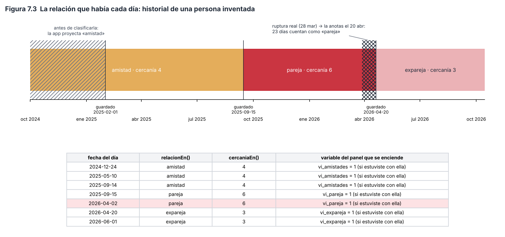
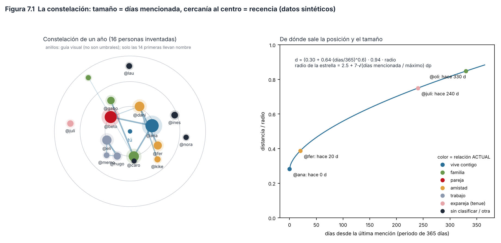
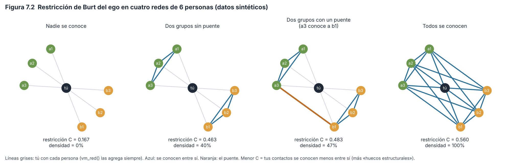

# Capítulo 7. Personas y red social

> **Para qué sirve este capítulo.** Explica **cómo la app registra a la gente de tu vida** y qué hace con eso: cómo reconoce a una persona cuando la nombras con @, cómo guarda qué es para ti (y cómo eso cambia con los años), cómo mide qué tan cerca la sientes, cómo dibuja la **Constelación** y la **Red**, qué calcula R con `vm_red()` y cómo entran las personas en las correlaciones. Todo corresponde a la versión v81 del código (commit `fa527df`). **Las personas, fechas y números de los ejemplos son inventados.**
>
> **Cómo leerlo.** Igual que los capítulos anteriores: lenguaje sencillo, pero las cifras, umbrales y condiciones del código van tal cual, con el nombre de la función de donde salen. Cada decisión se marca como **[Validado]** (respaldada por literatura o un estándar), **[Aproximación]** (razonable, con supuestos que conviene conocer) o **[Diseño propio]** (decisión de la app, sin estándar detrás). Los problemas encontrados se numeran H-6-n y se detallan en `hallazgos.md`.
>
> **Privacidad.** El capítulo describe la mecánica; no hay nombres reales. Los momentos del seguimiento privado se mencionan solo para decir dónde entran y dónde no (sección 7.13).

---

## 7.1 Mini-glosario

| Término | Qué significa aquí |
|---|---|
| **Mención** | Escribir `@nombre` en un texto (diario, momento, sueño, nota, carta). La app solo «ve» a una persona si está escrita así. |
| **Nombre canónico** | El nombre con el que la app cuenta a una persona después de aplicar las **equivalencias** (si dijiste que `@anita` es `@ana`, el canónico de `anita` es `ana`). |
| **Relación** | Qué es esa persona para ti (familia, pareja, amistad…). Se guarda con **historial**: la relación que tenía cada día. |
| **Grupo de relación** | La relación simplificada que usan los análisis: `familia`, `pareja`, `amistad`, `trabajo`, `casa` y, aparte, `expareja` y las demás (sección 7.4). |
| **Cercanía (IOS)** | Qué tan cerca sientes a alguien, de 1 a 7, eligiendo entre siete pares de círculos cada vez más encimados (Aron et al., 1992). |
| **Presencia** | Si ese día **estuviste con** la persona, solo **pensaste en** ella o hablaron por **mensajes** (capítulo 3, sección 3.13). |
| **Co-mención** | Que dos personas aparezcan mencionadas **el mismo día lógico**, aunque sea en textos distintos. Es la base de las líneas de la Constelación y de la Red. |
| **Red (grafo)** | Un dibujo de **nodos** (personas) unidos por **aristas** o **vínculos** (líneas). En matemáticas se llama *grafo*. |
| **Red egocéntrica** | La red vista desde una persona central, el **ego** (tú), con sus contactos (los **alteri**) y las relaciones entre ellos (Perry et al., 2018). Es el tipo de red de esta app. |
| **Grado** | Cuántas líneas tiene un nodo: con cuántas personas está unida. |
| **Densidad** | Qué fracción de todas las líneas posibles existe. Con *n* personas hay *n(n−1)/2* pares posibles. |
| **Componente** | Un grupo de nodos conectados entre sí por algún camino; dos componentes no tienen ninguna línea entre ellas. |
| **Restricción de Burt** | Una medida de qué tanto tus contactos **se conocen entre sí** (son redundantes). Baja = tus contactos están en mundos separados y tú eres el puente entre ellos (Burt, 2004; sección 7.11). |
| **Día lógico** | El día de la app: empieza a las 05:00 (capítulo 2). |

---

## 7.2 Mapa: de una @mención a cada salida

La misma persona puede «aparecer» de forma distinta según la función, porque **cada función lee textos distintos**. Esta tabla resume qué lee cada una (la diferencia importa: ver H-6-9).

| Función (archivo) | Diario (`nota`) | Momentos | Momentos privados (recaída, libido) | Sueño (texto y temas) | Mejor/peor momento | Notas del cronómetro | Cartas | Equivalencias |
|---|---|---|---|---|---|---|---|---|
| `Personas.menciones` (`data/Personas.kt`): lista de «Tu gente», «¿Quién es @x?», duplicados | sí | sí | **sí** | sí | no | sí | destinatario | sí |
| Variable `personas` del panel (`Estadistica.panel`) | sí | no | no | no | no | no | no | sí |
| `Presencias.delDia` → `personas_vistas`, `vi_*`, `penso_en_*`, `cercania_media`, `pen_*` | sí | sí | no | no | no | no | no | sí |
| Familia `per_` (`Dinamicas.construir`) | sí | sí | **sí** | sí | sí | no | destinatario y texto | sí |
| Constelación (`Constelacion.calcular`) | sí | sí | no | no | no | no | no | sí |
| Red y exportación `vm_red_*` (`RedPersonas.calcular`) | sí | sí | no | no | no | no | no | sí |
| Tarjeta «personas en tu cielo este año» (`Explorar.kt`, `Vida.kt`) | sí | no | no | no | no | no | no | **no** |

«Momentos privados» son los de tipo `recaida` o `libido` (la propiedad `Momento.privado` en `data/Modelo.kt`). Los momentos de tipo `impulso` **no** cuentan como privados para el código, así que entran en todas las filas que dicen «Momentos» (sección 7.13).

---

## 7.3 Menciones con @ y equivalencias

### 7.3.1 Qué hace

La app no intenta adivinar nombres en el texto libre: **solo cuenta a una persona si la escribes con @**. Así evita confundir «Rosa» (persona) con «rosa» (color) y no necesita reconocer nombres propios.

### 7.3.2 Cómo lo hace exactamente

- **Reconocer la mención** (`Texto.personas`): busca la expresión regular `@([\p{L}\p{N}_]+)`, es decir, una arroba seguida de letras (de cualquier alfabeto, con acentos), números o guion bajo. El nombre se pasa a **minúsculas**. `@Ana`, `@ana` y `@ANA` son lo mismo; `@ana.` termina en el punto; `@ana_m` es distinta de `@ana`.
- **Nombre canónico** (`Texto.canon`): si el nombre está en la tabla de equivalencias, se cambia por su equivalente; si no, se queda igual. **Es un solo paso**: si dijiste `anita → ana` y luego `ana → ana_g`, `anita` se cuenta como `ana`, no como `ana_g` (H-6-11).
- **Detectar posibles duplicados** (`Personas.duplicados`): compara cada par de nombres mencionados y propone «¿son la misma persona?» si se cumple cualquiera de estas condiciones (`Texto.parecidos` y la regla de prefijo):
  1. son iguales al quitar los guiones bajos (`luis_m` y `luism`);
  2. ambos tienen 4 letras o más y su **distancia de Levenshtein** es ≤ 2 (cuántas letras hay que cambiar, agregar o quitar para pasar de uno a otro: `daniel` → `danie` es 1);
  3. ambos tienen 3 letras o más, uno empieza con el otro y la diferencia de largo es ≤ 3 (`ana` y `anita`).

  Muestra hasta 20 pares (la pantalla enseña 6). Puedes responder «misma: @a», «misma: @b» (`Personas.unir` agrega la equivalencia) o «son distintas» (`Personas.distintas`, que guarda el par para no volver a preguntar).
- **Pedir que clasifiques** (`Personas.pendientes`): la tarjeta «¿Quién es @x?» propone, de la más mencionada a la menos, a quien aparece **2 días o más**, no está clasificada en «Tu gente» ni en «Conocerte» y no marcaste «no preguntar».

**Razonamiento.** Marcar a mano es más fiable que reconocer nombres automáticamente, y las equivalencias resuelven apodos y errores de dedo sin reescribir el diario (lo escrito se conserva; solo cambia cómo se cuenta). **[Diseño propio]**, razonable.

### 7.3.3 Ejemplo

Durante un mes escribes `@Dani` 6 días y `@daniel` 3 días. Sin equivalencias, son dos personas: 6 y 3 días. Como `dani` y `daniel` cumplen la regla 3 (prefijo, diferencia de 2 letras), la app pregunta. Si eliges «misma: @dani», se guarda `daniel → dani` y desde ese momento todas las funciones cuentan **9 días** (o menos si algún día aparecen ambas: un día cuenta una vez).

### 7.3.4 Cuándo falla

- **Personas sin @**: si escribes «comí con mi mamá» sin `@`, la app no la ve. Todas las variables sociales cuentan **menciones marcadas**, no contactos reales.
- **Homónimos**: dos personas distintas con el mismo `@nombre` se cuentan como una. La solución es escribirlas distinto (`@ana_t`, `@ana_u`).
- **Equivalencias compartidas con los temas**: la misma tabla `Config.equivalencias` se usa para `@personas` y `#temas` (el código llama a `Texto.canon` con el mismo mapa en ambos casos). Una equivalencia `ana → ana_g` creada para personas también cambiaría un tema `#ana` (H-6-11). Es poco probable, pero posible.

---

## 7.4 Quién es cada persona: relaciones con historial

### 7.4.1 Qué hace

En «Tu gente» dices qué es cada @persona para ti. Si eso cambia (pareja → expareja), la app **guarda lo de antes** con su fecha, y los análisis usan **la relación que había cada día**.

### 7.4.2 Las opciones

`Personas.RELACIONES` ofrece 12: familia, pareja, expareja, amistad cercana, amistad, colega o compañero de trabajo, compañero de escuela, profesor/jefe/mentor, conocido, «no la conozco en persona», mascota y otra.

Para los análisis se **agrupan** (`Personas.grupo`):

| Relación guardada | Grupo |
|---|---|
| familia, casa | `familia` |
| pareja | `pareja` |
| amistad, amistad cercana | `amistad` |
| colega, compañero de escuela, mentor, trabajo | `trabajo` |
| expareja, conocido, lejana, mascota, otra | se quedan como están (`expareja`, `conocido`…) |

Además existe la sección «Conocerte» (capítulo 3), con **«a quién ves más»** (`perfil.cercanas`, cada una con relación pareja/familia/amistad/trabajo/otra) y **«quiénes viven contigo»** (`perfil.convivientes`).

**Qué relación se usa** (`Perfiles.relacion(persona, perfil, fecha)`), en este orden:

1. Si la persona está en «Tu gente», el **grupo** de la relación que tenía en esa fecha.
2. Si no, si está en «a quién ves más» de Conocerte, esa relación (o `otra` si no la dijiste).
3. Si no, si está en «quiénes viven contigo», `casa`.
4. Si no, ninguna (`null`): la persona cuenta en los totales, pero no en `vi_familia`, `vi_pareja`, etc.

### 7.4.3 Cómo se guarda el historial (exacto)

Cada persona (`Persona` en `data/Modelo.kt`) tiene `relacion`, `cercania`, `detalle`, `desde` (el día en que la clasificaste por primera vez) e `historial`, una lista de `CambioRelacion(hasta, relacion, cercania)`.

**Al guardar** (`Personas.guardar`), hay «cambio» si:

- la relación es distinta de la anterior, **o**
- la cercanía anterior y la nueva existen las dos y son distintas.

Si hay cambio, se agrega al historial `CambioRelacion(hasta = hoy, relación anterior, cercanía anterior)`. «Hoy» es el **día lógico en que guardas**. Si la nueva cercanía viene vacía, se conserva la anterior.

**Al consultar** (`Personas.relacionEn(nombre, fecha)`): ordena el historial por `hasta` y toma la **primera** entrada con `fecha < hasta`; si ninguna cumple, usa la relación actual. `cercaniaEn` hace lo mismo con la cercanía (si esa entrada no tenía cercanía, usa la actual). En palabras: **cada entrada del historial vale para los días anteriores a su `hasta`** (y posteriores al `hasta` de la entrada anterior); el propio día del cambio ya tiene la relación nueva.

### 7.4.4 Ejemplo trabajado (Figura 7.3)

Clasificas a una persona inventada así:

1. 1 feb 2025: amistad, cercanía 4.
2. 15 sep 2025: la cambias a pareja, cercanía 6 → historial: `(hasta 2025-09-15, amistad, 4)`.
3. 20 abr 2026: la cambias a expareja, cercanía 3 → historial: `(hasta 2026-04-20, pareja, 6)`.

| Día que se analiza | Primera entrada con fecha < hasta | `relacionEn` | `cercaniaEn` |
|---|---|---|---|
| 2024-12-24 | 2025-09-15 | amistad | 4 |
| 2025-09-14 | 2025-09-15 | amistad | 4 |
| 2025-09-15 | 2026-04-20 | pareja | 6 |
| 2026-04-02 | 2026-04-20 | pareja | 6 |
| 2026-04-20 | ninguna | expareja | 3 |

Si estuviste con ella el 2 abr 2026, ese día se enciende `vi_pareja` (no `vi_expareja`).

*Figura 7.3. Historial de una persona inventada. Rayado: días anteriores a la primera clasificación, a los que se les proyecta la relación más antigua. Cuadriculado: días entre la ruptura real y el día en que la anotaste, que cuentan con la relación vieja. Script: `figuras/fig19_relacion_fecha.py`.*

**Razonamiento.** En un registro de años, las relaciones cambian. Si los análisis usaran la relación de hoy, todos los días con quien hoy es expareja contarían como «estuve con una expareja», incluidos los días en que era tu pareja: eso mezclaría dos situaciones opuestas. Guardar la relación por fecha es la forma correcta de tratar una **covariable que cambia con el tiempo** (*time-varying covariate*: un dato de contexto que no es fijo, sino que tiene un valor por periodo). **[Diseño propio]**, bien planteado.

### 7.4.5 Cuándo falla

- **La fecha del cambio es la fecha en que lo anotas**, no la fecha en que ocurrió. No hay forma de decir «terminamos hace tres semanas». En la Figura 7.3, los 23 días entre la ruptura real (28 mar) y la anotación (20 abr) cuentan como pareja (H-6-3).
- **Antes de la primera clasificación se proyecta la relación más antigua conocida.** Si clasificaste a alguien como amistad en 2025, los días de 2024 (cuando quizá era un conocido) también cuentan como amistad. Es el mismo problema que el perfil proyectado hacia atrás (H-2-5).
- **Conocerte no tiene historial por persona.** «A quién ves más» y «quiénes viven contigo» se leen con su valor **actual** para todas las fechas (H-6-4). Si alguien dejó de vivir contigo, `vi_convivientes` lo sigue contando como conviviente en todos los días anteriores y posteriores.
- **Comparaciones sin canon.** `Perfiles.relacion` busca en `perfil.cercanas` con `it.nombre == persona` y en `perfil.convivientes` con `persona in convivientes`, sin aplicar las equivalencias. Si en Conocerte escribiste `anita` y el canónico es `ana`, no se reconoce (H-6-4).
- **Cercanía que no se puede borrar ni fechar.** Guardar con la cercanía vacía conserva la anterior (`cercania ?: previo.cercania`), así que una vez puesta no se puede quitar. Y si la persona no tenía cercanía y le pones una, no hay «cambio»: la nueva cercanía se aplica a todos los días pasados (H-6-12).
- **Varios cambios el mismo día**: si cambias dos veces en un día, la relación intermedia se pierde (las dos entradas tienen el mismo `hasta`). Es irrelevante en la práctica.

---

## 7.5 Cercanía: los círculos de Aron (escala IOS)

### 7.5.1 Qué es la escala original

La **escala de Inclusión del Otro en el Yo** (*Inclusion of Other in the Self*, IOS) de Aron, Aron y Smollan (1992) es una pregunta de **un solo reactivo** con dibujos: siete pares de círculos, uno rotulado «yo» y otro «otro», que van de separados a casi completamente encimados. Eliges el par que mejor describe tu relación. La idea es que en una relación cercana el otro pasa a «formar parte» de cómo te ves a ti mismo. Los autores la validaron en dos estudios: buena confiabilidad (da lo mismo si se repite), relación con otras medidas de cercanía y capacidad de predecir si una relación de pareja seguía meses después (Aron et al., 1992). Gächter, Starmer y Tufano (2015) la compararon con seis medidas de cercanía en 772 adultos y concluyeron que es una medida fiable de la cercanía **subjetiva**; un índice combinado de las otras escalas correlacionó ρ = .85 con la IOS. **[Validado]** como instrumento.

### 7.5.2 La versión de la app

`CirculosCercania` (en `ui/pantallas/Gente.kt`) dibuja siete pares de círculos de radio *r*; la distancia entre los centros del par *i* es

$$d_i = r\,(2.1 - 0.31\,(i-1)), \quad i = 1,\dots,7$$

es decir, de 2.1 *r* (los círculos no se tocan) a 0.24 *r* (casi uno encima del otro). Debajo pone una palabra por nivel (`CERCANIA`): 1 «Casi nada en común», 2 «Poco», 3 «Algo», 4 «Bastante», 5 «Mucho», 6 «Muy cercana», 7 «Casi parte de mí». Es opcional; tocar de nuevo el par elegido lo desmarca.

Como la distancia entre centros baja en línea recta, la **fracción encimada** de cada círculo no sube en línea recta. Calculada con la fórmula del área de intersección de dos círculos iguales:

| Nivel | 1 | 2 | 3 | 4 | 5 | 6 | 7 |
|---|---|---|---|---|---|---|---|
| *d*/*r* | 2.10 | 1.79 | 1.48 | 1.17 | 0.86 | 0.55 | 0.24 |
| Fracción encimada | 0 % | 4 % | 15 % | 30 % | 47 % | 65 % | 85 % |

No pude comprobar en esta sesión cómo están espaciados los círculos en la publicación original **[sin verificar]**, así que no puedo decir si esta progresión se parece a la suya.

**Diferencias con el original y qué implican.** **[Aproximación]**:

- **Etiquetas con palabras.** La IOS original es solo dibujo. Las palabras de la app ayudan a que un «5» signifique lo mismo con el tiempo (como las anclas del capítulo 3), pero cambian el instrumento: alguien puede elegir por la palabra y no por el dibujo.
- **Se responde una vez por persona, no por día.** En los estudios, la IOS se aplica en un momento dado. En la app, la cercanía es un rasgo de la persona que **solo cambia cuando la editas**. Por eso `cercania_media` (sección 7.7) mide **a quién nombras** (personas que sientes más o menos cercanas), no **cómo te sentiste con ellas ese día**.
- **No se pregunta con regularidad.** Si no la actualizas, la cercanía de hace años sigue valiendo. No hay recordatorio para revisarla.

---

## 7.6 Presencias: estuve, pensé, mensajes (resumen)

El capítulo 3 (sección 3.13) explica las reglas de `data/Presencias.kt`. Lo que importa aquí:

- Cada persona de un día tiene uno de tres estados: `estuve`, `pense`, `mensajes`.
- **En el diario, el estado por omisión es «estuve»** si no tocas el nombre (H-1-6).
- Si alguien aparece **solo en momentos**, cuenta como «pensé» cuando el momento era «pensando en…» o «recuerdo» y no marcaste compañía (o marcaste solo «solo»); en cualquier otro caso, «estuve». Basta un momento con «estuve» para que el día cuente «estuve».
- **El diario manda**: si la persona está en el diario, se ignoran los momentos.
- `Presencias.delDia` **excluye los momentos privados** (`recaida`, `libido`).
- La pantalla «¿Estuviste o pensaste?» (`PantallaPresencias`) lista los días con personas sin revisar; «dejar todos como están» los da por revisados sin cambiar nada.

---

## 7.7 Las variables de personas en el panel

### 7.7.1 Variables fijas (`Estadistica.panel`)

Se calculan para **cada día que tenga documento de diario o algún momento** (`Repo.dias.keys` ∪ fechas de momentos). Primero `Presencias.delDia` da el estado de cada persona; luego se busca el grupo de relación **de ese día** (sección 7.4).

| Variable | Definición exacta | Aparece en la lista de análisis si… |
|---|---|---|
| `personas` | Número de @personas **distintas** (canónicas) en el **texto del diario**, sin importar su estado | siempre |
| `cercanos` | Número de personas con estado «estuve» y grupo `familia`, `pareja`, `amistad` o `casa` | hay alguien en Conocerte o en Tu gente |
| `vi_familia`, `vi_pareja`, `vi_amistades` | 1 si estuviste con al menos una persona de ese grupo; 0 si no | igual |
| `vi_convivientes` | 1 si estuviste con alguien cuyo nombre canónico está en la lista **actual** de convivientes **y** tiene algún grupo de relación | igual |
| `vi_expareja` | 1 si estuviste con alguien que **ese día** era expareja | alguien es o fue expareja |
| `vi_trabajo` | 1 si estuviste con alguien del grupo `trabajo` | alguien de Tu gente es del grupo trabajo |
| `personas_vistas`, `personas_pensadas`, `personas_mensajes` | Cuántas personas tuvieron cada estado (incluye personas sin clasificar) | algún día tiene un estado distinto de «estuve» marcado, o algún momento «pensando en» nombra a alguien |
| `penso_en_pareja`, `penso_en_expareja`, `penso_en_familia`, `penso_en_amistades` | 1 si pensaste sin ver a alguien de ese grupo | lo anterior (y, para pareja y expareja, que existan) |
| `cercania_media` | Promedio de `cercaniaEn` (cercanía de ese día) de **todas** las personas del día (cualquier estado) que tengan cercanía; vacío si ninguna | alguien tiene cercanía |
| `cartas_otros` | Cartas escritas a otra persona ese día (0 desde la primera carta) | hay cartas a otros |

Hay además variables de **compañía en los avisos** (`acompanado_pct`, `con_pareja`, `con_amigos`…), que **no** salen de las @menciones sino de la pregunta «¿con quién estás?» de cada registro de ánimo. Se explican en el capítulo 3; son una segunda fuente, independiente, sobre lo mismo.

### 7.7.2 Variables dinámicas: una por persona (`Dinamicas.construir`)

- **`per_<nombre>`**: «Aparece @x (diario, momentos, sueños o cartas) (0/1)». Vale 1 si la persona se menciona ese día en cualquiera de: texto del diario, texto del sueño, temas del sueño (los que no empiezan con `#`), «mejor momento» o «peor momento», el texto de **cualquier** momento, o una carta (como destinataria o dentro del texto). Vale 0 en los demás días con diario o momentos.
  - En los análisis entran las **15** personas con más días, siempre que tengan **al menos 5 días**. En la exportación extendida, todas las que tengan al menos 2 días (hasta 400).
- **`pen_<nombre>`**: «Pensé en @x sin verla (0/1)». Vale 1 si `Presencias.delDia` le da estado «pensé» ese día. Entran las **10** con más días, con **al menos 3 días** (en la exportación extendida, desde 2).
- El nombre de la variable es el `slug` del nombre canónico (minúsculas sin acentos, con `_`), hasta 40 caracteres; si dos coinciden, se agrega `_2`, `_3`…

**No existe una variable por persona de «estuve con @x».** `per_` mezcla haber estado con ella, pensar en ella, soñarla o escribirle una carta (H-6-2).

### 7.7.3 Ejemplo trabajado

Un día inventado. Diario: «Desayuné con @ana y @beto. Me acordé de @caro.» Tocas `@caro` y queda en «pensé». Un momento de las 18:00, tipo «pensando en…», sin compañía marcada: «@dani me hace falta». Esa noche sueñas con `@eli`.

Relaciones de ese día: ana = familia (cercanía 6), beto = pareja (7), caro = amistad cercana (5), dani = amistad (4), eli = colega (sin cercanía).

1. `Presencias.delDia`: ana → estuve, beto → estuve, caro → pensé (lo marcaste en el diario), dani → pensé (solo en un momento «pensando en», sin compañía). eli no aparece (los sueños no cuentan aquí).
2. `personas` = 3 (ana, beto, caro: solo el diario).
3. `personas_vistas` = 2, `personas_pensadas` = 2, `personas_mensajes` = 0.
4. `cercanos` = 2 (ana familia, beto pareja). `vi_familia` = 1, `vi_pareja` = 1, `vi_amistades` = 0 (caro y dani fueron «pensé»).
5. `penso_en_amistades` = 1 (caro y dani son del grupo amistad). `penso_en_familia` = 0.
6. `cercania_media` = (6 + 7 + 5 + 4) / 4 = **5.5** (incluye a las pensadas).
7. `per_ana` = `per_beto` = `per_caro` = `per_dani` = `per_eli` = 1 (eli por el sueño). `pen_caro` = `pen_dani` = 1.

### 7.7.4 Cuándo falla

- **Un 0 no siempre quiere decir «no la vi».** El panel pone `vi_familia = 0`, `personas_vistas = 0`, etc. en **cualquier día con documento de diario o con algún momento**, aunque ese día no hayas escrito el diario (por ejemplo, un día en que solo respondiste un aviso de ánimo o solo anotaste el sueño). Ese 0 significa «no la nombré», no «no la vi», y se confunde con los días en que de verdad no viste a nadie (H-6-13). Es un caso de dato faltante que se convierte en 0 (H-2-4).
- **Lo que no se nombra no existe** (sección 7.3.4).
- **«Estuve» por omisión** infla las presencias (H-1-6).
- **Relaciones proyectadas** hacia atrás o con fecha de cambio tardía (sección 7.4.5).

---

## 7.8 Co-mención como aproximación de co-presencia

### 7.8.1 Qué se hace

La Constelación y la Red trazan una línea entre dos personas cuando **aparecen el mismo día lógico**. La idea implícita: si nombras a dos personas el mismo día, es probable que se relacionen (estaban juntas, o las viste en el mismo contexto).

### 7.8.2 Qué tan buena es esa aproximación

**[Aproximación]** débil, por varias razones:

- **El mismo día no es el mismo momento.** Si ves a tu hermana en la mañana y a un compañero en la noche, aparecen juntos aunque nunca se hayan visto. La co-mención mide **co-ocurrencia en tu día**, no que esas personas compartan algo.
- **No distingue el estado.** La Constelación y la Red cuentan la mención sin mirar si fue «estuve», «pensé» o «mensajes»: pensar en alguien mientras estás con otra persona crea una línea.
- **Depende de cuánto escribes.** Los días con diarios largos generan muchas líneas; los días con una línea, ninguna.
- **La memoria de con quién interactuamos es imperfecta.** En estudios clásicos, lo que la gente reporta de sus interacciones coincide solo en parte con lo observado (Bernard et al., 1984). Y al comparar registros del teléfono con lo que las personas reportan, los dos tipos de datos se parecen pero no son lo mismo: lo reportado se desvía según qué tan reciente y qué tan llamativa fue la interacción (Eagle et al., 2009). El diario tiene este sesgo: anotas a quien recuerdas o te importó, no a todos.

Por eso la app exige **al menos 2 días juntas** para dibujar una línea derivada (`minJuntos = 2`; sección 7.10), lo que filtra coincidencias de un solo día. Y la Red permite **declarar** quién conoce a quién (sección 7.10.2), que es más fiable que la co-mención.

---

## 7.9 La Constelación

### 7.9.1 Qué muestra

Tu gente como un cielo: tú en el centro, cada persona una estrella. **Más grande** si la mencionaste más días; **más cerca del centro** si la mencionaste hace poco. Las personas que aparecen juntas quedan unidas por líneas. El color indica la relación. Está en `ui/pantallas/Constelacion.kt`.

### 7.9.2 Cómo lo hace exactamente (`Constelacion.calcular` y `PantallaConstelacion`)

1. **Periodo**: «3 meses» (90 días), «un año» (365, por omisión) o «siempre». Se toman los días con fecha ≥ hoy − periodo.
2. **Quién aparece**: menciones del **diario** y de los **momentos no privados** dentro del periodo, con nombre canónico. Para cada persona: `dias` = días distintos con mención; `ultima` = el día más reciente.
3. **Quiénes salen**: las **80** con más días.
4. **Líneas**: pares que aparecen el mismo día en **2 días o más** del periodo.
5. **Distancia al centro** (fracción del radio del dibujo):

$$d = \left(0.30 + 0.64\cdot \min\!\left(1, \frac{\text{días desde la última mención}}{P}\right)^{0.6}\right)\cdot 0.94$$

   donde *P* es el periodo en días (para «siempre», los días desde el primer diario, con mínimo 30). Así, alguien mencionado hoy queda a 0.28 del radio, y alguien no mencionado en todo el periodo, a 0.88. El exponente 0.6 abre más espacio entre los recientes.

6. **Ángulo**: el «ángulo de girasol» (2.399963 radianes ≈ 137.5° entre una estrella y la siguiente, por orden de días) más un pequeño ajuste fijo por nombre (hasta 0.35 radianes, según el `hashCode` del nombre). Sirve **solo para que no se encimen**: el ángulo **no significa nada**, y cambia si cambia el orden de las personas.
7. **Tamaño**: radio = 2.5 + 7·√(días / días de la más mencionada), en dp (unidades de pantalla), con un halo de 2.2 veces ese radio.
8. **Líneas**: opacidad = min(0.12 + 0.06·*n*, 0.5) y grosor = min(0.6 + 0.15·*n*, 2) dp, con *n* = días juntas.
9. **Color**: grupo de relación **actual** (`Perfiles.relacion(p)` sin fecha): casa, familia, pareja, amistad, trabajo y expareja (tenue); las demás, del color del texto.
10. **Nombres**: solo las 14 primeras (o la que tocas). Al tocar una estrella: días, última vez, relación y «suele aparecer con» las 4 personas con más días juntas.
11. Tres anillos de guía a 1/3, 2/3 y el total del radio útil; son decorativos, no umbrales.

*Figura 7.1. Una constelación de un año con 16 personas inventadas, calculada con las fórmulas de la app. Derecha: la curva que convierte «hace cuántos días» en distancia. Script: `figuras/fig17_constelacion.py`.*

### 7.9.3 Ejemplo

Con el periodo de un año: `@fer` fue mencionada 44 días, la última hace 20. La más mencionada tiene 210 días. Distancia: (20/365)^0.6 = 0.175; 0.30 + 0.64·0.175 = 0.412; ×0.94 = **0.387** del radio. Tamaño: 2.5 + 7·√(44/210) = 2.5 + 7·0.458 = **5.7 dp**.

### 7.9.4 Razonamiento y cuándo falla

Es una **visualización**, no un análisis: no produce variables ni entra en las correlaciones. **[Diseño propio]**. Combina dos ideas útiles: *frecuencia* (tamaño) y *recencia* (distancia). Hasta donde sé, la literatura sobre el tamaño de las redes sociales describe «círculos» de cercanía cada vez más amplios (no lo verifiqué en esta sesión **[sin verificar]**), pero aquí la distancia mide **recencia de la mención**, no cercanía emocional; para esa está la escala IOS.

Límites:

- **Color con la relación de hoy** (pista 6 del plan, confirmada). Una expareja aparece en rosa tenue aunque en el periodo mostrado haya sido tu pareja casi todo el tiempo. Para un dibujo de «cómo está hoy tu cielo» es razonable; solo hay que saberlo (H-6-14).
- **La distancia premia la última mención.** Una persona que viste a diario durante 11 meses y no mencionas desde hace 30 días queda más lejos que alguien que nombraste una vez ayer.
- **Las líneas son co-menciones** (sección 7.8).
- **Momentos de impulso**: al no ser «privados» para el código, sus @menciones cuentan (sección 7.13).

---

## 7.10 La pantalla Red

### 7.10.1 Qué muestra

Quién conoce a quién, como un grafo. Las **líneas firmes** son lo que **dijiste** en Tu gente; las **finas**, personas que aparecen juntas en tu diario o tus momentos **al menos 2 días**. Arriba, tres cifras: personas, densidad y número de grupos. Está en `PantallaRed` (`ui/pantallas/Lote3.kt`) y `RedPersonas` (`data/Lote3.kt`).

### 7.10.2 Vínculos declarados

En la ficha de una persona, «¿A quién conoce?» muestra hasta 24 personas (las clasificadas y las 20 más mencionadas). Cada toque avanza: sin decir → se conocen → familia entre sí → pareja → colegas → no se conocen → sin decir (`RedPersonas.siguiente`). Se guarda un `Vinculo(a, b, tipo)` con el par ordenado alfabéticamente, así que es **simétrico** (si A conoce a B, B conoce a A). «No se conocen» es información explícita: ese par **no** se dibuja ni cuenta como unido, aunque aparezcan juntas.

### 7.10.3 Cómo se calcula (`RedPersonas.calcular(minJuntos = 2, max = 45)`)

1. Para **todo el historial** (sin periodo), junta por día las personas del **diario** y de los **momentos no privados**.
2. `dias[p]` = días con mención; `juntos[a, b]` = días en que aparecen las dos.
3. **Nodos**: las **45** personas con más días, **más** todas las que tengan algún vínculo declarado (aunque tengan 0 días).
4. **Aristas**: pares con `juntos ≥ 2` **o** con vínculo declarado (de cualquier tipo), siempre que ambos estén entre los nodos.
5. **Líneas que cuentan** («conectadas»): todas menos las declaradas «no se conocen».
6. **Grado** de cada nodo: número de líneas que cuentan.

### 7.10.4 Las tres cifras

- **Personas**: número de nodos *n*.
- **Densidad**: líneas que cuentan / (*n*(*n*−1)/2), en porcentaje. Incluye en *n* a las personas sin ninguna línea.
- **Grupos** (`componentes`): número de componentes conectadas **sin contar a quienes no tienen ninguna línea**. Usa la técnica de *unión-búsqueda* (cada nodo apunta a un «representante» de su grupo; al encontrar una línea se juntan los dos grupos).

**Ejemplo.** 10 personas; líneas: un triángulo (A-B, B-C, A-C), una pareja de líneas (D-E, E-F), una línea G-H; I y J sin líneas. Densidad = 6 / 45 = **13 %**. Grupos = **3** ({A,B,C}, {D,E,F}, {G,H}); I y J no cuentan como grupo.

### 7.10.5 El dibujo: un modelo de fuerzas

`RedPersonas.acomodar` coloca los nodos con un **modelo de fuerzas** del tipo de Fruchterman y Reingold (1991): imagina que todos los nodos se repelen como imanes del mismo polo y que cada línea es un resorte que acerca a los unidos. Tras muchas vueltas, los grupos que se conocen quedan juntos y los grupos separados se alejan. **[Validado]** como técnica de dibujo (es estándar); no es una medida.

Parámetros exactos: posiciones iniciales al azar con semilla fija 7 (el dibujo es siempre igual con los mismos datos); distancia ideal *k* = 0.5/√*n*; repulsión *k*²/*d* entre todos los pares; atracción *d*²/*k*·peso en cada línea que cuenta, con peso **1.4** si es declarada y min(0.5 + 0.05·juntos, 1.2) si es derivada; una leve atracción al centro (0.12 × la distancia al centro) para que los sueltos no se vayan a las orillas; **300** vueltas con un paso máximo («temperatura») que empieza en 0.1 y se multiplica por 0.985 cada vuelta (mínimo 0.002); al final se estira todo al cuadro de 0.1 a 0.9.

Estilo: líneas declaradas de 2 dp y más opacas (punteadas si son «colegas»); derivadas de 1 dp y tenues. Radio del nodo = 4 + 8·√(días / máximo) dp. Nombres visibles si la persona tiene al menos 1/4 de los días de la más mencionada, si hay 15 personas o menos, o si la tocas. El botón «solo lo que dije» quita las líneas derivadas.

### 7.10.6 Constelación frente a Red

| | Constelación | Red |
|---|---|---|
| Pregunta que responde | ¿Quién está presente en mi vida y desde cuándo? | ¿Cómo se conectan entre sí las personas de mi vida? |
| Periodo | 3 meses, un año o siempre | todo el historial |
| Personas | 80 más mencionadas | 45 más mencionadas + las que tienen vínculos dichos |
| Posición | ángulo decorativo; distancia = recencia | modelo de fuerzas: cerca = conectadas |
| Tamaño | días mencionada | días mencionada |
| Líneas | solo co-mención (≥ 2 días) | co-mención (≥ 2 días) + vínculos declarados |
| Color | grupo de relación actual (agrupado) | relación actual **sin agrupar** (ver abajo) |
| Cifras | ninguna | personas, densidad, grupos |

### 7.10.7 Cuándo falla

- **Colores incompletos.** En la Red, el color sale de `p?.relacion ?: Perfiles.relacion(n)`: para quien está en Tu gente se usa la relación **tal cual** (`amistad_cercana`, `colega`, `companero`, `mentor`) y no el grupo. La tabla de colores solo tiene `familia`, `pareja`, `amistad`, `casa`, `trabajo` y `expareja`, así que una amistad cercana o un colega salen **sin color de relación**, aunque el texto de ayuda dice «como en la Constelación» (H-6-5).
- **«Solo lo que dije» cuenta grupos de más.** Al activar ese filtro, el grado de cada nodo sigue siendo el calculado con **todas** las líneas. `componentes` incluye como grupo a cada persona con grado > 0, así que alguien que solo tenía líneas derivadas (ya ocultas) cuenta como un grupo de una sola persona. La ficha «unida a N» también muestra ese grado completo (H-6-6).
- **La densidad depende de cuántas personas sueltas haya.** Con 45 nodos hay 990 pares posibles; muchas personas mencionadas pocas veces y sin líneas bajan la densidad sin que tu red sea «menos unida».

---

## 7.11 Métricas en R: `vm_red()`

### 7.11.1 Qué se exporta

`Exportar.filasRed` llama a `RedPersonas.calcular(minJuntos = 1, max = 400)`:

- `vm_red_nodos.csv`: `persona`, `relacion` (actual, sin agrupar para Tu gente; agrupada para Conocerte), `cercania` (actual), `dias_mencion`, `grado` (calculado con **cualquier** co-mención, `minJuntos = 1`).
- `vm_red_vinculos.csv`: `a`, `b`, `tipo_declarado` (vacío si no lo dijiste), `dias_juntos`.

Exportar con `minJuntos = 1` permite elegir el umbral en R. Pero ojo: el `grado` del archivo **no** es el que muestra la app (que usa 2 días).

### 7.11.2 Qué hace `vm_red(declaradas = FALSE, min_juntos = 2)`

1. Se queda con los vínculos declarados (que no sean «no se conocen») **o**, si `declaradas = FALSE`, con los pares con `dias_juntos ≥ min_juntos`.
2. Arma el grafo no dirigido con **todos** los nodos del archivo (hasta 400), tengan o no líneas.
3. Calcula:
   - **`densidad`** = `igraph::edge_density(g)`: líneas / (*n*(*n*−1)/2), sin el ego.
   - **`componentes`** = `igraph::components(g)$no`: número de componentes **incluyendo a cada persona sin líneas** como componente propia.
   - **`restriccion_burt`**: agrega un nodo «yo» unido a todas las personas y calcula `igraph::constraint` para «yo».
   - **`grado`**: grado de cada persona, de mayor a menor.
   - **`composicion`**: cuántas personas hay de cada relación (`table(relacion)`).
4. Dibuja el grafo con tamaño 4 + 2·√(días mencionada) y color por relación.

Requiere el paquete `igraph`.

### 7.11.3 Las métricas explicadas

**Densidad.** Si de 10 personas hay 9 pares que se conocen, la densidad es 9/45 = 0.20: uno de cada cinco pares posibles está unido. Una red personal densa es un grupo donde todos se conocen (un pueblo, una familia grande); una poco densa, varios mundos separados (trabajo, escuela, familia). Ninguna es «mejor» en sí: Burt (2004) muestra ventajas de ser el puente entre grupos que no se conocen (acceso a ideas y opciones distintas); de las redes densas se dice en general que dan más apoyo y confianza mutua, afirmación que no verifiqué con una fuente en esta sesión **[sin verificar]**.

**Componentes.** Cuántos «mundos» sin ninguna conexión entre sí tiene tu red.

**Restricción de Burt.** Burt llamó **huecos estructurales** (*structural holes*) a la ausencia de conexión entre dos de tus contactos: si conoces a dos personas que no se conocen entre sí, tú eres el puente. Su **restricción** (*constraint*) mide lo contrario: qué tanto tu tiempo y atención están «encerrados» en contactos redundantes, que se conocen entre sí. La fórmula (la que documenta `igraph::constraint`) es

$$C_i = \sum_{j \ne i} \Big(p_{ij} + \sum_{q \ne i,j} p_{iq}\,p_{qj}\Big)^2, \qquad p_{ij} = \frac{a_{ij}+a_{ji}}{\sum_{k \ne i}(a_{ik}+a_{ki})}$$

donde *a*ij = 1 si *i* y *j* están unidos. Sin pesos, *p*ij es simplemente 1/(grado de *i*): la parte de tu atención que «invierte» *i* en *j*. El término de adentro suma la inversión **indirecta**: lo que inviertes en *q* que a su vez invierte en *j*. Si tus contactos se conocen, cada uno te «llega» también por los demás y la restricción sube.

**Ejemplo trabajado (Figura 7.2).** Tú y 6 personas; `vm_red()` te une a las 6.

- **Nadie se conoce.** Cada *p* = 1/6 y no hay caminos indirectos: *C* = 6 × (1/6)² = **0.167** (en general, 1/*n*).
- **Dos grupos de 3** (cada grupo se conoce entero, sin conexión entre grupos). Cada persona tiene grado 3 (dos de su grupo + tú). Para un contacto *j*: directo 1/6; indirecto por sus dos compañeros de grupo, 2 × (1/6)(1/3) = 1/9. Término: (1/6 + 1/9)² = (5/18)² = 0.0772; × 6 = **0.463**.
- **Todos se conocen.** Cada persona tiene grado 6. Para un contacto *j*: directo 1/6; indirecto por los otros 5, 5 × (1/6)(1/6) = 5/36. Término: (11/36)² = 0.0934; × 6 = **0.560** (en general, (2*n*−1)²/*n*³).
- **Dos grupos con un puente** (a3 conoce a b1): **0.483**. Para ti, el puente *sube* la restricción, porque tus dos mundos ya no dependen solo de ti. Para a3, en cambio, es una ventaja: en la red sin ti, su restricción es 0.611 frente a 1.007 de sus compañeros de grupo; es la persona que une los dos grupos.

Estos números los calcula el script de la figura con la fórmula escrita a mano y los compara con `networkx.constraint` (coinciden). Para el ego unido a todas, `igraph` y `networkx` suman sobre las mismas personas, así que deberían coincidir también con R; **no pude ejecutar R en esta sesión** para confirmarlo **[sin verificar]**.

*Figura 7.2. Restricción de Burt del ego y densidad en cuatro redes de 6 personas (datos sintéticos). Script: `figuras/fig18_burt_puente.py`.*

**Composición.** Qué proporción de tu red es familia, amistad, trabajo… Es la descripción más sencilla de una red personal y una de las más usadas en el análisis de redes egocéntricas (Perry et al., 2018).

### 7.11.4 Razonamiento y validez

Las métricas son estándar **[Validado]** como definiciones (Burt, 2004; Perry et al., 2018). Lo que **no** está validado es la red sobre la que se calculan **[Aproximación]**:

- Las líneas derivadas son co-menciones (sección 7.8), no relaciones confirmadas. Con `declaradas = TRUE` solo cuentan las que dijiste, que son más fiables pero quizá incompletas.
- Los nodos son personas **mencionadas**, no tu red real.
- **La restricción y la densidad dependen mucho del número de personas.** Con el ego unido a todas, la restricción mínima es 1/*n*: con 400 personas puede bajar hasta 0.0025 solo por haber mencionado a mucha gente una vez. Como el archivo exportado no pone un mínimo de días para los nodos, cada persona mencionada un solo día baja la densidad y la restricción sin cambiar nada de tu red de verdad (H-6-8). Para comparar en el tiempo, conviene filtrar por un mínimo de `dias_mencion` antes de calcular.

### 7.11.5 Diferencias entre la app y R (H-6-7)

| Aspecto | App (pantalla Red) | R (`vm_red`) |
|---|---|---|
| Personas | 45 más mencionadas + declaradas | hasta 400 + declaradas, sin mínimo de días |
| Pares «no se conocen» que aparecen juntos ≥ umbral | **no** cuentan como línea | **sí** cuentan (la condición es «declarada y no "no se conocen"» **o** `dias_juntos ≥ min_juntos`) |
| Grupos / componentes | sin contar a las personas sin líneas | contando a cada persona sin líneas como componente |
| Grado | con co-mención ≥ 2 días | en el CSV, con ≥ 1 día; en R, recalculado con `min_juntos` |
| Relación | actual, sin agrupar | actual, sin agrupar (`composicion` separa «amistad» de «amistad_cercana») |

Con los mismos datos, la app y R pueden dar **densidades y número de grupos distintos** por estas razones, no por error de cálculo.

---

## 7.12 Cómo entran las personas en las correlaciones

Las variables de las secciones 7.7.1 y 7.7.2 entran en la lista de relaciones de Explorar con el mismo método que todas las demás (capítulo 6, pendiente del módulo 5): mínimo de días con dato, quitar la tendencia, intervalo y corrección por comparaciones múltiples. Lo específico de las personas:

- **Cuántas entran**: 15 `per_` (≥ 5 días) y 10 `pen_` (≥ 3 días). Es un filtro razonable para no llenar la lista de casos raros, pero significa que las relaciones con personas poco frecuentes **no se buscan** en la app (sí en R con la exportación extendida).
- **Pares «obvios» que se excluyen** (`Estadistica.obvia`), porque se mueven juntos por construcción:
  - cada `per_` con `personas`, `cercanos`, `vi_familia`, `vi_pareja`, `vi_amistades`, `vi_convivientes`, `palabras` y `cartas_otros` (`Dinamicas.AGREGADOS["per_"]`);
  - cada `pen_` con `personas`, `personas_pensadas` y los `penso_en_*`;
  - `per_x` con `pen_x` de la misma persona;
  - y las familias fijas: {`cercanos`, `vi_*`, `personas`, `palabras`}, {`cercanos`, `vi_*`, `cercania_media`, `personas`}, {`personas`, `personas_vistas`, `personas_pensadas`, `personas_mensajes`, `cercanos`}, {`personas_pensadas`, `penso_en_*`}.
- **Lo que no se excluye y quizá debería**: `per_x` con `personas_vistas`, `personas_mensajes`, `vi_expareja`, `vi_trabajo` y `cercania_media` (no están en `AGREGADOS["per_"]`). Si `@ana` es tu pareja, `per_ana` y `vi_pareja` se excluyen, pero `per_ana` con `personas_vistas` no, y saldrá como relación aunque sea por construcción (H-6-10).
- **Dos personas entre sí** (`per_ana` con `per_beto`) **no** se excluyen: una relación positiva entre ellas es su co-mención, que es la misma información de la Red. No es un error, pero no es un hallazgo nuevo.
- **La relación de cada día sí se usa** en `vi_*`, `penso_en_*` y `cercania_media` (sección 7.4). Las variables `per_`/`pen_` son por persona, sin relación.

---

## 7.13 Privacidad: dónde entran los momentos privados

Para el código, un momento es privado si su tipo es `recaida` o `libido` (`Momento.privado`). Según la tabla de la sección 7.2:

- **No entran** en presencias, `vi_*`, `personas_vistas`, `pen_`, Constelación ni Red (ni en `vm_red_*`).
- **Sí entran** en `per_` (`Dinamicas.construir` recorre todos los momentos) y en `Personas.menciones` (los días que ves en Tu gente, la tarjeta «¿Quién es @x?» y los duplicados). Esto no depende de que el seguimiento privado esté activado. En la práctica, una persona nombrada **solo** en momentos privados puede aparecer en «Tu gente» como pendiente de clasificar y tener su variable `per_` en la exportación (H-6-1).
- Los momentos de tipo **`impulso`** no son «privados» para el código, aunque el seguimiento de impulsos se considera privado en el resto de la app: sus @menciones entran **en todo** (presencias, Constelación, Red, `per_`). No sé si es intencional (H-6-1).

La pista 4 del plan («la constelación toma los momentos excepto el tipo `recaida`; la red excluye todos los privados») **no se confirma en esa forma**: en v81 ambas usan el mismo criterio (`!it.privado`, que excluye recaída y libido). Lo que sí queda es la inconsistencia con `per_`, `Personas.menciones` y los impulsos.

---

## 7.14 Resumen de decisiones

| Decisión | Clasificación | Respaldo |
|---|---|---|
| Solo cuentan las personas escritas con @ | Diseño propio | — |
| Equivalencias y detección de duplicados (Levenshtein ≤ 2, prefijo) | Diseño propio | — |
| Relación con historial por fecha | Diseño propio (bien fundado) | Tratamiento estándar de covariables que cambian en el tiempo |
| Grupos de relación (12 → 5 + otros) | Diseño propio | — |
| Cercanía con círculos de Aron (IOS) con etiquetas | Aproximación | Aron et al. (1992); Gächter et al. (2015) |
| Presencias (estuve / pensé / mensajes) | Diseño propio | capítulo 3 |
| Co-mención el mismo día como vínculo (≥ 2 días) | Aproximación (débil) | Bernard et al. (1984); Eagle et al. (2009), sobre los límites del autorreporte |
| Constelación (tamaño = frecuencia, distancia = recencia) | Diseño propio (visualización) | — |
| Dibujo por modelo de fuerzas | Validado (técnica de dibujo) | Fruchterman y Reingold (1991) |
| Densidad, componentes, restricción de Burt, composición | Validado (definiciones) | Burt (2004); Perry et al. (2018) |
| Ego unido a todas para la restricción | Validado (en una red egocéntrica el ego está unido, por definición, a cada contacto) | Perry et al. (2018) |
| Topes de 15 `per_` y 10 `pen_` en los análisis | Diseño propio | — |

---

## 7.15 Resumen del capítulo

1. La app reconoce a las personas **solo por `@nombre`**, en minúsculas, con equivalencias de un solo paso. Cada función lee textos distintos (sección 7.2), así que «aparecer» no significa lo mismo en todas partes.
2. La **relación con historial** es una buena decisión: los análisis usan la relación de cada día. Sus límites: la fecha del cambio es la de la anotación (H-6-3), lo anterior a la primera clasificación se proyecta, y Conocerte no tiene historial (H-6-4).
3. La **cercanía** usa la escala IOS, validada, con etiquetas añadidas y respondida una vez por persona; `cercania_media` describe a quién nombras, no cómo te fue con ellos ese día.
4. Las variables sociales del panel ponen **0 en días sin diario** pero con algún momento o documento (H-6-13), y **no hay variable por persona de «estuve con @x»**: `per_` mezcla presencia, pensamiento, sueños y cartas (H-6-2).
5. La **Constelación** es una visualización de frecuencia y recencia, coloreada con la relación actual. La **Red** combina co-menciones (≥ 2 días) y vínculos declarados, con un dibujo de fuerzas estándar; tiene dos fallos menores de presentación (H-6-5, H-6-6).
6. `vm_red()` calcula densidad, componentes, **restricción de Burt** y composición. Las definiciones son estándar, pero los resultados dependen mucho del número de personas incluidas (H-6-8) y **difieren de la app** en tres puntos concretos (H-6-7).
7. Los momentos privados no entran en la Constelación ni en la Red, pero **sí en `per_` y en «Tu gente»**, y los impulsos entran en todo (H-6-1).
8. Se identificaron **15 hallazgos** (H-6-1 a H-6-15). No se cambió código.

---

### Referencias citadas en este capítulo

Ver `referencias.md`. Citas: Aron, Aron y Smollan (1992); Bernard, Killworth, Kronenfeld y Sailer (1984); Burt (2004); Eagle, Pentland y Lazer (2009); Fruchterman y Reingold (1991); Gächter, Starmer y Tufano (2015); Perry, Pescosolido y Borgatti (2018).
