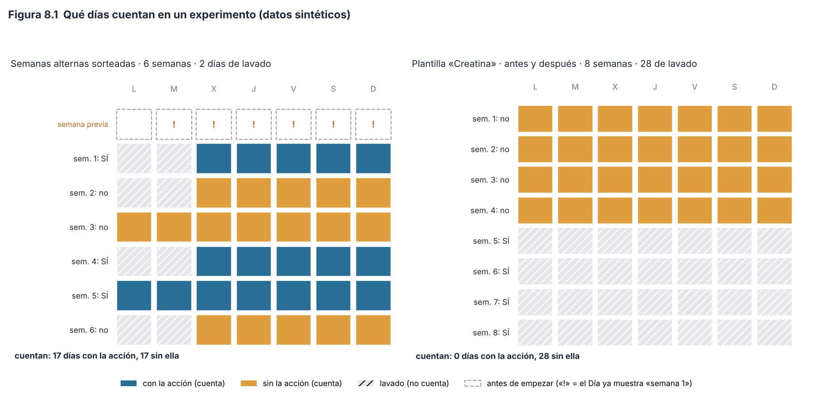
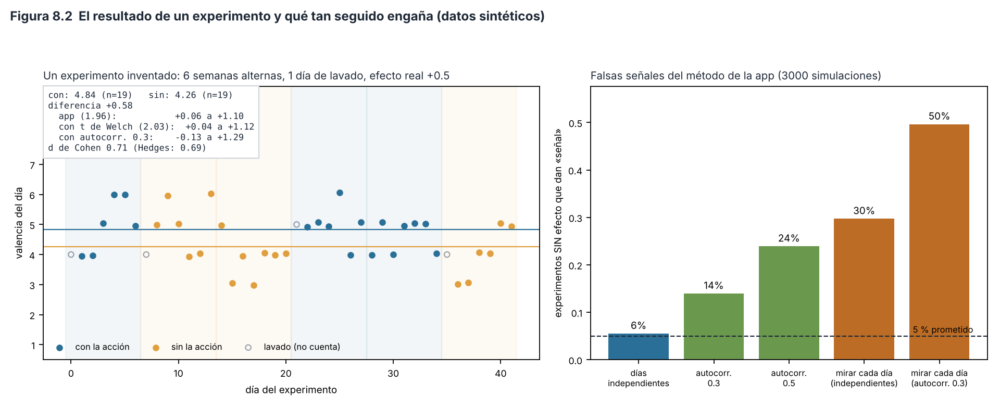
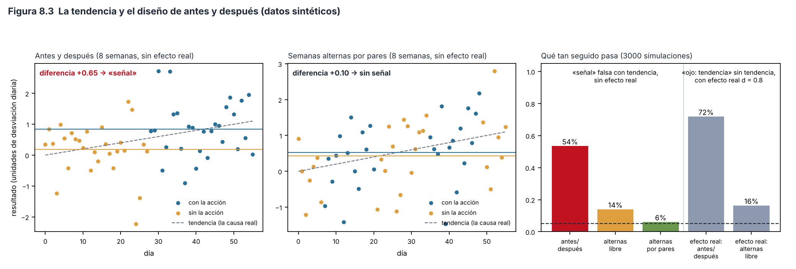

# Capítulo 8. Experimentos personales (N-de-1)

> **Para qué sirve este capítulo.** Explica cómo la app te ayuda a **probar algo en ti mismo** (dormirte antes, dejar la cafeína en la tarde, tomar creatina) y a decidir si funcionó. Cubre la lógica de estos diseños y su respaldo en la literatura, qué hace exactamente el código (sorteo de semanas, días de lavado, diferencia de medias, tamaño del efecto, prueba de tendencia) y qué tan confiable es el resultado. También trata la sección «Antes y después» de Explorar, que **parece** un experimento pero no lo es. Todo corresponde a la versión v81 (commit `fa527df`). **Los ejemplos y las simulaciones usan datos inventados.**
>
> **Cómo leerlo.** Igual que los capítulos anteriores: lenguaje sencillo, cifras y condiciones del código tal cual, con el nombre de la función. Cada decisión se marca como **[Validado]**, **[Aproximación]** o **[Diseño propio]**. Los problemas se numeran H-7-n y se detallan en `hallazgos.md`. Este capítulo usa **simulaciones**: generar miles de experimentos inventados en los que *sabemos* la verdad (por ejemplo, que la acción no hace nada) y contar cuántas veces el método de la app se equivoca. Los scripts están en `figuras/`.

---

## 8.1 Mini-glosario

| Término | Qué significa aquí |
|---|---|
| **Experimento N-de-1** | Un experimento con **una sola persona**, que se compara consigo misma en distintos periodos: unos con la acción y otros sin ella. «N» es el número de participantes; aquí, 1. |
| **Condición** | Cada una de las dos situaciones que se comparan: **con** la acción («SÍ») o **sin** ella («no»). |
| **Diseño ABAB (alterno)** | Alternar periodos sin la acción (A) y con ella (B) varias veces. En la app: semanas alternas, en un orden sorteado. |
| **Diseño antes/después (AB)** | Un solo periodo sin la acción y luego uno con ella. |
| **Aleatorizar (sortear)** | Decidir al azar qué periodos llevan la acción. Evita que tú elijas, sin querer, hacerla justo cuando ya ibas a estar mejor. |
| **Lavado** (*washout*) | Días que **no cuentan** después de cada cambio de condición, para que el efecto de la condición anterior se vaya (y el de la nueva aparezca). |
| **Arrastre** (*carryover*) | Que el efecto de una condición siga actuando cuando ya empezó la otra. El lavado existe para evitarlo. |
| **Prerregistro** | Escribir la pregunta, la hipótesis y cómo vas a analizar **antes** de ver los datos, para no acomodar la conclusión a lo que salga (Nosek et al., 2018). |
| **Intervalo de confianza del 95 %** | Un rango de valores plausibles para el efecto. Si se repitiera el experimento muchas veces con el mismo método, el 95 % de esos rangos contendría el efecto real… **si los supuestos del método se cumplen** (sección 8.6). |
| **Falsa señal** (falso positivo) | Que el método diga «hay un efecto» cuando en realidad no lo hay. Un intervalo del 95 % bien hecho lo hace el **5 %** de las veces. |
| **Autocorrelación** | Que un día se parezca al anterior (si hoy estás bien, mañana probablemente también). La autocorrelación de orden 1, *ρ*, va de −1 a 1; 0 significa días independientes. |
| **d de Cohen** | La diferencia entre las dos condiciones medida en «desviaciones típicas»: cuántas veces el vaivén normal de un día a otro (Cohen, 1988). |
| **Tendencia** | Que la medida suba o baje sola con el tiempo, por algo ajeno al experimento (la estación del año, avanzar en el gimnasio, una racha). |
| **Cegamiento** | Que quien recibe la acción no sepa si la está recibiendo (como con una pastilla de azúcar). En estos experimentos casi nunca es posible. |

---

## 8.2 Por qué experimentar en uno mismo

### 8.2.1 El problema que resuelven

El resto de la app encuentra **relaciones**: «los días que duermes más, estás de mejor ánimo». Pero una relación no dice qué causa qué: quizá dormir más mejora el ánimo, quizá el buen ánimo te deja dormir, quizá los fines de semana causan ambas cosas. La propia app lo recuerda en Explorar y Análisis: «Para causas, usa los experimentos personales» (`Explorar.kt`, `Mas.kt`).

Un **experimento** rompe ese nudo: **tú decides** cuándo hacer la acción, y si además lo decide **el azar**, lo demás (el día de la semana, tu humor previo, el clima) queda repartido entre las dos condiciones. Si después hay diferencia, lo más probable es que la cause la acción.

### 8.2.2 La literatura

Los **ensayos N-de-1** son ensayos aleatorizados en una sola persona. Se propusieron en medicina para elegir el tratamiento de un paciente concreto: Guyatt et al. (1986) describieron cómo alternar al azar periodos con y sin un medicamento en un paciente y decidir según su propia respuesta. La guía de la AHRQ (Kravitz et al., 2014) explica cómo diseñarlos y la extensión CONSORT para N-de-1 (CENT 2015; Vohra et al., 2015) dice qué hay que reportar. En psicología y educación, la misma idea existe como **diseños de caso único** (*single-case designs*), y se ha insistido en **añadir aleatorización** para que sus conclusiones sean más creíbles (Kratochwill y Levin, 2010; Tanious y Onghena, 2019). **[Validado]**: la lógica de alternar condiciones al azar en una misma persona está bien establecida.

**Cuándo sirven** (condiciones habituales en la literatura, resumidas):

1. La acción tiene un efecto **rápido** que también **se va rápido** (si tarda meses en aparecer o no se va, alternar no sirve).
2. La medida se puede tomar **muchas veces** (diaria, idealmente).
3. El problema es **estable**: no está empeorando o mejorando solo durante el experimento.
4. Se puede **repetir** la alternancia varias veces.

Dormirte antes, quitar la pantalla de noche o la cafeína de la tarde cumplen bastante bien esas condiciones. La creatina no (sección 8.9).

---

## 8.3 Cómo se crea un experimento

Está en `PantallaExperimentos` (`ui/pantallas/Lote3.kt`) y el modelo `Experimento` (`data/Modelo.kt`).

### 8.3.1 Lo que escribes

- **Nombre**, **pregunta** (opcional), **acción** («qué vas a cambiar») e **hipótesis** («qué crees que pasará»). Sin nombre, acción e hipótesis, el botón no se activa.
- **Qué vas a medir**: una sola variable del panel, elegida de una lista corta: valencia del día, activación, calidad de sueño, horas de sueño, valencia de los avisos, minutos de pantalla, tiempo de reacción, volumen en el gimnasio, minutos de enfoque o impulso (este último solo aparece si existe la variable, es decir, con el seguimiento privado activo). Las plantillas pueden traer otra.
- **Diseño**: «Semanas alternas sorteadas» (`alterno`) o «Antes y después» (`antes_despues`).
- **Duración**: 4, 6, 8 o 12 semanas.
- **Días de lavado tras cada cambio**: ninguno, 1, 2, 7 o 28.

### 8.3.2 El sellado

Al tocar **«Sellar y empezar el lunes»**:

1. Se guarda la hora exacta (`sellada = Fechas.ahoraIso()`, con su desfase horario).
2. Se **sortea el plan** (sección 8.4).
3. El experimento **empieza el lunes siguiente**: `inicio = lunesDe(hoy) + 7 días`. Si hoy es lunes, empieza dentro de 7 días.

Después, la tarjeta muestra la hipótesis con «sellada el … a las …». La pantalla no permite editar la pregunta, la hipótesis, la variable ni el plan; solo «Terminar experimento». Tampoco hay botón para borrar un experimento.

**Razonamiento.** Es un **prerregistro** casero: escribir qué esperas antes de ver los datos. Sin él, es fácil reinterpretar después («en realidad lo que quería ver era la energía, no el ánimo») y encontrar algo por casualidad (Simmons et al., 2011; Nosek et al., 2018). Que no se puedan borrar los experimentos también ayuda: los que no salieron quedan a la vista, en lugar de olvidarse. **[Diseño propio]** inspirado en una práctica **[Validada]**.

**Límites del sellado** (H-7-10):

- La hora queda guardada, pero no hay nada que impida cambiar el texto por otros medios (por ejemplo, restaurando un respaldo editado). El sello es de **honor**, no una garantía. Para un solo usuario es razonable.
- Se fija la variable, pero **no el análisis**: no se sella cuándo vas a mirar el resultado ni qué vas a considerar «funcionó». Y el resultado **se ve desde el principio** (sección 8.6.3).

### 8.3.3 El aviso diario

En la pantalla del día (`ui/pantallas/Dia.kt`), cada experimento activo muestra: «Experimento «…», semana *k* de *N*: esta semana SÍ: … / esta semana NO hagas: …». La semana se calcula con `ChronoUnit.WEEKS.between(inicio, fecha)`.

**Detalle.** Esa función **trunca hacia cero**: para los 6 días anteriores al inicio da 0, no −1. Por eso, desde el martes de la semana previa, el día ya muestra «semana 1 de *N*» con la instrucción de la primera semana (Figura 8.1, fila punteada). Si la primera semana es «SÍ», puedes empezar antes de tiempo. No afecta al cálculo del resultado, que solo cuenta desde `inicio`, pero sí puede contaminar la línea de base (H-7-9).

---

## 8.4 El sorteo del plan

### 8.4.1 Qué hace exactamente

En `PantallaExperimentos`, al sellar:

- **Alterno**: una lista con ⌊*N*/2⌋ semanas «SÍ» y el resto «no», **barajada** con `shuffled(Random(System.currentTimeMillis()))`.
- **Antes y después**: primero ⌊*N*/2⌋ semanas «no» y luego el resto «SÍ». **No se sortea nada.**

El plan se guarda en el experimento (`plan: List<Boolean>`) y se muestra completo en la tarjeta («plan: SÍ no no SÍ SÍ no»).

**Sí, se sortea de verdad.** Barajar una lista con un generador de números pseudoaleatorios (iniciado con la hora en milisegundos) produce cualquier orden con la misma probabilidad; como hay semanas repetidas, cada **plan distinto** también es igual de probable. Con *N* semanas hay $\binom{N}{N/2}$ planes posibles: 6 con 4 semanas, 20 con 6, 70 con 8 y 924 con 12. **[Validado]** como aleatorización.

**Un acierto del diseño**: como todo empieza en lunes y cada condición dura semanas completas, cada condición tiene la misma cantidad de lunes, martes… Así, el efecto del día de la semana (los fines de semana suelen ser distintos) no se cuela en la comparación.

### 8.4.2 El problema del sorteo libre (pista 3 del plan, confirmada)

Barajar sin restricciones puede dar «SÍ SÍ SÍ no no no», que en la práctica es un diseño de antes y después y queda expuesto a las tendencias (sección 8.8). La probabilidad de un plan así (todo «SÍ» seguido de todo «no», o al revés) es 2 entre el número de planes:

| Semanas | Planes posibles | Probabilidad de un bloque puro |
|---|---|---|
| 4 | 6 | 33 % |
| 6 | 20 | 10 % |
| 8 | 70 | 2.9 % |
| 12 | 924 | 0.2 % |

Con 4 semanas, uno de cada tres experimentos «alternos» es en realidad un antes/después (H-7-5).

**La alternativa habitual: sortear por pares.** Se agrupan las semanas de dos en dos y en cada par se sortea cuál lleva la acción. Así nunca hay más de dos semanas seguidas iguales, y una tendencia lenta afecta casi por igual a ambas condiciones. En las simulaciones de la Figura 8.3, con una tendencia de 0.02 desviaciones por día y sin efecto real, el sorteo libre de 8 semanas da una falsa señal el **14 %** de las veces y el sorteo por pares el **6 %**.

**Pero tiene un costo.** Por pares hay solo $2^{N/2}$ planes: 4 con 4 semanas, 8 con 6, 16 con 8 y 64 con 12. Esto importa para la **prueba de aleatorización** (sección 8.6.4), cuyo valor *p* más pequeño posible es 1 entre el número de planes: con 6 semanas por pares, nunca podría bajar de 1/8 = 0.125. Con pares conviene ir a 10 o 12 semanas.

---

## 8.5 Qué días cuentan: el lavado

### 8.5.1 Las reglas (`Experimentos.toca` y `Experimentos.enLavado`, `data/Lote3.kt`)

- **Qué condición tiene un día**: con *d* = días desde `inicio`, si *d* < 0 el día no está en el experimento; si no, la semana es ⌊*d*/7⌋ y la condición es `plan[semana]`. Pasado el plan, el día tampoco está.
- **Qué días son de lavado**: se buscan los **días de cambio**: el día 0 **si** el plan empieza con «SÍ», y el primer día de cada semana cuyo valor es distinto del de la semana anterior (7·*k*). Un día es de lavado si cae en los primeros `lavado_dias` días tras cualquiera de esos cambios: $0 \le d - c < L$.

Observa que el lavado se aplica **en los dos sentidos**: al pasar de «SÍ» a «no» (para que se vaya el efecto) y de «no» a «SÍ» (para que el efecto tenga tiempo de aparecer). Si el plan empieza con «no», el día 0 no es de lavado.

### 8.5.2 Ejemplo (Figura 8.1, izquierda)

Plan sorteado: SÍ no no SÍ SÍ no, 2 días de lavado. Cambios: día 0 (empieza con SÍ), día 7 (SÍ→no), día 21 (no→SÍ), día 35 (SÍ→no). Días de lavado: 0–1, 7–8, 21–22, 35–36 = 8 días. Cuentan **17 días con la acción** (21 − 4) y **17 sin ella** (21 − 4). La semana 3 («no» tras «no») no pierde ningún día.

*Figura 8.1. Izquierda: qué días cuentan con un plan alterno y 2 días de lavado; la fila punteada es la semana previa, en la que el día ya muestra la instrucción de la semana 1. Derecha: la plantilla «Creatina» (8 semanas, antes y después, 28 días de lavado): todo el periodo con la acción queda en lavado. Script: `figuras/fig20_calendario_experimento.py`.*

### 8.5.3 Razonamiento y cuándo falla

Excluir los primeros días de cada periodo es una forma estándar de lidiar con el arrastre cuando no se puede (o no se quiere) dejar un periodo sin nada entre condiciones; hasta donde sé, las guías de N-de-1 lo llaman *lavado analítico*, pero no lo verifiqué en el texto de la guía **[sin verificar]**. **[Aproximación]** razonable: la duración correcta depende de cada acción, y la app la deja a tu criterio (o a la plantilla).

**El problema grave: el lavado puede comerse una condición entera** (H-7-1).

- Con semanas alternas y **7 días de lavado**, toda semana que empieza con un cambio se pierde completa. Con un plan que alterna cada semana (SÍ no SÍ no SÍ no), **no queda ningún día**; con «no SÍ no SÍ no SÍ», solo quedan los 7 días «no» de la primera semana. El experimento nunca da resultado.
- Con **28 días** y semanas alternas, todo queda en lavado.
- **La plantilla «Creatina»** (8 semanas, antes y después, 28 días de lavado) sufre exactamente esto: el plan es 4 semanas «no» + 4 «SÍ»; el único cambio es el día 28, y los días 28 a 55 son de lavado. Cuentan **28 días sin la acción y 0 con ella** (Figura 8.1, derecha). La tarjeta siempre dirá «Aún no hay suficientes días medidos en ambas condiciones (0 con, …)». **La plantilla no puede dar resultado nunca.**

La app debería impedir combinaciones en las que el lavado sea igual o mayor que la duración de un periodo, o alargar el experimento en esos casos.

---

## 8.6 El resultado: diferencia, intervalo y tamaño del efecto

### 8.6.1 Qué calcula (`Experimentos.resultado` y `Estadistica.diferencia`)

Recorre los días desde `inicio` hasta el último día del plan (o hasta hoy, lo que llegue antes). Para cada día que está en el experimento, no es de lavado y **tiene dato** en la variable elegida, guarda el valor en la lista «con» o «sin». El panel es el mismo de los análisis (`Estadistica.panel(dinamicas = false)`).

1. **Diferencia de medias con su intervalo** (`Estadistica.diferencia(con, sin)`), solo si hay **al menos 3 días en cada condición**:

$$\bar{x}_c - \bar{x}_s \;\pm\; 1.96\sqrt{\frac{s_c^2}{n_c} + \frac{s_s^2}{n_s}}$$

   donde $\bar{x}$ son las medias, $s^2$ las varianzas muestrales (dividiendo entre *n* − 1) y *n* el número de días de cada condición. Es el **error estándar de Welch** (no supone que las dos condiciones tengan la misma varianza) con el valor **1.96 fijo** de la distribución normal.

2. **Mensaje**: si el intervalo no toca el cero, «es una señal para ti»; si lo toca, «todavía no se distingue del azar».

3. **d de Cohen**, también con al menos 3 días por condición:

$$d = \frac{\bar{x}_c - \bar{x}_s}{s_p}, \qquad s_p = \sqrt{\frac{(n_c-1)s_c^2 + (n_s-1)s_s^2}{n_c+n_s-2}}$$

   con la **desviación típica agrupada** $s_p$. La palabra (`Experimentos.tamano`): |*d*| < 0.2 «muy pequeño», < 0.5 «pequeño», < 0.8 «mediano» y desde 0.8 «grande». Son los puntos de referencia de Cohen (1988).

4. **Prueba de tendencia** (sección 8.8).

### 8.6.2 Ejemplo trabajado (Figura 8.2, izquierda)

Un experimento inventado: 6 semanas alternas (SÍ no no SÍ SÍ no), 1 día de lavado, medida = valencia del día. Los datos se generaron con un efecto real de +0.5 y días que se parecen al anterior (autocorrelación 0.3).

- Cuentan 19 días con la acción (suma 92) y 19 sin ella (suma 81).
- Medias: 92/19 = **4.84** y 81/19 = **4.26**. Diferencia = **+0.58**.
- Varianzas: $s_c^2$ = 0.474 y $s_s^2$ = 0.871.
- Error estándar: √(0.474/19 + 0.871/19) = √(0.0249 + 0.0459) = √0.0708 = **0.266**.
- Intervalo de la app: 0.58 ± 1.96 × 0.266 = 0.58 ± 0.52 → **+0.06 a +1.10**. No toca el cero: «es una señal para ti».
- $s_p$ = √((18 × 0.474 + 18 × 0.871)/36) = √0.672 = 0.820; *d* = 0.58/0.820 = **0.71**, «mediano».

Ahora, lo mismo con dos correcciones que la app **no** hace:

- **Con *t* en lugar de 1.96.** Los grados de libertad de Welch son ≈ 33, y el valor de *t* para el 95 % es 2.03: intervalo **+0.04 a +1.12**. Cambia poco con 19 días por lado. Con 3 días por lado (lo mínimo que acepta la app), *t* sería ≈ 2.78 en vez de 1.96: el intervalo tendría que ser **42 % más ancho**.
- **Con la autocorrelación.** Si los días se parecen al anterior con *ρ* = 0.3, una aproximación habitual multiplica el error estándar por √((1 + *ρ*)/(1 − *ρ*)) = √(1.3/0.7) = 1.36: intervalo **−0.13 a +1.29**. **Ahora sí toca el cero.** Con la información que hay, no se puede distinguir del azar. **[Aproximación]**: ese factor es exacto para la media de una serie con autocorrelación de orden 1 y aproximado para una diferencia entre bloques de semanas.

### 8.6.3 Por qué el intervalo de la app es demasiado estrecho (pistas 1 y 2, confirmadas)

**1. Trata cada día como independiente** (H-7-3). El cálculo supone que cada día es un dato nuevo, como si fueran 38 personas distintas. Pero el ánimo, el sueño y casi todo lo que mide la app **se parecen de un día al siguiente**. La propia app lo sabe: para las correlaciones calcula la autocorrelación de cada variable y un *n efectivo* (`Estadistica.autocorr`; capítulo 6, pendiente). En los experimentos no lo usa. Además, lo que se sortea son **semanas**, no días: en un experimento de 6 semanas hay 6 unidades sorteadas, no 38.

**2. Usa 1.96 fijo** (H-7-3). Con pocos días, el valor correcto sale de la distribución *t* y es mayor.

**3. Se puede mirar todos los días** (H-7-4). La tarjeta muestra el resultado en cuanto hay 3 días de cada condición, y lo actualiza cada día. Si miras cada día y te detienes la primera vez que dice «señal», el intervalo ya no significa lo que dice: mirar repetidamente datos que se acumulan aumenta mucho la probabilidad de una falsa señal (Armitage et al., 1969).

**Cuánto importa (Figura 8.2, derecha).** Simulé 3000 experimentos de 6 semanas alternas con 1 día de lavado **en los que la acción no hace nada**, con el método exacto de la app:

| Situación | Falsas señales | Lo prometido |
|---|---|---|
| Días independientes, mirar solo al final | 6 % | 5 % |
| Autocorrelación 0.3, mirar al final | 14 % | 5 % |
| Autocorrelación 0.5, mirar al final | 24 % | 5 % |
| Días independientes, detenerse en la primera «señal» | 30 % | 5 % |
| Autocorrelación 0.3, detenerse en la primera «señal» | 50 % | 5 % |

Con autocorrelaciones como las que suelen tener las medidas diarias de ánimo (la app calcula la tuya), **entre una de cada siete y una de cada cuatro** «señales» pueden ser azar, y la mitad si te detienes al ver la primera. La cifra de 0.3 a 0.5 es ilustrativa: no verifiqué un valor típico en la literatura **[sin verificar]**; lo que importa es que cualquier autocorrelación positiva estrecha el intervalo de más.

*Figura 8.2. Izquierda: un experimento inventado con su resultado calculado como en la app y con dos correcciones. Derecha: con qué frecuencia el método de la app da una «señal» cuando la acción no hace nada. Script: `figuras/fig21_resultado_experimento.py`.*

### 8.6.4 Qué sería más adecuado

**[Validado]** en la literatura de caso único: la **prueba de aleatorización** (Kratochwill y Levin, 2010; Tanious y Onghena, 2019). La idea es sencilla:

1. Calcula la diferencia con el plan que de verdad se sorteó.
2. Calcula la misma diferencia con **cada uno de los otros planes que pudieron salir** (con los mismos datos y el lavado que correspondería a cada plan).
3. El valor *p* es la fracción de planes que dan una diferencia igual o mayor que la real.

Su ventaja: **no supone que los días sean independientes**, porque se apoya solo en que el sorteo fue real. Su límite: el *p* más pequeño posible es 1 / número de planes. Con 6 semanas (20 planes) es 0.05 (en una sola dirección); con 4 semanas (6 planes), 0.17. Es decir, **con 4 semanas no se puede llegar a una conclusión con el criterio habitual**, por grande que sea el efecto. La app no la ofrece, y **tampoco hay función de R para los experimentos**, aunque `vm_experimentos.csv` exporta el plan, el lavado y la variable (H-7-11).

### 8.6.5 El d de Cohen en una sola persona

- **Sin corrección de Hedges** (H-7-7). El *d* calculado con pocos datos sale un poco inflado; Hedges (1981) derivó la corrección. Con la aproximación habitual, el factor es 1 − 3/(4(*n*c + *n*s) − 9): 0.98 con 19 + 19 días (0.71 → 0.69) y 0.80 con 3 + 3. Importa solo con muy pocos días.
- **Los umbrales de Cohen no significan lo mismo aquí.** Cohen propuso 0.2, 0.5 y 0.8 para diferencias **entre personas**, con la desviación típica de un grupo de personas. En un experimento N-de-1, la desviación es la de **tus días**, que suele ser menor que la que hay entre personas, así que el mismo cambio da un *d* más grande. Un «mediano» aquí no equivale a un «mediano» en un estudio de grupos. **[Aproximación]**: es útil como escala dentro de la app, no como comparación con la literatura.

---

## 8.7 Lo que no se registra: la adherencia

La app guarda qué **debías** hacer cada semana, pero **no si lo hiciste** (H-7-8). Si en una semana «SÍ» te dormiste tarde tres noches, esos días cuentan igual como «con la acción». Es lo que en ensayos clínicos se llama análisis por **intención de tratar**: compara lo asignado, no lo hecho. Es una forma legítima de análisis (estima el efecto de *intentar* la acción) **[Validado]**, pero diluye el efecto si no la cumples y no te deja saber cuánto la cumpliste.

Relacionado: **«Terminar experimento» no guarda la fecha** (H-7-2). Solo marca `activo = false`. `Experimentos.resultado` sigue contando todos los días hasta el final del plan original, así que si terminas en la semana 3 de 6 y dejas de hacer la acción, las semanas «SÍ» posteriores se cuentan como «con la acción» aunque no la hiciste. Además, el aviso del día desaparece y no sabrás qué semanas tocaban.

---

## 8.8 La prueba de tendencia

### 8.8.1 Qué hace

Si hay al menos 8 días que cuentan, `Experimentos.resultado` ajusta una **recta** del valor contra el número de día (*i* = 0, 1, 2…, con **ambas condiciones juntas**) por mínimos cuadrados:

$$b = \frac{\sum (i-\bar{i})(y-\bar{y})}{\sum (i-\bar{i})^2}, \qquad EE(b) = \sqrt{\frac{\sum (y - \hat{y})^2/(n-2)}{\sum (i-\bar{i})^2}}$$

Si |*b*/EE(*b*)| > 2, avisa: «Ojo: tu medida venía cambiando sola a lo largo del experimento (… por día). Parte de la diferencia puede ser esa tendencia», y añade «en un diseño de antes y después pesa más».

### 8.8.2 Por qué importa la tendencia

Si la medida sube sola (por la estación, por avanzar en el gimnasio, por salir de una mala racha), en un diseño **antes/después** el periodo «después» siempre se verá mejor, aunque la acción no haga nada. Es la principal debilidad de los diseños AB, y la razón de alternar y sortear (Kratochwill y Levin, 2010).

**Simulación (Figura 8.3).** Con una tendencia de 0.02 desviaciones por día (en 8 semanas, ≈ 1.1 desviaciones) y **sin efecto real**: el antes/después da falsa señal el **54 %** de las veces; las semanas alternas con sorteo libre, el 14 %; por pares, el 6 %.

### 8.8.3 El problema de la prueba (H-7-6)

La recta se ajusta **sin separar la condición**. En un antes/después, un **efecto real** también hace que la segunda mitad sea más alta, y la recta lo confunde con una tendencia. En la simulación, con un efecto real *d* = 0.8 y **sin ninguna tendencia**, el aviso «tu medida venía cambiando sola» aparece en el **72 %** de los antes/después y en el 16 % de los alternos (lo esperado por azar sería ≈ 5 %). Es decir: justo cuando la acción funciona, la app sugiere que quizá fue la tendencia.

Lo adecuado sería ajustar **a la vez** la tendencia y la condición (una regresión del valor contra el día **y** contra «con/sin»), y reportar el efecto de la condición ya descontada la tendencia. Aun así, en un antes/después puro, tendencia y efecto se separan mal (la condición cambia una sola vez); en un alterno, bien.

*Figura 8.3. Izquierda: una tendencia sin efecto real produce una diferencia falsa en un antes/después. Centro: con semanas alternas por pares, la misma tendencia se reparte entre las dos condiciones. Derecha: frecuencia de falsas señales con tendencia, y de avisos de tendencia cuando hay un efecto real. Script: `figuras/fig22_tendencia_diseno.py`.*

---

## 8.9 Las plantillas

`Experimentos.PLANTILLAS` (`data/Lote3.kt`):

| Plantilla | Acción | Medida | Diseño | Semanas | Lavado | Nota de la app |
|---|---|---|---|---|---|---|
| Creatina | 5 g al día | `volumen_kg` | antes/después | 8 | 28 | «la reserva del músculo tarda semanas en llenarse y en vaciarse, así que alternar semanas no sirve» |
| Hora de dormir | en la cama antes de las 00:00 | `valencia` | alterno | 6 | 1 | «el primer día de cada cambio no cuenta» |
| Pantalla antes de dormir | sin pantalla la última hora | `sueno_calidad` | alterno | 6 | 1 | — |
| Cafeína en la tarde | nada después de las 14:00 | `sueno_horas` | alterno | 6 | 2 | «dos días de lavado por la cafeína que queda en el cuerpo» |

**Por qué la creatina va en antes/después.** La creatina no actúa como una pastilla para dormir: se acumula en el músculo. Hultman et al. (1996) midieron que la creatina total del músculo sube alrededor de un 20 % tras 6 días a 20 g diarios y se mantiene con 2 g diarios durante 30 días más. Si la reserva tarda semanas en llenarse y en vaciarse, alternar semanas solo compararía «medio lleno» con «medio lleno». El razonamiento es correcto. El modelo de saturación de la app (28 días para llenarse y 35 para vaciarse) se trata en el capítulo 5 (pendiente); el tiempo exacto de vaciado no lo verifiqué en esta sesión **[sin verificar]**.

**Pero la plantilla no funciona** (H-7-1): con 28 días de lavado sobre 4 semanas «SÍ», todos los días con la acción quedan excluidos (sección 8.5.3). Además:

- **Antes/después + volumen de entrenamiento** es la peor combinación para la tendencia: si estás progresando en el gimnasio, el volumen sube solo. Es justo el caso de la Figura 8.3.
- `volumen_kg` solo existe los días con entrenamiento importado y depende de **qué sesión** hiciste (pierna o brazo), no solo de tu fuerza. Una semana con más días de pierna tendrá más volumen. Medir fuerza en un ejercicio fijo sería más limpio (H-7-14).

Las otras tres plantillas son diseños razonables: efectos que aparecen y se van en uno o dos días, medidas diarias y lavado corto. **[Aproximación]**: las duraciones de lavado son razonables pero no vienen de un estudio específico.

---

## 8.10 Cegamiento y efecto expectativa

En los ensayos con medicamentos, ni el paciente ni el médico saben quién toma el fármaco y quién la pastilla de azúcar. Aquí eso es imposible: **sabes** si te acostaste antes o si tomaste café. Y además escribiste qué esperabas (la hipótesis) y ves el plan completo desde el primer día.

Esto importa sobre todo con medidas **subjetivas** (valencia, calidad de sueño percibida): si crees que dormir antes te hará sentir mejor, es probable que califiques tus días un poco mejor en las semanas «SÍ», aunque el sueño no haya cambiado nada. Es el **efecto expectativa** o placebo. La extensión CENT pide reportar si hubo cegamiento justamente por esto (Vohra et al., 2015).

Lo que ayuda (sin cambiar la app):

- Preferir **medidas objetivas** cuando existan: `sueno_horas` del reloj en vez de `sueno_calidad`, `rt_media` (tiempo de reacción) en vez de «me sentí despierto».
- Mirar el resultado **solo al final**.
- Para la valencia, preferir `muestreo_valencia` (avisos al azar en el momento, capítulo 3), que es menos propensa a reinterpretaciones que la valencia del día recordada en la noche. No pude comprobar cuánto reduce el sesgo de expectativa **[sin verificar]**.

**[Aproximación]**: sin cegamiento, el resultado responde a «¿hacer esto **sabiendo que lo hago** me cambia?», que es una pregunta legítima para uso personal, pero no aísla el efecto «químico» o fisiológico de la acción.

---

## 8.11 «Antes y después» en Explorar: un estudio observacional

### 8.11.1 Qué hace (`EtapasDeVida`, `ui/pantallas/Explorar.kt`)

Para cada uno de los **8 cambios más recientes** que guardaste en «Conocerte» (mudanza, pareja, trabajo…; `perfil_historial`), compara siete variables: valencia, horas de sueño, minutos de pantalla, pasos, gasto, personas mencionadas y palabras escritas.

- **Antes**: los días −1 a −60 respecto a la fecha del cambio.
- **Después**: los días 0 a 59.
- Usa `Estadistica.diferencia(despues, antes)` (la misma de los experimentos, con 1.96). Si el intervalo no toca el cero, muestra el cambio sin advertencia; si lo toca, añade «podría ser azar».
- La sección avisa: «Muchas cosas cambian a la vez; tómalo como una pista».

### 8.11.2 Por qué no es un experimento

Nadie sorteó cuándo mudarte o cambiar de trabajo, y esos cambios suelen venir con muchos otros (estación, rutina, estrés). Es un **estudio observacional** del tipo de *serie de tiempo interrumpida* (comparar una serie antes y después de un evento). **[Aproximación]**: útil para generar ideas, no para concluir causas. La propia app lo dice bien.

### 8.11.3 Cuándo falla (H-7-12)

- **Muchas comparaciones.** 8 cambios × 7 variables = hasta **56 comparaciones**. Aunque nada cambiara de verdad, con días independientes y 5 % de error cabe esperar unas **3** comparaciones «claras» por azar; con la autocorrelación de 60 días de datos, muchas más (sección 8.6.3). No se corrige por comparaciones múltiples.
- **Días tratados como independientes**, con 1.96 (igual que en H-7-3).
- **Tendencias**: el mismo problema del antes/después (sección 8.8).
- **La fecha es la del registro en la app**, no la del cambio real (como H-6-3).
- **Un mismo cambio puede salir varias veces**: si en una sola edición cambiaste ciudad, vivienda y «vive con», salen tres tarjetas con la misma fecha y **los mismos números**, lo que da la impresión de tres hallazgos.
- **Ventanas que se enciman**: dos cambios separados por menos de 60 días comparten días.
- `gasto_total` pone 0 en los días sin gastos (H-1-1); `personas` y `palabras` miden **cuánto escribes**, no tu vida social.

---

## 8.12 Lo que el resultado puede y no puede decir

**Puede decir**, si el experimento fue alterno, sorteado, con lavado razonable, una medida objetiva, suficientes semanas y miraste solo al final: «en mi caso, en este periodo, hacer esto se asoció con este cambio, y es poco probable que sea solo por cómo cayeron las semanas».

**No puede decir:**

- Que el efecto sea **igual** en otra época de tu vida (un N-de-1 vale para la persona y el periodo en que se hizo).
- Que el efecto sea **fisiológico** y no expectativa (sin cegamiento).
- Con el intervalo actual, que una «señal» sea fiable con la seguridad que aparenta (sección 8.6.3).
- Nada, si el diseño fue antes/después con una medida que tiende a subir o bajar sola.

---

## 8.13 Resumen de decisiones

| Decisión | Clasificación | Respaldo |
|---|---|---|
| Comparar periodos con y sin la acción en una misma persona | Validado | Guyatt et al. (1986); Kravitz et al. (2014) |
| Sorteo real del orden de las semanas (sorteo libre) | Validado como aleatorización; mejorable (por pares) | Kratochwill y Levin (2010) |
| Empezar en lunes, semanas completas | Diseño propio (acierto: equilibra el día de la semana) | — |
| Sellar pregunta e hipótesis con la hora | Diseño propio inspirado en el prerregistro | Nosek et al. (2018); Simmons et al. (2011) |
| Lavado en ambos sentidos tras cada cambio | Aproximación | — |
| Intervalo de Welch con 1.96, días independientes | Aproximación (demasiado estrecho) | Armitage et al. (1969) sobre mirar repetidamente |
| d de Cohen con desviación agrupada, umbrales 0.2/0.5/0.8 | Aproximación | Cohen (1988); Hedges (1981) |
| Prueba de tendencia con la recta sin separar la condición | Diseño propio (confunde efecto con tendencia) | — |
| Plantilla «Creatina» en antes/después | Razonamiento correcto; parámetros incompatibles | Hultman et al. (1996) |
| «Antes y después» de los cambios de vida, 60 contra 60 días | Aproximación (observacional) | — |

---

## 8.14 Resumen del capítulo

1. Los experimentos de la app siguen la lógica de los **ensayos N-de-1**: semanas con y sin la acción, **sorteadas de verdad**, que empiezan en lunes, con la pregunta y la hipótesis **selladas** antes de empezar.
2. El hallazgo más grave: **la plantilla «Creatina» nunca puede dar resultado**, porque sus 28 días de lavado cubren todo el periodo con la acción; y con 7 o 28 días de lavado, un plan alterno puede quedarse sin días (H-7-1).
3. El **intervalo** trata los días como independientes y usa 1.96: con autocorrelaciones de 0.3 a 0.5, da falsas señales el 14 % a 24 % de las veces en lugar del 5 %; si se mira cada día y uno se detiene en la primera señal, hasta el 50 % (H-7-3, H-7-4). La alternativa natural es una **prueba de aleatorización** por semanas, que no existe ni en la app ni en R (H-7-11).
4. El **sorteo libre** puede producir un antes/después disfrazado (33 % de las veces con 4 semanas); sortear por pares protege de las tendencias, pero requiere más semanas para poder concluir (H-7-5).
5. La **prueba de tendencia** confunde un efecto real con una tendencia en los antes/después: avisa en el 72 % de los casos con un efecto grande y sin tendencia (H-7-6).
6. **«Terminar» no guarda la fecha** y no se registra si cumpliste la acción (H-7-2, H-7-8). No hay cegamiento: prefiere medidas objetivas y mirar solo al final.
7. «Antes y después» en Explorar es **observacional**, con hasta 56 comparaciones sin corregir (H-7-12).
8. Se identificaron **14 hallazgos** (H-7-1 a H-7-14). No se cambió código.

---

### Referencias citadas en este capítulo

Ver `referencias.md`. Citas: Armitage, McPherson y Rowe (1969); Cohen (1988); Guyatt et al. (1986); Hedges (1981); Hultman et al. (1996); Kratochwill y Levin (2010); Kravitz et al. (2014); Nosek et al. (2018); Simmons, Nelson y Simonsohn (2011); Tanious y Onghena (2019); Vohra et al. (2015).
