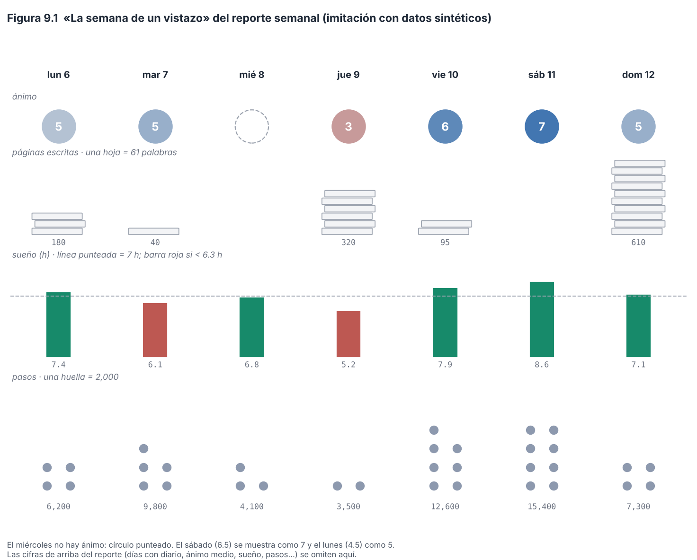

# Capítulo 9. Reportes, visualización y motivación

> **Para qué sirve este capítulo.** Explica qué te devuelve la app a cambio de registrar: los **reportes** (semanal, mensual y anual), **«Tu año»**, los **logros** y las **campañas** semanales. Para cada uno dice qué muestra, de dónde sale cada cifra y qué decisiones de visualización se tomaron. Después discute el lado científico: un sistema de motivación ayuda a que no falten datos, pero también puede **cambiar lo que se mide**. Se escribió sobre la v81 (commit `fa527df`) y está al día con el código de la v92 (la v91 más la entrega 10f; `SCHEMA_V = 15`), la versión que describe todo el paper; lo que cambió en el módulo 10 se marca «desde 10a…10f» o «desde el esquema 13» y está en el Apéndice D. **Los ejemplos son inventados.**
>
> **Cómo leerlo.** Igual que los capítulos anteriores: lenguaje sencillo, cifras y condiciones del código tal cual, con el nombre de la función; cada decisión se marca como **[Validado]**, **[Aproximación]** o **[Diseño propio]**. Los problemas se numeran H-8-n (este capítulo y el 10 forman el módulo 8; los H-9-n son del módulo 9) y se detallan en `hallazgos.md`. Lo relativo a qué datos privados llegan a cada salida está en el capítulo 10.
>
> **Fuentes.** Además del código, se leyó el documento de contexto del proyecto (`VESTIGIUM_MEI_CONTEXTO.md`, v81, que no está en el repositorio). Su sección 7 fija las **reglas de privacidad** de la app; el capítulo 10 (sección 10.3.4) las compara una por una con el código. Donde ese documento describe una intención («nunca en reportes…») y el código hace otra cosa, este capítulo y el 10 lo dicen.

---

## 9.1 Mini-glosario

| Término | Qué significa aquí |
|---|---|
| **Reporte** | Una imagen (y, para el mes y el año, también un PDF) que resume un periodo. La app la genera sola y la guarda en el teléfono. |
| **Periodo anterior** | El periodo de la misma duración inmediatamente antes (la semana o el mes anterior). Los reportes se comparan contra él. |
| **Gamificación** | Usar elementos de juego (puntos, medallas, retos, rachas) en algo que no es un juego (Deterding et al., 2011). |
| **Logro** | Una medalla que se gana al llegar a una meta (100 días escritos, un día de 20 000 pasos). |
| **Racha** | Días **seguidos** cumpliendo algo. Un solo día sin cumplir la rompe. |
| **Constancia** | Cumplir algo **la mayoría** de los días de una ventana (por ejemplo, 25 de 30), sin necesidad de racha. |
| **Campaña** | Un reto opcional de lunes a domingo («5 noches de 7 horas»). |
| **Reactividad** | Que medir algo cambie lo que se mide (capítulo 3, sección 3.14). |
| **Ley de Campbell** | Cuanto más se usa un indicador para premiar o decidir, más presión hay para distorsionarlo y más deja de reflejar lo que medía (Campbell, 1979). |

---

## 9.2 De dónde salen las cifras: `Periodo.calcular`

Los reportes y «Tu año» no calculan nada por su cuenta: usan un mismo resumen del periodo, `Periodo.calcular(ini, fin)` (`ciencia/Periodo.kt`). Lo importante, regla por regla:

| Cifra | Cómo se calcula exactamente |
|---|---|
| **Días con diario** | Días con texto en el diario **o** con valencia del día. |
| **Ánimo del día** (`valDe`) | La valencia del diario, como `valencia` en el panel y en R (desde la entrega 10c). Hasta entonces, si no había valencia del diario, se usaba el promedio de los registros de ánimo de ese día. |
| **Ánimo medio** | Promedio de los «ánimos del día» que existen. El reporte lo rotula «ánimo medio del diario (de 7)» y, si en el periodo hubo días con valencia solo en los avisos (`diasSoloAvisos`), añade «*N* días solo con avisos no cuentan». |
| **Mejor y peor día** | El día con mayor y menor «ánimo del día»; en empate, el primero. Con el mejor día se muestra su «mejor momento» (hasta 90 caracteres). |
| **Racha de diario** | La racha más larga **dentro del periodo** de días con texto o valencia. |
| **Hábitos cumplidos** | Hábitos activos marcados ÷ (hábitos activos × días con documento de diario). No cuenta el hábito ligado a las recaídas (`Privado.habitosVisibles`). |
| **Sueño medio** | Promedio de las noches del reloj con **más de 120 minutos** (las más cortas se descartan como siestas o errores). |
| **Hora de dormir media** | Promedio de las horas de inicio, con la misma regla que el panel y R (`Exportar.horaDecimal`, desde 10c): de noche, las anteriores a las **12:00** suman 24 (la 01:00 cuenta como 25:00) para no promediar la 01:00 con las 23:00 como si fuera mediodía. Antes el corte era a las 15:00, y una siesta larga que empezara a las 13:00 contaba como 37:00. Desde 10f (D.109), cada hora es la hora local del lugar donde estabas esa noche: se lee con el desfase guardado en la propia marca (`Fechas.localDe`). Antes se pasaba a la zona que tenía el teléfono al calcular el reporte, y una noche de viaje salía corrida tantas horas como la diferencia de zona. |
| **Pasos** | Promedio de los días con pasos > 0. Km: los del reloj o, si no hay, pasos × 0.00075. |
| **Mejor marca** | La mayor repetición máxima estimada del periodo con `Macrofactor.e1rm`, la misma que usan la exportación (`e1rm_kg`), Fuerza, Totales y `vm_fuerza` en R (desde 10c, D.72): peso × (1 + repeticiones/30) (**fórmula de Epley**), solo en series de **1 a 12** repeticiones y sin calentamientos, redondeada a 0.1 kg. Antes se aceptaban hasta 15 repeticiones y los calentamientos. Ejemplo: series de 100 × 15, 120 × 5 y un calentamiento de 130 × 8 → antes 164.7 kg (el calentamiento); ahora **140 kg**. Tus apps usa la misma función. |
| **Gasto e ingresos** | Por el **día del diario** (`Gasto.dia`, `Ingreso.dia`: antes de las 5:00 cuenta para el día anterior), igual que el panel; los ingresos se contaban por su fecha de calendario hasta 10c, así que un ingreso de madrugada caía en otro día que su gasto. Totales usa la misma regla desde 10c (D.77). |
| **Tazas de café** | Cafeína total ÷ 95 mg. |
| **Personas, temas** | Las @ y # del diario (una vez por día) y de los momentos no privados. |
| **Comparación con el periodo anterior** | Solo si el periodo anterior tiene **al menos 3 días** con dato. |

**Detalle a saber** (H-8-10 y H-5-15, resueltos en 10c, D.77). Hasta la entrega 10c, el «ánimo del día» mezclaba dos instrumentos distintos: la valencia recordada del diario y, cuando faltaba, el promedio de los registros momentáneos. El capítulo 3 (sección 3.3.4) explica por qué no son la misma medida: si un mes tenía pocos diarios y muchos avisos, su «ánimo medio» no era comparable con el de un mes con diario completo, ni con `mean(panel$valencia)` en R. Ahora el ánimo medio usa solo la valencia del diario, y el reporte dice cuántos días tenían solo avisos. Ejemplo (inventado): una semana con valencia del diario 5, 6 y 4 en tres días y avisos con promedio 3 en otros dos: antes, ánimo medio (5 + 6 + 4 + 3 + 3) / 5 = 4.2; ahora (5 + 6 + 4) / 3 = **5.0**, «2 días solo con avisos no cuentan». La **activación** del día sigue completándose con los avisos cuando falta la del diario.

---

## 9.3 Los reportes

### 9.3.1 Cuándo se generan y dónde quedan

La tarea periódica (`avisos/Trabajo.kt`) genera, sin que lo pidas:

- **El semanal**, cada **lunes desde las 8:00**, de la semana anterior: una imagen PNG.
- **El mensual**, cada **día 1 desde las 9:00**, del mes anterior: PNG y PDF.
- **El anual**: a petición (y «Tu año» avisa el 31 de diciembre desde las 9:00).

Se guardan en las carpetas públicas del teléfono: **`Pictures/VestigiumMei`** (imágenes) y **`Download/VestigiumMei`** (PDF), con una notificación. Desde el módulo 10a, los que se generan solos van **siempre en modo discreto** (iniciales en vez de nombres) y **sin la frase del mejor momento**; los que pides a mano siguen tu ajuste de modo discreto. Las consecuencias para la privacidad están en el capítulo 10 (H-8-4).

### 9.3.2 Qué muestran (`Reportes.cuerpo`)

Arriba, hasta **9 cifras** (días con diario, ánimo medio, sueño, pasos, pantalla, palabras, gasto, entrenamientos, música). Después, **solo las secciones que tienen datos**, cada una con un nombre en español y otro en latín (*Animus*, *Corpus*, *Mens*, *Homines*, *Orbis*, *Cultura*, *Pecunia*, *Telephonum*, *Memorabilia*):

- **La semana de un vistazo** (solo el semanal; Figura 9.1).
- **El mes de un vistazo** (solo el mensual): calendario del ánimo, curva del sueño, comparación con el mes anterior, nubes de personas y temas, y un **mapa abstracto**: cada lugar guardado es un punto sobre una cuadrícula, **sin calles ni nombres**.
- **Ánimo**: gráfica de valencia (con la activación detrás) o, en el anual, un cuadro por día del color del ánimo; mejor y peor día, cambio frente al periodo anterior, el mejor día de la semana (si el periodo pasa de 13 días), hábitos y racha.
- **Cuerpo, Mente, Gente, Mundo, Cultura, Dinero, Teléfono, Lo memorable** (hitos y logros del periodo).

**El modo discreto** (`Config.discreto`, apagado por omisión), en los reportes, cambia los nombres de las personas por iniciales (`@ana_luisa` → «A.L.», `Reportes.persona`). No toca nada más del reporte (en otras pantallas también oculta, por ejemplo, los nombres de las emociones).

### 9.3.3 Decisiones de visualización

La Figura 9.1 imita «La semana de un vistazo» con datos inventados y las reglas de `semanaVisual`:

- **Ánimo**: una **medalla** por día con el color del ánimo y el número (`%.0f`). Desde 10c es la valencia del diario, un entero de 1 a 7, así que no se redondea nada; hasta entonces podía ser un promedio de avisos y se redondeaba la mitad hacia arriba (4.5 → 5, 6.5 → 7). El color va del color de alerta (1), pasando por un gris neutro (4), al color del tema (7) (`Lienzo.colorAnimo`). Sin dato, un círculo punteado.
- **Diario**: hojas apiladas; una hoja = max(10, ⌈máximo de la semana / 10⌉) palabras, hasta 10 hojas. El día que más escribiste llega a 10 hojas.
- **Sueño**: barras de 0 a 10 h, con una línea punteada en **7 h** y la barra en tono de alerta si la noche duró **menos de 6.3 h**.
- **Pasos**: ⌈pasos / 2 000⌉ huellas, hasta 10.

*Figura 9.1. «La semana de un vistazo», imitada con datos inventados y las mismas reglas del código. El ánimo de la figura trae dos días con decimales (4.5 y 6.5), como podía pasar hasta 10c; desde entonces el número de la medalla siempre es un entero. Script: `figuras/fig23_reporte_semanal.py`.*

**Qué dice la investigación sobre gráficas.** Cleveland y McGill (1984) midieron qué tan bien la gente lee distintas codificaciones: la **posición sobre una escala común** (la altura de una barra con su eje) se lee con mucha más precisión que el **área** o el **color**. Aplicado a la app **[Aproximación]**:

- Las barras de sueño son la codificación más precisa del reporte, y además llevan el número.
- La medalla del ánimo codifica con **color**, que se lee mal, pero lleva el número escrito, lo que lo compensa. Hasta 10c, cuando el ánimo podía ser un promedio, el redondeo perdía información (un 4.5 y un 5.4 se veían igual, «5»); con la valencia del diario, que es entera, ya no.
- Las hojas y huellas son **conteos de iconos**: se leen bien para comparaciones gruesas («el domingo escribí mucho más»), no para cifras exactas.
- La línea de 7 h y el corte de 6.3 h son **[Diseño propio]**: 7 h coincide con la recomendación habitual mínima de sueño para adultos (no verificada en esta sesión **[sin verificar]**); el 6.3 h no tiene una fuente que yo conozca.
- El color «de alerta» para el ánimo bajo y el sueño corto **juzga** el dato (rojo = malo). Para un resumen personal es útil, pero refuerza la idea de que hay valores «correctos», lo que se relaciona con la sección 9.7.

### 9.3.4 Comparar con el periodo anterior

`Reportes.cambio` compara cuatro cifras con el periodo anterior: el ánimo, las horas de sueño, los pasos y los minutos de pantalla. Decide así, en este orden:

1. Si la diferencia es menor que **0.05** (o **0.5** en las cifras sin decimales: pasos y pantalla), «igual que el periodo anterior».
2. **Desde 10e** (D.101, H-8-11): si es menor que su **error típico**, «parecido al periodo anterior (la diferencia cabe en lo que varían tus días)». El error típico (`Periodo.errorDif`) es

$$EE = \sqrt{\frac{s_1^2}{n_1} + \frac{s_2^2}{n_2}}$$

   con $s^2$ la varianza de los días de cada periodo (dividiendo entre *n* − 1) y *n* sus días con dato. Mide cuánto podría moverse la diferencia de promedios solo porque los días varían. Se calcula si los dos periodos tienen al menos 3 días; si no, se salta este paso.
3. Si no, «+0.4 de ánimo frente al periodo anterior» (o «−», con la cifra y su unidad).

*Ejemplo (inventado).* Esta semana, ánimo 5, 6, 4 y 5 (media 5.0, varianza 0.667); la anterior, 4, 5, 3, 5 y 4 (media 4.2, varianza 0.70). *EE* = √(0.667/4 + 0.70/5) = √0.307 = 0.55. La diferencia, 0.8, es mayor: «+0.8 de ánimo frente al periodo anterior». Si la anterior hubiera sido 4, 6, 3, 5 y 5 (media 4.6, varianza 1.30), *EE* = √(0.167 + 0.26) = 0.65 y la diferencia, 0.4, es menor: «parecido al periodo anterior».

**Hasta 10e no había ninguna noción de ruido**: una semana con 3 días de ánimo podía variar medio punto respecto de la anterior por puro azar, y el reporte lo presentaba como un cambio. **[Aproximación]**: el umbral de un error típico es poco exigente (una diferencia así de grande sale por azar alrededor de un tercio de las veces) y, como no descuenta que los días seguidos se parecen (la autocorrelación, capítulo 6), el error real es mayor que el calculado: el filtro se queda corto, y algunas diferencias que se reportan como cambio siguen siendo ruido. Tampoco se aplica cuando el periodo actual tiene menos de 3 días con dato. En los experimentos (capítulo 8) y en las correlaciones (capítulo 6) la app calcula intervalos completos; en los reportes, solo este filtro. Conviene leer estas flechas como «qué pasó», no como «qué cambió de verdad».

### 9.3.5 «Tu año»

`TuAnio.calcular` usa el mismo `Periodo` del año y le suma: equivalencias («escribiste el equivalente a *N* páginas», a 300 palabras por página), un día típico armado con lo más frecuente, lo que pasó una sola vez, **el día más raro** (`Analisis.atipicos` con umbral 2.8, sobre 15 variables fijas; desde 10e, D.100, «Tu año» le pasa `desde = null` y usa todos los días del año elegido; antes, `atipicos` solo devolvía días de los últimos 365 contados desde hoy, así que al ver un año pasado podía faltar o quedarse en parte del año, H-14-3), récords, **la relación más fuerte del año** (la correlación no obvia con mayor |*r*|, con *q* < 0.05 y *n* ≥ 30, si el año tiene al menos 40 días), la palabra del año, un «arquetipo», tus medallas y cómo te fue con las **predicciones de enero** (8 preguntas: obras, países, ciudades, pasos, sueño, **ánimo medio**, persona más mencionada y palabras).

Dos observaciones:

- **«La relación del año» es la más fuerte de muchas.** Elegir el máximo |*r*| entre cientos de pares sobrestima su tamaño: es la que tuvo más suerte además de ser real (un sesgo de selección; el método y su criterio para «Tu año» están en el capítulo 6, secciones 6.8 y 6.10). Que pase la corrección por comparaciones múltiples (*q* < 0.05) ayuda, pero el valor de *r* mostrado será, en promedio, más alto que el verdadero. **[Aproximación]**.
- **Predecir tu ánimo medio en enero** crea una expectativa sobre la variable que luego mides. No hay forma de saber cuánto influye, pero es una forma de reactividad (sección 9.7).

### 9.3.6 El reporte para terapia (desde D.119)

**Qué es.** Un PDF tamaño carta, de varias páginas, que resume los **últimos 7 o 14 días** para llevarlo a una sesión de psicoterapia. A diferencia de los otros reportes, no se genera solo ni se guarda en la galería: se arma en Reportes › «Para terapia» y se abre directo el menú de compartir de Android (el archivo queda en la carpeta interna `cache/export/terapia/`, y cada reporte nuevo borra el anterior). Va en blanco y negro con un solo color de acento, sin los colores ni las letras del tema, para que se pueda imprimir. El cálculo está en `Terapia.calcular` (`ciencia/Terapia.kt`) y el dibujo en `ReporteTerapia.pdf` (`reportes/ReporteTerapia.kt`).

**El periodo.** Por omisión termina **ayer** (el día lógico de hoy menos uno, porque hoy aún no se cierra) y cubre 7 o 14 días hacia atrás (`Opciones.ini = fin − (días − 1)`). Se puede elegir otro último día. Pensado para quien va a terapia en un día fijo: el de 7 días cubre justo de una sesión a otra; el de 14, una sesión quincenal. La comparación con el «periodo anterior» usa los 7 o 14 días inmediatamente antes (la misma regla de la sección 9.3.4, con `Periodo.errorDif`).

**Qué lleva, en este orden** (todo sale de funciones que ya existían; donde hay una regla nueva, se dice):

| Sección | Qué muestra | De dónde sale |
|---|---|---|
| Qué tan completo está | Días con diario de *N*; avisos de ánimo respondidos de los mostrados y su tasa; días con ánimo solo en los avisos | `Periodo.diasDiario`, `AvisosAnimo.cifras`, `diasSoloAvisos` |
| Día por día | Una tabla: ánimo y energía (1–7), horas de sueño, calidad (1–5), kcal menos el objetivo, minutos de gimnasio; un asterisco en los días marcados como difíciles | `Repo.dias`, `Periodo.activacion` y `suenoPorDia`, `NutricionDia` |
| Ánimo | Gráfica de ánimo y energía por día; ánimo medio del diario y su cambio; días difíciles; las 5 emociones más nombradas en los registros y qué parte de las nombradas son desagradables; en qué pensabas; qué parte de los avisos estabas con alguien y el ánimo solo frente a acompañado; cómo viviste la exigencia del día (reto, amenaza, pérdida, rutina); el error medio de la predicción del día siguiente | `Periodo`, `Terapia.emociones`, `Catalogo.pensamientoDe`, `Momento.con_quien`, `Dia.apreciacion`, `prediccion_manana` |
| Cuestionarios | WHO-5 (0–100), PSS-4 (0–16) y UCLA-3 (3–9) respondidos en el periodo, con el texto de lectura de `Escalas` y hasta 3 respuestas anteriores. El TIPI no entra: la personalidad no cambia en una semana | `Repo.respuestas`, `Instrumento.lectura` |
| Sueño | Barras de horas por noche; media y cambio; hora media de dormir y de despertar con su desviación estándar; calidad media; noches con sueño «ansioso o pesadilla» (solo el número); minutos de pantalla en la hora antes de dormir | `Periodo`, `Exportar.horaDecimal`, `Dia.sueno_tipo`, `PantallaDia.cama_min` |
| Actividad y rutina | Pasos; minutos de ejercicio del reloj; minutos al aire libre y horas en casa al día; hábitos cumplidos; dolor medio y máximo; días con los contextos «enfermo», «trabajo» y «académico»; pantalla y desbloqueos | `Periodo`, el panel (`aire_libre_min`, `en_casa_min`) |
| Contacto con otros | Días en que estuviste en persona con familia, pareja, amistades o expareja, y días en que solo pensaste en ellas; llamadas. **Sin nombres** | El panel (`vi_*`, `penso_en_*`), `Periodo.llamadas` |
| Gimnasio y ejercicio | Días de gimnasio (con series en MacroFactor o con el contexto «gym») y la duración de cada uno; las otras sesiones del reloj por tipo | `EntrenoDia.minutos`; si falta, la sesión de fuerza o pesas del reloj de ese día; `Sesion` |
| Alimentación | Calorías y proteína contra el objetivo de cada día; carbohidratos y grasa contra el suyo; promedio diario de cafeína, alcohol, azúcares añadidos, fibra, omega-3 y agua; hora de la última cafeína; comidas al día y hora de la primera y la última | `NutricionDia` (MacroFactor), `Terapia.contraObjetivo` |
| Sustancias (casilla, encendida por omisión) | Por cada sustancia que no ocultaste: días, cantidad total, nivel máximo (0–10), malestar medio del día siguiente (0–5) y los síntomas más frecuentes | `Repo.consumos`, `Sustancias.maximo` |
| Momentos del periodo (casilla, encendida) | «Lo mejor» de tu mejor día y «lo peor» de tu peor día, tal como los escribiste | `Periodo.mejorDia` y `peorDia` |
| Lo mejor y lo peor de cada día (casilla, apagada) | Los mismos dos textos de cada día | `Dia.mejor_momento`, `peor_momento` |
| Seguimiento privado (casilla, apagada) | Impulso medio del día (0–5) y por día en la tabla; impulsos registrados y cuántos no tuvieron una recaída en las 3 h siguientes; días con recaída de los días con respuesta; detonantes más frecuentes; medicamentos anotados | `Dia.impulso`, `recaida`, `detonantes`, `medicamentos`; momentos `impulso` y `recaida`; `Terapia.superados` (la misma regla de `Recaidas.resumen`) |

**Lo que nunca lleva**, aunque exista: el diario completo, los sueños escritos, las cartas, las notas, los títulos de la agenda, el contenido o los nombres de los chats, los lugares y el GPS, los nombres de personas (en los textos de «lo mejor» y «lo peor», cada `@ana_luisa` sale como «A.L.», `Terapia.sinNombres`), el dinero, la música, YouTube, los libros, el volumen y los récords del gimnasio, los alimentos, el peso, la frecuencia cardiaca, la HRV, la SpO₂, el tiempo de reacción y la libido. Tampoco lleva correlaciones, valores *p* ni experimentos: son análisis de una sola persona que, fuera de contexto, se leen como hallazgos firmes. El reporte describe; no interpreta ni etiqueta. **[Diseño propio]**: la selección se hizo pensando en lo que se suele revisar en una sesión (ánimo, sueño, actividad, contacto, consumo, alimentación), no siguiendo un formato clínico validado.

**La regla nueva: calorías contra el objetivo** (`Terapia.contraObjetivo`). Para cada día con registro y con objetivo, la diferencia es *lo que comiste − tu objetivo* y su porcentaje es esa diferencia entre el objetivo. Un día cuenta como «dentro» si el porcentaje está entre −10 % y +10 % (los extremos incluidos), «por encima» si pasa de +10 % y «por debajo» si baja de −10 %. Un día con menos de 300 kcal (`MINIMO_KCAL`, la misma regla de `Periodo`) se toma como **sin registro** (se te olvidó anotar), no como un día de ayuno: no cuenta en los promedios y la nota lo dice. La proteína usa la misma cuenta sobre los días con registro. **[Diseño propio]**: el margen de 10 % es una convención para no marcar como «fallo» variaciones pequeñas; no viene de una guía.

*Ejemplo (inventado).* Tres días con objetivo de 2,000 kcal: comiste 2,300, 1,700 y 2,050. Las diferencias son +300, −300 y +50; la media, **+17 kcal** (+0.8 %). Por porcentaje: +15 % (por encima), −15 % (por debajo) y +2.5 % (dentro). Un cuarto día con 120 kcal anotadas no cuenta. El reporte diría: «2,017 kcal al día contra un objetivo de 2,000: +17 kcal (+0.8 %) · dentro de ±10 %: 1 día · por encima: 1 día · por debajo: 1 día», y la barra de cada día muestra su diferencia.

Esta media esconde los extremos: un día de +300 y otro de −300 se anulan. Por eso el reporte da también el conteo de días fuera del margen y la barra por día.

**Las otras cuentas nuevas:**
- **Emociones desagradables** (`Terapia.emociones`): de todas las emociones nombradas en los registros de ánimo del periodo, la parte con tono −1 en `Catalogo.SENTIMIENTOS`. Las mixtas (nostalgia, confusión, sorpresa) cuentan en el total; «no sé» y «otro» no, porque no tienen tono. *Ejemplo (inventado)*: ansiedad, ansiedad, calma y nostalgia → 2 de 4 = **50 %**. Es una proporción de **menciones**, no de registros: un registro con tres emociones pesa tres veces. **[Diseño propio]**.
- **Regularidad del horario**: la desviación estándar muestral (con *n* − 1) de las horas de dormir y de despertar de las noches del reloj con más de 2 h. *Ejemplo (inventado)*: 23:30, 00:30 y 01:30 → media 00:30, desviación **60 min**. No es el índice de regularidad del sueño (*Sleep Regularity Index*), que compara minuto a minuto; es una aproximación más simple. **[Aproximación]**.
- **Error de predicción**: el promedio, con signo, de *ánimo del día − predicción de la noche anterior*, el mismo `error_prediccion_signo` del panel (capítulo 3). Positivo: los días salieron mejor de lo que predijiste.
- **Gimnasio**: un día cuenta si MacroFactor tiene series ese día o si marcaste el contexto «gym». La duración es la de MacroFactor (`EntrenoDia.minutos`); si no la hay, la suma de las sesiones del reloj de tipo «fuerza» o «pesas» de ese día. Esas sesiones no se cuentan otra vez entre las «otras sesiones». **[Diseño propio]**.

**Las casillas no se guardan.** Cada vez que se abre la pantalla empiezan igual: sustancias y momentos del periodo encendidos; momentos de cada día y seguimiento privado apagados. Así, lo privado solo sale si lo eliges en ese momento, y un reporte compartido con prisa no lo lleva por error (capítulo 10, sección 10.3.4).

**Cuándo falla o engaña:**
- **Pocos datos.** Con pocos días de diario o pocos avisos respondidos, las medias son inestables. Por eso la primera sección dice cuántos hay; la comparación con el periodo anterior exige al menos 3 días en cada lado (sección 9.3.4).
- **Avisos que faltan sin azar.** Si dejas de responder los avisos justo en los peores momentos, las emociones y el ánimo «solo o acompañado» se ven mejor de lo que fueron. El reporte no puede saberlo; la tasa de respuesta es la única pista.
- **Contacto.** Solo cuenta lo que nombraste con `@` y la relación que le diste a cada persona; un día sin nombres no es un día sin contacto (por eso se dice de cuántos días hay datos).
- **Alimentación.** Depende de que MacroFactor esté importado hasta el último día del periodo; un día a medio anotar (más de 300 kcal pero incompleto) cuenta como «por debajo».
- **Cuestionarios.** El WHO-5 y el PSS-4 se aplican aquí con un periodo de 7 días en lugar de 2 semanas y un mes (capítulo 3); sus puntos de corte se validaron con el periodo original.
- **Texto libre.** «Lo mejor» y «lo peor» van tal como se escribieron: aunque los `@nombres` salen como iniciales, un nombre escrito sin `@` sí sale.

---

## 9.4 Logros

### 9.4.1 Qué son (`ciencia/Logros.kt`)

Medallas de cuatro niveles (bronce, plata, oro, legendario) en 9 categorías: Diario, Mundo, Cuerpo, Mente, Cultura, Gente, Constancia, Curiosos y Tuyos. **Se calculan de tus datos cada vez**; lo único que se guarda es cuáles ya viste. Tres tipos:

| Tipo | Ejemplos (metas exactas) | Función |
|---|---|---|
| **Cantidad** | Diario: 1, 7, 30, 100, 365 y 1000 días; palabras: 10 000 a 1 000 000; momentos: 10, 100 y 1000; avisos contestados: 50, 250 y 1000 | `escalones` |
| **Récord** | 20 000 pasos en un día; 42.195 km en un día; reacción con mediana < 250 ms | — |
| **Constancia** | «Escribe 20, 25 o 28 de 30 días»; 8000 pasos 15, 20 o 25 de 30 días; 7 h de sueño 15, 20 o 25 de 30 noches; entrenar 16, 20 o 24 de 56 días; cada hábito activo 15, 20 o 25 de 30 días (salvo el ligado a las recaídas, desde el módulo 10a) | `constancia` |

Además hay **rachas** de diario (7, 30 y 100 días seguidos), **secretos** (aparecen al lograrlos: «Día perfecto», «Remontada», «Noctámbulo», «Desahogo»…) y **logros propios**: eliges una fuente (un hábito, una @persona o #tema, o **cualquier variable del panel** que no sea privada), un umbral y un modo (total, racha, días o constancia en una ventana). Desde el módulo 10a no se ofrecen ni se muestran los logros propios sobre algo privado: el hábito ligado a las recaídas o una variable privada.

Al abrir un logro, `comoSeConsiguio` dice en qué día de registro llegó, el ánimo de ese día y una cita de hasta **22 palabras** del diario de esa noche (no en los secretos).

### 9.4.2 Una buena decisión: constancia en lugar de rachas

La propia app lo explica: «de constancia (25 de 30 días; no hace falta racha)». Las rachas castigan un solo día perdido con volver a cero, lo que puede desanimar justo cuando más falta hace seguir; la constancia tolera días malos. **[Diseño propio]** con buen fundamento: para un registro de por vida, lo que importa es **no abandonar**, y la meta «25 de 30» premia eso sin convertir un tropiezo en fracaso. (Hay rachas de diario, pero son pocas y no son el centro del sistema.)

### 9.4.3 Lo que premian, y por qué importa para los datos

Conviene separar los logros por **qué** premian:

| Premian… | Ejemplos | Efecto sobre los datos |
|---|---|---|
| **Registrar** | días de diario, avisos contestados, momentos, cuestionarios, pruebas de reacción | Menos datos faltantes (bueno: capítulo 3, sección 3.15). Riesgo: entradas de relleno para cumplir. |
| **Una conducta** | pasos, sueño ≥ 7 h, entrenar, hábitos, enfoque | Cambian la conducta medida: es su objetivo (es una intervención). Riesgo: confundir el análisis observacional (sección 9.7). |
| **Un valor de la medida subjetiva** | «Día perfecto» (calificar un día con 7 de 7), «Remontada» (un ≥ 6 tras un ≤ 2 en alguno de los 3 días con valencia anteriores, que pueden no ser seguidos) | Premian **un número que tú escribes**. Riesgo directo de sesgar la valencia (H-8-6). Se quedan por decisión del autor (D.117). |
| **Un rendimiento** | «Rayo» (reacción < 250 ms) | Incentiva practicar la prueba; los tiempos pueden mejorar por práctica y no por estar más despierto. |

Los dos logros del tercer grupo son **secretos** y se ganan una sola vez, lo que reduce mucho el incentivo: no sabes que existen hasta que ocurren. Aun así, una vez descubiertos, son medallas por escribir cierto valor en la escala que más se analiza. **[Diseño propio]**, de bajo riesgo en la práctica, pero contrario al principio de no premiar el valor de una medida.

**Se quedan, por decisión del autor (10f, D.117; H-8-6).** El módulo 8 propuso cambiarlos para que premiaran registrar y no un valor, o quitarlos; el autor decidió dejarlos como están (`Logros.kt` no cambió). El riesgo que queda, dicho con precisión: **un incentivo pequeño a sesgar la valencia**, por ejemplo a poner un 7 en lugar de un 6, o un 6 en lugar de un 5 justo después de un día de 2. Lo acotan tres cosas del código: cada uno se gana **una sola vez** (meta 1, `dia_perfecto` con el primer día de valencia 7 y `remontada` con la primera remontada), así que el empujón desaparece en cuanto se consigue; no hay niveles que perseguir; y la valencia que piden es la del diario de la noche, no la de los avisos al azar (`muestreo_valencia`), que ningún logro premia. Lo que **no** lo acota: la protección de ser «secreto» casi no vale aquí, porque el único usuario es el autor, que sabe que existen y qué piden. **Cómo leerlo en los datos**: si alguna vez sospechas el efecto, compara la proporción de 7 (y de subidas a ≥ 6 tras un ≤ 2) antes y después de la fecha en que se ganó cada logro (`Logro.conseguido`: el primer día que lo cumplió), y contrasta la valencia del diario con `muestreo_valencia` esos días. No lo comprobé con datos reales.

---

## 9.5 Campañas

`ciencia/Campanas.kt`. Un reto de lunes a domingo con una meta de días. Los retos y la meta que propone cada uno (al aceptar se puede elegir de 3 a 7 días):

| Reto | Cuenta el día si… | Meta |
|---|---|---|
| Noches de 7 horas | el reloj marca ≥ 420 min de sueño | 5 |
| Dormir antes de medianoche | el sueño empieza entre las 18:00 y las 23:59 (desde 10f, en la hora local de esa noche, `Fechas.localDe`) | 4 |
| 8000 pasos | pasos ≥ 8000 | 5 |
| Escribir el diario | hay texto en el diario | 6 |
| Una hora de enfoque | ≥ 60 min con el cronómetro (sin siestas) | 5 |
| Menos de 3 horas de pantalla | pantalla < 180 min | 4 |
| Entrenar o escalar | un entreno con series, una sesión de escalada o ejercicio del reloj | 3 |
| Leer | un libro o artículo marcado ese día, o lectura en el cronómetro | 5 |
| Prueba de reacción | al menos una prueba | 5 |
| Contestar los avisos de ánimo | al menos 2 avisos contestados | 5 |
| Cada hábito activo | el hábito marcado | 5 |

`Campanas.estado`: cada día cumplido avanza una etapa en un «mapa» narrativo que cambia con el tema (de Roma a Alesia, de Chang'an a Antioquía…); se **gana** al llegar a la meta y se **pierde** cuando ya no da tiempo (días cumplidos + días que quedan < meta). Ganar campañas da logros (1, 5, 20 y 52 victorias).

**Qué son científicamente.** Una campaña de sueño **es una intervención**: durante esa semana intentas dormir más. Eso está bien para tu vida, pero tiene una consecuencia para el análisis. **Hasta el esquema 12, las campañas no se guardaban como variable del panel ni se exportaban como tal** (solo vivían en los ajustes, `Config.campanas`) (H-8-7). Si en las semanas con campaña de sueño también estuviste de mejor ánimo, la app veía «dormir más se asocia con mejor ánimo», sin poder distinguir si fue el sueño o el empujón motivacional de la campaña (o qué te llevó a elegir esa campaña esa semana). Un experimento personal (capítulo 8) separa esto; una campaña, no; desde el esquema 13, al menos queda registrada.

**Desde el esquema 13 (P-11) la campaña es una variable del panel.** Hay una columna `campana_<reto>` por cada reto que hayas tenido. Por ejemplo, `campana_sueno7`, o `campana_hab_<id>` para un hábito. Vale **1** los días que tenías ese reto aceptado y **0** los demás, desde el primer día de tu primera campaña; antes, sin dato. Además está `campanas_n`, cuántas tenías ese día, porque puede haber hasta tres a la vez. Codifica la **asignación** (la tenías aceptada), no el cumplimiento. `Campanas.diasActivos` la arma desde `Config.campanas`, que guarda la historia completa.

Cada `campana_<reto>` se marca como «obvia» con lo que ese reto busca mover (`Campanas.MUEVE`; capítulo 6). La de sueño va con las horas y las horas de dormir y despertar; la de pantalla, con los minutos y desbloqueos. Así no aparece como hallazgo «en las semanas de campaña de sueño dormiste más». En R, desde la entrega 10d (P-31), la regla sale de la misma fuente: `vm_familias.csv` se genera desde `Campanas.MUEVE` (`Estadistica.familias`: cada campaña va en el lado 1 y lo que busca mover en el lado 2, y solo cuentan como obvias las parejas de lados distintos; así, dos variables que mueve la misma campaña, como las horas de sueño y la hora de dormir, no se esconden entre sí por esa razón), y `vm_obvia` lo lee. La lista escrita a mano en R (`vm_campana_mueve`) queda solo para exportaciones viejas sin ese archivo; desde la entrega 10d tiene los mismos retos que `Campanas.MUEVE`, con los nombres de `vm_panel.csv`.

Lo que sí queda para el análisis es lo interesante: por ejemplo, si en las semanas de campaña de sueño cambió **otra** cosa, como el ánimo. Y la campaña sirve como control: comparar «dormir más y ánimo» con y sin campaña. **[Diseño propio]**.

**Tres cambios en cómo se cuentan, también del esquema 13:**
- **Fecha de aceptación.** `Campana.aceptada` guarda el día lógico. Una campaña aceptada el miércoles ya no cuenta el lunes ni el martes, así que no se puede ganar en el mismo acto de aceptarla (H-9-34).
- **Abandonar no borra.** Abandonar la cierra ese día (`Campana.abandonada`): queda en la historia y en el panel, los días que la tuviste (H-9-36).
- **Hábitos desactivados.** Desactivar un hábito ya no anula las campañas ganadas con él ni sus logros, porque `Campanas.reto` sigue encontrando el hábito (H-9-35).

Las campañas de antes no tienen `aceptada` y cuentan la semana completa.

**Lo que hay que tener en cuenta al leerlas:**
- Una campaña es **autoelegida**, no sorteada. Pudiste elegirla justo en una semana en que ya ibas a mejorar.
- Varias semanas seguidas de la misma campaña hacen que la variable cambie poco. Puede clasificarse como «lenta» y quedar fuera del análisis sin tendencia (capítulo 6).
- Una campaña de avisos o de diario cambia cuántos datos faltan esa semana.

---

## 9.6 Gamificación: lo que dice la evidencia

- **Qué es.** Deterding et al. (2011) definen la gamificación como el uso de elementos de diseño de juegos en contextos que no son juegos. La app la usa con medallas, retos, mapas narrativos, temas y «Tu año».
- **¿Funciona?** La revisión de Hamari, Koivisto y Sarsa (2014) encontró que la mayoría de los estudios reportan efectos positivos, pero que dependen mucho del contexto y de quién la usa, y que muchos estudios tenían problemas de método. **[Validado]** que *puede* funcionar; no que funcione siempre.
- **El riesgo de las recompensas.** El metaanálisis de Deci, Koestner y Ryan (1999) encontró que las recompensas **tangibles y esperadas** reducen la motivación intrínseca (hacer algo porque te interesa), mientras que la retroalimentación verbal positiva tiende a aumentarla. Las medallas de la app no son tangibles; están a medio camino entre una recompensa y una retroalimentación. **[Aproximación]**: no sé de un estudio que mida esto con medallas digitales en autorregistro, así que no puedo decir hacia qué lado cae.
- **El autorregistro ya cambia la conducta.** En la literatura clínica, el autoseguimiento es reactivo: tiende a aumentar las conductas deseables y a reducir las indeseables (Korotitsch y Nelson-Gray, 1999). Premiar ciertos valores suma un segundo empujón en la misma dirección.
- **En los rastreadores personales.** Los modelos de *personal informatics* describen etapas (preparar, recolectar, integrar, reflexionar, actuar) y las barreras de cada una; el abandono es uno de los problemas centrales (Li et al., 2010). Quienes llevan un autoseguimiento intensivo suelen registrar demasiadas cosas y luego no saber qué hacer con ellas (Choe et al., 2014). La app ataca el abandono con constancia, campañas y reportes, y la reflexión con los análisis.

---

## 9.7 El dilema: motivar sin distorsionar

Toda la app tiene dos objetivos que tiran en direcciones opuestas:

1. **Que no falten datos.** Los datos que faltan no faltan al azar (capítulo 3, sección 3.15). Todo lo que haga más probable registrar los días malos mejora la validez.
2. **Que los datos midan la vida tal como es.** Si registrar o ciertos valores dan premios, los datos empiezan a medir, en parte, el deseo de ganar el premio. Es la **ley de Campbell**: cuanto más se usa un indicador para premiar, más se distorsiona lo que mide (Campbell, 1979).

**Cómo lo resuelve la app** (en el código actual):

- **Bien**: la mayoría de los logros premian **registrar** o **conductas objetivas medidas por sensores** (pasos y sueño del reloj, pantalla del teléfono), no lo que escribes. Un reloj no se deja convencer por una medalla.
- **Bien**: la constancia tolera días malos, así que no hay incentivo para inventar un día con tal de no romper la racha… salvo en las rachas de diario, donde sí lo hay.
- **Bien**: el registro de un toque para días difíciles (capítulo 3) hace que registrar un día malo cuente igual que uno bueno para los logros de diario.
- **Mejorable**: «Día perfecto» y «Remontada» premian valores de la valencia (H-8-6); se quedan por decisión del autor (D.117), con el riesgo descrito en la sección 9.4.3. Las predicciones de enero incluyen el ánimo medio. Las campañas, desde el esquema 13, sí quedan como variable (H-8-7, resuelto).
- **No se puede evitar**: que ver tus reportes cambie tu conducta. Es, en parte, el propósito de la app.

**Recomendación práctica para leer los datos** (no requiere cambiar código): al analizar una variable que también fue meta de una campaña o un logro, mirar si su relación con otras cambia antes y después de empezar a perseguir esa meta.

---

## 9.8 Resumen de decisiones

| Decisión | Clasificación | Respaldo |
|---|---|---|
| Reportes generados solos y guardados en carpetas públicas | Diseño propio | — (ver capítulo 10) |
| Barras con eje y número para el sueño; medalla de color con número para el ánimo | Aproximación | Cleveland y McGill (1984) |
| Línea de 7 h; alerta bajo 6.3 h | Diseño propio | 7 h: recomendación habitual [sin verificar] |
| Comparación con el periodo anterior: «parecido» si la diferencia es menor que su error típico (desde 10e; antes, sin incertidumbre) | Aproximación (no descuenta la autocorrelación) | — |
| Logros de constancia (k de n días) en lugar de rachas | Diseño propio (bien fundado) | — |
| Logros que premian valores de la valencia; se quedan por decisión del autor (10f, D.117) | Diseño propio (contrario a la ley de Campbell) | Campbell (1979) |
| Campañas semanales como retos | Diseño propio | Hamari et al. (2014) sobre gamificación |
| «Relación del año» = máximo |*r*| con *q* < 0.05 | Aproximación (sobrestima) | — |
| Reporte para terapia: qué entra y qué no; casillas que no se guardan, con lo privado apagado | Diseño propio | — |
| Calorías y proteína contra el objetivo con un margen de ±10 %; menos de 300 kcal = sin registro | Diseño propio | — |
| Regularidad del horario de sueño como desviación estándar de las horas | Aproximación | — |

---

## 9.9 Resumen del capítulo

1. Los reportes y «Tu año» usan un mismo resumen, `Periodo.calcular`. Hasta la entrega 10c su «ánimo del día» mezclaba la valencia del diario con el promedio de los avisos (H-8-10); ahora usa la valencia del diario, la hora de dormir y los ingresos siguen las reglas del panel, y la mejor marca es la misma 1RM de la exportación (D.72, D.77).
2. Los reportes se generan solos (lunes y día 1) y se guardan en las carpetas públicas de imágenes y descargas; su contenido y privacidad se tratan en el capítulo 10.
3. La visualización combina codificaciones precisas (barras con eje y números) con otras gruesas (colores, iconos); las comparaciones con el periodo anterior no tenían noción de azar; desde 10e dicen «parecido» cuando la diferencia es menor que su error típico, un filtro que se queda corto porque no descuenta la autocorrelación (H-8-11).
4. Los logros premian sobre todo **registrar** y **conductas medidas por sensores**, y prefieren la **constancia** a las rachas: una buena decisión para no abandonar. Dos logros secretos premian valores de la valencia (H-8-6). Desde 10f se quedan como están por decisión del autor (D.117); el riesgo, un incentivo pequeño a sesgar la valencia que desaparece al ganarlos, queda descrito en la sección 9.4.3.
5. Las campañas son **intervenciones**. Hasta el esquema 12 no quedaban registradas como variable y podían confundir el análisis observacional (H-8-7). Desde el 13 son variables del panel (`campana_<reto>`, `campanas_n`), obvias con lo que cada reto mueve.
6. La gamificación puede ayudar a no abandonar, pero con efectos dependientes del contexto; las recompensas pueden cambiar la motivación y lo que se mide.
7. Desde D.119 hay un reporte para terapia de 7 o 14 días, en PDF para compartir (sección 9.3.6). Describe ánimo, cuestionarios, sueño, rutina, contacto, gimnasio, alimentación contra el objetivo y, si se elige al generarlo, sustancias, textos de «lo mejor» y «lo peor» y el seguimiento privado. No lleva nombres, lugares, el diario ni análisis estadísticos.

---

### Referencias citadas en este capítulo

Ver `referencias.md`. Citas: Campbell (1979); Choe et al. (2014); Cleveland y McGill (1984); Deci, Koestner y Ryan (1999); Deterding et al. (2011); Hamari, Koivisto y Sarsa (2014); Korotitsch y Nelson-Gray (1999); Li, Dey y Forlizzi (2010).
