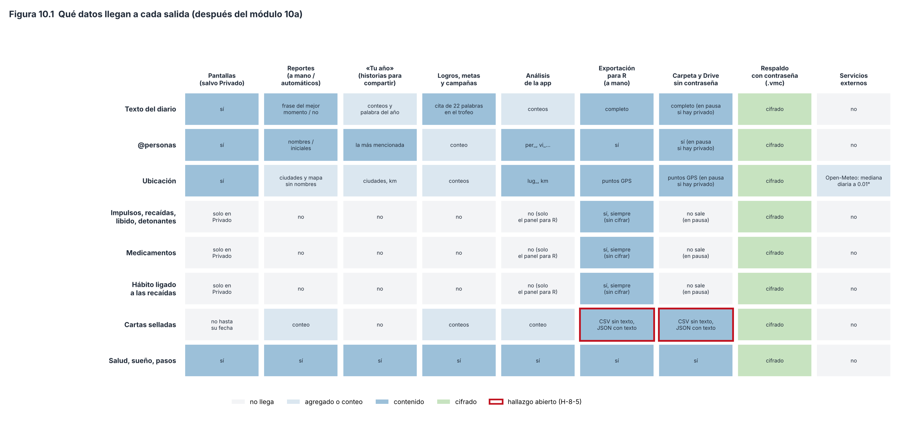

# Capítulo 10. Privacidad, seguridad e integridad de los datos

> **Para qué sirve este capítulo.** Explica **dónde viven tus datos, quién puede verlos y qué tan seguro es que no se pierdan**: el almacenamiento en el teléfono, el seguimiento privado y por dónde se filtra, el cifrado del respaldo, la verificación sin restaurar, los respaldos automáticos (carpeta y Google Drive), la restauración y los servicios externos con los que la app habla. Todo corresponde a la versión v81 (commit `fa527df`).
>
> **Cómo leerlo.** Igual que los capítulos anteriores. Las cifras criptográficas y las reglas vienen del código, con el nombre de la función. Los hallazgos son H-8-n (módulo 8, junto con el capítulo 9). Las **reglas de privacidad declaradas** vienen de la sección 7 del documento de contexto del proyecto (`VESTIGIUM_MEI_CONTEXTO.md`, v81); la sección 10.3.4 las compara con el código.
>
> **Privacidad del propio capítulo.** El seguimiento privado (impulsos, recaídas, libido, medicamentos) se describe **solo en su mecánica**: no hay ejemplos ni datos personales, y tampoco se reproducen las palabras clave que el código usa para reconocer ciertos hábitos. No se habla de la firma de la app.

---

## 10.1 Mini-glosario

| Término | Qué significa aquí |
|---|---|
| **Cifrar** | Convertir un archivo en algo ilegible sin una llave. |
| **AES-256** | El algoritmo de cifrado estándar más usado; «256» es el largo de la llave en bits. |
| **GCM** | Un modo de usar AES que, además de cifrar, añade una **etiqueta de autenticación**: si alguien cambia un solo bit del archivo, el descifrado falla en vez de dar datos alterados (Dworkin, 2007). |
| **IV (vector de inicialización)** | Un número al azar que se usa una sola vez por cifrado para que el mismo contenido no produzca el mismo resultado. |
| **PBKDF2** | Una función que convierte una contraseña en una llave **a propósito lenta**: repite un cálculo muchas veces (las **iteraciones**) para que probar millones de contraseñas cueste mucho (Turan et al., 2010). |
| **Sal** | Bytes al azar que se mezclan con la contraseña, para que la misma contraseña dé llaves distintas en cada archivo. |
| **Android Keystore** | Un almacén de llaves del sistema: la app puede usar una llave para cifrar, pero no puede sacarla del teléfono. |
| **Seguimiento privado** | Impulsos, recaídas, libido, detonantes, medicamentos y el hábito ligado a las recaídas. Desde el módulo 10a solo se ven en la pantalla Privado y viajan a R (sección 10.3). |
| **Integridad** | Que los datos no se pierdan, no se dañen y no cambien sin que lo sepas. |

---

## 10.2 Dónde viven los datos

- **En el teléfono**, en una base SQLite de documentos JSON (`vestigium.db`, capítulo 2) en el almacenamiento privado de la app, al que otras apps no tienen acceso.
- **Sin copia automática de Android**: el manifiesto declara `android:allowBackup="false"`, así que la copia de seguridad del sistema **no** sube la base a la nube. Los únicos respaldos son los que hace la app (sección 10.5). **[Validado]** como decisión: evita que el diario termine en una copia que no controlas.
- **La base no tiene un cifrado propio**: depende del cifrado del almacenamiento que hace Android cuando el teléfono tiene bloqueo de pantalla. No verifiqué en esta sesión cómo funciona ese cifrado en cada versión de Android **[sin verificar]**.
- **Bloqueo de la app** (opcional, `Config.bloqueo`, apagado por omisión): al abrirla pide huella o el bloqueo del teléfono (`BiometricPrompt`, con `BIOMETRIC_WEAK` o credencial del dispositivo) y vuelve a pedirlo si estuvo **más de 60 segundos** en segundo plano. Si el teléfono no tiene ningún bloqueo configurado, la app **no puede** pedirlo y queda abierta. Es una protección contra miradas casuales, no contra alguien con acceso técnico al teléfono.

---

## 10.3 El seguimiento privado

### 10.3.1 Qué es y cómo funciona

_Esta sección describe el código después del módulo 10a (decisiones D-1 y D-2 de `revision_propuestas.md`). Hasta v84 la regla era otra; el cambio está en el Apéndice D._

- **Una sola regla, en un solo archivo** (`data/Privado.kt`). Es privado:
  - todo momento de tipo `impulso`, `recaida` o `libido` (`Momento.privado`, que usa `Privado.TIPOS`);
  - en el día, la intensidad del impulso (0 a 5), si hubo recaída, los detonantes y los **medicamentos**;
  - el **hábito ligado a las recaídas**. Con el interruptor encendido es el que elegiste en Privacidad o, si no elegiste, un hábito activo cuyo nombre contenga ciertas palabras clave. Con el interruptor apagado, solo el que elegiste. Elegir «ninguno» funciona; hasta v84 caía de nuevo en las palabras clave.
- **Dónde se ve: solo en la pantalla Privado** (Más → Privado; antes «Impulsos y recaídas»). Ahí se anota cada día:
  - los medicamentos, con un botón «lo de siempre» que copia los del último día con medicamentos;
  - con el interruptor encendido, también el impulso, la recaída, los detonantes y el hábito ligado.

  La pantalla trae además:
  - el resumen privado;
  - una tendencia de los últimos 12 meses: días con recaída, impulsos y días con medicamentos;
  - los días que tomaste cada medicamento;
  - el registro de los últimos 30 momentos privados, que se pueden corregir.

  Desde Día, el enlace «privado de este día» abre la pantalla en esa fecha. Las correlaciones de estas variables se hacen **solo en R**, como decidiste.
- **Dónde no se ve: en ninguna otra parte de la app**, ni con el interruptor encendido:
  - Día, Hoy, momentos, cinta, diarios, libreta, calendario, semana, año, totales, mapa y widgets;
  - reportes, «Tu año», logros (también los propios), metas, campañas y experimentos (el impulso dejó de ser una medida posible);
  - Constelación, Red, Tu gente, las sugerencias de @ y # al escribir, «Tus temas», y las variables `per_`, `pen_` y `tema_`;
  - todas las listas de análisis: `Estadistica.variables()` excluye `impulso`, `recaida`, `n_recaida`, `recaida_min`, `libido_max`, `n_libido`, `n_impulso`, `medicamentos_n`, las familias `med_` y `det_` y `hab_` del hábito ligado.
- **El interruptor `Config.seguimiento_privado`** (apagado por omisión) solo decide qué se **ofrece** anotar: con él apagado, la pantalla Privado tiene medicamentos e impulsos; con él encendido, también recaídas, libido y detonantes. Ya no decide qué se muestra fuera de Privado: fuera, nunca se muestra.
- **La exportación para R lleva todo, siempre.** El panel calcula las variables privadas aunque el interruptor esté apagado, y `vm_momentos.csv`, `vm_dias.csv`, `vm_panel_extendido.csv` y `vm_respaldo.json` las llevan. Las coordenadas de un momento privado ya no se usan para pedir el clima (`Entorno.lugarDe`).
- **Registrar una recaída** (`Recaidas.registrar`) guarda el momento con hora y lugar, marca el día con recaída y **desmarca el hábito ligado**. Se puede deshacer tal cual (`deshacer`) y cambiar la hora (`moverHora`), que busca la ubicación de esa hora (la más cercana en ±30 min) y descarta la luz y el ruido medidos al registrar. Desde el esquema 14 (H-NAV-6): cambiar solo el día, con la misma hora, también la mueve, porque se compara el minuto completo; y borrarla desde el diálogo de Privado quita la marca del día si era la única recaída de ese día (`alBorrar`; el día queda sin respuesta, porque no se sabe qué había antes).
- **El resumen privado** (`Recaidas.resumen`):
  - impulsos y recaídas por hora; recaídas por día de la semana;
  - lugares, detonantes, qué hacías antes y aparato;
  - minutos entre un impulso y la recaída que le siguió (dentro de 24 h);
  - cuántos impulsos pasaron **sin recaída en las 3 horas siguientes**;
  - días desde la última recaída y rachas.
- **Lo que no se puede filtrar:** si escribes algo privado en el texto libre del diario o de un momento común, la app no tiene forma de saberlo.

### 10.3.2 Las rachas: solo los días respondidos (H-8-8)

**Hasta la entrega 10c**, `Recaidas.resumen` empezaba a contar desde el primer día con respuesta y, a partir de ahí, **todo día que no era de recaída contaba como limpio**, aunque ese día no se hubiera contestado nada. Es el mismo problema de los datos faltantes del capítulo 3 (sección 3.15): si los días sin registro son justamente los difíciles, la racha queda inflada.

**Desde la entrega 10c (D.75)** las rachas salen de una función pura, `Recaidas.rachas(recaidas, limpios, hoy)`:

- un día **con recaída** (marcado en el día o con un momento de recaída) reinicia la racha a 0;
- un día cuenta como **limpio** solo si ese día se respondió «no» (`Dia.recaida == false`); suma 1;
- un día **sin respuesta** no suma ni reinicia: se cuenta aparte, como «sin respuesta» desde la última recaída. El día de hoy, mientras no se responda, no cuenta como sin respuesta.

La más larga (`rachaMaxima`) y la actual (`rachaActual`) salen de ahí, y la pantalla Privado dice «días respondidos sin» y, si los hay, cuántos días quedaron sin respuesta desde la última («no se sabe»). Ejemplo con una secuencia inventada de cuatro días (sí, no, sin respuesta, no): antes, racha actual 3; ahora, **2**, con 1 día sin respuesta. Lo comprueba `CalculosPrueba.rachasSoloConRespuesta`. **[Diseño propio]**: no contar ni romper con los días sin respuesta es un punto medio; romper la racha castigaría olvidar el registro, y contarlos la inflaría.

### 10.3.3 Dónde aparecía hasta v84 y qué cambió

La Figura 10.1 resume qué tipo de dato llega a cada salida. Hasta v84, el seguimiento privado se ocultaba de casi todo, pero se filtraba por seis vías. Todas quedaron resueltas en el módulo 10a:

1. **Los momentos de impulso no eran «privados» para el código** (H-8-1). Contaban en el reporte, en «Tu año», en los logros de momentos, en el mapa, en un widget, en la semana, el calendario, el año, la Constelación, la Red y las presencias. Ahora `Momento.privado` incluye el impulso.
2. **«La relación del año» podía usar variables privadas y `medicamentos_n`** (H-8-2), y `n_impulso` entraba siempre, aun con el interruptor apagado, porque estaba en el grupo «Momentos» (H-9-1). Ahora `variables()` las excluye.
3. **La recaída apagaba un hábito con logros, campañas y rachas visibles** (H-8-3, H-9-38), y los logros propios aceptaban variables privadas. Ahora el hábito ligado solo se ve y se marca en Privado (`Privado.habitosVisibles`), y los logros propios sobre algo privado no se ofrecen ni se muestran.
4. **Los medicamentos no estaban detrás de ninguna regla** (H-8-16). Ahora son privados.
5. **La exportación salía en claro a la carpeta y a Drive** (H-8-5). Ahora, con datos privados y sin contraseña, el respaldo no sale del teléfono (sección 10.5).
6. **Las @menciones y #temas de los momentos privados** entraban en `per_`, `tema_`, «Tu gente», «¿Quién es @x?» y las sugerencias al escribir (H-6-1). Ahora se filtran.

**Sobre la pregunta del plan («por qué los logros nunca se ligan a sustancias, impulsos, recaídas ni libido»).** El documento de contexto lo afirma de los 12 logros secretos y, en general, de todo el seguimiento privado. El razonamiento es correcto: un logro por «días sin recaída» o por «tomar menos alcohol» convertiría el seguimiento privado en un marcador, con la presión de la ley de Campbell (capítulo 9, sección 9.7) justo sobre los datos más delicados; y uno «por registrar impulsos» premiaría registrarlos.

Hasta v84 la afirmación era **casi** cierta, por las tres vías indirectas de arriba (puntos 1 y 3). Desde el módulo 10a se cumple. Las sustancias **no** son privadas según la regla declarada («Sustancias NO son privadas: dato normal»), así que un logro propio sobre ellas no rompe ninguna regla; solo conviene recordar el riesgo de la ley de Campbell.

### 10.3.4 Las reglas declaradas frente al código

La sección 7 del documento de contexto llama a estas reglas «no negociables». Comparación con el código de v81:

| Regla declarada | ¿Se cumple? | Dónde se comprobó |
|---|---|---|
| WhatsApp y comentarios de YouTube: nunca guardar texto | **Sí** | `ChatDia` guarda solo conteos por chat y día (`mios`, `otros`); de los comentarios y chats de YouTube solo se guarda cuándo y en qué video (`data/Modelo.kt`, `Importaciones.kt`) |
| Notificaciones: no leer su texto | **Sí** | `sensores/Oyente.kt` cuenta solo la app y la hora |
| Tokens de Spotify y claves de API solo en el teléfono | **Sí** | Preferencias privadas (`Spotify.prefs`, `Portadas.prefs` «claves_busqueda»), fuera de `Config` y por tanto fuera de los respaldos |
| `allowBackup=false` | **Sí** | Manifiesto |
| Fotos nunca se copian | **Sí** | El catálogo guarda hora, coordenadas y aparato, no la imagen |
| Cartas selladas: sin contenido en búsqueda, CSV ni «Tu año» | **En parte** | El CSV y «Tu año» cumplen; `vm_respaldo.json`, que se exporta junto al CSV, lleva el texto (H-8-5). La búsqueda no la comprobé **[sin verificar]** |
| Seguimiento privado (impulsos, recaídas, libido, detonantes, medicamentos) nunca en reportes, «Tu año», logros, mapas ni widgets; sí en la exportación a R | **Sí desde el módulo 10a**, con una regla más estricta: fuera de la pantalla Privado no aparece en ninguna salida. Hasta v84 fallaba en los impulsos y los medicamentos (H-8-1, H-8-2) | `data/Privado.kt`, `Momento.privado`, `Estadistica.variables` |
| Sustancias no son privadas | **Sí** | Se tratan como dato normal |
| La imagen del hall no lleva texto del diario | **Sí** | `HallImagen.kt` («Sin textos del diario ni nada privado»); la cita del diario solo aparece en el detalle del trofeo dentro de la app |
| «Nada pasa por servidores ajenos salvo Drive, Open-Meteo y Spotify» (sección 1) | **No del todo** | También hay consultas a TMDB, RAWG, TVmaze, Open Library, Crossref y a los mosaicos de OpenStreetMap (sección 10.8; H-8-17) |

*Figura 10.1. Qué tipo de dato llega a cada salida, según el código después del módulo 10a. Borde rojo: hallazgo que sigue abierto (H-8-5). Script: `figuras/fig24_flujo_privacidad.py`.*

---

## 10.4 El respaldo cifrado

### 10.4.1 Qué contiene

`Respaldos.archivo` arma un **.zip** con `vm_respaldo.json` (diario, momentos, cartas, ajustes, Conocerte… todo), `vm_ubicaciones.csv`, `vm_fotos_catalogo.csv` (solo hora y coordenadas de las fotos, **nunca la foto**) y las portadas de libros y películas. Si pusiste contraseña, ese .zip se cifra y se guarda como **.vmc**; el .zip en claro se borra.

### 10.4.2 Cómo se cifra exactamente (`Respaldos.cifrar`)

1. **Sal**: 16 bytes al azar (`SecureRandom`), nueva en cada respaldo.
2. **Llave**: PBKDF2 con HMAC-SHA256, **210 000 iteraciones**, 256 bits (`ITERACIONES`, `llave`).
3. **IV**: 12 bytes al azar, nuevo en cada respaldo.
4. **Cifrado**: AES-256 en modo GCM con etiqueta de **128 bits**. El encabezado `VESTIGIUM-MEI-CIFRADO-1` (23 bytes) entra como **dato adicional autenticado**: no se cifra, pero si alguien lo cambia, el descifrado falla.
5. **Formato del archivo**: encabezado (23 bytes) · sal (16) · IV (12) · datos cifrados con su etiqueta.

**Qué protege.** Sin la contraseña, el contenido es ilegible, y cualquier cambio o daño del archivo hace que el descifrado **falle** (no devuelve datos alterados). Como la sal y el IV son nuevos en cada respaldo, nunca se repite una combinación de llave e IV. Las elecciones (AES-GCM con IV de 96 bits y etiqueta de 128; PBKDF2 con sal de 128 bits) siguen las recomendaciones del NIST (Dworkin, 2007; Turan et al., 2010). **[Validado]**.

**Qué no protege.** El tamaño del archivo y sus fechas se ven. Y el punto débil de todo cifrado con contraseña es **adivinar la contraseña**: quien tenga el .vmc puede probar contraseñas sin límite en su propia computadora.

### 10.4.3 Las iteraciones (H-8-9)

Las iteraciones son el «peaje» por cada intento de adivinar. La guía de OWASP para guardar contraseñas recomienda, para PBKDF2 con HMAC-SHA256, **600 000 iteraciones** (y 220 000 para HMAC-SHA512) (OWASP, s. f.). La app usa **210 000 con SHA-256**: unas 2.9 veces menos peaje que lo recomendado hoy. **[Aproximación]**: es mucho mejor que nada, pero por debajo de la recomendación actual.

**Ejemplo (cuentas exactas, sin velocidades).** La app exige al menos **8 caracteres**. Si fueran 8 letras minúsculas al azar, hay 26⁸ ≈ 2.1 × 10¹¹ contraseñas posibles; probarlas todas cuesta 2.1 × 10¹¹ × 210 000 ≈ 4.4 × 10¹⁶ cálculos de HMAC. Con 600 000 iteraciones serían ≈ 1.3 × 10¹⁷. Pero una contraseña humana (una palabra con un número) no es aleatoria y se adivina mucho antes. **La longitud y el azar de la contraseña importan mucho más que las iteraciones.** No doy tiempos, porque dependen del equipo del atacante y no los verifiqué.

### 10.4.4 La contraseña en el teléfono

`ponerContrasena` guarda la contraseña **cifrada con una llave AES-256-GCM del Android Keystore** (en las preferencias privadas `respaldo_secreto`). Así la app puede hacer respaldos cifrados sola, cada día, sin pedírtela. La contraseña **nunca viaja** en ningún respaldo. Si la olvidas, los .vmc no se pueden abrir: la propia pantalla lo advierte.

**Detalle** (H-8-15): si cambias la contraseña, las copias semanales y mensuales anteriores siguen cifradas con la **anterior**. Para restaurar una copia vieja hará falta recordar esa contraseña.

---

## 10.5 Respaldos automáticos

### 10.5.1 A una carpeta (`Respaldos.aCarpeta`)

Una vez al día (la primera vez que corre la tarea diaria después de las 6:00, `Trabajo.diario`), si elegiste una carpeta:

- **Con contraseña**: se escribe solo `vestigium_respaldo.vmc` y se **borran** los archivos en claro que hubiera de antes (`vm_*.csv`, `vm_*.json`, `LEEME.txt`, `vestigium.R`, `vestigium_*.zip`). Desde el esquema 13 (P-09) se borran **después** de que el .vmc quedó escrito: si la escritura falla, la copia en claro sigue ahí (H-9-37).
- **Sin contraseña**: se escriben **todos** los CSV de la exportación, el diccionario, `vm_respaldo.json`, `vestigium.R` y `vestigium_respaldo.zip`, en claro.
- **Sin contraseña y con datos privados** (desde el módulo 10a): **no se escribe nada** (`Respaldos.bloqueado`). Hoy muestra «Tus respaldos están en pausa…» y llega una notificación por semana hasta que pongas contraseña.

### 10.5.2 A Google Drive (`data/Drive.kt`)

- Usa el permiso **`drive.file`**: la app solo ve los archivos que ella misma creó, **nunca el resto de tu Drive**. **[Validado]** como el permiso mínimo necesario.
- Todo va a una carpeta «Vestigium Mei». Cada día **reemplaza** el respaldo del día (y, sin contraseña, los CSV); guarda una **copia semanal** fechada con el lunes (se conservan las **8** más recientes) y una **mensual** (las **12** más recientes).
- Con contraseña, solo sube el .vmc y borra de Drive los archivos en claro anteriores; sin contraseña, sube los CSV y el .zip en claro. Desde el esquema 13 (P-09), los archivos en claro se borran solo **después** de subir el .vmc (H-9-37).
- **No se reemplaza una copia buena por una mucho más pobre** (esquema 13, P-09). Antes de subir, `Respaldos.empobrecido` compara cuántos días y momentos trae el respaldo nuevo con los del último que reemplazó la copia (`Config.drive_conteo`). Si el nuevo trae **menos del 90 %** de cualquiera de los dos (y el anterior tenía 20 o más), no toca la copia del día, la semanal ni la mensual. En su lugar lo guarda aparte como `vestigium_revisar` y avisa con una notificación. «Restaurar desde Drive» nunca elige esa copia. Si el borrado fue a propósito, «conectar y subir ahora» (a mano) reemplaza la copia y fija el nuevo punto de comparación. El umbral de 90 % y el mínimo de 20 son **[Diseño propio]**: borrar a propósito muchos días también dispara el aviso, y eso es lo que se busca (H-8-14).
- Con datos privados y sin contraseña, no sube nada (desde el módulo 10a), igual que la carpeta. Tampoco se puede **compartir** el respaldo completo desde la pantalla Respaldo: el botón se desactiva y explica por qué.
- Si el permiso de Google caduca, avisa una vez por semana.

### 10.5.3 Cuándo falla

- **Sin contraseña, todo queda en claro fuera del teléfono** (H-8-5), incluido el diario completo. Desde el módulo 10a, si hay datos privados, el respaldo no sale sin contraseña. La **exportación para R** (resumida o extendida, que pides a mano y compartes) es la excepción: R necesita leer los CSV, así que va sin cifrar, y la pantalla advierte que lleva los datos privados.
- **El costo de esa regla:** si nunca pones contraseña, los respaldos automáticos quedan en pausa mientras haya datos privados. Por eso el aviso es visible en Hoy y llega una notificación semanal.
- **Las cartas selladas** van **sin texto** en `vm_cartas.csv` («no se pueden leer antes de su fecha»), pero `vm_respaldo.json`, que se exporta junto, lleva **el texto completo** (H-8-5). El sello se puede saltar abriendo el JSON.
- **Hasta el esquema 12, un respaldo malo podía reemplazar a uno bueno** (H-8-14; desde el 13, ver la sección 10.5.2). Si un día los datos del teléfono se dañan o se pierden (por ejemplo, tras reinstalar), el respaldo de ese día **sobrescribe** el anterior sin comprobar si trae muchos menos datos. La copia semanal de esa semana también será mala si es la primera de la semana. Quedan las copias semanales y mensuales anteriores, pero «Restaurar desde Drive» **toma siempre la más reciente** (`Drive.ultimaCopia`, por fecha de modificación). Para traer una anterior hay que bajarla a mano y usar «Restaurar desde un archivo».

### 10.5.4 Los reportes, en carpetas públicas (H-8-4)

Los reportes semanales y mensuales se generan **solos** (capítulo 9, sección 9.3.1) y se guardan con `MediaStore` en `Pictures/VestigiumMei` y `Download/VestigiumMei`, fuera del almacenamiento privado de la app. Ahí los ve la galería, cualquier app con permiso para leer imágenes o descargas y, si está activada, la copia automática de fotos del teléfono, que puede subirlos a la nube sin que lo decidas. El reporte excluye el seguimiento privado (desde el módulo 10a también los impulsos), las calles y los nombres de lugares, pero incluye ciudades, peso, dinero y ánimo. Hasta v84 incluía también los **nombres de personas** (salvo en modo discreto, apagado por omisión) y la **frase del mejor momento** del diario. Desde el módulo 10a, los reportes **que se guardan solos** (lunes y día 1) van siempre en modo discreto, con iniciales, y sin esa frase (`Reportes.reporte(automatico = true)`); los que pides a mano siguen como antes. **[Diseño propio]**: la idea de reportes «para compartir» es coherente, pero guardarlos solos en una carpeta pública convierte cada lunes en una salida de datos que no elegiste.

---

## 10.6 Verificar sin restaurar

`Respaldos.verificar` (desde un archivo) y `Drive.verificar` (la copia más reciente de Drive):

1. Si está cifrado, lo descifra (con la contraseña guardada o la que escribas). **Si el archivo está dañado, aquí falla**, gracias a la etiqueta de GCM.
2. Lee el .zip en memoria (`contenido`): decodifica `vm_respaldo.json` completo y cuenta las líneas de ubicaciones y del catálogo de fotos y las portadas.
3. Muestra un **informe** (`informe`): fecha y esquema del respaldo, días (y rango de fechas), días con diario, sueños, momentos, tramos, gastos, cartas, obras, días de salud y de pantalla, canciones, comidas, lugares, visitas, ubicaciones, fotos con lugar, portadas y algunos ajustes; y debajo, cuántos días, momentos y gastos hay **en este teléfono**.

**Qué garantiza.** Que el archivo se abre, que no fue alterado (si está cifrado) y que el JSON se puede leer de punta a punta. Al leer las entradas del .zip, Java comprueba la suma de verificación (CRC-32) de cada una; esto no lo comprobé en la documentación durante esta sesión **[sin verificar]**. Es una práctica muy buena: **un respaldo que nunca se probó no es un respaldo**. **[Validado]** como práctica.

**Qué no garantiza** (H-8-12):

- Hasta el esquema 12, el mensaje decía «**El respaldo se lee completo y no le falta nada**», pero la app **no comparaba** nada: mostraba las cifras del respaldo y las del teléfono una debajo de otra, y tú tenías que notar si no cuadraban. «No le falta nada» era más de lo que se comprobó. Desde el 13 (P-08) dice solo «El respaldo se lee completo», y pone lado a lado respaldo / teléfono en días, momentos, gastos y experimentos.
- **La versión del esquema.** Como el lector de JSON ignora los campos que no conoce (`ignoreUnknownKeys = true`), restaurar en una versión vieja de la app un respaldo hecho con una versión más nueva **perdía en silencio** los campos nuevos. Desde el esquema 13, `Importar.esquemaFuturo` **rechaza** restaurar un respaldo con `schema_v` mayor que el de la app, antes de tocar nada (ni días, ni ubicaciones, ni portadas), y «Verificar» lo advierte. Al revés, los campos que falten se siguen llenando con valores por omisión (H-1-4).

---

## 10.7 Restaurar: cómo se combinan los datos

`Respaldos.restaurar` acepta el .vmc, el .zip completo, la exportación extendida o el JSON suelto. La pantalla promete: «Lo que ya tengas aquí no se duplica ni se borra». Con la app vacía, se trae todo, incluidos los ajustes. Con datos, `Importar.respaldoTexto` **combina**, pero con reglas distintas según la colección (H-8-13):

| Colección | Si ya existe en el teléfono… |
|---|---|
| Días | **gana el teléfono**: el día del respaldo se ignora (`importarDias(sobrescribir = false)`) |
| Momentos, reacciones, obras, ascensos, chats, YouTube | se agregan los que no existan (por identificador) |
| Salud, pantalla, lugares, cartas, entorno, fotos, agenda, sesiones, canciones | **gana el respaldo**: se guardan encima. Desde el esquema 14, con una excepción: el sueño que corregiste a mano en el teléfono (`sueno_manual`) no lo pisa un respaldo que no lo tenía corregido (`Fusion.salud`; H-NAV-5) |
| Experimentos (desde el esquema 13) | gana el teléfono, pero se conserva lo que solo trae el respaldo: la fecha de fin (un respaldo viejo no reactiva uno terminado) y las respuestas de «¿Lo hiciste hoy?» (`Fusion.experimento`). Hasta el 12, ganaba el respaldo |
| Gastos e ingresos | se agregan los que no existan (por identificador). Hasta el esquema 12, los repetidos se sobrescribían en la base pero no en memoria, y al reiniciar aparecía en silencio la versión del respaldo (H-9-28) |
| Avisos de ánimo (desde el esquema 13) | se juntan los dos: el mayor número de planeados y la unión de vencidos y mostrados |
| Personas y fechas propias (desde el esquema 13) | las personas del teléfono mandan, pero toman la fecha de nacimiento o de fallecimiento que solo tenga el respaldo; las fechas propias se suman |
| Laptop, comunicación, conexiones | se agregan solo las fechas nuevas |
| MacroFactor (nutrición, comidas, series, entrenos) | solo si en el teléfono **no hay nada** de MacroFactor |
| Ajustes | se combinan (`combinarConfig`) |
| Ubicaciones | se agregan las que no existan (por milisegundo); las de fotos se rehacen del catálogo |

**Por qué importa.** Si restauras un respaldo sobre un teléfono que tiene una versión **incompleta** de un día (por ejemplo, solo el sueño de esa mañana), el diario completo del respaldo para ese día **no se recupera**. En cambio, para la salud, un respaldo viejo puede **pisar** datos más nuevos del teléfono. Ninguna de las dos cosas se avisa.

---

### 10.7.1 La papelera (desde el esquema 14)

Antes de borrar un registro que hiciste tú (momentos, tramos, consumos, notas, metas, tomas, gastos, ingresos, lugares, cartas, sesiones de escalada y obras), `Repo` copia el documento tal como estaba a la colección `papelera` (`Borrado`: colección, id, el documento y cuándo se borró). Lo que lleva más de 7 días se vacía en la tarea diaria (`Repo.limpiarPapelera`). Lo que volvió con «deshacer» deja de contar como borrado. La papelera **no viaja** en los respaldos ni en la exportación. Lo que vive en los ajustes (fechas propias, logros propios, ciudades) no pasa por la papelera; para eso queda «deshacer». Desde la entrega N7 de la revisión de navegación hay una pantalla para recuperar (Más → Datos → «Papelera»): lista lo borrado con cuántos días le quedan y «recuperar». **Lo privado no aparece ahí** (ni siquiera se cuenta): un impulso, una recaída o la libido borrados se recuperan en la papelera de la pantalla Privado (`Papelera.esPrivado`, vigilado por `PrivadoPrueba`). Una sustancia que ocultaste sale como «Un registro oculto». **[Diseño propio]**.

## 10.8 Servicios externos

La app no incluye herramientas de analítica, publicidad ni reporte de errores (no hay dependencias de ese tipo en `app/build.gradle.kts`). Habla con estos servicios:

| Servicio | Para qué | Qué se envía |
|---|---|---|
| **Google Drive** (`googleapis.com`) | Respaldos (sección 10.5), solo si lo activas | Los archivos de respaldo (cifrados o no) |
| **Open-Meteo** (pronóstico, archivo histórico y calidad del aire) | Clima y aire del día (capítulo 4) | La **mediana de las ubicaciones del día, redondeada a 2 decimales** (`Entorno.r2`: ≈ 1.1 km en latitud) y las fechas |
| **Spotify** | Historial de canciones (capítulo 4) | Autorización con redirección a `127.0.0.1` (solo dentro del teléfono) y luego consultas con tu permiso |
| **Catálogos de obras**: TMDB, RAWG, TVmaze, Open Library, Crossref | Portadas y fichas de libros, películas, series, juegos y artículos | El **título o DOI** que buscas |
| **Mapas de OpenStreetMap** (osmdroid, mosaicos `MAPNIK`) | Fondo del mapa | Qué zona del mapa estás viendo (al pedir los mosaicos) |
| **Health Connect, uso del teléfono, ubicación** | Datos pasivos (capítulo 4) | Nada: se leen **dentro** del teléfono |

El documento de contexto dice que «nada pasa por servidores ajenos salvo Drive del usuario, Open-Meteo (clima) y Spotify API»; la tabla muestra que hay más servicios, aunque los demás solo reciben títulos de obras o la zona del mapa que miras (H-8-17).

**[Validado]** como enfoque general: el procesamiento es local y solo salen las consultas necesarias, con la ubicación redondeada para el clima. Lo que no es mínimo es el respaldo sin contraseña. No verifiqué las políticas de privacidad de cada servicio en esta sesión **[sin verificar]**.

---

## 10.9 Integridad: lo que ya se vio en otros capítulos

- **Documentos que no se pueden leer.** Hasta el esquema 12 se descartaban en silencio (H-1-3). Desde el 13 (P-07) se cuentan por colección y se muestran en «Estado de los datos» y en Hoy, y una configuración ilegible se copia aparte antes de quedar en blanco (H-9-2; capítulo 2). Los **valores inválidos se convierten en valores por omisión** (H-1-4).
- **Versión del esquema**: cada día guarda `schema_v` y cada respaldo el suyo (capítulo 2); el diccionario no versiona variable por variable (H-1-8).
- **Estado de los datos** (`EstadoDatos.kt`, capítulo 4): muestra por fuente si llegó hoy o ayer (verde), si está atrasada (ámbar), si falta un permiso (rojo) o si está apagada (gris). Es el monitor de integridad de los datos pasivos.
- **Días importados sin sellos** (H-1-9).

---

## 10.10 Resumen de decisiones

| Decisión | Clasificación | Respaldo |
|---|---|---|
| Datos solo en el teléfono, sin copia automática de Android | Validado (buena práctica) | — |
| Bloqueo opcional con huella o credencial, 60 s | Diseño propio | — |
| AES-256-GCM, IV de 12 bytes y sal de 16 nuevos en cada respaldo | Validado | Dworkin (2007); Turan et al. (2010) |
| PBKDF2-HMAC-SHA256 con 210 000 iteraciones | Aproximación (por debajo de la recomendación actual) | OWASP (s. f.): 600 000 |
| Contraseña guardada con el Android Keystore, nunca en el respaldo | Diseño propio (razonable) | — |
| Permiso `drive.file` | Validado (mínimo necesario) | — |
| 8 copias semanales y 12 mensuales | Diseño propio | — |
| Verificar sin restaurar | Validado como práctica | — |
| Combinar al restaurar con reglas distintas por colección | Diseño propio (inconsistente) | — |
| Ubicación redondeada a 0.01° para el clima | Diseño propio (razonable) | — |
| Seguimiento privado: visible solo en la pantalla Privado, siempre en la exportación para R | Diseño propio | — |
| Sin contraseña no sale ningún respaldo si hay datos privados (salvo la exportación para R, a mano) | Diseño propio | — |
| Contar lo ilegible y apartar la configuración dañada (esquema 13) | Diseño propio | — |
| No restaurar un respaldo de un esquema más nuevo (esquema 13) | Validado como práctica | — |
| No reemplazar en Drive una copia por otra con menos del 90 % de días o momentos (esquema 13) | Diseño propio | — |

---

## 10.11 Resumen del capítulo

1. Los datos viven solo en el teléfono, sin copia automática de Android; la app puede pedir huella. Salen solo por los respaldos que tú activas y por consultas puntuales (clima con la ubicación redondeada, títulos de obras, mapas).
2. El **respaldo cifrado** usa AES-256-GCM con sal e IV nuevos en cada archivo: bien diseñado. PBKDF2 con 210 000 iteraciones está por debajo de las 600 000 que recomienda hoy OWASP (H-8-9); lo que más importa es una contraseña larga.
3. **Sin contraseña, todo sale en claro** a la carpeta y a Drive, incluido el texto de las cartas selladas (H-8-5). Desde el módulo 10a, si hay datos privados, el respaldo no sale sin contraseña; solo la exportación para R, que pides a mano, va en claro y lo advierte.
4. **El seguimiento privado** (impulsos, recaídas, libido, detonantes, medicamentos y el hábito ligado) se ve, desde el módulo 10a, **solo en la pantalla Privado** y va completo a R. Hasta v84 se colaba por los impulsos, los medicamentos y el hábito ligado (H-8-1, H-8-2, H-8-3, H-9-39). Desde la entrega 10c, las rachas cuentan solo los días respondidos «no» (H-8-8, D.75).
5. **Verificar** un respaldo es una gran idea. Hasta el esquema 12, el mensaje prometía más de lo que comprobaba y no revisaba la versión del esquema (H-8-12). Desde el 13 dice solo lo que comprueba, compara respaldo y teléfono, y un respaldo de una versión más nueva no se restaura.
6. **Restaurar** combina con reglas distintas según la colección (H-8-13). Desde el esquema 13, los gastos e ingresos no se pisan y un experimento terminado no se reactiva. En Drive, un respaldo mucho más pobre ya no reemplaza al bueno: se guarda aparte y se avisa (H-8-14).
7. Los reportes se guardan solos en carpetas públicas con nombres y frases del diario (H-8-4; capítulo 9).
8. Las reglas de privacidad declaradas se cumplen en casi todo (texto de WhatsApp, notificaciones, claves, fotos, recaídas, libido); fallan en los impulsos y los medicamentos (H-8-1, H-8-2), en el texto de las cartas selladas dentro del JSON (H-8-5) y en la lista de servicios externos (H-8-17).
9. Entre los capítulos 9 y 10 se identificaron **17 hallazgos** (H-8-1 a H-8-17). No se cambió código.

---

### Referencias citadas en este capítulo

Ver `referencias.md`. Citas: Dworkin (2007); OWASP (s. f.); Turan, Barker, Burr y Chen (2010).
