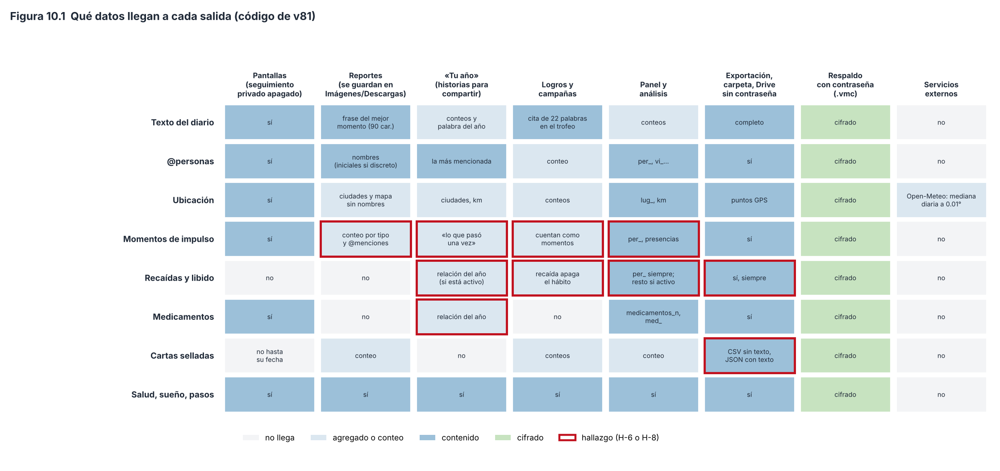

# Capítulo 10. Privacidad, seguridad e integridad de los datos

> **Para qué sirve este capítulo.** Explica **dónde viven tus datos, quién puede verlos y qué tan seguro es que no se pierdan**: el almacenamiento en el teléfono, el seguimiento privado y por dónde se filtra, el cifrado del respaldo, la verificación sin restaurar, los respaldos automáticos (carpeta y Google Drive), la restauración y los servicios externos con los que la app habla. Todo corresponde a la versión v81 (commit `fa527df`).
>
> **Cómo leerlo.** Igual que los capítulos anteriores. Las cifras criptográficas y las reglas vienen del código, con el nombre de la función. Los hallazgos son H-8-n (módulo 8, junto con el capítulo 9).
>
> **Privacidad del propio capítulo.** El seguimiento privado (impulsos, recaídas, libido, medicamentos) se describe **solo en su mecánica**: no hay ejemplos ni datos personales, y tampoco se reproducen las palabras clave que el código usa para reconocer ciertos hábitos. No se habla de la firma de la app.

---

## 10.1 Mini-glosario

| Término | Qué significa aquí |
|---|---|
| **Cifrar** | Convertir un archivo en algo ilegible sin una llave. |
| **AES-256** | El algoritmo de cifrado estándar más usado; «256» es el largo de la llave en bits. |
| **GCM** | Un modo de usar AES que, además de cifrar, añade una **etiqueta de autenticación**: si alguien cambia un solo bit del archivo, el descifrado falla en vez de dar datos alterados (Dworkin, 2007). |
| **IV (vector de inicialización)** | Un número al azar que se usa una sola vez por cifrado para que el mismo contenido no produzca el mismo resultado. |
| **PBKDF2** | Una función que convierte una contraseña en una llave **a propósito lenta**: repite un cálculo muchas veces (las **iteraciones**) para que probar millones de contraseñas cueste mucho (Turan et al., 2010). |
| **Sal** | Bytes al azar que se mezclan con la contraseña, para que la misma contraseña dé llaves distintas en cada archivo. |
| **Android Keystore** | Un almacén de llaves del sistema: la app puede usar una llave para cifrar, pero no puede sacarla del teléfono. |
| **Seguimiento privado** | Los registros de recaídas y libido (y el interruptor que los muestra). La app los oculta de casi todas las salidas (sección 10.3). |
| **Integridad** | Que los datos no se pierdan, no se dañen y no cambien sin que lo sepas. |

---

## 10.2 Dónde viven los datos

- **En el teléfono**, en una base SQLite de documentos JSON (`vestigium.db`, capítulo 2) en el almacenamiento privado de la app, al que otras apps no tienen acceso.
- **Sin copia automática de Android**: el manifiesto declara `android:allowBackup="false"`, así que la copia de seguridad del sistema **no** sube la base a la nube. Los únicos respaldos son los que hace la app (sección 10.5). **[Validado]** como decisión: evita que el diario termine en una copia que no controlas.
- **La base no tiene un cifrado propio**: depende del cifrado del almacenamiento que hace Android cuando el teléfono tiene bloqueo de pantalla. No verifiqué en esta sesión cómo funciona ese cifrado en cada versión de Android **[sin verificar]**.
- **Bloqueo de la app** (opcional, `Config.bloqueo`, apagado por omisión): al abrirla pide huella o el bloqueo del teléfono (`BiometricPrompt`, con `BIOMETRIC_WEAK` o credencial del dispositivo) y vuelve a pedirlo si estuvo **más de 60 segundos** en segundo plano. Si el teléfono no tiene ningún bloqueo configurado, la app **no puede** pedirlo y queda abierta. Es una protección contra miradas casuales, no contra alguien con acceso técnico al teléfono.

---

## 10.3 El seguimiento privado

### 10.3.1 Qué es y cómo funciona

- Un momento es **privado** para el código si su tipo es `recaida` o `libido` (`Momento.privado`, `data/Modelo.kt`). Además, el día guarda una intensidad de impulso (0 a 5), si hubo recaída y los detonantes.
- El interruptor `Config.seguimiento_privado` está **apagado por omisión**. Con él apagado, las pantallas del día, los momentos, la cinta y los diarios no muestran los momentos privados, y la sección «Seguimiento privado» del día no aparece.
- **Registrar una recaída** (`Recaidas.registrar`) guarda el momento con hora y lugar, marca el día con recaída y **desmarca el hábito ligado**: el que elegiste en Privacidad o, si no elegiste ninguno, un hábito activo cuyo nombre contenga ciertas palabras clave del código. Se puede deshacer tal cual (`deshacer`) y cambiar la hora (`moverHora`), que busca la ubicación de esa hora (la más cercana en ±30 min) y descarta la luz y el ruido medidos al registrar.
- **El resumen privado** (`Recaidas.resumen`): impulsos y recaídas por hora, recaídas por día de la semana, lugares, detonantes, qué hacías antes, aparato, minutos entre un impulso y la recaída que le siguió (dentro de 24 h), cuántos impulsos pasaron **sin recaída en las 3 horas siguientes**, días desde la última y rachas.

### 10.3.2 Las rachas cuentan como «limpios» los días sin respuesta (H-8-8)

`Recaidas.resumen` empieza a contar desde el primer día con respuesta y, a partir de ahí, **todo día que no es de recaída cuenta como limpio**, aunque ese día no hayas contestado nada. Es el mismo problema de los datos faltantes del capítulo 3 (sección 3.15): si los días sin registro son justamente los difíciles, la racha queda inflada. Existe `diasConRespuesta()`, pero la racha no la usa.

### 10.3.3 Dónde aparece y dónde no

La Figura 10.1 resume, según el código, qué tipo de dato llega a cada salida. Lo principal:

**Se respeta bien**: los momentos de recaída y libido no aparecen en los reportes, «Tu año» (salvo lo de abajo), los logros, el mapa, la semana, el calendario, el año, los totales ni en la Constelación o la Red (capítulo 7). Las variables del panel `impulso`, `recaida`, `n_recaida`, `recaida_min`, `libido_max`, `n_libido` y la familia `det_` (detonantes) **solo existen con el interruptor encendido**.

**Por dónde se filtra:**

1. **Los momentos de impulso no son «privados» para el código** (H-8-1). Solo `recaida` y `libido` lo son, aunque los comentarios del propio código (`Periodo`: «Nunca toca lo privado (impulsos, detonantes, medicamentos)») y la guía del proyecto consideran privado el seguimiento de impulsos. En consecuencia, los momentos de impulso:
   - cuentan en la línea «momenta» del reporte (conteo por tipo) y sus @menciones entran en «con quién»;
   - pueden aparecer en «Tu año» como «lo que pasó una sola vez»;
   - **cuentan para los logros de momentos** («Coleccionista», «Cien momentos», «Mil momentos»);
   - entran en la semana, el calendario, el año, el mapa, la Constelación, la Red y las presencias (capítulo 7, H-6-1).
2. **«La relación del año» de «Tu año»** usa todas las variables del panel (`Estadistica.variables(dinamicas = false)`), incluidas las privadas cuando el interruptor está encendido y `medicamentos_n` siempre (H-8-2). Esa tarjeta se puede compartir como imagen.
3. **La recaída apaga el hábito ligado** (H-8-3), y cada hábito activo tiene logros de constancia («15, 20 o 25 de 30 días») y puede ser reto de campaña. Así, registrar una recaída **sí afecta** logros y campañas, de forma indirecta. Además, los **logros propios** pueden usar cualquier variable del panel, incluidas las privadas y las de sustancias.
4. **Los medicamentos** no están detrás del interruptor: la sección «Medicamentos» del día siempre se ve y `medicamentos_n` y `med_*` siempre están en el panel (H-8-16). Puede ser una decisión deliberada (son datos de salud, no del seguimiento privado), pero no coincide con los comentarios del código.
5. **La exportación incluye todo, siempre** (H-8-5): `vm_momentos.csv`, `vm_dias.csv` y `vm_respaldo.json` llevan los momentos privados, detonantes, aparatos y demás, **con o sin el interruptor**. Es razonable para analizar en R, pero sin contraseña esos archivos se copian en claro a la carpeta elegida y a Drive (sección 10.5).
6. **Las menciones dentro de momentos privados** entran en `per_*` y en «Tu gente» (capítulo 7, H-6-1).

**Sobre la pregunta del plan («por qué los logros nunca se ligan a sustancias, impulsos, recaídas ni libido»):** en el código de v81 la afirmación es **casi** cierta. Ningún logro predefinido usa variables de sustancias, impulsos, recaídas ni libido, y el razonamiento es correcto: un logro por «días sin recaída» o por «tomar menos alcohol» convertiría el seguimiento privado en un marcador, con la presión de la ley de Campbell (capítulo 9, sección 9.7) justo sobre los datos más delicados, y uno «por registrar impulsos» premiaría registrarlos. Pero hay tres vías indirectas: los impulsos cuentan como momentos, la recaída desmarca un hábito que tiene logros, y los logros propios aceptan cualquier variable.

*Figura 10.1. Qué tipo de dato llega a cada salida, según el código de v81. Borde rojo: hallazgos de los módulos 6 y 8. Script: `figuras/fig18_flujo_privacidad.py`.*

---

## 10.4 El respaldo cifrado

### 10.4.1 Qué contiene

`Respaldos.archivo` arma un **.zip** con `vm_respaldo.json` (diario, momentos, cartas, ajustes, Conocerte… todo), `vm_ubicaciones.csv`, `vm_fotos_catalogo.csv` (solo hora y coordenadas de las fotos, **nunca la foto**) y las portadas de libros y películas. Si pusiste contraseña, ese .zip se cifra y se guarda como **.vmc**; el .zip en claro se borra.

### 10.4.2 Cómo se cifra exactamente (`Respaldos.cifrar`)

1. **Sal**: 16 bytes al azar (`SecureRandom`), nueva en cada respaldo.
2. **Llave**: PBKDF2 con HMAC-SHA256, **210 000 iteraciones**, 256 bits (`ITERACIONES`, `llave`).
3. **IV**: 12 bytes al azar, nuevo en cada respaldo.
4. **Cifrado**: AES-256 en modo GCM con etiqueta de **128 bits**. El encabezado `VESTIGIUM-MEI-CIFRADO-1` (23 bytes) entra como **dato adicional autenticado**: no se cifra, pero si alguien lo cambia, el descifrado falla.
5. **Formato del archivo**: encabezado (23 bytes) · sal (16) · IV (12) · datos cifrados con su etiqueta.

**Qué protege.** Sin la contraseña, el contenido es ilegible, y cualquier cambio o daño del archivo hace que el descifrado **falle** (no devuelve datos alterados). Como la sal y el IV son nuevos en cada respaldo, nunca se repite una combinación de llave e IV. Las elecciones (AES-GCM con IV de 96 bits y etiqueta de 128; PBKDF2 con sal de 128 bits) siguen las recomendaciones del NIST (Dworkin, 2007; Turan et al., 2010). **[Validado]**.

**Qué no protege.** El tamaño del archivo y sus fechas se ven. Y el punto débil de todo cifrado con contraseña es **adivinar la contraseña**: quien tenga el .vmc puede probar contraseñas sin límite en su propia computadora.

### 10.4.3 Las iteraciones (H-8-9)

Las iteraciones son el «peaje» por cada intento de adivinar. La guía de OWASP para guardar contraseñas recomienda, para PBKDF2 con HMAC-SHA256, **600 000 iteraciones** (y 220 000 para HMAC-SHA512) (OWASP, s. f.). La app usa **210 000 con SHA-256**: unas 2.9 veces menos peaje que lo recomendado hoy. **[Aproximación]**: es mucho mejor que nada, pero por debajo de la recomendación actual.

**Ejemplo (cuentas exactas, sin velocidades).** La app exige al menos **8 caracteres**. Si fueran 8 letras minúsculas al azar, hay 26⁸ ≈ 2.1 × 10¹¹ contraseñas posibles; probarlas todas cuesta 2.1 × 10¹¹ × 210 000 ≈ 4.4 × 10¹⁶ cálculos de HMAC. Con 600 000 iteraciones serían ≈ 1.3 × 10¹⁷. Pero una contraseña humana (una palabra con un número) no es aleatoria y se adivina mucho antes. **La longitud y el azar de la contraseña importan mucho más que las iteraciones.** No doy tiempos, porque dependen del equipo del atacante y no los verifiqué.

### 10.4.4 La contraseña en el teléfono

`ponerContrasena` guarda la contraseña **cifrada con una llave AES-256-GCM del Android Keystore** (en las preferencias privadas `respaldo_secreto`). Así la app puede hacer respaldos cifrados sola, cada día, sin pedírtela. La contraseña **nunca viaja** en ningún respaldo. Si la olvidas, los .vmc no se pueden abrir: la propia pantalla lo advierte.

**Detalle** (H-8-15): si cambias la contraseña, las copias semanales y mensuales anteriores siguen cifradas con la **anterior**. Para restaurar una copia vieja hará falta recordar esa contraseña.

---

## 10.5 Respaldos automáticos

### 10.5.1 A una carpeta (`Respaldos.aCarpeta`)

Una vez al día (la primera vez que corre la tarea diaria después de las 6:00, `Trabajo.diario`), si elegiste una carpeta:

- **Con contraseña**: se escribe solo `vestigium_respaldo.vmc` y se **borran** los archivos en claro que hubiera de antes (`vm_*.csv`, `vm_*.json`, `LEEME.txt`, `vestigium.R`, `vestigium_*.zip`).
- **Sin contraseña**: se escriben **todos** los CSV de la exportación, el diccionario, `vm_respaldo.json`, `vestigium.R` y `vestigium_respaldo.zip`, en claro.

### 10.5.2 A Google Drive (`data/Drive.kt`)

- Usa el permiso **`drive.file`**: la app solo ve los archivos que ella misma creó, **nunca el resto de tu Drive**. **[Validado]** como el permiso mínimo necesario.
- Todo va a una carpeta «Vestigium Mei». Cada día **reemplaza** el respaldo del día (y, sin contraseña, los CSV); guarda una **copia semanal** fechada con el lunes (se conservan las **8** más recientes) y una **mensual** (las **12** más recientes).
- Con contraseña, solo sube el .vmc y borra de Drive los archivos en claro anteriores; sin contraseña, sube los CSV y el .zip en claro.
- Si el permiso de Google caduca, avisa una vez por semana.

### 10.5.3 Cuándo falla

- **Sin contraseña, todo queda en claro fuera del teléfono** (H-8-5), incluido el seguimiento privado y el diario completo. El cifrado es opcional y no se propone al activar Drive.
- **Las cartas selladas** van **sin texto** en `vm_cartas.csv` («no se pueden leer antes de su fecha»), pero `vm_respaldo.json`, que se exporta junto, lleva **el texto completo** (H-8-5). El sello se puede saltar abriendo el JSON.
- **Un respaldo malo puede reemplazar a uno bueno** (H-8-14). Si un día los datos del teléfono se dañan o se pierden (por ejemplo, tras reinstalar), el respaldo de ese día **sobrescribe** el anterior sin comprobar si trae muchos menos datos. La copia semanal de esa semana también será mala si es la primera de la semana. Quedan las copias semanales y mensuales anteriores, pero «Restaurar desde Drive» **toma siempre la más reciente** (`Drive.ultimaCopia`, por fecha de modificación). Para traer una anterior hay que bajarla a mano y usar «Restaurar desde un archivo».

### 10.5.4 Los reportes, en carpetas públicas (H-8-4)

Los reportes semanales y mensuales se generan **solos** (capítulo 9, sección 9.3.1) y se guardan con `MediaStore` en `Pictures/VestigiumMei` y `Download/VestigiumMei`, fuera del almacenamiento privado de la app. Ahí los ve la galería, cualquier app con permiso para leer imágenes o descargas y, si está activada, la copia automática de fotos del teléfono, que puede subirlos a la nube sin que lo decidas. El reporte excluye el seguimiento privado (salvo los impulsos, H-8-1), las calles y los nombres de lugares, pero incluye **nombres de personas** (salvo en modo discreto, apagado por omisión), la **frase del mejor momento** del diario, ciudades, peso, dinero y ánimo. **[Diseño propio]**: la idea de reportes «para compartir» es coherente, pero guardarlos solos en una carpeta pública convierte cada lunes en una salida de datos que no elegiste.

---

## 10.6 Verificar sin restaurar

`Respaldos.verificar` (desde un archivo) y `Drive.verificar` (la copia más reciente de Drive):

1. Si está cifrado, lo descifra (con la contraseña guardada o la que escribas). **Si el archivo está dañado, aquí falla**, gracias a la etiqueta de GCM.
2. Lee el .zip en memoria (`contenido`): decodifica `vm_respaldo.json` completo y cuenta las líneas de ubicaciones y del catálogo de fotos y las portadas.
3. Muestra un **informe** (`informe`): fecha y esquema del respaldo, días (y rango de fechas), días con diario, sueños, momentos, tramos, gastos, cartas, obras, días de salud y de pantalla, canciones, comidas, lugares, visitas, ubicaciones, fotos con lugar, portadas y algunos ajustes; y debajo, cuántos días, momentos y gastos hay **en este teléfono**.

**Qué garantiza.** Que el archivo se abre, que no fue alterado (si está cifrado) y que el JSON se puede leer de punta a punta. Al leer las entradas del .zip, Java comprueba la suma de verificación (CRC-32) de cada una; esto no lo comprobé en la documentación durante esta sesión **[sin verificar]**. Es una práctica muy buena: **un respaldo que nunca se probó no es un respaldo**. **[Validado]** como práctica.

**Qué no garantiza** (H-8-12):

- El mensaje dice «**El respaldo se lee completo y no le falta nada**», pero la app **no compara** nada: muestra las cifras del respaldo y las del teléfono una debajo de otra, y tú tienes que notar si no cuadran. «No le falta nada» es más de lo que se comprobó.
- **No revisa la versión del esquema.** Como el lector de JSON ignora los campos que no conoce (`ignoreUnknownKeys = true`), restaurar en una versión vieja de la app un respaldo hecho con una versión más nueva **pierde en silencio** los campos nuevos. Y al revés, los campos que falten se llenan con valores por omisión (H-1-4).

---

## 10.7 Restaurar: cómo se combinan los datos

`Respaldos.restaurar` acepta el .vmc, el .zip completo, la exportación extendida o el JSON suelto. La pantalla promete: «Lo que ya tengas aquí no se duplica ni se borra». Con la app vacía, se trae todo, incluidos los ajustes. Con datos, `Importar.respaldoTexto` **combina**, pero con reglas distintas según la colección (H-8-13):

| Colección | Si ya existe en el teléfono… |
|---|---|
| Días | **gana el teléfono**: el día del respaldo se ignora (`importarDias(sobrescribir = false)`) |
| Momentos, reacciones, obras, ascensos, chats, YouTube | se agregan los que no existan (por identificador) |
| Salud, pantalla, lugares, cartas, experimentos, entorno, fotos, agenda, sesiones, canciones | **gana el respaldo**: se guardan encima |
| Laptop, comunicación, conexiones | se agregan solo las fechas nuevas |
| MacroFactor (nutrición, comidas, series, entrenos) | solo si en el teléfono **no hay nada** de MacroFactor |
| Ajustes | se combinan (`combinarConfig`) |
| Ubicaciones | se agregan las que no existan (por milisegundo); las de fotos se rehacen del catálogo |

**Por qué importa.** Si restauras un respaldo sobre un teléfono que tiene una versión **incompleta** de un día (por ejemplo, solo el sueño de esa mañana), el diario completo del respaldo para ese día **no se recupera**. En cambio, para la salud, un respaldo viejo puede **pisar** datos más nuevos del teléfono. Ninguna de las dos cosas se avisa.

---

## 10.8 Servicios externos

La app no incluye herramientas de analítica, publicidad ni reporte de errores (no hay dependencias de ese tipo en `app/build.gradle.kts`). Habla con estos servicios:

| Servicio | Para qué | Qué se envía |
|---|---|---|
| **Google Drive** (`googleapis.com`) | Respaldos (sección 10.5), solo si lo activas | Los archivos de respaldo (cifrados o no) |
| **Open-Meteo** (pronóstico, archivo histórico y calidad del aire) | Clima y aire del día (capítulo 4) | La **mediana de las ubicaciones del día, redondeada a 2 decimales** (`Entorno.r2`: ≈ 1.1 km en latitud) y las fechas |
| **Spotify** | Historial de canciones (capítulo 4) | Autorización con redirección a `127.0.0.1` (solo dentro del teléfono) y luego consultas con tu permiso |
| **Catálogos de obras**: TMDB, RAWG, TVmaze, Open Library, Crossref | Portadas y fichas de libros, películas, series, juegos y artículos | El **título o DOI** que buscas |
| **Mapas de OpenStreetMap** (osmdroid, mosaicos `MAPNIK`) | Fondo del mapa | Qué zona del mapa estás viendo (al pedir los mosaicos) |
| **Health Connect, uso del teléfono, ubicación** | Datos pasivos (capítulo 4) | Nada: se leen **dentro** del teléfono |

**[Validado]** como enfoque general: el procesamiento es local y solo salen las consultas necesarias, con la ubicación redondeada para el clima. Lo que no es mínimo es el respaldo sin contraseña. No verifiqué las políticas de privacidad de cada servicio en esta sesión **[sin verificar]**.

---

## 10.9 Integridad: lo que ya se vio en otros capítulos

- **Documentos que no se pueden leer se descartan en silencio** (H-1-3) y **valores inválidos se convierten en valores por omisión** (H-1-4).
- **Versión del esquema**: cada día guarda `schema_v` y cada respaldo el suyo (capítulo 2); el diccionario no versiona variable por variable (H-1-8).
- **Estado de los datos** (`EstadoDatos.kt`, capítulo 4): muestra por fuente si llegó hoy o ayer (verde), si está atrasada (ámbar), si falta un permiso (rojo) o si está apagada (gris). Es el monitor de integridad de los datos pasivos.
- **Días importados sin sellos** (H-1-9).

---

## 10.10 Resumen de decisiones

| Decisión | Clasificación | Respaldo |
|---|---|---|
| Datos solo en el teléfono, sin copia automática de Android | Validado (buena práctica) | — |
| Bloqueo opcional con huella o credencial, 60 s | Diseño propio | — |
| AES-256-GCM, IV de 12 bytes y sal de 16 nuevos en cada respaldo | Validado | Dworkin (2007); Turan et al. (2010) |
| PBKDF2-HMAC-SHA256 con 210 000 iteraciones | Aproximación (por debajo de la recomendación actual) | OWASP (s. f.): 600 000 |
| Contraseña guardada con el Android Keystore, nunca en el respaldo | Diseño propio (razonable) | — |
| Permiso `drive.file` | Validado (mínimo necesario) | — |
| 8 copias semanales y 12 mensuales | Diseño propio | — |
| Verificar sin restaurar | Validado como práctica | — |
| Combinar al restaurar con reglas distintas por colección | Diseño propio (inconsistente) | — |
| Ubicación redondeada a 0.01° para el clima | Diseño propio (razonable) | — |
| Seguimiento privado detrás de un interruptor | Diseño propio | — |

---

## 10.11 Resumen del capítulo

1. Los datos viven solo en el teléfono, sin copia automática de Android; la app puede pedir huella. Salen solo por los respaldos que tú activas y por consultas puntuales (clima con la ubicación redondeada, títulos de obras, mapas).
2. El **respaldo cifrado** usa AES-256-GCM con sal e IV nuevos en cada archivo: bien diseñado. PBKDF2 con 210 000 iteraciones está por debajo de las 600 000 que recomienda hoy OWASP (H-8-9); lo que más importa es una contraseña larga.
3. **Sin contraseña, todo sale en claro** a la carpeta y a Drive, incluido el seguimiento privado y el texto de las cartas selladas (H-8-5).
4. El seguimiento privado se oculta bien en casi todo, pero **los impulsos no cuentan como privados** y llegan a reportes, «Tu año» y logros (H-8-1); «la relación del año» puede usar variables privadas y de medicamentos (H-8-2); la recaída afecta logros de hábitos (H-8-3); las rachas cuentan como limpios los días sin respuesta (H-8-8).
5. **Verificar** un respaldo es una gran idea, pero el mensaje promete más de lo que comprueba y no revisa la versión del esquema (H-8-12).
6. **Restaurar** combina con reglas distintas según la colección (H-8-13), y un respaldo malo puede reemplazar al bueno en Drive, que restaura siempre el más reciente (H-8-14).
7. Los reportes se guardan solos en carpetas públicas con nombres y frases del diario (H-8-4; capítulo 9).
8. Entre los capítulos 9 y 10 se identificaron **16 hallazgos** (H-8-1 a H-8-16). No se cambió código.

---

### Referencias citadas en este capítulo

Ver `referencias.md`. Citas: Dworkin (2007); OWASP (s. f.); Turan, Barker, Burr y Chen (2010).
